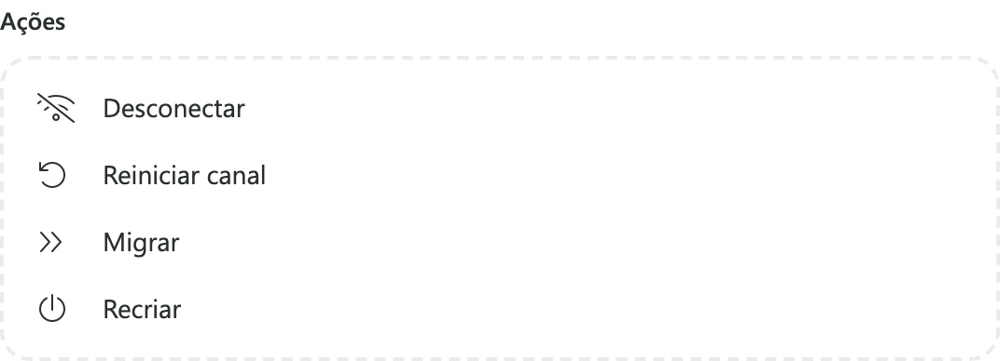

## Sintoma

- Na lista de canais (**Configurações** → **Chat** → **Canais**), o canal aparece como **Desconectado**, **Necessário ler QR-Code**, **Necessário reiniciar canal**, **Recomendado recriar canal**, **Criando...** ou com um status em inglês (`starting`, `connecting`).
- No topo da lista de conversas aparece a faixa **Telefone desconectado**.
- Na **Express**, as mensagens enviadas pela Kinbox ficam com erro na hora. Elas não são reenviadas sozinhas: reenvie depois que o canal voltar.

## Onde ficam as ações

Clique no canal na lista. As ações ficam no bloco **Ações** do painel do canal. No menu de três pontos da lista, **Reiniciar canal** se chama **Reiniciar**.

<Frame caption="Bloco Ações no painel de um canal Express">
  
</Frame>

Reiniciar o canal não apaga conversas nem configurações.

## Causas e soluções

<AccordionGroup>
  <Accordion title="O canal está Desconectado">
    **Como confirmar:** o status é **Desconectado** e não há alerta de bloqueio.

    **O que fazer:**

    1. Confira se o celular do número está ligado e com internet. Muitas vezes o canal volta sozinho para **Conectado** em alguns instantes.
    2. No WhatsApp do celular, abra **Dispositivos conectados** e veja se a Kinbox ainda está na lista.
    3. Se o canal não voltar, clique em **Reiniciar canal**.
    4. Se a Kinbox saiu da lista de dispositivos do celular, ou se o canal pedir o QR Code, leia o QR Code de novo. Veja [Conectar o WhatsApp pelo QR Code](/docs/canais/conectar-whatsapp-app).

    Use **Desconectar** só quando precisar conectar o número de novo do zero: na **Express**, ele encerra a conexão e pede um QR Code novo.
  </Accordion>

  <Accordion title="O QR Code expirou antes da leitura">
    **Como confirmar:** na **Express**, o canal fica **Desconectado** logo depois de criado ou reiniciado e o QR Code some. O QR Code fica disponível por cerca de 13 minutos. Com o painel aberto, aparece o aviso "QRCode expirou, necessário reiniciar o canal.".

    **O que fazer:** clique em **Reiniciar canal** e leia o QR Code novo no celular.
  </Accordion>

  <Accordion title="O canal pede o QR Code">
    **Como confirmar:** o status é **Necessário ler QR-Code**.

    **O que fazer:** abra o canal e leia o QR Code no celular. Na **Express**, você também pode usar **Conectar com número de telefone**.
  </Accordion>

  <Accordion title="Aparece starting ou connecting">
    **Como confirmar:** o status aparece em inglês, em vermelho, como `starting` ou `connecting`.

    **O que fazer:** espere alguns instantes. O canal está carregando ou reconectando.
  </Accordion>

  <Accordion title="O número foi bloqueado">
    **Como confirmar:** a lista mostra o alerta "Seu canal foi possivelmente bloqueado pelo WhatsApp", o painel do canal mostra o alerta de bloqueio ou a faixa das conversas diz "Possivelmente seu número foi bloqueado pelo WhatsApp.".

    **O que fazer:** veja [Meu número foi bloqueado](/docs/canais/whatsapp/whatsapp-app/o-que-fazer-se-meu-numero-foi-bloqueado).
  </Accordion>

  <Accordion title="Clássica pede reinício ou recriação">
    **Como confirmar:** o status é **Necessário reiniciar canal** ou **Recomendado recriar canal**.

    **O que fazer:** clique em **Reiniciar canal**. Se aparecer "Necessário recriar o canal para reiniciar", ou se o status for **Recomendado recriar canal**, clique em **Recriar**. Se a **Versão** do canal for **Multidevice**, a janela mostra **Tipo de conexão**: escolha **Express**. Sem esse seletor, o **Recriar** mantém a **Clássica**. Veja [Migrar da conexão Clássica para a Express](/docs/canais/whatsapp/whatsapp-app/migracao-tipo-classico-para-alternativo).
  </Accordion>

  <Accordion title="Clássica presa em Criando...">
    **Como confirmar:** um canal **Clássica** está em **Criando...** há mais de 10 minutos.

    **O que fazer:** fale com o suporte, com o ID do canal.
  </Accordion>
</AccordionGroup>

## Como evitar novas quedas

- Deixe o celular do número com internet e abra o WhatsApp de tempos em tempos.
- Não remova a Kinbox de **Dispositivos conectados** no celular.

## Ainda não resolveu?

Fale com o suporte e informe:

- o tipo de conexão (campo **Versão**: **v5** é **Express**, **Multidevice** é **Clássica**);
- o status que aparece;
- se a Kinbox está em **Dispositivos conectados** no celular;
- o ID do canal (**Copiar ID**, no menu de três pontos da lista).

## Próximos passos

- [Configurações do WhatsApp por QR Code](/docs/canais/whatsapp/whatsapp-app/configuracoes)
- [Meu número foi bloqueado](/docs/canais/whatsapp/whatsapp-app/o-que-fazer-se-meu-numero-foi-bloqueado)
