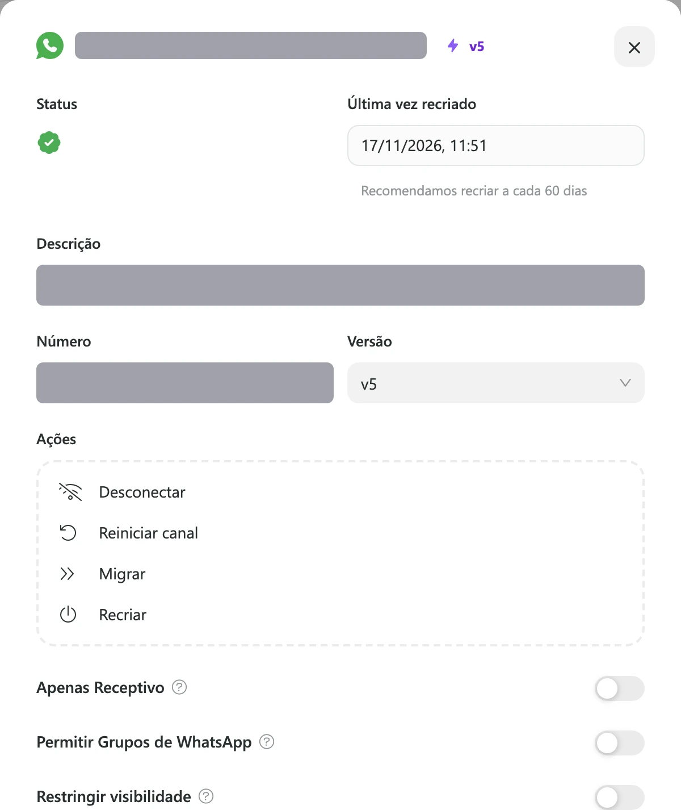

O painel do canal reúne os campos, as ações e as opções de um canal de WhatsApp por QR Code (**Express** e **Clássica**). Para abrir, vá em **Configurações** → **Chat** → **Canais** e clique no canal. O título do painel é o nome do canal.

<Frame caption="Painel de um canal de WhatsApp Express conectado">
  
</Frame>

## Campos e opções

| Campo | O que é | Express × Clássica |
| --- | --- | --- |
| **Status** | Situação do canal (veja [Canais: conectar e gerenciar](/docs/canais/visao-geral)). | Na **Clássica**, ao lado aparece **Atualizado** ou **Atualização disponível**. |
| **Última vez recriado** | Data da última criação ou recriação, com a dica "Recomendamos recriar a cada 60 dias". | Vale para a **Clássica**. Na **Express**, **Recriar** não muda essa data. |
| **Descrição** | Nome do canal na Kinbox. Obrigatório. | Igual. |
| **Número** | Número do canal. Não dá para editar: para trocar de número, crie outro canal. | Igual. |
| **Versão** | Tipo do canal. Não dá para editar. | **v5** na **Express**. **Multidevice** ou **Versão antiga** na **Clássica**. |
| **QRCode** | Aparece só com o status **Necessário ler QR-Code**. Atualiza a cada 10 segundos. | Na **Express**, tem o link **Conectar com número de telefone**. |
| **Apenas Receptivo** | O canal não envia mensagem ativa e não aparece nas campanhas. | Igual. |
| **Permitir Grupos de WhatsApp** | Escolhe os grupos de WhatsApp do número que entram na Kinbox. Sem grupos marcados, a Kinbox ignora as mensagens de grupo. | Igual. |
| **Restringir visibilidade** | Escolhe os grupos de membros da Kinbox que podem ver o canal (veja [Criar grupos de atendimento](/docs/configuracoes-no-workspace/criar-e-gerenciar-grupos)). | Igual. |
| **Aquecedor** | Perfil de aquecimento do número. | Recurso em teste: pode não aparecer no seu workspace. |
| Campos personalizados | Os [campos personalizados](/docs/configuracoes-no-workspace/campos-personalizados-no-kinbox) de canal do workspace. | Igual. |

Depois de mudar um campo, clique em **Salvar**. A Kinbox confirma com "Canal de WhatsApp salvo.".

O topo do painel também pode mostrar:

- um aviso do suporte;
- o alerta de número possivelmente bloqueado ([Meu número foi bloqueado](/docs/canais/whatsapp/whatsapp-app/o-que-fazer-se-meu-numero-foi-bloqueado));
- na **Clássica**, o aviso de nova versão (veja abaixo).

## Ações

As ações ficam no bloco **Ações** do painel. No menu de três pontos da lista de canais, algumas têm outro nome: **Reiniciar** e **Migrar conversas**.

| Ação | Na Express | Na Clássica |
| --- | --- | --- |
| **Desconectar** | Encerra a conexão do número e já pede um QR Code novo. | Desconecta o número. |
| **Reiniciar canal** | Reinicia a conexão. Não apaga conversas nem configurações. | Reinicia o canal. Se aparecer "Necessário recriar o canal para reiniciar", use **Recriar**. |
| **Sincronizar histórico** | Não existe. | Traz conversas recentes do WhatsApp. Só com o canal conectado. |
| **Migrar** | Move as conversas para outro canal de WhatsApp. Veja [Migrar conversas](/docs/canais/visao-geral#migrar-conversas). | Igual. |
| **Recriar** | Só reinicia a conexão. | Recria o canal. Canais **Multidevice** podem passar para a **Express** aqui. Veja [Migrar da conexão Clássica para a Express](/docs/canais/whatsapp/whatsapp-app/migracao-tipo-classico-para-alternativo). |

**Desconectar**, **Reiniciar canal** e **Recriar** ficam desativados enquanto o canal está sendo criado. **Desconectar** também fica desativado enquanto ele reinicia.

## Atualizar canal (só Clássica)

Quando existe uma versão nova, o topo do painel mostra **Nova versão do canal disponível.** com o botão **Atualizar canal**. Ao confirmar em **Atualizar agora**:

- o canal fica fora do ar por alguns instantes;
- talvez seja preciso ler o QR Code de novo.

Faça isso fora do horário de pico.

## Permissões que mudam o painel

- Com a restrição **Somente pode dar manutenção simples em canais**, as opções e **Migrar** ficam desativadas, e salvar mostra "Você não tem permissão para editar o canal". **Desconectar**, **Reiniciar canal**, **Sincronizar histórico** e **Recriar** continuam liberados.
- Com a restrição **Somente pode ver canais na lista se estiver no grupo do canal**, **Migrar** e **Salvar** ficam desativados.

As opções de cada papel estão na [Referência de permissões](/docs/administracao/referencia-de-permissoes).

## Próximos passos

- [O que funciona e o que não funciona no WhatsApp por QR Code](/docs/canais/whatsapp/whatsapp-app/o-que-funciona)
- [Meu WhatsApp desconectou](/docs/canais/whatsapp/whatsapp-app/como-evitar-que-o-celular-desconecte)
