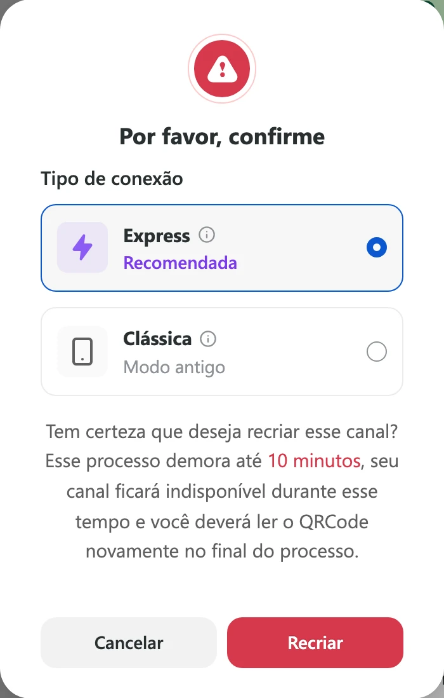

Passe um canal de WhatsApp por QR Code da conexão **Clássica** para a **Express** pelo próprio canal. O canal continua o mesmo: mesmo ID, mesmas conversas e mesmas configurações. "Alternativa" era o nome antigo da **Express**.

<Note>Quem pode: membros com a permissão **Gerenciar Canais**. O dono do workspace sempre pode. **Recriar** continua liberado com a restrição **Somente pode dar manutenção simples em canais**.</Note>

<Warning>Do clique em **Recriar** até você ler o QR Code novo, o número não recebe nem envia mensagens pela Kinbox. Faça a troca fora do horário de pico.</Warning>

## Antes de começar

Abra o canal em **Configurações** → **Chat** → **Canais** e olhe o campo **Versão**:

- **Multidevice**: o canal é **Clássica** e pode passar para a **Express** com este guia.
- **Versão antiga**: a janela de **Recriar** não oferece a **Express**. Fale com o suporte.
- **v5**: o canal já é **Express**.

## Passo a passo

<Steps>
  <Step title="Abra o canal">
    Em **Configurações** → **Chat** → **Canais**, clique no canal **Multidevice**. Você também pode usar o menu de três pontos da linha e escolher **Recriar**.
  </Step>
  <Step title="Clique em Recriar">
    No painel do canal, no bloco **Ações**, clique em **Recriar**.
  </Step>
  <Step title="Escolha Express e confirme">
    Na janela **Por favor, confirme**, deixe **Express** marcado em **Tipo de conexão** (ele já vem marcado) e clique em **Recriar**.

    A janela fala em até 10 minutos, mas a criação na **Express** é rápida.

    <Frame caption="Janela de confirmação do Recriar num canal Clássica">
      
    </Frame>
  </Step>
  <Step title="Leia o QR Code novo">
    O canal fica **Desconectado** e logo pede o QR Code. Leia o QR Code no celular ou use **Conectar com número de telefone**, como em [Conectar o WhatsApp pelo QR Code](/docs/canais/conectar-whatsapp-app).
  </Step>
</Steps>

Se o seletor **Tipo de conexão** não aparecer na janela, cancele e fale com o suporte.

## Como conferir

- O canal mostra o selo **v5**, e o campo **Versão** mostra **v5**.
- O ID do canal (em **Copiar ID**) é o mesmo de antes.
- Se o status aparecer como `pending_review` ou `error` (em inglês), a troca não terminou. Fale com o suporte e informe o ID do canal.
- Se aparecer **Número inválido** ao confirmar, o número salvo no canal não está no formato que a **Express** aceita. Fale com o suporte.

## O que muda depois

- **Sincronizar histórico** deixa de existir.
- **Recriar** passa a só reiniciar a conexão.
- O canal ganha **Conectar com número de telefone** (conexão por código, sem câmera).
- Depois de conectar, o campo **Número** pode mudar para o número confirmado pelo WhatsApp.
- Não dá para usar canais **Express** e **Clássica** na mesma campanha.

## Voltar para a Clássica

Não dá para voltar pelo **Recriar**. A Kinbox recomenda a **Express**. Se precisar mesmo da **Clássica**, fale com o suporte.

## Próximos passos

- [Configurações do WhatsApp por QR Code](/docs/canais/whatsapp/whatsapp-app/configuracoes)
- [O que funciona e o que não funciona no WhatsApp por QR Code](/docs/canais/whatsapp/whatsapp-app/o-que-funciona)
