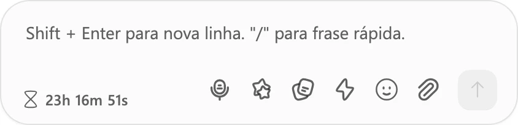
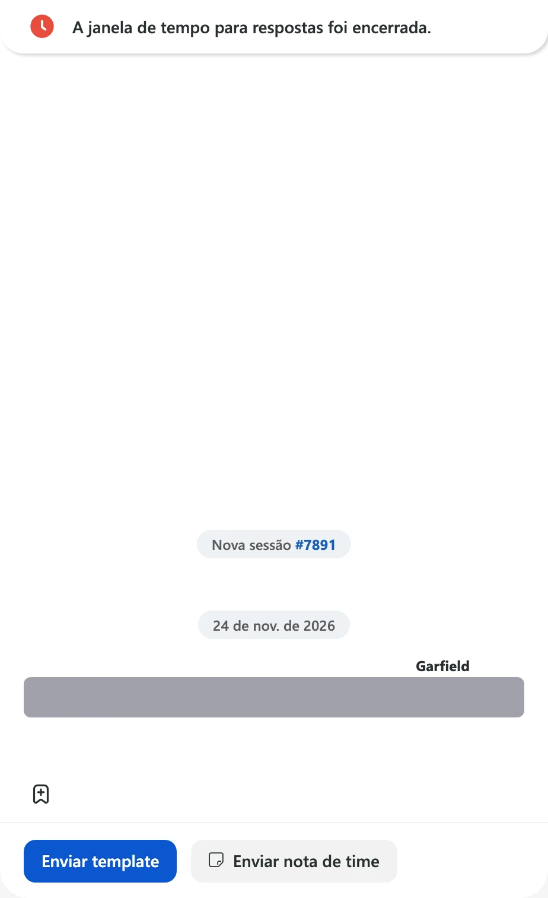

A janela de 24 horas é o período em que você pode enviar mensagens livres para um contato no WhatsApp oficial antes de precisar usar um template aprovado.

## Como a janela conta

- A regra vale apenas no WhatsApp oficial. No WhatsApp por QR Code não existe janela de 24 horas (veja [Qual WhatsApp usar: oficial ou QR Code](/docs/canais/whatsapp/visao-geral)).
- A janela abre quando o **contato** envia uma mensagem e fica aberta por 24 horas a partir da última mensagem dele.
- Mensagens que você envia não reabrem nem renovam a contagem.
- Conversas em que o contato nunca escreveu — por exemplo, quando você começa a conversa — já nascem com a janela fechada.
- Dentro da janela, você envia texto livre e arquivos normalmente. Fora dela, só pode enviar um template aprovado.

## Janela aberta

Com a janela aberta, o canto esquerdo do editor da conversa mostra um contador com o tempo que falta (em horas, minutos e segundos). Passar o mouse sobre ele exibe a dica: "Tempo restante para enviar mensagens dentro da janela de resposta do WhatsApp Oficial. Ao passar desse período será necessário enviar um template."

Quando falta menos de 1 hora para o fim da janela, o contador fica vermelho.

<Frame caption="Editor da conversa com o contador da janela de 24 horas aberta">
  
</Frame>

## Janela fechada

Quando a janela encerra em uma conversa aberta, o campo de texto some. No topo aparece "A janela de tempo para respostas foi encerrada." e, no rodapé, os botões **Enviar template** e **Enviar nota de time**.

<Frame caption="Conversa aberta com a janela de 24 horas fechada: aviso no topo e botões no rodapé">
  
</Frame>

Em uma conversa resolvida com a janela fechada, o rodapé exibe **Enviar template** (com um menu para **Enviar nota de time** e **Reabrir conversa**) e o texto "Resolvida · janela de 24h encerrada". A dica desse texto informa: "No WhatsApp Oficial, só é possível enviar mensagens livres até 24h após a última mensagem do contato. Depois disso, envie um template para abrir uma nova sessão." Essa "sessão" é a janela de mensagens da Meta, não a sessão de atendimento da Kinbox (veja [Conversas, sessões e status](/docs/conceitos/conversas-e-sessoes)).

O botão **Enviar nota de time** cria uma anotação interna, que não vai para o contato.

## Como voltar a falar com o contato

Clique em **Enviar template** para abrir a janela **Enviar mensagem** e escolher um template aprovado (veja [Enviar um template aprovado](/docs/canais/whatsapp/whatsapp-templates/enviar-template)).

Enviar o template não libera o editor de texto na hora: o campo de mensagem só volta a abrir quando o contato responder, porque a janela conta sempre a partir da última mensagem do contato. Os templates são criados e enviados para aprovação na tela **WhatsApp API** (**Configurações** → **Automação** → **WhatsApp API**): veja [Criar um template e enviar para aprovação](/docs/canais/criar-templates-dentro-do-kinbox).

Se uma mensagem livre for disparada fora da janela por outro caminho (como API ou automação), a Meta recusa o envio e a mensagem fica com erro. Veja [Problemas ao conectar ou enviar pelo WhatsApp oficial](/docs/canais/whatsapp/whatsapp-cloud-api/problemas-comuns).

## Onde mais a janela vale

- **Agendar mensagem:** se a data escolhida passar do fim da janela (ou se a janela já estiver fechada), o agendamento exige um template.
- **Bot:** você pode usar a condição **Janela de resposta** com os valores **Aberto** ou **Fechado** para definir o caminho do fluxo no bot.
- **Transferir conversa para outro canal ou Migrar conversas:** quando a conversa passa para um canal oficial de destino, a contagem da última mensagem do contato é zerada e a conversa começa com a janela fechada no novo canal.
