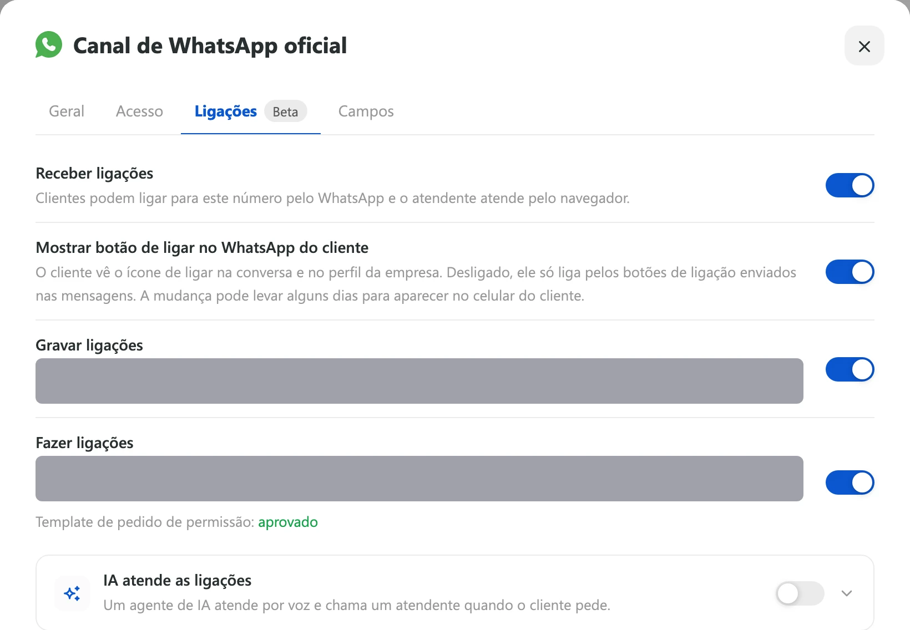

Com as ligações pelo WhatsApp oficial, o contato liga pelo WhatsApp para o número da empresa e o membro atende direto pelo navegador, sem sair da conversa. O membro na conversa também pode ligar para o contato pelo WhatsApp, depois que o contato permite receber ligações.

<Note>
As ligações pelo WhatsApp são um recurso em teste (**Beta**) e podem não aparecer no seu workspace. Elas funcionam apenas em canais de **WhatsApp oficial** sem coexistência e exigem o plano **Ligações WhatsApp** (veja [Assinar ou mudar o plano](/docs/assinatura/assinar-ou-mudar-plano)). Quem pode configurar: proprietário do workspace ou membro com a permissão **Gerenciar Canais** ([Referência de permissões](/docs/administracao/referencia-de-permissoes)).
</Note>

## Antes de começar

- Tenha o recurso em teste (**Beta**) liberado no workspace (sem ele, a aba **Ligações** não aparece).
- Tenha um canal de **WhatsApp oficial** conectado (veja [Conectar o WhatsApp oficial](/docs/canais/whatsapp-api-oficial-padrao)). O WhatsApp por QR Code não tem ligações pela Kinbox.
- Use o número sem [coexistência](/docs/canais/whatsapp-api-oficial-coexistente) com o app WhatsApp Business.
- Tenha o plano **Ligações WhatsApp** contratado em **Configurações** → **Assinatura** por quem cuida da assinatura ([Assinar ou mudar o plano](/docs/assinatura/assinar-ou-mudar-plano)).
- Tenha franquia de minutos sobrando no plano ou [saldo na carteira](/docs/conceitos/saldo-e-creditos).
- Tenha a permissão **Gerenciar Canais** (ou seja o proprietário) para configurar o canal.
- Libere o microfone no navegador para quem faz ou atende ligações.

## Ativar no canal

<Steps>
  <Step title="Abra a aba Ligações do canal oficial">
    Vá em **Configurações** → **Chat** → **Canais**, clique no canal de WhatsApp oficial (veja [Configurações do WhatsApp oficial](/docs/canais/whatsapp/whatsapp-cloud-api/configuracoes)) e acesse a aba **Ligações** (com o selo **Beta**).

    <Frame caption="Aba Ligações de um canal de WhatsApp oficial com as opções ativadas">
      
    </Frame>
  </Step>
  <Step title="Ligue Receber ligações">
    Ative o interruptor **Receber ligações** para habilitar as ligações desse número na Meta. Se o workspace ainda não tiver o plano **Ligações WhatsApp**, abre o aviso **Ligações pelo WhatsApp** (quem cuida da assinatura vê **Ver planos**; os demais veem o aviso para pedir ao gestor do ambiente).
  </Step>
  <Step title="Ajuste as demais opções">
    Ative ou desative **Mostrar botão de ligar no WhatsApp do cliente**, **Gravar ligações** e **Fazer ligações** conforme a necessidade da sua equipe.

    Cada opção salva na hora com o aviso "Configuração de ligações atualizada." — não é necessário clicar no botão **Salvar** do rodapé do painel.
  </Step>
</Steps>

### Opções da aba Ligações

| Opção | O que faz |
| --- | --- |
| **Receber ligações** | "Clientes podem ligar para este número pelo WhatsApp e o atendente atende pelo navegador." É a opção principal: se estiver desligada, as outras opções e o cartão **IA atende as ligações** somem, e **Fazer ligações** também é desligada. |
| **Mostrar botão de ligar no WhatsApp do cliente** | "O cliente vê o ícone de ligar na conversa e no perfil da empresa. Desligado, ele só liga pelos botões de ligação enviados nas mensagens. A mudança pode levar alguns dias para aparecer no celular do cliente." Vem ligada por padrão. |
| **Gravar ligações** | Grava as ligações atendidas e gera transcrição e resumo. Avise o contato de que a ligação é gravada. Com o plano, gravação e transcrição estão incluídas. Vem desligada por padrão. |
| **Fazer ligações** | Libera a opção **Ligar pelo WhatsApp** na conversa para o membro ligar depois que o contato permitir. Ao ativar, a Kinbox cria automaticamente o template de pedido de permissão e envia para aprovação da Meta, e também libera o retorno para quem ligou para a empresa. |

Quando **Fazer ligações** está ligada, a tela mostra **Template de pedido de permissão:** com o status na Meta (**não criado**, **em análise**, **aprovado** ou **rejeitado** com o motivo). Se estiver **não criado** ou **rejeitado**, clique em **Criar template** ou **Reenviar template** (aparece "Template enviado para aprovação da Meta. Costuma levar alguns minutos."). Você também pode criar um template desse tipo pela tela de templates usando a opção **Pedir permissão para ligar** (veja [Criar um template e enviar para aprovação](/docs/canais/criar-templates-dentro-do-kinbox)).

Para configurar um agente de IA que atende chamadas pelo cartão **IA atende as ligações**, veja [Agente de voz para as ligações do WhatsApp (Beta)](/docs/agente-de-ia/agente-de-voz).

Se o número estiver em [coexistência](/docs/canais/whatsapp-api-oficial-coexistente) com o app WhatsApp Business, a aba mostra o aviso **A Meta não oferece ligações neste número** e as ligações ficam apenas no app do celular. Se o número estiver com SIP ativado na Meta (com as ligações indo para outro provedor), a aba exibe um aviso com o botão **Desativar SIP** para que as ligações voltem a passar pela Kinbox.

## Receber ligações

O contato não precisa dar permissão prévia para ligar para a sua empresa. Quando ele liga pelo WhatsApp, a conversa recebe a mensagem **Ligação recebida pelo WhatsApp** ("Tocando...") e a Kinbox exibe um cartão em qualquer tela com nome e foto do contato, "Ligação do WhatsApp" e os botões **Recusar** e **Atender**.

A ligação toca apenas para quem pode atender: o proprietário ou membros com a permissão **Responder** que estejam online, disponíveis (não **Ausente** — veja [Disponibilidade](/docs/conta/disponibilidade)) e fora de outra ligação. Se a conversa já tem um responsável disponível, toca só para ele; caso contrário, toca para quem pode atender e visualiza a conversa sem atribuição.

- **Atender:** quem clicar primeiro fica com a ligação e a conversa passa a ser atribuída a essa pessoa. Durante a ligação, a janela mostra o tempo, os botões de silenciar e desligar e o selo **Gravando** quando a gravação estiver ativa.
- **Recusar:** apenas tira o aviso da sua tela. A ligação só é recusada no WhatsApp quando todos para quem tocou recusam.
- **Sem atendimento:** se ninguém atender em cerca de 60 segundos, a Meta desiste da chamada, a conversa registra **Chamada perdida** e o gatilho de automação **Chamada perdida** pode ser disparado.

Cada membro pode ajustar se o toque aparece em qualquer tela e para conversas sem responsável em **Configurações** → **Notificações** (veja [Notificações](/docs/conta/notificacoes)).

## Ligar para o contato

Para fazer uma ligação pelo WhatsApp, o canal oficial precisa estar sem coexistência, com o recurso em teste liberado, o plano **Ligações WhatsApp** ativo, **Receber ligações** e **Fazer ligações** ligados, e o contato precisa ter permitido receber ligações. O membro na conversa pode ligar pelo WhatsApp (a permissão **Pode ligar para o contato** vale apenas para o VoIP).

<Steps>
  <Step title="Clique no botão de telefone na conversa">
    Abra a conversa do contato no canal oficial pela [Caixa de entrada](/docs/conversas/caixa-de-entrada-do-kinbox) e clique no botão de telefone (**Ligar**) no painel do contato, à direita.
  </Step>
  <Step title="Escolha Ligar pelo WhatsApp">
    No menu, clique em **Ligar pelo WhatsApp**. Logo abaixo dessa opção aparece a situação do contato (se já há permissão, se é preciso pedir ou se existe algum bloqueio). Se você não tiver a permissão de VoIP, clicar no botão de telefone vai direto para a ligação pelo WhatsApp ou mostra o motivo de não poder ligar.
  </Step>
  <Step title="Converse pela janela da ligação">
    Quando o contato já permitiu, a janela da ligação abre exibindo "Iniciando chamada…", "Chamando…" e "Tocando…" (a chamada desiste após 45 segundos se o contato não atender). Use os botões da janela para silenciar o microfone ou desligar.
  </Step>
</Steps>

Fechar ou recarregar a aba do navegador durante uma ligação feita pelo WhatsApp pede confirmação e encerra a chamada.

## Pedir permissão ao contato

Se aparecer "Sem permissão. Pedir ao cliente", clique em **Ligar pelo WhatsApp** para abrir a janela **Pedir permissão para ligar** e clique em **Enviar pedido**. O formato do pedido depende da [janela de 24 horas](/docs/canais/whatsapp/whatsapp-cloud-api/janela-de-24-horas):

- **Dentro das 24 horas:** o pedido vai como mensagem gratuita. Você pode editar o campo **Mensagem** (até 1.024 caracteres; texto padrão: "Podemos te ligar por aqui no WhatsApp?").
- **Fora das 24 horas:** o pedido vai como template aprovado com o botão **Permitir ligações**, cobrado pela Meta como uma mensagem. Se o template ainda estiver **em análise** ou **rejeitado**, quem tem **Gerenciar Canais** pode criar ou reenviar pela própria janela.

A tela informa o limite de pedidos da Meta como "Limite de pedidos atingido (1 por dia e 2 por semana).". Ao atingir o limite, **Enviar pedido** fica desativado até a data exibida.

Quando o contato aceita, a permissão pode ser temporária (vale por 7 dias, mostrando até qual data está permitida) ou permanente ("O cliente permitiu ligações"). Se o contato não permitir, não é possível ligar pelo WhatsApp — como alternativa, use [ligação por telefone (VoIP)](/docs/canais/ligacoes/ligar-por-telefone) se o contato tiver telefone no cadastro e você tiver a permissão.

<Warning>
Se o contato não atender 4 ligações feitas seguidas, o WhatsApp retira a permissão e você precisará pedir de novo. Após 2 ligações sem resposta, a conversa recebe um aviso; antes da 4ª tentativa, a Kinbox abre a janela **Esta pode ser a última tentativa** com as opções **Cancelar** e **Ligar mesmo assim** e sugere combinar um horário por mensagem antes de ligar.
</Warning>

## Depois da ligação

A ligação fica registrada na conversa como **Ligação recebida pelo WhatsApp** ou **Ligação feita pelo WhatsApp**, com a duração. Clique na mensagem para abrir o painel **Ligação de voz**: quando **Gravar ligações** estava ativa, você encontra o player de áudio, **Baixar áudio**, **Resumo** (com sentimento) e **Transcrição** gerados automaticamente. Se a transcrição automática falhar, o painel mostra o botão **Transcrever**, que gera a transcrição usando o saldo da carteira.

Você também encontra as ligações e gravações em **Relatórios** → **Ligações**, filtrando por "WhatsApp: feitas" ou "WhatsApp: recebidas".

## Quanto custa

- **Plano e franquia:** as ligações pelo WhatsApp exigem o plano **Ligações WhatsApp** (veja [Assinar ou mudar o plano](/docs/assinatura/assinar-ou-mudar-plano)), com franquia mensal de minutos humanos (ligações feitas e recebidas atendidas por pessoa, contadas por minuto iniciado). A franquia é compartilhada entre os canais de WhatsApp do workspace e os minutos que sobram não acumulam para o mês seguinte.
- **Excedente:** quando a franquia acaba, os minutos extras saem do [saldo da carteira](/docs/conceitos/saldo-e-creditos) (veja [Adicionar saldo e créditos de SMS](/docs/assinatura/adicionar-saldo)).
- **Gravação, transcrição e resumo:** gravação e transcrição automática estão incluídas no plano. O resumo da transcrição é gerado por IA e gasta saldo da carteira. Ligações não atendidas não gastam franquia nem saldo.
- **Tarifas da Meta:** as tarifas oficiais da Meta (inclusive templates enviados fora das 24 horas) são cobradas diretamente pela Meta, à parte da mensalidade do plano.
- **Saldo de ligações acabando:** 30 segundos antes de a franquia e o saldo acabarem durante uma ligação, aparece uma faixa vermelha de aviso (com o link **Adicionar saldo** para quem cuida da assinatura). Se não houver recarga a tempo, a ligação é encerrada.
- **Agente de voz:** para os minutos atendidos por IA, veja [Agente de voz para as ligações do WhatsApp (Beta)](/docs/agente-de-ia/agente-de-voz).

## Problemas comuns

- **A aba Ligações ou a opção Ligar pelo WhatsApp não aparece.** O recurso está em teste (**Beta**), funciona apenas em canal de **WhatsApp oficial** sem coexistência e exige **Gerenciar Canais** (ou ser proprietário) para configurar.
- **A ligação recebida não toca para você.** Ela só toca para quem tem **Responder** (ou é proprietário), está online, não está **Ausente** e está fora de outra ligação. Confira também suas preferências em **Notificações** e se o microfone está liberado no navegador.
- **A ligação recebida virou Chamada perdida sem tocar.** Sem plano **Ligações WhatsApp** ou sem franquia e sem saldo na carteira, a Kinbox recusa a ligação. Se a ligação tocou e ninguém atendeu em cerca de 60 segundos, ela também fica como **Chamada perdida**.

Veja todas as causas e soluções em [Não consigo ligar ou a ligação caiu](/docs/canais/ligacoes/problemas-comuns).
