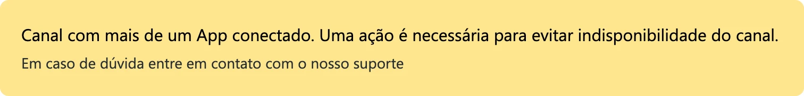

Use esta página quando o WhatsApp oficial não conecta, mostra um aviso amarelo no painel do canal, para de receber mensagens ou apresenta erro ao enviar.

## Sintoma

- Ao conectar, aparece "Erro ao conectar canal de WhatsApp." ou a janela da Meta não abre.
- O painel do canal mostra um aviso amarelo no topo da aba **Geral**.
- O canal aparece **Conectado**, mas as mensagens não chegam.
- A conversa não deixa digitar e mostra apenas **Enviar template**.
- Uma mensagem enviada fica com ícone de erro.
- Você excluiu o canal e quer trazê-lo de volta.

## Causas e soluções

<AccordionGroup>
  <Accordion title='Ao conectar, aparece "Erro ao conectar canal de WhatsApp."'>
    A Meta ou a Kinbox recusou a criação do canal. Leia a mensagem exibida junto com esse aviso para saber o motivo.

    - Se aparecer "Você precisa remover canais de Whatsapp para prosseguir com a contratação", o workspace atingiu o limite de canais de WhatsApp ativos do plano.
    - Nos demais casos, ajuste o ponto indicado na Meta ou no plano e tente conectar de novo em [Conectar o WhatsApp oficial](/docs/canais/whatsapp-api-oficial-padrao). Se o erro continuar, fale com o suporte.
  </Accordion>

  <Accordion title="Cliquei em Conectar WhatsApp e nada aconteceu, ou fechei a janela da Meta">
    A conexão abre uma janela (pop-up) da Meta. Se nada abrir ao clicar em **Conectar WhatsApp**, libere pop-ups do navegador para a Kinbox e tente novamente.

    Se você fechou a janela da Meta antes de concluir, nenhum canal é criado e nenhum aviso aparece na Kinbox. Clique em **Conectar WhatsApp** novamente para recomeçar.
  </Accordion>

  <Accordion title='Aviso "Canal sem webhooks configurados." no painel do canal'>
    Esse aviso indica que a Kinbox não está recebendo as mensagens enviadas para esse número ("webhooks" é o nome técnico do envio automático de mensagens da Meta para a Kinbox).

    Isso acontece quando o acesso da Kinbox foi retirado da conta na Meta ou quando outro canal da mesma conta do WhatsApp Business foi excluído na Kinbox.

    Para resolver, conecte o mesmo número novamente por **Configurações** → **Chat** → **Canais** → **Novo canal** → **WhatsApp** → **API Oficial** (veja [Conectar o WhatsApp oficial](/docs/canais/whatsapp-api-oficial-padrao)). A Kinbox reaproveita o canal, mantém as conversas e volta a ligar o recebimento de mensagens. Se o plano estiver no limite de canais de WhatsApp, a nova conexão é recusada com "Você precisa remover canais de Whatsapp para prosseguir com a contratação", mesmo sendo o mesmo número. Nesse caso, exclua o canal e conecte o número de novo: o mesmo canal volta com as conversas.

    Quando a situação é resolvida, o aviso some sozinho na próxima vez que você abrir o painel. Se o aviso continuar, fale com o suporte.
  </Accordion>

  <Accordion title='Aviso "Canal com mais de um App conectado. Uma ação é necessária para evitar indisponibilidade do canal."'>
    Esse aviso indica que outra plataforma ou integração ("App") também está ligada à mesma conta do WhatsApp Business na Meta. Isso é comum quando o número veio de outro provedor.

    <Frame caption="Aviso amarelo exibido no painel do canal quando há outra plataforma ligada à mesma conta">
      
    </Frame>

    Para resolver, remova o acesso da outra plataforma à sua conta do WhatsApp Business (na Meta ou na outra plataforma) ou fale com o suporte da Kinbox. Quando só a Kinbox ficar ligada à conta, o aviso some sozinho ao abrir o painel do canal novamente.
  </Accordion>

  <Accordion title="A conversa não deixa escrever e só aparece Enviar template">
    A janela de 24 horas dessa conversa está fechada. No WhatsApp oficial, você só envia mensagens livres até 24 horas após a última mensagem do contato.

    Clique em **Enviar template** para enviar um modelo aprovado. O campo de texto livre volta quando o contato responder. Veja mais em [Janela de 24 horas: quando é preciso usar um template](/docs/canais/whatsapp/whatsapp-cloud-api/janela-de-24-horas).
  </Accordion>

  <Accordion title="Mensagem enviada ficou com ícone de erro">
    Passe o mouse sobre o aviso da mensagem para ver o motivo devolvido pela Meta (o texto vem sem tradução). Quando não há motivo específico, a tela mostra "Erro ao enviar mensagem".

    Duas causas comuns:

    - **Janela de 24 horas fechada:** envie um template aprovado para retomar o contato.
    - **O contato pediu para não receber marketing:** a Kinbox marca o contato e exibe o selo **Opt-out** no topo da conversa, com a dica "Esse contato optou por não receber marketing desse canal". Não envie templates de marketing para esse contato por esse canal.
  </Accordion>

  <Accordion title="O canal aparece Conectado, mas as mensagens não chegam">
    No WhatsApp oficial, o status **Conectado** na lista de canais não acompanha restrições, qualidade ou limites da conta na Meta (veja [Canais](/docs/canais/visao-geral)).

    Abra o painel do canal em [Configurações do WhatsApp oficial](/docs/canais/whatsapp/whatsapp-cloud-api/configuracoes) e verifique se há um aviso amarelo na aba **Geral** (veja os dois avisos acima). Se não houver aviso na Kinbox, confira diretamente na Meta se a conta do WhatsApp Business ou o número têm alguma restrição.
  </Accordion>

  <Accordion title="Atualizar registro deu erro">
    A Meta recusou o registro do número e a mensagem exibida na tela mostra o motivo. Não use **Atualizar registro** em canais de [coexistência](/docs/canais/whatsapp-api-oficial-coexistente). Se o erro persistir em um canal padrão, fale com o suporte.
  </Accordion>

  <Accordion title="Excluí o canal e quero trazê-lo de volta">
    Conecte o mesmo número novamente em **Configurações** → **Chat** → **Canais** → **Novo canal** → **WhatsApp** → **API Oficial** (veja [Conectar o WhatsApp oficial](/docs/canais/whatsapp-api-oficial-padrao)). Se houver linha de WhatsApp livre no plano, a Kinbox reativa o mesmo canal com as conversas anteriores.
  </Accordion>
</AccordionGroup>

## Ainda não resolveu?

Fale com o suporte da Kinbox informando:

- O nome do canal (**Descrição**) e o ID obtido em **Copiar ID**.
- O texto exato do aviso ou da mensagem de erro exibida na tela.
- Quando o problema começou.
- Se houve alguma mudança recente na Meta (como outra plataforma ligada ou mudança de permissões).
