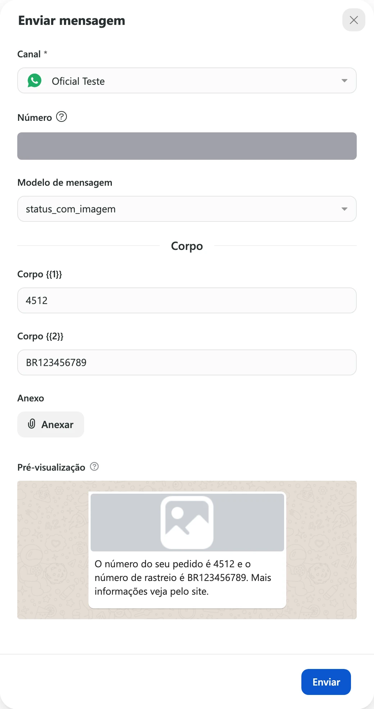

Envie templates com status **Aprovado** para iniciar conversas ou retomar atendimentos fora da [janela de 24 horas](/docs/canais/whatsapp/whatsapp-cloud-api/janela-de-24-horas). O envio de templates existe apenas no **WhatsApp oficial**: no WhatsApp por QR Code esse recurso não existe (veja [Qual WhatsApp usar: oficial ou QR Code](/docs/canais/whatsapp/visao-geral)).

<Note>Quem pode: depende do lugar do envio. Começar uma conversa nova pede a permissão **Iniciar chat ativo**, e **Agendar mensagem** pede a permissão **Agendar mensagem**. Campanhas, automações, bot e cenários pedem a permissão de cada uma dessas telas, e os agentes de IA pedem a permissão **Agentes de IA**. Em todos os casos, o canal precisa ser um WhatsApp oficial e o template precisa estar **Aprovado**.</Note>

Se ainda não criou o template, veja [Criar um template e enviar para aprovação](/docs/canais/criar-templates-dentro-do-kinbox).

## Quais templates aparecem

As telas de envio listam só os templates **Aprovado** do canal oficial escolhido, pelo nome e com busca. Templates pendentes, rejeitados, pausados ou desativados não aparecem. Um template recém-aprovado pode levar alguns minutos para aparecer na lista.

## Onde dá para enviar

| Lugar | Onde fica | Regra do template nesse lugar |
| --- | --- | --- |
| Conversa com a janela fechada | Botão **Enviar template** → janela **Enviar mensagem** | Única forma de falar com o contato até ele responder. |
| Conversa nova | Botão **Enviar mensagem** (lista de conversas, contato ou CRM) | Com um canal oficial escolhido, a mensagem é sempre um template. |
| Agendar na conversa | Menu da conversa → **Agendar mensagem** | Template obrigatório quando a data cai fora da janela de 24 horas. |
| Campanhas | **Criar Campanha** → seção **Conteúdo** | Template obrigatório; um canal oficial por campanha; variáveis pelas colunas do arquivo. |
| Automações | Ações **Agendar mensagem template** e **Iniciar conversa** | Use template sem mídia no cabeçalho: o anexo escolhido nessas ações não é enviado. Em **Agendar mensagem template**, o envio sai pelo canal da conversa: ela precisa estar no WhatsApp oficial em que o template está aprovado. |
| Bot | Bloco **Notificar** | O template aparece ao escolher um canal oficial em **Do canal**. |
| Cenários | Ação **Enviar mensagem** (conversa) | Template obrigatório no canal oficial; mídia do cabeçalho por link (**URL da mídia**). |
| Agentes de IA | Ação **Enviar template WhatsApp** ou opção **Usar template caso conversa expirada** | Envio direto ou plano B quando a janela já expirou. |

Para escolher entre bot, automações, cenários e agentes de IA, veja [Bot, automações, cenários e agentes de IA: qual usar](/docs/conceitos/automacao-e-ia). Para agendar na conversa, veja [Agendar uma mensagem](/docs/conversas/agendar-mensagem).

## Enviar pela conversa

<Steps>
  <Step title="Abra a janela Enviar mensagem">
    Numa conversa com a janela fechada, clique em **Enviar template**: a janela já abre com o canal e o número da conversa. Para começar uma conversa nova, clique em **Enviar mensagem** na lista de conversas (ou na tela do contato); veja também [Iniciar uma conversa com um contato](/docs/conversas/iniciar-conversa).
  </Step>
  <Step title="Confira o canal e o destinatário">
    Escolha o canal oficial em **Canal** (canais marcados como **Apenas Receptivo** não aparecem). Numa conversa nova, sem contato escolhido, digite o **Número** com o código do país (por exemplo, `+55 11 90000-0001`).
  </Step>
  <Step title="Escolha o template">
    No campo **Modelo de mensagem**, busque e selecione o template aprovado.
  </Step>
  <Step title="Preencha as variáveis">
    Aparece um campo para cada variável do template (por exemplo, **Corpo** `{{1}}` e **Corpo** `{{2}}`). Preencha todos: a Meta pode recusar o envio com campo vazio.

    <Frame caption="Janela Enviar mensagem com o template escolhido, os campos das variáveis e a pré-visualização">
      
    </Frame>
  </Step>
  <Step title="Anexe a mídia do cabeçalho, se houver">
    Se o cabeçalho do template é imagem, vídeo ou documento, clique em **Anexar** e envie um arquivo do mesmo tipo. Templates com Flow ou carrossel não pedem campo extra.
  </Step>
  <Step title="Confira a pré-visualização e envie">
    Revise o balão em **Pré-visualização** e clique em **Enviar**.
  </Step>
</Steps>

O template entra na conversa do contato naquele canal. Se havia uma sessão aberta, ele entra nela; se a última sessão estava resolvida, começa uma sessão nova, atribuída a você (veja [Conversas, sessões e status](/docs/conceitos/conversas-e-sessoes)).

<Note>O aviso "Mensagem enviada" aparece mesmo quando a Meta recusa a entrega. Confira o balão na conversa: se houver erro, passe o mouse no ícone para ler o motivo (veja [Problemas ao conectar ou enviar pelo WhatsApp oficial](/docs/canais/whatsapp/whatsapp-cloud-api/problemas-comuns)).</Note>

## Variáveis no envio

- **Conversa, agendamento, automações e bot**: digite o valor ou uma chave do contato, como `{{first_name}}`. A chave é trocada pelos dados do contato no corpo e na URL do botão, mas não no cabeçalho.
- **Campanha**: digite `{{2}}`, `{{3}}` e assim por diante para usar as colunas do arquivo (`{{1}}` é o número). Chaves do contato não funcionam na campanha.
- **Cenários**: use as variáveis do próprio cenário.

## Depois do envio

Enviar um template não reabre a janela de 24 horas: ela continua fechada até o contato responder (veja [Janela de 24 horas: quando é preciso usar um template](/docs/canais/whatsapp/whatsapp-cloud-api/janela-de-24-horas)). A Kinbox não cobra pelo envio de templates; a cobrança é da Meta, na conta do WhatsApp (veja [Antes de conectar o WhatsApp oficial](/docs/canais/requisitos-para-se-ter-uma-api-oficial)).
