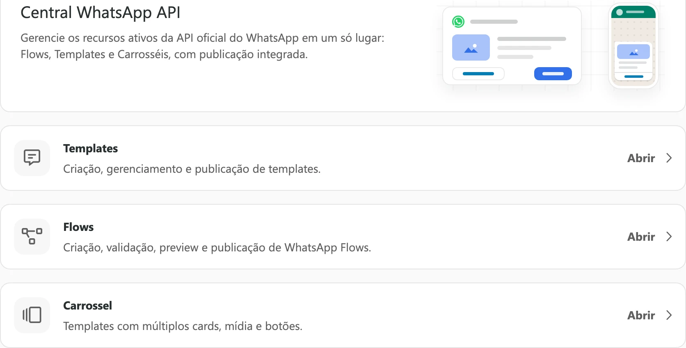

No WhatsApp oficial, um **template** é uma mensagem pronta aprovada pela Meta, necessária para começar uma conversa ou falar com um contato fora da [janela de 24 horas](/docs/canais/whatsapp/whatsapp-cloud-api/janela-de-24-horas).

Templates, Flows e carrosséis existem apenas no **WhatsApp oficial**. Em canais de WhatsApp por QR Code (**Express** ou **Clássica**), esses recursos não estão disponíveis — veja [Qual WhatsApp usar: oficial ou QR Code](/docs/canais/whatsapp/visao-geral) e [O que funciona e o que não funciona no WhatsApp por QR Code](/docs/canais/whatsapp/whatsapp-app/o-que-funciona).

## Onde fica e quem pode usar

Você acessa esses recursos em **Configurações** → **Automação** → **WhatsApp API**. A tela exibe o título **Central WhatsApp API** com três cartões — **Templates**, **Flows** e **Carrossel** —, cada um com o botão **Abrir**.

Você também pode ir direto para a lista de templates pela aba **Templates** no painel do canal oficial, clicando em **Gerenciar** ([Configurações do WhatsApp oficial](/docs/canais/whatsapp/whatsapp-cloud-api/configuracoes)).

<Frame caption="Tela WhatsApp API com os cartões Templates, Flows e Carrossel">
  
</Frame>

<Note>Quem pode: membros com a permissão **Gerenciar Canais** e o proprietário do workspace (veja [Workspace, membros e papéis](/docs/conceitos/workspace-membros-e-papeis)). É necessário ter pelo menos um canal de WhatsApp oficial ativo.</Note>

Se o workspace não tiver nenhum canal oficial conectado, a tela exibe a janela **Conecte uma API Oficial** com o botão **Conectar WhatsApp** (veja [Antes de conectar o WhatsApp oficial](/docs/canais/requisitos-para-se-ter-uma-api-oficial) e [Conectar o WhatsApp oficial](/docs/canais/whatsapp-api-oficial-padrao)).

Cada template, Flow e carrossel pertence a um único canal de WhatsApp oficial.

## O que é cada um

Flows e carrosséis não são enviados sozinhos: eles chegam ao contato dentro de um template aprovado pela Meta.

| Recurso | O que é | Como chega ao contato |
| --- | --- | --- |
| **Template** | Mensagem com texto, cabeçalho opcional (texto ou mídia), rodapé, botões e variáveis como `{{1}}`. | Enviado direto depois de aprovado pela Meta. |
| **WhatsApp Flow** | Formulário com telas que o contato preenche dentro do próprio WhatsApp. | Pelo botão de um **Template + Flow** aprovado pela Meta. |
| **Carrossel** | Sequência de 2 a 10 cards lado a lado com imagem ou vídeo, título, descrição e botões. | Dentro de um **Template + Carrossel** aprovado pela Meta (sempre na categoria **Marketing**). |

## Categorias

Ao criar um template na Kinbox, você escolhe uma categoria: **Marketing**, **Utility** (utilidade) ou **Authentication** (autenticação). Em **Template + Carrossel**, a categoria é sempre **Marketing**.

A categoria final é decisão da Meta, que pode alterá-la durante ou após a análise. Quando isso ocorre, a Kinbox atualiza a coluna **Categoria** automaticamente e envia uma notificação no sino.

## Do rascunho ao envio

Um template passa por estas etapas até poder ser enviado:

1. **Rascunho**: salvo apenas na Kinbox, ainda sem envio à Meta.
2. **Submetido** ou **Pendente**: enviado com **Solicitar Aprovação**, aguardando análise da Meta.
3. **Aprovado** ou **Rejeitado**: decisão da Meta. Apenas templates com status **Aprovado** podem ser enviados.
4. **Pausado** ou **Desativado**: a Meta pode pausar ou desativar um template já aprovado depois.

A Kinbox acompanha as mudanças de status automaticamente e avisa no sino do cabeçalho. Você também pode forçar a atualização com **Sincronizar Meta**.

## Onde usar um template aprovado

Depois de aprovado pela Meta, você pode enviar o template em:

- conversas (com janela fechada ou ao iniciar uma conversa nova);
- agendamento de mensagem na conversa;
- campanhas;
- automações;
- bot;
- cenários;
- agentes de IA.

Para saber o que funciona em cada lugar, veja [Enviar um template na conversa, na campanha e na automação](/docs/canais/whatsapp/whatsapp-templates/enviar-template). Para entender a diferença entre bot, automações, cenários e agentes de IA, veja [Bot, automações, cenários e agentes de IA: qual usar](/docs/conceitos/automacao-e-ia).

## Cobrança

A Kinbox não cobra pelo envio de templates. Qualquer cobrança relacionada a templates é feita pela Meta na conta do WhatsApp.

## Próximos passos

<CardGroup cols={2}>
  <Card title="Criar um template e enviar para aprovação" href="/docs/canais/criar-templates-dentro-do-kinbox">
    Monte um template com cabeçalho, variáveis e botões e envie para análise da Meta.
  </Card>
  <Card title="Enviar um template" href="/docs/canais/whatsapp/whatsapp-templates/enviar-template">
    Veja onde enviar templates aprovados e como preencher variáveis e anexos.
  </Card>
  <Card title="Criar WhatsApp Flows" href="/docs/canais/criar-flows-dentro-do-kinbox">
    Crie formulários interativos dentro do WhatsApp, publique na Meta e vincule a um template.
  </Card>
  <Card title="Criar um carrossel" href="/docs/canais/criar-carrossel-dentro-do-kinbox">
    Monte de 2 a 10 cards com mídia e botões e transforme o rascunho em um template.
  </Card>
  <Card title="Template rejeitado, pausado ou desativado" href="/docs/canais/whatsapp/whatsapp-templates/template-rejeitado">
    Saiba como agir quando a Meta recusa, pausa, desativa ou muda a categoria de um template.
  </Card>
</CardGroup>
