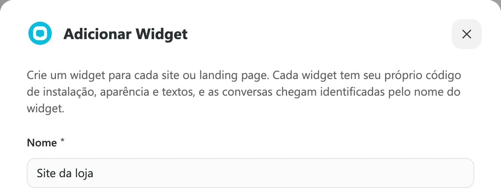
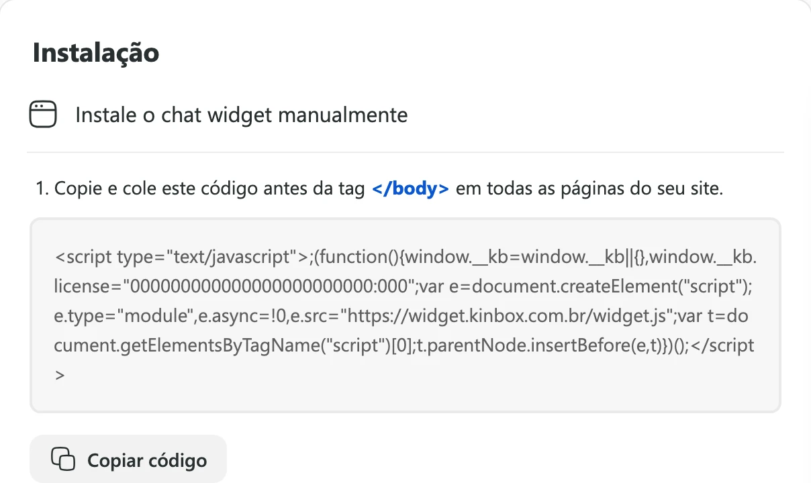
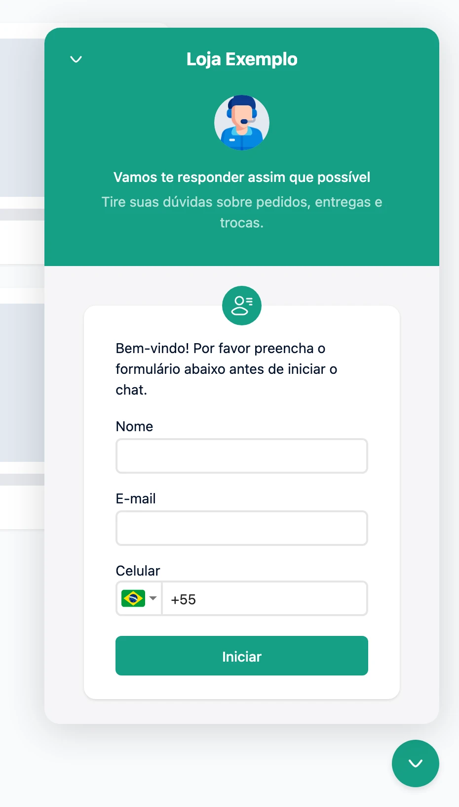

O widget é um chat instalado no seu site: o visitante clica no botão, escreve e a conversa chega na [Caixa de entrada](/docs/conversas/caixa-de-entrada-do-kinbox) identificada pelo nome do widget. Você pode criar um widget para cada site ou landing page, cada um com código de instalação, aparência e textos próprios.

<Note>
  **Quem pode:** o proprietário do workspace e membros com a permissão **Gerenciar Canais** ([Referência de permissões](/docs/administracao/referencia-de-permissoes)). A restrição **Não pode gerenciar widget.** esconde o cartão **Widget**, os widgets da lista de canais e a tela do widget. A restrição **Somente pode dar manutenção simples em canais** esconde **Novo canal** e **Excluir** (quem tem essa restrição não cria nem exclui widgets). O widget não entra na cobrança do plano nem tem limite de quantidade.
</Note>

## Antes de começar

- Tenha acesso ao código do seu site ou contato com a pessoa que cuida dele, porque o código de instalação precisa ser colado antes da tag `</body>` em todas as páginas.

## Passo a passo

<Steps>
  <Step title="Abra a tela de canais">
    Vá em **Configurações** → **Chat** → **Canais** e clique em **Novo canal**.

    Se **Novo canal** não aparecer, peça ao proprietário do workspace para verificar se você tem a permissão **Gerenciar Canais** e se está sem a restrição **Somente pode dar manutenção simples em canais**.
  </Step>
  <Step title="Escolha Widget">
    Em **Conectar novo canal**, clique no cartão **Widget**.

    Se o cartão **Widget** não aparecer, peça ao proprietário para tirar a restrição **Não pode gerenciar widget.** do seu papel.
  </Step>
  <Step title="Dê um nome e crie o widget">
    No painel **Adicionar Widget**, preencha **Nome** (obrigatório) e clique em **Criar widget**. Esse nome aparece para a equipe como o canal das conversas: use, por exemplo, o nome do site ou da landing page.

    <Frame caption="Painel Adicionar Widget com o campo Nome preenchido">
      
    </Frame>

    A Kinbox mostra "Widget criado." e abre a tela do novo widget. Ele já nasce com o nome do workspace em **Nome de exibição** e com a foto do workspace como foto do chat.
  </Step>
  <Step title="Copie o código de instalação">
    No cartão **Instalação**, clique em **Copiar código** (clicar na caixa do código também copia). A tela mostra o aviso "Copiado para o clipboard".

    <Frame caption="Cartão Instalação com o botão Copiar código">
      
    </Frame>
  </Step>
  <Step title="Cole o código no seu site">
    Cole o código copiado antes da tag `</body>` em todas as páginas do seu site. Se você não tem acesso ao código do site, envie o código copiado para a pessoa que cuida dele.

    A Kinbox não tem plugin nem aplicativo para WordPress, Wix ou outras plataformas de site: em qualquer plataforma, a instalação usa esse mesmo código.
  </Step>
  <Step title="Publique e teste">
    Publique o site e abra uma página: o botão redondo do chat aparece no canto de baixo (à direita por padrão). Clique no botão, envie uma mensagem de teste e confirme que a conversa chega na **Caixa de entrada** com o nome do widget.

    <Frame caption="Chat do site aberto no canto de uma página de exemplo">
      
    </Frame>
  </Step>
</Steps>

## Depois de instalar

- **Personalização:** mude cores, posição, textos, mensagem inicial e formulário pré-chat em [Personalizar a aparência, os textos e o formulário do widget](/docs/canais/widget/personalizar).
- **Configurações:** restrinja domínios, controle a exibição no celular, ative o horário comercial e adicione o balão de WhatsApp em [Configurações do widget](/docs/canais/widget/configuracoes).
- **Atualizações no site:** mudanças salvas na Kinbox aparecem no site quando a página é aberta ou recarregada.
- **Bot e agente de IA:** o widget funciona como canal para [bot](/docs/bot/aprender-a-usar-o-bot) e [agente de IA](/docs/agente-de-ia/conectar-canais). Nos menus do bot, as opções aparecem como botões clicáveis enquanto o menu for a última mensagem da conversa (veja [Blocos do bot](/docs/bot/blocos-do-bot)).
- **Como a conversa começa:** não dá para iniciar uma conversa pelo widget a partir da Kinbox; a conversa começa quando o visitante escreve ou envia o formulário pré-chat com a mensagem automática ligada (veja [Iniciar uma conversa com um contato](/docs/conversas/iniciar-conversa)).
- **Histórico no navegador:** a conversa fica guardada no navegador do visitante, por widget. Em outro navegador, outro aparelho ou janela anônima, começa uma conversa nova.

## Mais de um site

Você pode criar um widget para cada site ou landing page: não há limite de quantidade nem cobrança no plano. Assim cada site tem aparência e textos próprios, e você identifica na **Caixa de entrada** de qual site cada conversa veio.

O mesmo código também funciona em vários sites (desde que **Restringir domínio** não bloqueie), mas todas as conversas chegam agrupadas com o nome daquele único widget.

## Renomear e excluir

- **Renomear:** abra o widget em **Configurações** → **Chat** → **Canais**, clique no lápis **Editar nome** ao lado do título, altere o **Nome** na janela **Editar nome do widget** e clique em **Salvar** (aviso "Nome atualizado").
- **Ações na lista de canais:** em **Configurações** → **Chat** → **Canais**, o widget aparece com o nome dele e "Chat no site" abaixo. No menu de três pontos você encontra **Editar**, **Copiar ID** e **Excluir** (veja [Canais: conectar e gerenciar](/docs/canais/visao-geral)).

<Warning>
  **Excluir** um widget desativa o canal, apaga as configurações dele e remove o chat de todos os sites onde aquele código está instalado. Não é possível desfazer: um novo widget gera um código novo, que precisa ser instalado no site no lugar do antigo. As conversas já registradas não são apagadas.
</Warning>

## Problemas comuns

- **O chat não aparece no site ou as mudanças não entram:** confira se o código foi colado antes de `</body>` em todas as páginas publicadas, se **Restringir domínio** inclui o endereço exato e se a página foi recarregada. Veja todas as causas em [O chat não aparece no meu site](/docs/canais/widget/problemas-comuns).
- **O cartão Widget não aparece ou a tela volta para Canais:** confira se o seu papel tem a permissão **Gerenciar Canais** e está sem a restrição **Não pode gerenciar widget.** Peça ao proprietário para ajustar em [Criar papéis e permissões](/docs/configuracoes-no-workspace/configurar-permissoes-dos-usuarios).

<CardGroup cols={3}>
  <Card title="Personalizar o widget" href="/docs/canais/widget/personalizar">
    Cores, posição na tela, textos do topo, mensagem inicial e formulário pré-chat.
  </Card>
  <Card title="Configurações do widget" href="/docs/canais/widget/configuracoes">
    Restringir domínio, horário comercial, exibição no celular e balão de WhatsApp.
  </Card>
  <Card title="O chat não aparece no meu site" href="/docs/canais/widget/problemas-comuns">
    Causas e soluções quando o chat não carrega, não mostra Online ou não recebe arquivos.
  </Card>
</CardGroup>
