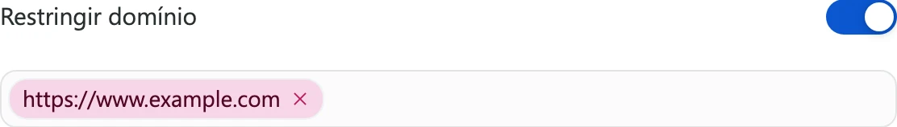

As opções de comportamento do chat do site ficam no cartão **Ajustes** da tela do widget (**Configurações** → **Chat** → **Canais** → clique no widget). Depois de mudar uma opção, clique em **Salvar mudanças**. As mudanças salvas aparecem no site quando a página é aberta ou recarregada.

<Note>
  **Quem pode:** o proprietário do workspace (na tela, **ambiente**) e membros com a permissão **Gerenciar Canais**, sem a restrição **Não pode gerenciar widget.** ([Referência de permissões](/docs/administracao/referencia-de-permissoes)).
</Note>

## Ajustes

Cada opção é um interruptor. Algumas mostram campos extras quando ligadas. Ao criar um widget, **Mostrar avatares dos membros**, **Mostrar widget no celular** e **Habilitar sons** vêm ligados, e as outras vêm desligadas.

| Opção | O que faz |
| --- | --- |
| **Mostrar avatares dos membros** | Mostra a foto do membro que respondeu no topo do chat e nas respostas. |
| **Usar imagem personalizada** | Troca o ícone do botão e a foto do topo do chat por uma imagem sua (por exemplo, o logo). Sem ela, o botão mostra o ícone de chat e o topo mostra a foto do workspace do momento em que o widget foi criado. |
| **Chamada para ação** | Mostra um balão de texto ao lado do botão depois de um tempo. Veja abaixo. |
| **Mostrar widget no celular** | Desligado, o chat não aparece em telas com menos de 768 px de largura (celular ou janela estreita no computador). |
| **Esconder botão do widget** | Esconde o botão do chat no site. Veja abaixo. |
| **Habilitar sons** | Toca som no chat do visitante, por exemplo quando chega uma resposta. |
| **Restringir domínio** | Deixa o chat funcionar só nos endereços da lista. Veja abaixo. |
| **Habilitar balão de WhatsApp** | Mostra um botão verde do WhatsApp junto do botão do chat. Veja abaixo. |
| **Habilitar horário comercial** | Mostra "Online" no topo do chat durante o horário escolhido. Veja abaixo. |

## Chamada para ação

Ligue **Chamada para ação** e preencha **Texto** e **Tempo até aparecer** (em segundos). O balão aparece ao lado do botão do chat depois desse tempo, enquanto o visitante não abriu o chat. Clicar no balão abre o chat.

<Frame caption="Botão do chat com a chamada para ação e, acima, o botão do WhatsApp">
  
</Frame>

## Esconder o botão

Com **Esconder botão do widget** ligado, o botão do chat e o número de mensagens não lidas ficam escondidos no site. O chat abre de duas formas: pelo balão da **Chamada para ação**, se estiver ligada, ou por um botão ou link do seu site que chame `window.openWidget()` (peça a quem cuida do site).

## Restringir domínio

Com **Restringir domínio** desligado, o código funciona em qualquer site onde for colado. Ao ligar, digite cada endereço permitido e aperte **Enter** ou vírgula.

<Frame caption="Restringir domínio com um endereço cadastrado">
  
</Frame>

O endereço precisa ser **exato**: o protocolo que o site usa (`https://` ou `http://`), o domínio e a porta, se houver, sem barra no fim e sem caminho.

- `https://www.example.com` e `https://example.com` são endereços diferentes: cadastre os dois se o site abre dos dois jeitos.
- `https://example.com/` (com barra no fim), `https://example.com/contato` (com caminho) e `example.com` (sem o protocolo) não funcionam.
- Cada subdomínio é um endereço (por exemplo, `https://blog.example.com`).
- Com a opção ligada e a lista vazia, o chat não aparece em nenhum site.

## Balão de WhatsApp

Ligue **Habilitar balão de WhatsApp** e preencha **Número** (o país vem como Brasil) e **Texto padrão**. Digite o número completo: se o campo ficar só com o código do país (+55), a tela salva assim mesmo e o botão verde aparece no site, mas abre o WhatsApp sem um número válido.

- No computador, o botão verde aparece quando o visitante passa o mouse sobre o botão do chat. No celular, o primeiro toque (no botão do chat, no balão da chamada para ação ou por `window.openWidget()`) só mostra o botão verde; o segundo abre o chat.
- O botão verde abre o WhatsApp (site ou app) numa conversa com o **Número**, com o **Texto padrão** já escrito. A conversa acontece no WhatsApp desse número. Para recebê-la na Kinbox, o número precisa estar conectado como canal de WhatsApp (veja [Qual WhatsApp usar: oficial ou QR Code](/docs/canais/whatsapp/visao-geral)).
- **Usar somente WhatsApp:** o botão do chat some e fica só o botão verde, maior. Se **Chamada para ação** estiver ligada, o balão dela ainda abre o chat; desligue-a para ficar só com o WhatsApp.
- **Capturar informações de campanha:** quando o endereço da página tem parâmetros (por exemplo, `utm_campaign`), o link do WhatsApp leva junto os dados da página. Marcando também **Enviar código de rastreio na mensagem**, a Kinbox pode acrescentar um código curto, como "(ref: K7F2Q9)", no fim do **Texto padrão**, para identificar a campanha mesmo no WhatsApp do celular.

As conversas pelo próprio chat do site guardam os dados de campanha da página sem precisar dessa caixa.

## Horário comercial

Ligue **Habilitar horário comercial** e escolha um horário em **Selecione o horário**. A lista traz os horários de **Configurações** → **Ambiente** → **Horários**; se estiver vazia, cadastre um horário antes (veja [Definir os horários de atendimento](/docs/configuracoes-no-workspace/criar-e-gerenciar-horarios)).

- O topo do chat mostra "Online" dentro do horário, pelo **relógio do aparelho do visitante**. Fora dele, ou com a opção desligada, mostra a **Mensagem de fora do expediente**.
- O horário não fecha o chat: o visitante continua podendo mandar mensagens.
- Na **Pré-visualização**, com a opção ligada, o topo mostra "Online" o tempo todo.

## Outras ações

| Ação | Onde fica | O que faz |
| --- | --- | --- |
| Renomear | Lápis **Editar nome** ao lado do nome do widget | Muda o nome que a equipe vê como canal das conversas ("Nome atualizado"). |
| **Copiar código** | Cartão **Instalação** | Copia o código de instalação para colar no site ("Copiado para o clipboard"). |

Para **Copiar ID** e **Excluir**, veja [Instalar o chat no seu site](/docs/canais/widget).

## Veja também

- [Personalizar a aparência, os textos e o formulário do widget](/docs/canais/widget/personalizar)
- [O chat não aparece no meu site](/docs/canais/widget/problemas-comuns)
- [Canais: conectar e gerenciar](/docs/canais/visao-geral)
