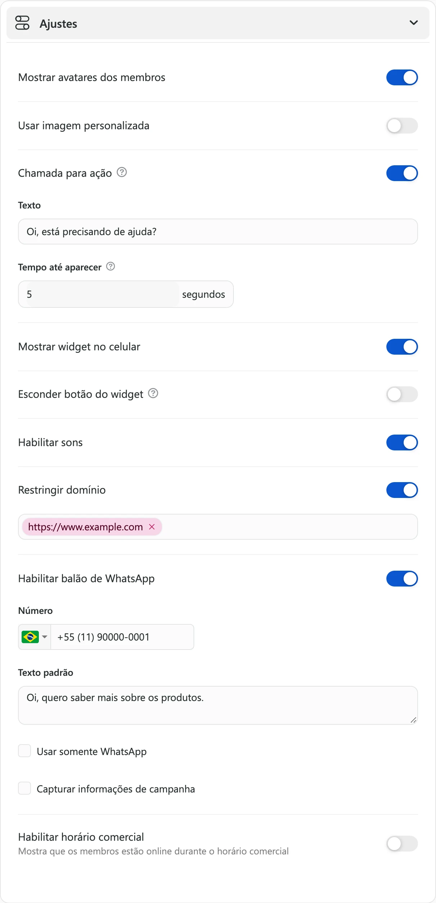
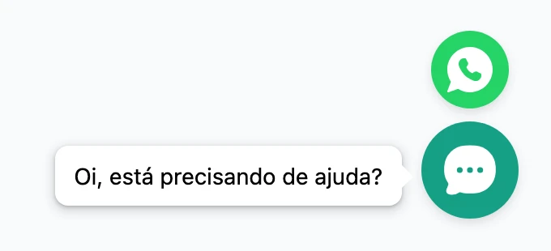

As opções de comportamento do chat do site ficam no cartão **Ajustes** da tela do widget (**Configurações** → **Chat** → **Canais** → clique no widget). Depois de alterar qualquer opção, clique em **Salvar mudanças**; as mudanças salvas aparecem no site quando a página é aberta ou recarregada.

<Note>
  **Quem pode:** o proprietário do workspace e membros com a permissão **Gerenciar Canais** ([Referência de permissões](/docs/administracao/referencia-de-permissoes)). A restrição **Não pode gerenciar widget.** esconde o cartão **Widget**, os widgets da lista de canais e a tela do widget. A restrição **Somente pode dar manutenção simples em canais** esconde **Novo canal** e **Excluir** (não cria nem exclui widgets).
</Note>

<Frame caption="Cartão Ajustes com as opções de comportamento do widget">
  
</Frame>

## Ajustes

Ao criar um widget, vêm ligados por padrão **Mostrar avatares dos membros**, **Mostrar widget no celular** e **Habilitar sons**; as demais opções vêm desligadas. Opções com campos extras abrem esses campos quando o interruptor está ligado.

| Opção | Padrão | O que faz |
| --- | --- | --- |
| **Mostrar avatares dos membros** | Ligado | O topo do chat e as respostas mostram a foto do membro que respondeu. Desligado, mostra a foto do widget. |
| **Usar imagem personalizada** | Desligado | Abre um campo para enviar uma imagem, que vira o botão do chat e a foto do topo. Desligado, o chat usa a foto do workspace do momento em que o widget foi criado. |
| **Chamada para ação** | Desligado | "Balão de texto que aparece depois de algum tempo se o lead não tiver interagido com o widget ainda." Define **Texto** e **Tempo até aparecer** (em **segundos**; ajuda "Tempo de espera até o texto aparecer para o visitante."; aceita apenas número, senão exibe "Digite um número"; vazio ou `0` espera 1 segundo). Aparece a cada página aberta enquanto o visitante não abriu o chat e toca som se **Habilitar sons** estiver ligado. |
| **Mostrar widget no celular** | Ligado | Desligado, o chat não aparece em nenhuma tela com menos de 768 px de largura (celular ou janela estreita no computador). |
| **Esconder botão do widget** | Desligado | "Caso queira manualmente controlar quando o widget deve ser aberto você pode deixar o botão do widget escondido." Esconde o botão do chat e o indicador de não lidas. Veja **Esconder o botão**, abaixo. |
| **Habilitar sons** | Ligado | Toca som ao enviar mensagem, ao chegar resposta e quando a chamada para ação aparece. |
| **Restringir domínio** | Desligado | Limita o chat apenas aos endereços da lista. Veja **Restringir domínio**, abaixo. |
| **Habilitar balão de WhatsApp** | Desligado | Mostra um botão verde do WhatsApp junto ao botão do chat. Veja **Balão de WhatsApp**, abaixo. |
| **Habilitar horário comercial** | Desligado | "Mostra que os membros estão online durante o horário comercial". Escolhe um horário em **Selecione o horário**. Veja **Horário comercial**, abaixo. |

## Restringir domínio

Com **Restringir domínio** desligado, o código funciona em qualquer site onde for colado. Ao ligar a opção, digite cada endereço permitido e pressione **Enter** ou vírgula (o campo mostra o exemplo `https://example.com.br`).

O endereço precisa ser **exato**: protocolo e domínio (e porta, se houver), sem barra no fim e sem caminho:

- `https://www.example.com` e `https://example.com` são endereços diferentes: cadastre os dois se o site abre dos dois jeitos.
- `http://` e `https://` são diferentes.
- `https://example.com/` (com barra no fim), `https://example.com/contato` (com caminho) e `example.com` (sem `https://`) não batem.
- Subdomínios contam separado (por exemplo, `https://blog.example.com`).

Se **Restringir domínio** ficar ligado com a lista vazia, o chat não aparece em lugar nenhum.

## Balão de WhatsApp

Ligue **Habilitar balão de WhatsApp** para mostrar um botão verde do WhatsApp junto ao botão do chat:

- **Número** (seletor de país com Brasil por padrão): número que recebe a conversa. Sem **Número** preenchido, o balão não aparece no site.
- **Texto padrão** (exemplo da tela: "Oi, quero saber mais sobre seus serviços."): mensagem pré-preenchida ao abrir o WhatsApp.
- No computador, o botão verde aparece quando o visitante passa o mouse sobre o botão do chat. No celular, o primeiro toque mostra o botão verde e o segundo abre o chat.

<Frame caption="Botão do chat com a chamada para ação e o balão do WhatsApp acima">
  
</Frame>

Clicar no botão verde abre o WhatsApp (site ou app) em uma conversa com o **Número** e o **Texto padrão** preenchido. A conversa acontece no WhatsApp daquele número; para recebê-la na Kinbox, conecte esse número como canal de WhatsApp no workspace (veja [Qual WhatsApp usar: oficial ou QR Code](/docs/canais/whatsapp/visao-geral)).

Opções extras do balão:

- **Usar somente WhatsApp:** esconde o botão do chat da Kinbox e deixa apenas o botão verde do WhatsApp, maior. O chat da Kinbox não abre.
- **Capturar informações de campanha:** quando a página abre com parâmetros de campanha na URL (como `utm_campaign`), o link do WhatsApp leva informações da página. Marcada essa caixa, aparece **Enviar código de rastreio na mensagem** ("Acrescenta um código curto no fim da mensagem, ex.: (ref: K7F2Q9). Ele identifica a campanha mesmo quando o lead abre o WhatsApp pelo celular."), que acrescenta o código "(ref: ...)" no fim do **Texto padrão** apenas quando a página foi aberta com parâmetros de campanha na URL. Sem parâmetros na URL, o link abre normalmente sem código. (A captura de campanha nas conversas pelo chat do site é automática e não depende dessa caixa.)

## Horário comercial

Com **Habilitar horário comercial** ligado, selecione um horário em **Selecione o horário**. A lista traz os horários cadastrados em **Configurações** → **Ambiente** → **Horários** (o workspace aparece na tela como **ambiente**). Se a lista estiver vazia, cadastre um horário antes.

- O topo do chat mostra "Online" apenas quando **Habilitar horário comercial** está ligado e dentro do horário cadastrado, comparado pelo **relógio do aparelho do visitante**. Em qualquer outro caso, o topo mostra a **Mensagem de fora do expediente**.
- O horário comercial não fecha o chat: o visitante continua podendo enviar mensagens fora do expediente.
- Na **Pré-visualização**, enquanto **Habilitar horário comercial** está ligado, o topo mostra "Online" o tempo todo.

## Esconder o botão

Com **Esconder botão do widget** ligado, o botão flutuante e o indicador de mensagens não lidas ficam ocultos no site. Quem cuida do site pode abrir o chat a partir de um botão ou link próprio chamando `window.openWidget()`.

## Outras ações

| Ação | Onde fica | O que faz |
| --- | --- | --- |
| Renomear | Lápis **Editar nome** ao lado do título na tela do widget | Abre **Editar nome do widget** para alterar o nome que a equipe vê como canal ("Nome atualizado"). |
| **Copiar ID** | Menu de três pontos na lista de canais | Copia o ID do canal ("ID do canal (...) copiado para clipboard."). |
| **Excluir** | Menu de três pontos na lista de canais | Pede confirmação ("Tem certeza que deseja excluir esse canal?"), desativa o canal e apaga as configurações do widget. |
| **Copiar código** | Cartão **Instalação** na tela do widget | Copia o código de instalação para colar no site ("Copiado para o clipboard"). |

<Warning>
  **Excluir** tira o chat de todos os sites com aquele código e não pode ser desfeito. As conversas já registradas ficam salvas, mas um novo widget gera um código novo que precisa ser instalado no site no lugar do antigo.
</Warning>

## Quem pode

Criar, editar e excluir widgets exige a permissão **Gerenciar Canais** ou ser o proprietário do workspace (veja [Criar papéis e permissões](/docs/configuracoes-no-workspace/configurar-permissoes-dos-usuarios) e [Referência de permissões](/docs/administracao/referencia-de-permissoes)). A restrição **Não pode gerenciar widget.** esconde o cartão **Widget**, os widgets da lista de canais e a tela do widget. A restrição **Somente pode dar manutenção simples em canais** esconde **Novo canal** e **Excluir**, impedindo criar ou excluir widgets.

Veja também [Instalar o chat no seu site](/docs/canais/widget), [Personalizar a aparência, os textos e o formulário do widget](/docs/canais/widget/personalizar) e [Canais: conectar e gerenciar](/docs/canais/visao-geral).
