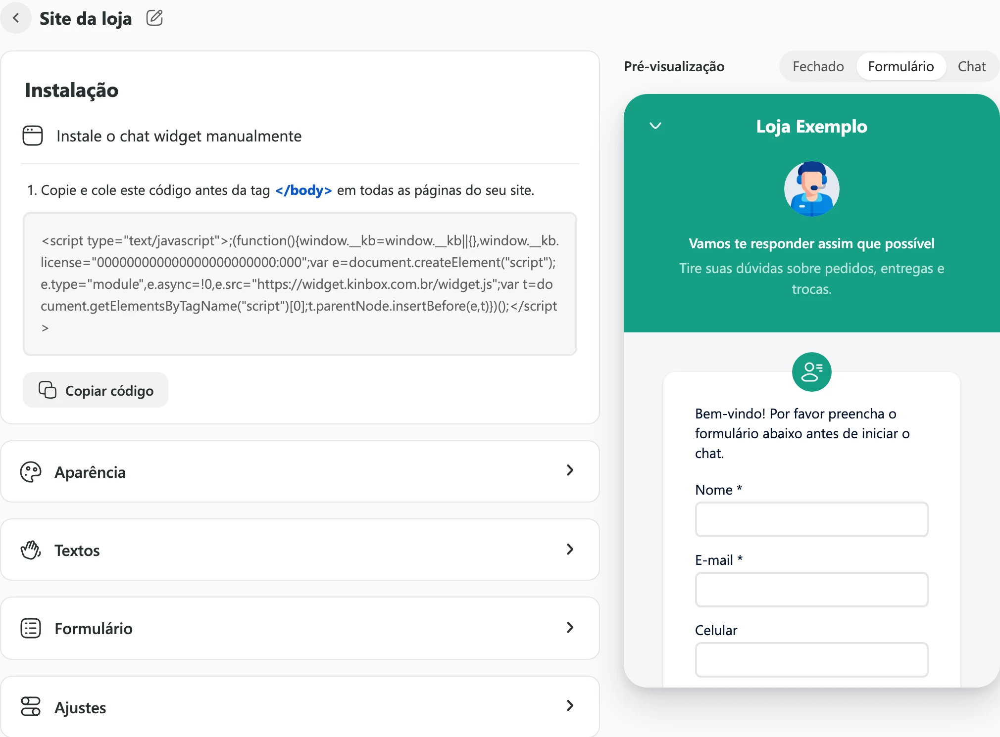
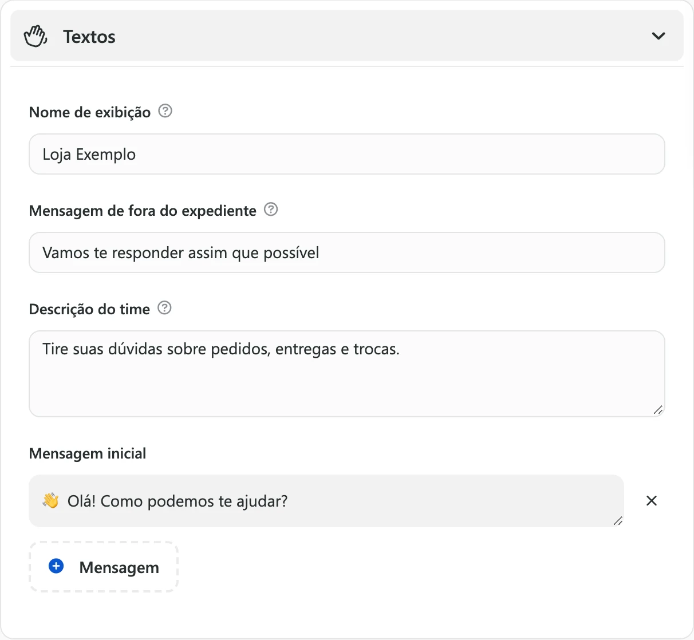
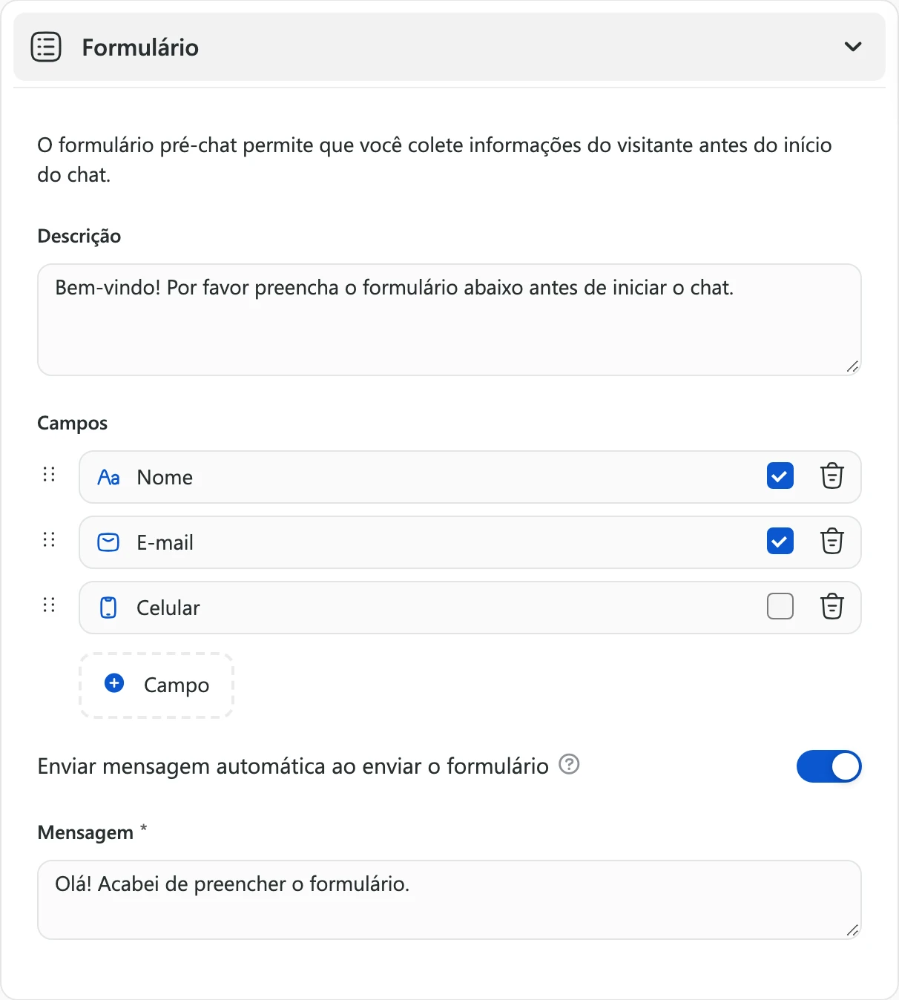

Configure a cor, a posição, os textos do cabeçalho, a mensagem inicial e o formulário pré-chat do widget. Você acompanha o visual na **Pré-visualização** enquanto edita, antes de salvar.

<Note>
  **Quem pode:** o proprietário do workspace e membros com a permissão **Gerenciar Canais** ([Referência de permissões](/docs/administracao/referencia-de-permissoes)). A restrição **Não pode gerenciar widget.** esconde o cartão **Widget**, os widgets da lista de canais e a tela do widget. A restrição **Somente pode dar manutenção simples em canais** esconde **Novo canal** e **Excluir**.
</Note>

## A tela do widget

1. Vá em **Configurações** → **Chat** → **Canais** e clique no widget que você quer personalizar. Se o widget não aparecer na lista, peça ao proprietário para tirar a restrição **Não pode gerenciar widget.** do seu papel.
2. Abaixo do cartão **Instalação**, os cartões **Aparência**, **Textos**, **Formulário** e **Ajustes** começam fechados. Clique em cada cartão para abrir e editar.
3. À direita fica a **Pré-visualização**, com as opções **Fechado**, **Formulário** e **Chat**. Ela atualiza na hora, enquanto você muda os campos.
   - Se a **Pré-visualização** não aparecer, aumente a largura da janela do navegador: ela só aparece em telas largas (a partir de 1280 px) e fora do celular.
   - **Formulário** fica desativado se o formulário não tiver campos. Com **Usar somente WhatsApp** ligado em **Ajustes**, **Formulário** e **Chat** ficam desativados e a prévia mostra "Pré-visualização indisponível" e "O balão abre a conversa direto no WhatsApp."
4. Ao alterar qualquer campo, aparece a barra com **Cancelar** (desfaz as mudanças não salvas) e **Salvar mudanças** (salva e mostra "Configurações salvas"). As mudanças salvas só aparecem no site quando a página é aberta ou recarregada.

<Frame caption="Tela de edição do widget com os cartões fechados à esquerda e a Pré-visualização à direita">
  
</Frame>

## Aparência

Abra o cartão **Aparência** para definir a cor e a posição do botão do chat na página.

| Campo | O que faz | Padrão |
| --- | --- | --- |
| **Tema** | Cor principal do botão e do cabeçalho do chat. Oferece 10 cores prontas e um ícone de pincel para escolher qualquer outra cor. | Azul (`#0d5acf`) |
| **Cor do texto** | **Claro** ou **Escuro**: cor do texto e dos ícones sobre a cor do tema. | **Claro** |
| **Posição na tela** | **Esquerda** ou **Direita**: lado da página onde o botão fica. | **Direita** |
| **Espaçamento lateral** | Distância, em px, entre o botão e a lateral da tela. | `20` |
| **Espaçamento embaixo** | Distância, em px, entre o botão e a parte de baixo da tela. | `20` |

Em telas com menos de 768 px de largura (celular ou janela estreita), o chat aberto ocupa a tela toda, sem os espaçamentos. Para trocar a foto do botão e do topo do chat, use **Usar imagem personalizada** em [Configurações do widget](/docs/canais/widget/configuracoes).

<Frame caption="Cartão Aparência com Tema, Cor do texto, Posição na tela e espaçamentos">
  
</Frame>

## Textos

Abra o cartão **Textos** para configurar o cabeçalho do chat e as mensagens de boas-vindas.

| Campo | O que faz | Padrão |
| --- | --- | --- |
| **Nome de exibição** | Ajuda na tela: O nome da sua empresa ou "Suporte", "Atendimento", etc. Aparece no topo do chat até um membro responder; depois, o topo mostra o nome do membro. Se ficar vazio, mostra "Suporte". | Nome do workspace na criação |
| **Mensagem de fora do expediente** | Ajuda na tela: "Vamos te responder assim que possível". Aparece no topo do chat sempre que o status não estiver "Online" (inclusive quando **Habilitar horário comercial** está desligado). | "Vamos te responder assim que possível" |
| **Descrição do time** | Ajuda na tela: "Em poucas palavras fale sobre seu time ou expectativas que o cliente pode ter com esse chat". Texto exibido abaixo do status no topo do chat. | "Nos pergunte qualquer coisa, ou deixe seu feedback." |
| **Mensagem inicial** | Mensagens exibidas uma por vez quando o visitante abre o chat. Clique em **Mensagem** (botão com `+`) para adicionar outra ou no **X** para remover. Deixar uma mensagem vazia impede salvar ("Obrigatório."). | "👋 Olá! Como podemos te ajudar?" |

Regras importantes sobre os textos:

- **Topo do chat:** depois que um membro responde, o topo passa a mostrar o nome do último membro que respondeu. O status "Online" só aparece com **Habilitar horário comercial** ligado e dentro do horário, pelo relógio do aparelho do visitante; em qualquer outro caso, aparece a **Mensagem de fora do expediente**.
- **Mensagem inicial:** aparece apenas na janela do visitante e não entra no histórico da conversa na Kinbox. Se o formulário pré-chat tiver campos, a mensagem inicial aparece depois que o visitante clica em **Iniciar**.

<Frame caption="Cartão Textos com Nome de exibição, Mensagem de fora do expediente, Descrição do time e Mensagem inicial">
  
</Frame>

## Formulário antes do chat

Abra o cartão **Formulário** ("O formulário pré-chat permite que você colete informações do visitante antes do início do chat.") para pedir dados antes de o visitante começar a conversar. Sem campos adicionados, o chat abre direto.

- **Descrição:** escreva o texto exibido acima dos campos (padrão: "Bem-vindo! Por favor preencha o formulário abaixo antes de iniciar o chat.").
- **Adicionar campos:** em **Campos**, clique em **Campo** (botão com `+`) e escolha entre **Nome**, **E-mail**, **Celular** e os campos personalizados de contato e de sessão do workspace (cadastrados em **Configurações** → **Ambiente** → **Campos personalizados**; o workspace aparece na tela como **ambiente**). Campos já adicionados ficam desativados na lista; campos personalizados de outros tipos não aparecem.
- **Editar e organizar campos:** em cada campo da lista, clique no nome para mudar o texto que o visitante vê (um nome vazio impede salvar, com "Obrigatório."), marque a caixa **Obrigatório** para exigir o preenchimento, arraste pela alça à esquerda para mudar a ordem ou clique na lixeira **Remover** para excluir o campo.
- **Mensagem automática:** ligue **Enviar mensagem automática ao enviar o formulário** ("Ao enviar o formulário, o widget manda esta mensagem em nome do visitante. Assim a conversa é criada no Kinbox e o bot do canal já começa o atendimento.") e preencha **Mensagem** (obrigatória quando ligada; exemplo da tela: "e.g: Olá! Acabei de preencher o formulário."). Com ela ligada, a conversa nasce na Kinbox assim que o visitante clica em **Iniciar** e o [bot](/docs/bot/aprender-a-usar-o-bot) do canal já pode atender. Com ela desligada, a conversa só nasce quando o visitante escreve.

Como a Kinbox trata os dados preenchidos:

- O formulário aparece uma vez por navegador, antes da primeira mensagem.
- Ao clicar em **Iniciar**, a Kinbox procura um contato com o mesmo e-mail ou celular. Se encontrar, usa esse contato e preenche apenas o que estiver vazio nele (sem sobrescrever dados já salvos); se não encontrar, cria um novo contato.
- Campos personalizados de contato são gravados no contato; campos personalizados de sessão vão para a sessão junto com a primeira mensagem.

<Frame caption="Cartão Formulário com campos configurados e mensagem automática ligada">
  
</Frame>

## Próximos passos

Para configurar o cartão **Ajustes** (domínios permitidos, exibição no celular, horário comercial, chamada para ação e balão de WhatsApp), veja [Configurações do widget](/docs/canais/widget/configuracoes).
