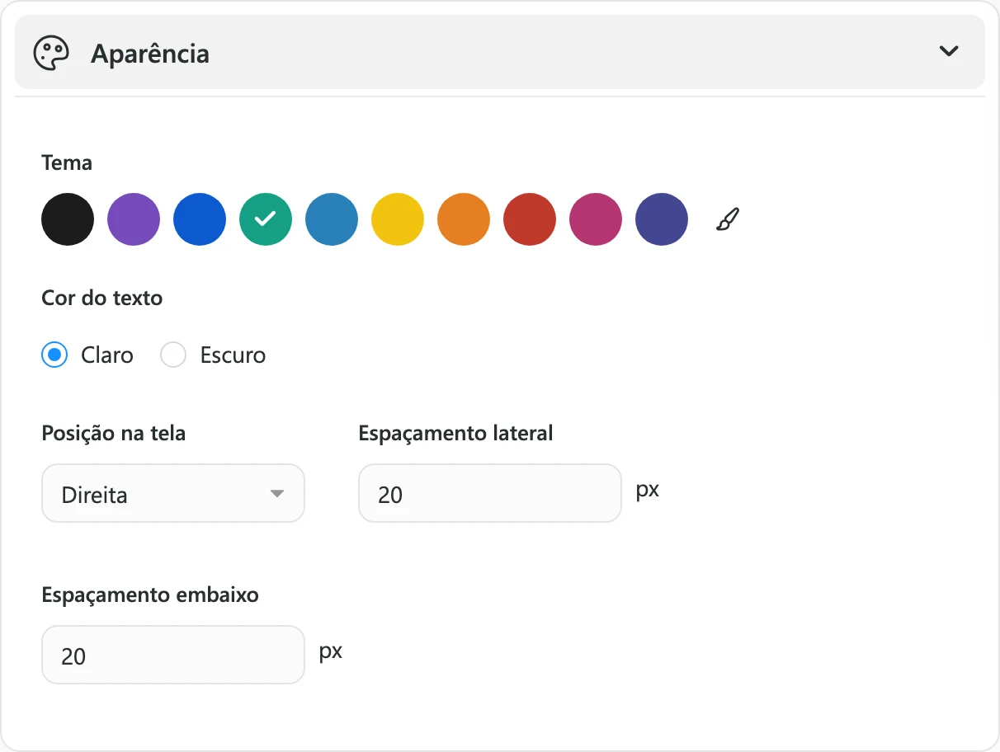

Configure a cor, a posição, os textos do topo do chat, a mensagem inicial e o formulário pré-chat do widget. Você acompanha o visual na **Pré-visualização** enquanto edita, antes de salvar.

<Note>
  **Quem pode:** o proprietário do workspace e membros com a permissão **Gerenciar Canais**, sem a restrição **Não pode gerenciar widget.** ([Referência de permissões](/docs/administracao/referencia-de-permissoes)).
</Note>

## A tela do widget

Vá em **Configurações** → **Chat** → **Canais** e clique no widget. Se o widget não aparecer na lista, peça ao proprietário para tirar a restrição **Não pode gerenciar widget.** do seu papel.

- Abaixo do cartão **Instalação** ficam os cartões **Aparência**, **Textos**, **Formulário** e **Ajustes**. Eles começam fechados: clique em cada um para abrir.
- À direita fica a **Pré-visualização**, com as opções **Fechado**, **Formulário** e **Chat**. Ela muda na hora, enquanto você edita. Se ela não aparecer, aumente a janela do navegador: ela só aparece em telas largas (a partir de 1280 px) e fora do celular.
- **Formulário** fica desativado quando o formulário não tem campos. Com o balão de WhatsApp ligado, com **Número** preenchido e **Usar somente WhatsApp** marcado, **Formulário** e **Chat** ficam desativados.
- Ao alterar qualquer campo, aparece a barra com **Cancelar** (desfaz o que não foi salvo) e **Salvar mudanças** (aviso "Configurações salvas"). As mudanças salvas aparecem no site quando a página é aberta ou recarregada.

<Frame caption="Tela do widget com os cartões à esquerda e a Pré-visualização à direita">
  
</Frame>

## Aparência

Abra o cartão **Aparência** para definir a cor e a posição do botão do chat na página.

| Campo | O que faz | Padrão |
| --- | --- | --- |
| **Tema** | Cor principal do botão e do topo do chat. Escolha uma das 10 cores ou clique no pincel para escolher qualquer outra. | Azul |
| **Cor do texto** | **Claro** ou **Escuro**: cor do texto e dos ícones sobre a cor do tema. | **Claro** |
| **Posição na tela** | **Esquerda** ou **Direita**: lado da página onde o botão fica. | **Direita** |
| **Espaçamento lateral** | Distância, em px, entre o botão e a lateral da tela. | 20 |
| **Espaçamento embaixo** | Distância, em px, entre o botão e a parte de baixo da tela. | 20 |

Em telas com menos de 768 px de largura (celular ou janela estreita), o chat aberto ocupa a tela toda. Para trocar a foto do botão e do topo do chat, use **Usar imagem personalizada** em [Configurações do widget](/docs/canais/widget/configuracoes).

<Frame caption="Cartão Aparência">
  
</Frame>

## Textos

Abra o cartão **Textos** para configurar o topo do chat e as mensagens de boas-vindas.

| Campo | O que faz | Padrão |
| --- | --- | --- |
| **Nome de exibição** | Nome da empresa ou da equipe (ex.: "Suporte", "Atendimento") no topo do chat. | Nome do workspace quando o widget foi criado |
| **Mensagem de fora do expediente** | Frase de status no topo do chat quando ele não está "Online". | "Vamos te responder assim que possível" |
| **Descrição do time** | Poucas palavras sobre a equipe ou sobre o que o visitante pode esperar do chat. | "Nos pergunte qualquer coisa, ou deixe seu feedback." |
| **Mensagem inicial** | Mensagens que aparecem uma por vez quando o visitante abre o chat. Clique em **Mensagem** para adicionar outra e no **X** para remover. Uma mensagem vazia impede salvar ("Obrigatório."). | "👋 Olá! Como podemos te ajudar?" |

Como esses textos aparecem para o visitante:

- **Topo do chat aberto:** mostra o nome (o **Nome de exibição** ou, se vazio, "Suporte"), a frase de status e a **Descrição do time**. No computador, o topo começa aberto; no celular, começa recolhido. Depois que o visitante escreve, o topo se recolhe e mostra só o nome e o status (o visitante pode clicar nele para abrir de novo).
- **Depois que um membro responde:** o topo passa a mostrar o nome do último membro que respondeu.
- **Status:** "Online" só aparece com **Habilitar horário comercial** ligado e dentro do horário, pelo relógio do aparelho do visitante. Em qualquer outro caso, aparece a **Mensagem de fora do expediente**. Veja [Configurações do widget](/docs/canais/widget/configuracoes).
- **Mensagem inicial:** aparece só na janela do visitante e não entra na conversa da Kinbox. Se o formulário pré-chat tiver campos, ela aparece depois que o visitante clica em **Iniciar**.

<Frame caption="Cartão Textos">
  
</Frame>

## Formulário antes do chat

O formulário pré-chat pede dados ao visitante antes de ele começar a conversar. Sem campos, o chat abre direto.

<Steps>
  <Step title="Abra o cartão Formulário">
    Em **Descrição**, escreva o texto que aparece acima dos campos.
  </Step>
  <Step title="Adicione os campos">
    Em **Campos**, clique em **Campo** e escolha **Nome**, **E-mail**, **Celular** ou um campo personalizado de contato ou de sessão (cadastrados em **Configurações** → **Ambiente** → **Campos personalizados**). Campos personalizados de outras áreas, como negociação, não aparecem na lista. Um campo já adicionado fica desativado.
  </Step>
  <Step title="Ajuste cada campo">
    Mude o nome do campo, que é o texto que o visitante vê (vazio impede salvar). Marque **Obrigatório** para exigir o preenchimento. Arraste pela alça à esquerda para mudar a ordem, ou clique na lixeira (**Remover**) para tirar o campo.
  </Step>
  <Step title="Ligue a mensagem automática, se quiser">
    Ligue **Enviar mensagem automática ao enviar o formulário** e preencha **Mensagem** (obrigatória quando ligada). O widget manda essa mensagem em nome do visitante assim que ele clica em **Iniciar**: a conversa é criada na Kinbox na hora e o [bot](/docs/bot/aprender-a-usar-o-bot) do canal já pode começar o atendimento. Com ela desligada, a conversa só nasce quando o visitante escreve.
  </Step>
  <Step title="Salve">
    Clique em **Salvar mudanças**.
  </Step>
</Steps>

<Frame caption="Cartão Formulário com campos e a mensagem automática ligada">
  
</Frame>

O que acontece com os dados:

- O formulário aparece para cada visitante uma vez por navegador, antes da primeira mensagem.
- Ao clicar em **Iniciar**, a Kinbox procura um contato com o mesmo e-mail ou celular. Se encontrar, usa esse contato e completa o nome e os campos personalizados que estiverem vazios. O e-mail e o celular do contato não mudam, mesmo vazios. Se não encontrar, cria um contato novo.
- Campos personalizados de contato são gravados no contato. Campos personalizados de sessão vão para a sessão, junto com a primeira mensagem.

## Próximos passos

Para o cartão **Ajustes** (domínios permitidos, celular, horário comercial, chamada para ação e balão de WhatsApp), veja [Configurações do widget](/docs/canais/widget/configuracoes).
