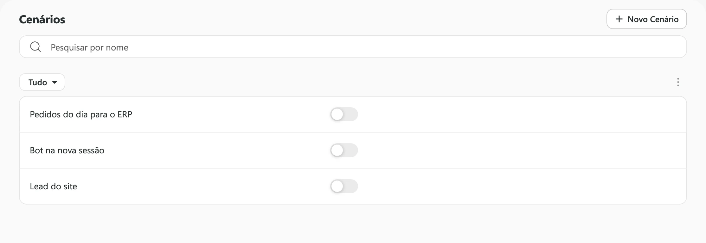
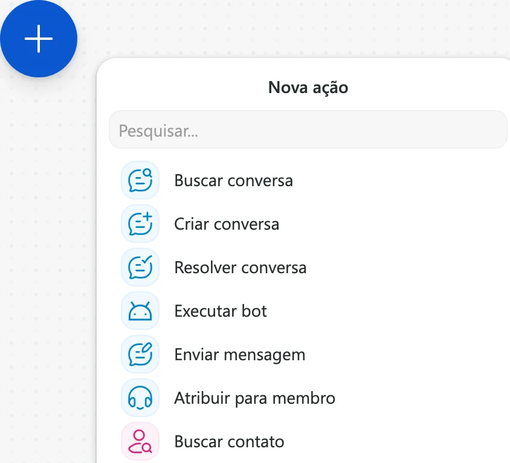
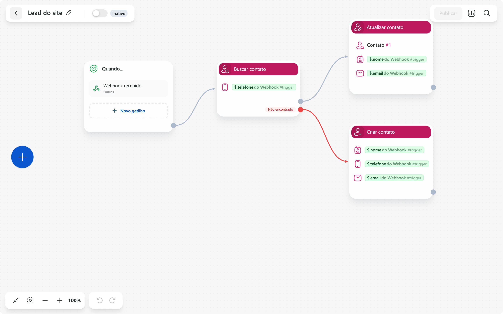

Monte um cenário do início ao fim no editor visual, publique e ligue para colocá-lo em funcionamento, e gerencie seus cenários na lista.

<Note>
  Ver, criar, editar e excluir cenários exige a permissão **Cenários** (ou ser o proprietário). Veja [Referência de permissões](/docs/administracao/referencia-de-permissoes) e [Criar papéis e permissões](/docs/configuracoes-no-workspace/configurar-permissoes-dos-usuarios).
</Note>

## Antes de começar

- Tenha a permissão **Cenários** (ou seja o proprietário do workspace).
- Use um computador: na tela do celular, o editor não mostra os botões **Publicar** e **Analítico**.

## Passo a passo

<Steps>
  <Step title="Abra a lista e crie o cenário">
    Vá em **Configurações** → **Automação** → **Cenários** e clique em **Novo Cenário**.

    <Frame caption="Tela Cenários com o botão Novo Cenário no topo">
      
    </Frame>
  </Step>
  <Step title="Nomeie o cenário">
    O editor abre em tela cheia com o cartão **Quando...** e o nome padrão **Meu cenário**. Clique no nome (ícone de lápis) no topo para editar o campo **Nome do cenário**.
  </Step>
  <Step title="Escolha o gatilho">
    No cartão **Quando...**, clique em **Novo gatilho** e selecione o evento desejado na janela **Começar o cenário quando...**. O painel do gatilho abre à direita para configuração.

    Você pode adicionar mais de um gatilho no mesmo cartão; qualquer um deles começa o cenário. Veja os 4 gatilhos disponíveis em [Gatilhos e ações dos cenários](/docs/cenarios/gatilhos-e-acoes).
  </Step>
  <Step title="Adicione os passos">
    Clique no botão **+** à esquerda para abrir o menu **Nova ação**, filtre em **Pesquisar...** se quiser e escolha a ação. Você também pode puxar a bolinha de saída de um passo e soltar no espaço vazio para abrir o mesmo menu com o caminho já ligado.

    <Frame caption="Menu Nova ação aberto pelo botão + à esquerda do quadro">
      
    </Frame>
  </Step>
  <Step title="Ligue os passos">
    Arraste da bolinha de saída de um passo até o passo seguinte. Cada saída aceita apenas um caminho.
  </Step>
  <Step title="Configure cada passo">
    Clique sobre um passo para abrir o painel de configuração à direita. Selecione as referências de passos anteriores ou do gatilho (como **Contato #1** ou **Conversa #trigger**) e clique em `{...}` nos campos de texto para inserir variáveis.

    <Frame caption="Editor do cenário Lead do site com gatilho, busca, atualização e criação de contato">
      
    </Frame>
  </Step>
  <Step title="Publique o cenário">
    Clique em **Publicar** no topo do editor. Ao salvar, aparece o aviso "Cenário salvo". O botão **Publicar** fica desabilitado quando não há mudanças para gravar.
  </Step>
  <Step title="Ligue o cenário">
    Ative o interruptor no topo do editor e clique em **Publicar** novamente, ou ative o interruptor na linha do cenário na lista **Cenários**.
  </Step>
  <Step title="Teste pelo gatilho real">
    Como não há execução manual, provoque o gatilho de verdade (por exemplo, envie uma amostra ao webhook com o cenário ligado) e confira o resultado em [Acompanhar as execuções no Analítico](/docs/cenarios/execucoes).
  </Step>
</Steps>

## Publicar e ligar

Um cenário só roda quando está **ligado e publicado**. Os dois controles funcionam de forma independente:

- **Publicar** grava o nome, o gatilho, os passos e a posição do interruptor do topo.
- O **interruptor** liga ou desliga o cenário. No editor, mexer no interruptor só passa a valer depois de clicar em **Publicar**. Na lista **Cenários**, o interruptor grava na hora, sem precisar publicar.
- Ao lado do interruptor do editor, o selo **Live** (ligado) ou **Inativo** (desligado) mostra o estado já gravado, não a posição ainda não publicada. Esse selo só aparece depois que o cenário tem pelo menos um gatilho.

<Note>
  Na lista **Cenários**, o interruptor da linha só aparece quando o cenário já tem pelo menos um gatilho. Se o interruptor não aparecer, abra o cenário, adicione um gatilho em **Quando...** e clique em **Publicar**.
</Note>

## Depois de criar

- **Alterações pendentes**: qualquer mudança no editor só vale depois de clicar em **Publicar**. Se tentar fechar com alterações não gravadas, aparece a pergunta "Você tem mudanças não salvas, tem certeza que deseja fechar?".
- **Atalhos visuais do editor**: use a barra inferior para desfazer e refazer alterações, ajustar o zoom, centralizar o quadro ou alternar tela cheia; no topo, **Pesquisar ação** encontra passos rapidamente.
- **Execuções em andamento**: se você publicar alterações enquanto uma execução já está rodando ou aguardando, ela passa a usar os passos da nova versão publicada.

## Clonar, exportar, importar e excluir

Na lista **Cenários**, abra o menu de três pontos na linha do cenário para acessar **Editar**, **Clonar**, **Exportar** e **Excluir**. O menu de três pontos ao lado do filtro **Tudo** traz a opção **Importar**.

- **Clonar**: abre uma cópia com o nome `<nome> (cópia)`, desligada e **sem gatilho**. Adicione o gatilho novamente e clique em **Publicar** — a cópia só é criada depois de publicada.
- **Exportar**: baixa um arquivo `cenario_<nome>.json` com o nome e os passos do cenário, sem o status de ativo e sem histórico de execuções.
- **Importar**: clique no menu de três pontos ao lado do filtro **Tudo** e escolha um arquivo `.json` exportado de um cenário. A Kinbox cria o cenário `Cópia importada de <nome>`, desligado. Se o cenário usar **Webhook recebido**, ele ganha um **Endereço Url** novo — atualize o endereço no sistema externo. Ao importar em outro workspace, confira cada passo (canais, bots, funis e membros) antes de ligar.
- **Excluir**: pede confirmação ("Tem certeza que deseja excluir esse cenário?"), apaga o cenário e remove os gatilhos e agendamentos ligados a ele.

<Warning>
  Excluir um cenário não tem volta. Se o cenário usar o gatilho **Webhook recebido**, o endereço do webhook para de funcionar imediatamente.
</Warning>

## Boas práticas

- **Busque antes de criar contatos**: para evitar duplicidade, coloque **Buscar contato** antes de **Criar contato** e ligue a saída **Não encontrado** ao **Criar contato** (como no exemplo **Lead do site**). O passo **Criar contato** já reaproveita um contato com o mesmo telefone, mas buscar antes permite atualizar os dados existentes pela saída principal.
- **Use nomes claros**: dê ao cenário um nome que descreva o que ele faz, como **Lead do site** ou **Pedidos do dia para o ERP**.

## Veja também

- [Receber dados de outro sistema por webhook](/docs/cenarios/integrar-via-webhook-com-cenarios)
- [Acompanhar as execuções no Analítico](/docs/cenarios/execucoes)
- [Gatilhos e ações dos cenários](/docs/cenarios/gatilhos-e-acoes)
