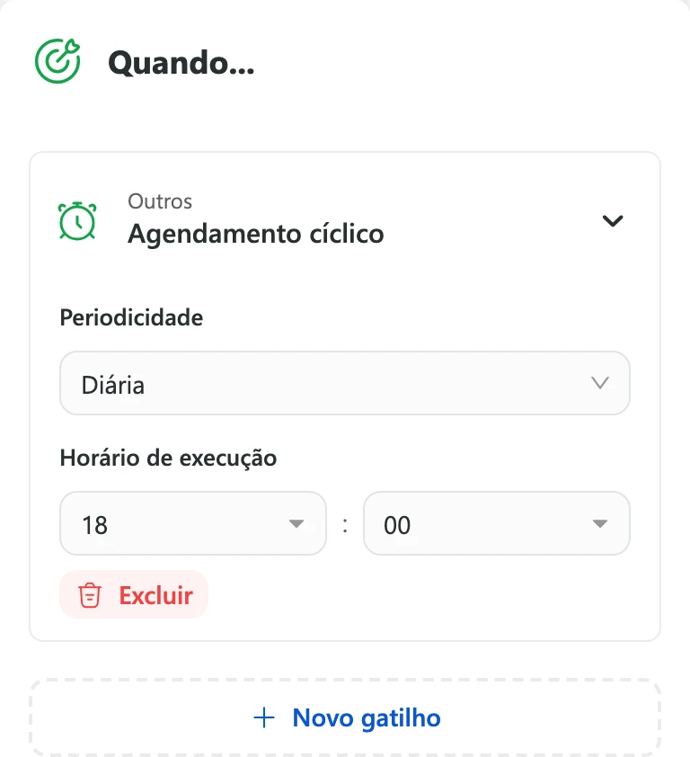
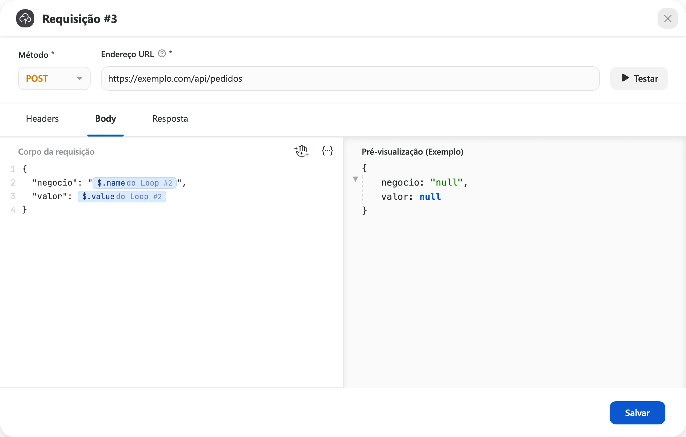
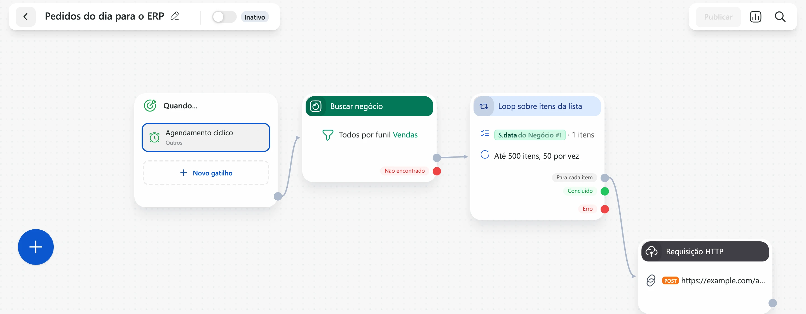

Consulte aqui os 4 gatilhos e todas as ações disponíveis nos cenários da Kinbox, com o que cada item faz, o que configurar e quais saídas extras oferece.

<Note>
  Ver, criar e editar cenários exige a permissão **Cenários** (ou ser o proprietário). Um cenário só roda quando está **ligado e publicado** — no editor, o interruptor só vale depois de clicar em **Publicar**; na lista, grava na hora.
</Note>

## Gatilhos

No cartão **Quando...**, clique em **Novo gatilho** para abrir a janela **Começar o cenário quando...**, que traz busca e lista os gatilhos com o rótulo da categoria de cada um (**Outros**, **Campanha**, **Conversa**). O mesmo cartão aceita um gatilho de cada tipo, e qualquer um deles inicia a execução. Escolher de novo um tipo que já está no cartão substitui a configuração anterior desse gatilho. Para remover um gatilho, clique em **Excluir** no painel dele.

| Gatilho | Categoria | Quando começa | O que configurar |
| --- | --- | --- | --- |
| **Webhook recebido** | Outros | Quando outro sistema envia dados com **POST** e corpo em JSON para o **Endereço Url**. | Copiar o **Endereço Url** e usar **Determinar estrutura** ([ver guia](/docs/cenarios/integrar-via-webhook-com-cenarios)). |
| **Mensagem de campanha enviada** | Campanha | A cada mensagem de [campanha](/docs/campanhas/campanhas-no-kinbox) enviada pelo canal escolhido. | Selecionar o canal (obrigatório). |
| **Nova Sessão** | Conversa | A cada [sessão nova](/docs/conceitos/conversas-e-sessoes) nos canais escolhidos (ou em todos, se você não escolher nenhum). | **Canais** (vários; deixe vazio para **Todos os canais**). |
| **Agendamento cíclico** | Outros | No dia e horário definidos, repetindo na periodicidade escolhida. | **Periodicidade**, dia, **Horário de execução** ou **Expressão cron**. |

### Agendamento cíclico

- **Periodicidade**: **Diária** (padrão ao adicionar, às 09:00), **Semanal** (escolhe **Dia da semana**, de Domingo a Sábado), **Mensal** (escolhe **Dia do mês**, de 1 a 31) ou **Cron customizado**.
- **Horário de execução**: defina hora (`00` a `23`) e minuto (`00` a `59`).
- **Cron customizado**: preencha **Expressão cron** com 5 campos (`minuto hora dia-mês mês dia-semana`) e intervalo mínimo de 1 minuto — por exemplo, `*/15 * * * *`.
- O horário segue o [**Fuso horário**](/docs/configuracoes-no-workspace/configuracoes-gerais#preferências) do workspace, no cartão **Preferências** de **Configurações** → **Ambiente** → **Geral**.

<Frame caption="Painel do gatilho Agendamento cíclico configurado com periodicidade diária às 18:00">
  
</Frame>

## Como os passos se ligam

Para adicionar, ligar e configurar passos no editor, veja [Criar e publicar um cenário](/docs/cenarios/criar-um-cenario). Cada passo recebe um número (`#1`, `#2`…) usado nas referências dos passos seguintes (por exemplo, **Contato #1** ou **Loop #2**).

Alguns passos têm saídas extras (bolinha vermelha), listadas nas tabelas abaixo. Se a saída extra não estiver ligada a outro passo, o cenário para ali.

## Ações

### Conversa

Os passos **Buscar conversa**, **Criar conversa** e **Enviar mensagem** funcionam apenas em canais de [WhatsApp](/docs/canais/whatsapp/visao-geral). No WhatsApp oficial, **Enviar mensagem** aceita apenas um **Modelo de mensagem** (template aprovado).

| Ação | O que faz | O que configurar | Saídas extras |
| --- | --- | --- | --- |
| **Buscar conversa** | Localiza uma conversa pelo **ID** ou pelo contato no canal escolhido. | **Contato** (referência), **ID** (opcional) e **Canal** (obrigatório; só WhatsApp). | **Não encontrado** |
| **Criar conversa** | Cria uma conversa para o contato em um canal de WhatsApp. | **Contato** (obrigatório), **Canal** (obrigatório; só WhatsApp), **Atribuído**, **Grupo**, **Tags** e campos personalizados de sessão. | **Em caso de falha** |
| **Resolver conversa** | Encerra a sessão aberta da conversa. | **Conversa** (referência). | — |
| **Executar bot** | Inicia um bot na conversa (executa o bot mesmo que ele esteja desligado; veja [Criar e publicar um bot](/docs/bot/aprender-a-usar-o-bot)). | **Conversa**, **Bot** e **Opções** → **Reabrir conversa**. | — |
| **Enviar mensagem** | Envia uma mensagem na conversa (só canais de WhatsApp). | **Conversa** (obrigatória) e **Canal**. No WhatsApp oficial, escolha um [**Modelo de mensagem**](/docs/canais/whatsapp/whatsapp-templates/enviar-template) aprovado (**Cabeçalho**, **Corpo**, **Mídia** com **URL da mídia** e **Nome do arquivo**, e **Botões**). No WhatsApp por QR Code, informe a **Mensagem** em texto livre. | — |
| **Atribuir para membro** | Atribui a conversa a um membro ou a membros de um [grupo](/docs/configuracoes-no-workspace/criar-e-gerenciar-grupos). | **Conversa**, **Tipo** e **Condições de elegibilidade**. **Cíclico** faz rodízio entre os membros; **Cíclico com fila** põe a conversa numa fila até alguém ter vaga (o cenário segue para o próximo passo). | **Nenhum membro elegível** (exceto em **Cíclico com fila**) |

### Contato

| Ação | O que faz | O que configurar | Saídas extras |
| --- | --- | --- | --- |
| **Buscar contato** | Procura um contato pelos identificadores informados. | **ID**, **Celular** e/ou **E-mail**. | **Não encontrado** |
| **Criar contato** | Cria um contato; se já existir um contato com o mesmo telefone, reaproveita esse contato em vez de criar outro. | **Nome**, **Celular**, **E-mail**, **Notas** e campos personalizados do contato. | — |
| **Atualizar contato** | Altera os campos selecionados de um contato. | **Contato** (referência) e os campos em **Campos** → **Campo**. | — |

### Negócio

Os rótulos das ações usam "negócio" para as negociações dos [funis](/docs/crm/visao-geral).

| Ação | O que faz | O que configurar | Saídas extras |
| --- | --- | --- | --- |
| **Buscar negócio** | Localiza uma negociação ou lista negociações de um funil. | **Modo de busca**: **Um negócio** (por **ID**, **Contato** e/ou **Conversa**, com filtros) ou **Todos por funil** (**Funil** obrigatório; retorna até 500 negociações, as mais novas primeiro, para uso em **Loop sobre itens da lista**). | **Não encontrado** |
| **Criar negócio** | Cria uma nova negociação em um funil e etapa. | **Funil** e **Etapa** (obrigatórios), **Nome** ou **Contato**, **Produtos** e campos da negociação. | — |
| **Atualizar negócio** | Altera dados, etapa, tags, comentários ou produtos de uma negociação. | **Negócio** (referência), **Mudar etapa** e os campos a alterar. | — |

### Produto

As ações usam os produtos cadastrados em [Cadastrar produtos](/docs/crm/criar-e-gerenciar-produtos).

| Ação | O que faz | O que configurar | Saídas extras |
| --- | --- | --- | --- |
| **Buscar produto** | Localiza um produto cadastrado. | **ID** ou **ID Externo**. | **Não encontrado** |
| **Criar produto** | Cadastra um novo produto. | **Nome** (obrigatório), **ID Externo**, **Descrição** e **Preço**. | — |
| **Atualizar produto** | Altera dados de um produto cadastrado. | **Produto** (referência) e os campos a atualizar (**Nome**, **ID Externo**, **Preço** e campos personalizados; a **Descrição** não é alterada por este passo). | — |

### Controle

| Ação | O que faz | O que configurar | Saídas extras |
| --- | --- | --- | --- |
| **Requisição HTTP** | Chama um endereço externo e disponibiliza a resposta para os próximos passos. | **Método**, **Endereço URL**, **Headers** e **Body** (JSON). | — |
| **Esperar um tempo** | Pausa a execução pelo tempo escolhido (fica como **Aguardando** no **Analítico**). | **Duração**, **Unidade** (**Segundos**, **Minutos**, **Horas**, **Dias**) e **Considerar horários** (com um [horário cadastrado](/docs/configuracoes-no-workspace/criar-e-gerenciar-horarios), agendando para o próximo horário permitido se o fim da espera cair fora dele). | — |
| **Decisão** | Compara uma variável com um valor e escolhe um de dois caminhos. | **Campo** (variável), **Operador** e **Valor**. | **Sim** (saída principal) e **Não** |
| **Loop sobre itens da lista** | Roda os passos ligados em **Para cada item** uma vez para cada item de uma lista. | **Lista**, **Limite máximo de repetições**, **Tamanho do lote** e **Controle de paginação** (opcional). | **Para cada item** e **Concluído** |
| **Split** | Distribui as execuções igualmente entre as saídas ligadas, em ordem. | **Quantidade de saídas** (2 a 10). | Saídas **1**, **2**… até a quantidade escolhida |

#### Requisição HTTP

- Use um endereço `https://` (a tela orienta: "Apenas links https são permitidos"). Métodos: **POST** (padrão), **GET**, **PUT**, **PATCH** e **DELETE**.
- Configure cabeçalhos na aba **Headers** (**Chave** e **Valor**) e o corpo JSON na aba **Body** (**Corpo da requisição**, desabilitada em **GET** e **DELETE**), conferindo o formato em **Pré-visualização (Exemplo)**.
- Clique em **Testar** (ou em **Testar Requisição** na aba **Resposta**) antes de clicar em **Salvar**: a resposta do teste vira o exemplo dos campos que os passos seguintes podem escolher em `{...}`.

<Note>
  O botão **Testar** chama o sistema externo de verdade usando os valores de exemplo. No **Body**, o botão **Corrigir e formatar com IA** usa o [saldo da carteira](/docs/conceitos/saldo-e-creditos); o restante dos cenários não gasta saldo.
</Note>

<Frame caption="Janela Requisição HTTP configurada com método POST e variáveis do Loop no corpo JSON">
  
</Frame>

#### Loop sobre itens da lista

- Em **Lista**, clique em `{...}` e selecione o campo que contém a lista (como a saída de **Buscar negócio** em **Todos por funil** ou uma lista recebida por webhook). No quadro, o número ao lado da lista (como "· 1 itens") é a quantidade de itens do exemplo usado no editor, não da lista que a execução vai receber.
- Os passos ligados à saída **Para cada item** executam uma vez por item. Quando a lista termina, o fluxo continua pela saída **Concluído**.
- **Limite máximo de repetições**: de 1 a **1000** (padrão **300**). Se a lista tiver mais itens do que esse limite, a execução falha — ao combinar com **Buscar negócio** (**Todos por funil**, até 500 itens), aumente o limite.
- **Tamanho do lote**: de 1 a **500** (padrão **50**), indicando quantos itens são processados antes de salvar o progresso e continuar.
- **Controle de paginação** (opcional): campo com o cursor da próxima página quando a origem da lista é paginada.
- Se o Loop der erro, a execução aparece como **Falhou** no **Analítico**.

<Frame caption="Cenário Pedidos do dia para o ERP percorrendo as negociações do funil Vendas com o Loop sobre itens da lista">
  
</Frame>

#### Split

Escolha a **Quantidade de saídas** de **2 a 10**. As execuções são distribuídas igualmente entre as saídas ligadas, em ordem (`1`, `2`, `3`, `1`…), útil para testes A/B ou divisão de leads. Saídas sem caminho ligado não recebem execuções.

#### Decisão

Compara o **Campo** escolhido com o **Valor** e segue pela saída **Sim** ou **Não**. Operadores disponíveis:

- **é igual a**
- **não é igual a**
- **é maior que**
- **é menor que**
- **contém**
- **não contém**
- **é vazio**
- **não é vazio**
- **começa com**
- **não começa com**

## Veja também

- [Criar e publicar um cenário](/docs/cenarios/criar-um-cenario)
- [Receber dados de outro sistema por webhook](/docs/cenarios/integrar-via-webhook-com-cenarios)
- [Meu cenário não rodou](/docs/cenarios/problemas-comuns)
