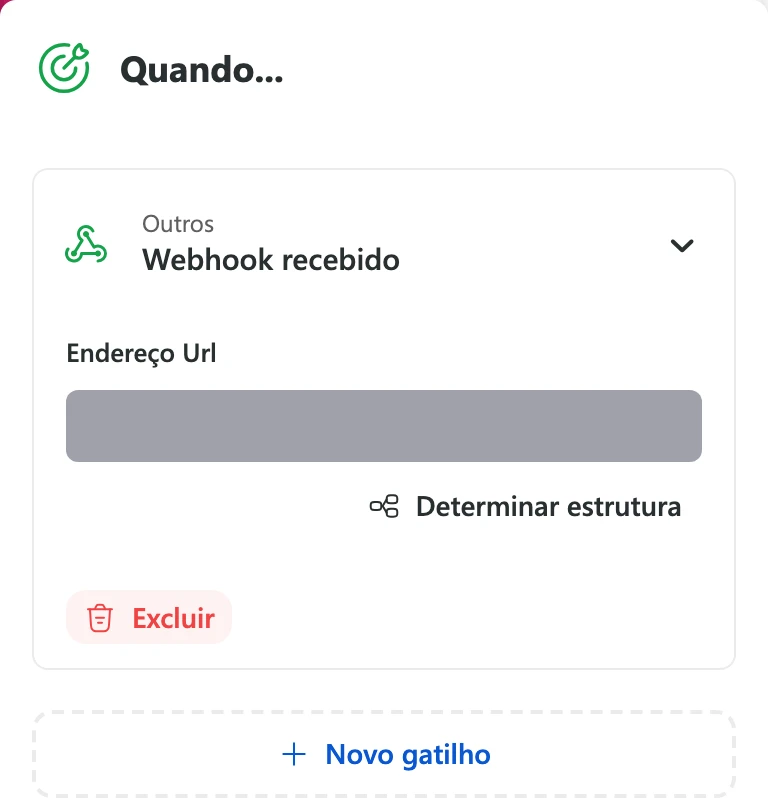
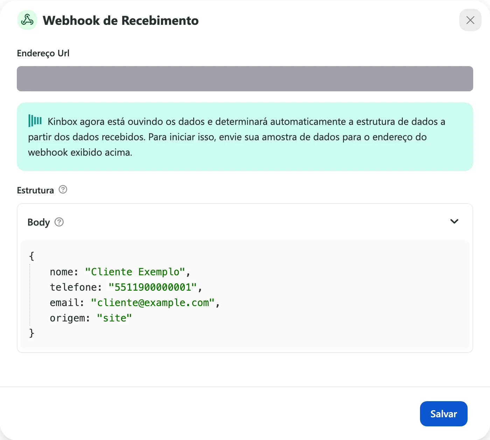
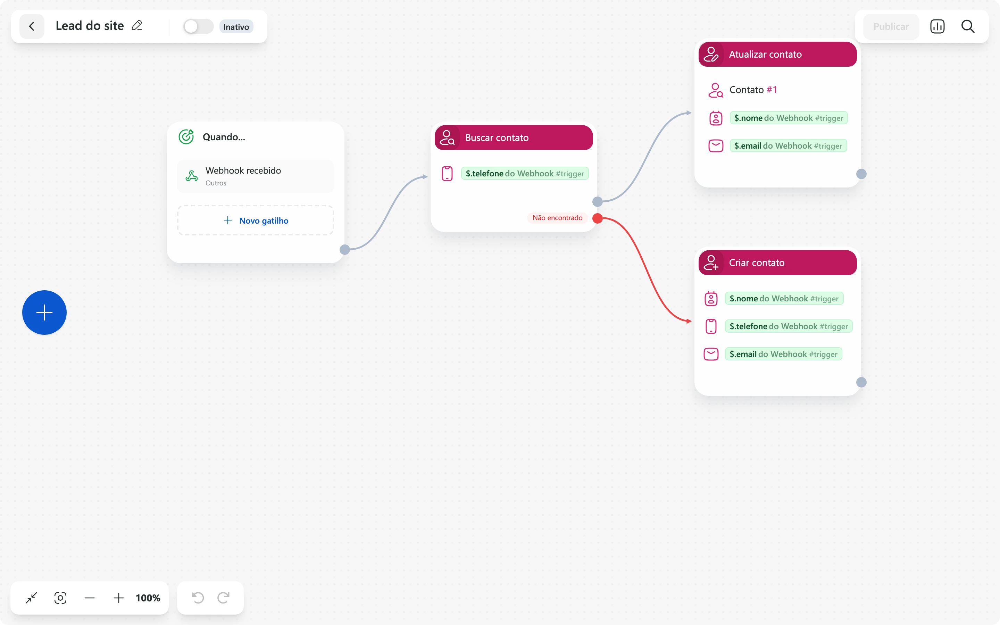

Use o gatilho **Webhook recebido** (categoria **Outros**) para que outro sistema — como um formulário do site, loja virtual, ERP ou ferramenta de automação — envie dados para o endereço do campo **Endereço Url**. Com esses dados, o cenário pode criar ou atualizar contatos, negociações, conversas e produtos na Kinbox.

Esse gatilho serve para **receber** dados de fora. A Kinbox não tem webhook de saída por evento; para **enviar** dados da Kinbox a outro sistema, use a ação **Requisição HTTP** em um cenário (veja [Gatilhos e ações dos cenários](/docs/cenarios/gatilhos-e-acoes)).

<Note>
  Ver, criar e editar cenários exige a permissão **Cenários** (ou ser o proprietário). Veja [Referência de permissões](/docs/administracao/referencia-de-permissoes).
</Note>

## Antes de começar

- Tenha a permissão **Cenários** (ou seja o proprietário do workspace) e use o computador (no celular, o editor não exibe **Publicar** nem **Analítico**).
- Tenha à mão o sistema que vai enviar os dados e um meio de disparar uma amostra (o próprio sistema, um formulário de teste ou uma ferramenta de requisições).

## Passo a passo

Este exemplo monta o cenário **Lead do site**, que recebe dados de um formulário e atualiza ou cria o contato na Kinbox.

<Steps>
  <Step title="Crie o cenário e adicione o gatilho">
    Vá em **Configurações** → **Automação** → **Cenários**, clique em **Novo Cenário** e dê um nome (por exemplo, **Lead do site**). No cartão **Quando...**, clique em **Novo gatilho** e escolha **Webhook recebido**.
  </Step>
  <Step title="Copie o Endereço Url">
    O painel do gatilho mostra o campo **Endereço Url** já preenchido, com botão de copiar. Cada gatilho **Webhook recebido** novo gera um endereço próprio.

    <Frame caption="Painel do gatilho Webhook recebido com o campo Endereço Url e o botão Determinar estrutura">
      
    </Frame>
  </Step>
  <Step title="Abra a janela para determinar a estrutura">
    Clique em **Determinar estrutura**. A janela **Webhook de Recebimento** abre exibindo o **Endereço Url**, o aviso de que a Kinbox está ouvindo os dados e, em **Estrutura**, o status "Aguardando recebimento de dados...".
  </Step>
  <Step title="Envie uma amostra com a janela aberta">
    Com a janela **Webhook de Recebimento** aberta, envie uma amostra de dados usando **POST** com corpo em JSON para o **Endereço Url**. A captura funciona mesmo antes de clicar em **Publicar**.
  </Step>
  <Step title="Confira os campos recebidos e salve">
    A amostra aparece em **Estrutura**, dividida em **Body** (dados do corpo) e/ou **Query** (parâmetros da URL). Clique em **Salvar** — o botão fica desabilitado até chegar uma amostra.

    <Frame caption="Janela Webhook de Recebimento com a estrutura capturada em Body">
      
    </Frame>
  </Step>
  <Step title="Monte os passos com as variáveis do webhook">
    Adicione os passos do cenário e clique em `{...}` nos campos de texto para escolher os campos capturados em **Webhook** → **Body** (por exemplo, `$.telefone`, que aparece como `$.telefone do Webhook #trigger`). A estrutura salva serve de exemplo para selecionar os campos.

    No exemplo **Lead do site**:
    - Ligue o gatilho a **Buscar contato** usando `$.telefone` no campo **Celular**.
    - Ligue a saída principal a **Atualizar contato** (**Contato #1**) para atualizar nome e e-mail.
    - Ligue a saída **Não encontrado** a **Criar contato** com nome, telefone e e-mail.

    <Frame caption="Cenário Lead do site usando os campos da amostra do webhook">
      
    </Frame>
  </Step>
  <Step title="Publique e ligue o cenário">
    Clique em **Publicar** para gravar o cenário. Depois, ative o interruptor no topo do editor e clique em **Publicar** novamente (o selo passa para **Live**), ou ative o interruptor na lista **Cenários** (que grava na hora). O cenário só começa a rodar quando está **ligado e publicado**.
  </Step>
  <Step title="Configure o sistema de origem e teste">
    Cadastre o **Endereço Url** no sistema que vai enviar os dados, faça um envio real e acompanhe o resultado em [Acompanhar as execuções no Analítico](/docs/cenarios/execucoes).
  </Step>
</Steps>

## O que o outro sistema precisa enviar

Envie uma requisição **POST** com o cabeçalho `Content-Type: application/json` e o corpo em **JSON**. Parâmetros na URL (como `?origem=site`) também chegam no grupo **Query**. Não é necessário enviar token nem cabeçalho de autenticação.

O endereço apenas confirma o recebimento; o resultado de cada passo aparece no **Analítico**.

Exemplo de envio com `curl` (substitua `SEU_ENDERECO_DO_WEBHOOK` pelo endereço copiado do campo **Endereço Url**):

```bash
curl -X POST "SEU_ENDERECO_DO_WEBHOOK" \
  -H "Content-Type: application/json" \
  -d '{"nome": "Cliente Exemplo", "telefone": "5511900000001", "email": "cliente@example.com", "origem": "site"}'
```

## Cuidados

<Note>
  **Trate o Endereço Url como um segredo.** Qualquer sistema que tenha esse endereço consegue iniciar o cenário. Não o publique em páginas públicas. Se o endereço vazar, exclua o gatilho **Webhook recebido**, adicione outro (que gera um endereço novo) e clique em **Publicar**. Para reforçar, você pode enviar um campo combinado no corpo (por exemplo, `"chave": "..."`) e conferi-lo logo no início com um passo **Decisão** (**é igual a**).
</Note>

<Warning>
  **Enviar amostra com o cenário ligado executa o fluxo.** Se você mandar uma amostra enquanto a janela **Webhook de Recebimento** está aberta e o cenário estiver ligado e publicado, o cenário também vai rodar com esses dados. Para definir ou atualizar a estrutura sem criar ou alterar registros, desligue o cenário antes.
</Warning>

- **Quando o endereço muda**: o **Endereço Url** muda se você excluir e recriar o gatilho, importar o cenário ou clonar o cenário (a cópia vem sem gatilho). Nesses casos, atualize o endereço no sistema de origem. Excluir o cenário desativa o endereço definitivamente.
- **Quando o formato dos dados muda**: se o sistema externo passar a enviar novos campos, abra **Determinar estrutura** novamente, envie uma nova amostra, clique em **Salvar** e depois em **Publicar**. Sem determinar a estrutura, os campos não aparecem para escolha nas variáveis.
- **Evite duplicar contatos**: prefira usar **Buscar contato** antes de **Criar contato**. O passo **Criar contato** já reaproveita um contato com o mesmo telefone, mas buscar antes permite atualizar os dados do contato existente.

## Veja também

- Para receber leads do RD Station Marketing, existe uma integração própria que não precisa de cenário: veja [Receber leads do RD Station Marketing por webhook](/docs/integracoes/rdstation-marketing-webhook).
- [Acompanhar as execuções no Analítico](/docs/cenarios/execucoes)
- [Meu cenário não rodou](/docs/cenarios/problemas-comuns)
- [Gatilhos e ações dos cenários](/docs/cenarios/gatilhos-e-acoes)
- [Contatos, organizações e negociações](/docs/conceitos/contatos-e-negocios)
