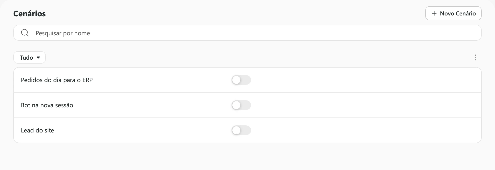

Um cenário é um fluxo de passos que começa sozinho quando algo acontece — outro sistema envia dados, uma campanha envia uma mensagem, começa uma sessão nova ou chega o horário marcado — e executa ações em contatos, conversas, negociações e produtos, ou chama outro sistema.

<Note>
  Ver, criar e editar cenários exige a permissão **Cenários** (ou ser o proprietário). Veja [Referência de permissões](/docs/administracao/referencia-de-permissoes). Os cenários não descontam [saldo da carteira](/docs/conceitos/saldo-e-creditos), exceto quando você usa o botão **Corrigir e formatar com IA** na **Requisição HTTP**.
</Note>

## Onde fica e quem pode

Os cenários ficam em **Configurações** → **Automação** → **Cenários**. O menu e a tela só aparecem para membros com a permissão **Cenários** ou para o proprietário do workspace.

Crie e edite cenários pelo computador, pois na tela do celular o editor não exibe os botões **Publicar** e **Analítico**.

<Frame caption="Lista de cenários em Configurações → Automação → Cenários">
  
</Frame>

## Como um cenário funciona

### Gatilhos

O gatilho (cartão **Quando...**) define o evento que inicia o cenário. Um cenário pode ter mais de um gatilho no mesmo cartão, e qualquer um deles começa a execução.

| Gatilho | Quando começa |
| --- | --- |
| **Webhook recebido** | Quando outro sistema envia dados com **POST** e corpo em JSON para o endereço do campo **Endereço Url**. |
| **Mensagem de campanha enviada** | A cada mensagem de [campanha](/docs/campanhas/campanhas-no-kinbox) enviada pelo canal escolhido. |
| **Nova Sessão** | Quando começa uma [sessão nova](/docs/conceitos/conversas-e-sessoes) numa conversa nos canais escolhidos (ou em todos os canais, se nenhum for escolhido). |
| **Agendamento cíclico** | No dia e horário escolhidos, de forma recorrente. |

Veja o que configurar em cada gatilho em [Gatilhos e ações dos cenários](/docs/cenarios/gatilhos-e-acoes).

### Passos e saídas

Os passos (ações) ficam ligados por caminhos em um quadro visual e estão divididos em grupos: conversa, contato, negociação (na tela, os rótulos dos passos usam **negócio**), produto e controle (**Requisição HTTP**, **Esperar um tempo**, **Decisão**, **Loop sobre itens da lista** e **Split**).

Alguns passos têm uma saída extra para tratar exceções — por exemplo, **Não encontrado** nas buscas ou **Em caso de falha** ao criar conversa.

### Variáveis

Os dados do gatilho e dos passos anteriores podem ser inseridos em outros campos pelo botão `{...}`. Assim, um passo usa diretamente informações como `$.telefone` vinda do webhook ou referências como **Contato #1**.

### Ligado e publicado

Um cenário só roda quando está **ligado e publicado**. No editor, o botão **Publicar** grava o nome, o gatilho, os passos e o interruptor do topo; ligar ou desligar pelo editor só passa a valer depois de clicar em **Publicar**, quando o selo ao lado passa a exibir **Live** (ou **Inativo**). Na lista **Cenários**, o interruptor da linha grava na hora e só aparece quando o cenário já tem pelo menos um gatilho.

### Execuções e operações

Cada vez que um cenário roda é uma execução. Você acompanha tudo no painel **Analítico**, que exibe filtros de até os **Últimos 30 dias** (o histórico fica guardado por 60 dias).

Cada execução conta **operações** — 1 ao começar e mais 1 a cada passo executado — apenas para acompanhar o tamanho das execuções, sem descontar [saldo da carteira](/docs/conceitos/saldo-e-creditos). Veja [Acompanhar as execuções no Analítico](/docs/cenarios/execucoes).

## Exemplos de uso

- **Lead do site**: receber dados de um formulário via webhook para buscar, atualizar ou criar o contato ([Receber dados de outro sistema por webhook](/docs/cenarios/integrar-via-webhook-com-cenarios)).
- **Pedidos do dia para o ERP**: no fim do dia, buscar as negociações de um funil com **Todos por funil**, percorrer a lista no **Loop sobre itens da lista** e enviar cada item por **Requisição HTTP** ([Gatilhos e ações dos cenários](/docs/cenarios/gatilhos-e-acoes)).
- **Bot na nova sessão**: iniciar um bot automaticamente a cada sessão nova de um canal com **Nova Sessão** e **Executar bot** — essa ação executa o bot mesmo desligado ([Criar e publicar um bot](/docs/bot/aprender-a-usar-o-bot)).
- **Teste A/B**: dividir leads entre dois caminhos usando o **Split** ([Gatilhos e ações dos cenários](/docs/cenarios/gatilhos-e-acoes)).

## Cenário, automação ou bot?

- **Automações**: regras do tipo "quando X, faça Y" configuradas em formulário para reagir a eventos dentro da Kinbox.
- **Cenários**: fluxos de vários passos com caminhos, variáveis, requisições HTTP e loops, voltados a integrar sistemas e tratar dados.
- **Bot**: conversa diretamente com o contato usando blocos de mensagens, menus e perguntas.

Para comparar todas as ferramentas, veja [Bot, automações, cenários e agentes de IA: qual usar](/docs/conceitos/automacao-e-ia).

## O que os cenários não fazem

- **Execução manual**: um cenário só começa quando um de seus gatilhos acontece; não existe botão para dispará-lo manualmente.
- **Webhook de saída por evento**: não há um cadastro de webhook de saída para avisar sobre eventos da Kinbox. Para enviar dados a outro sistema, monte um cenário com o passo **Requisição HTTP**.
- **Interromper execuções em andamento**: não dá para interromper uma execução que já começou. Desligar o cenário impede novas execuções, mas não interrompe as que já estão rodando ou aguardando.

Além da tela da Kinbox, um assistente de IA externo também pode ler, criar e editar cenários pelo [MCP](/docs/desenvolvedor/mcp), com a mesma permissão **Cenários**.

## Próximos passos

<CardGroup cols={2}>
  <Card title="Criar e publicar um cenário" href="/docs/cenarios/criar-um-cenario">
    Passo a passo para montar, publicar, ligar, clonar, exportar e importar cenários.
  </Card>
  <Card title="Receber dados por webhook" href="/docs/cenarios/integrar-via-webhook-com-cenarios">
    Configure o gatilho Webhook recebido e mapeie os campos recebidos de outro sistema.
  </Card>
  <Card title="Gatilhos e ações dos cenários" href="/docs/cenarios/gatilhos-e-acoes">
    Consulte os 4 gatilhos e todas as ações disponíveis no editor.
  </Card>
  <Card title="Acompanhar as execuções" href="/docs/cenarios/execucoes">
    Veja status, detalhes de cada passo e como exportar o histórico no Analítico.
  </Card>
  <Card title="Meu cenário não rodou" href="/docs/cenarios/problemas-comuns">
    Descubra por que um cenário não começou, parou no meio ou falhou.
  </Card>
</CardGroup>
