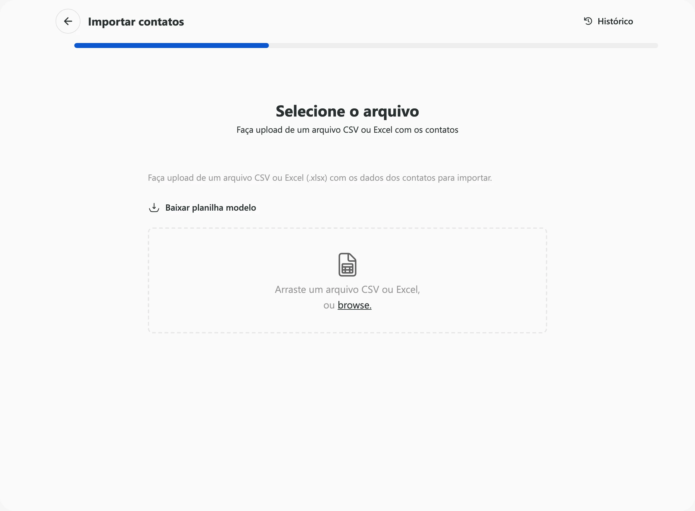
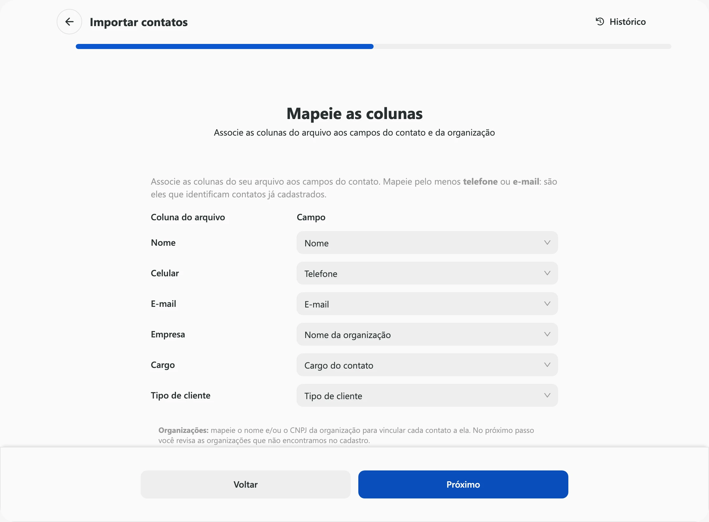
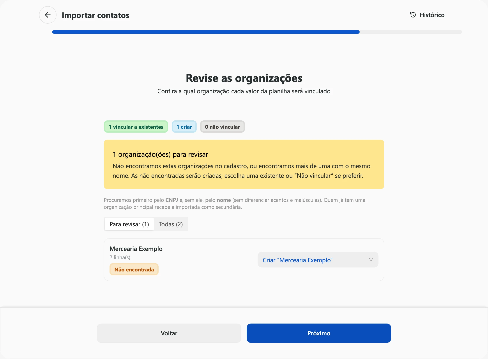
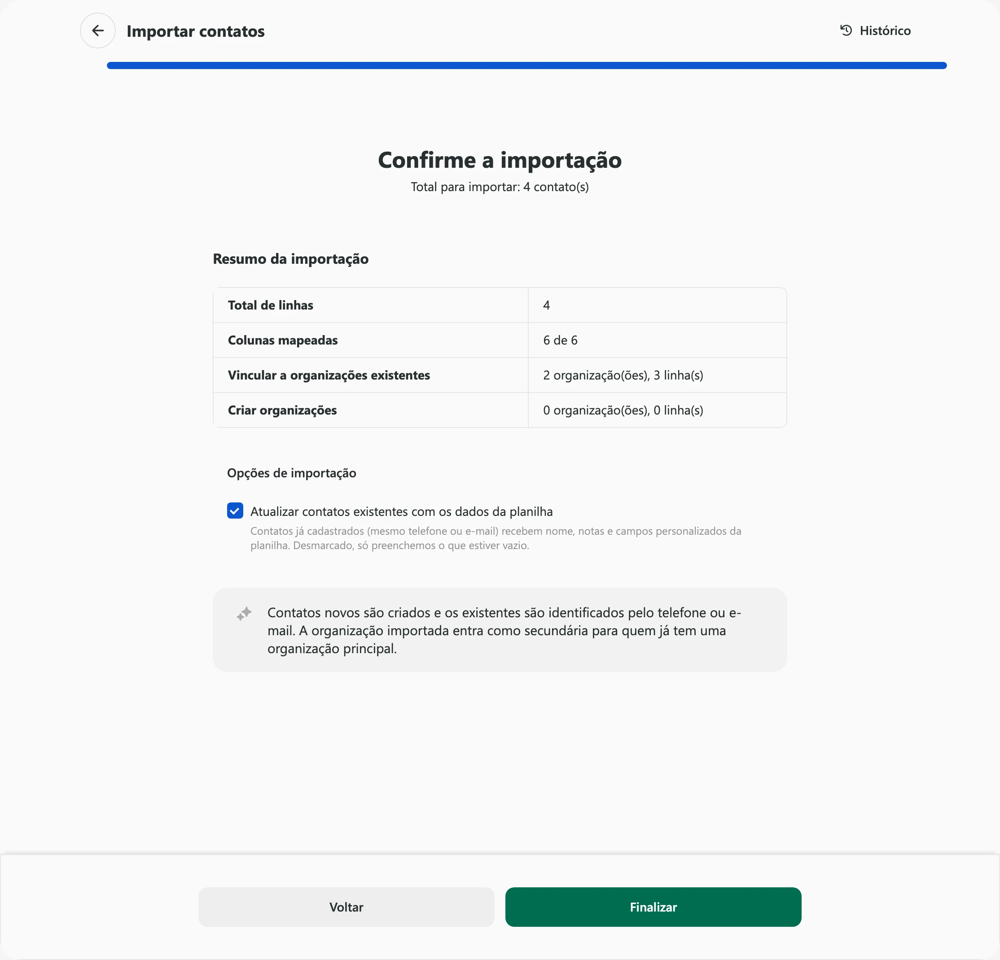

Importe uma planilha CSV ou Excel (`.xlsx`) para cadastrar vários contatos de uma vez, atualizar dados de contatos já existentes e vinculá-los a organizações.

<Note>
  Quem pode: membros com a permissão **Gerenciar Contatos** ou o proprietário do workspace. Se o item **Clientes** não aparecer no menu lateral, peça ao proprietário para dar **Gerenciar Contatos** ao seu papel (veja [Criar papéis e permissões](/docs/configuracoes-no-workspace/configurar-permissoes-dos-usuarios)). Para vincular ou criar organizações durante a importação, também é necessário ter **Gerenciar Organizações** — sem ela, os campos de organização não aparecem no mapeamento, a planilha modelo sai sem essas colunas e o passo de revisão de organizações é omitido.
</Note>

## Antes de começar: prepare a planilha

- **Formato e tamanho:** arquivo `.csv` (separado por vírgula ou ponto e vírgula, em UTF-8) ou Excel `.xlsx` de até **10 MB**. No Excel, a Kinbox lê apenas a **primeira aba**.
- **Cabeçalho:** coloque o nome de cada coluna na **primeira linha**. Colunas sem cabeçalho e linhas vazias são ignoradas.
- **Identificação obrigatória:** cada linha precisa ter ao menos **telefone** ou **e-mail** — são eles que identificam contatos já cadastrados.
- **Telefones:** números de outro país devem começar com `+` e o código do país. Números do Brasil podem ir com ou sem o `55` (por exemplo, `+55 11 90000-0001` ou `11 90000-0001`).
- **Números longos no Excel:** formate as colunas de **telefone** e **CNPJ** como **texto** para evitar que o Excel converta os números em notação científica e apague os últimos dígitos (ou envie o arquivo em `.xlsx`).
- **Campos personalizados:** a importação grava o texto da célula como está, sem conferir formato nem lista de opções. Use exatamente as opções cadastradas nos campos de seleção e o formato de data ou número que a tela usa (veja [Tipos de campo e validações](/docs/clientes/tipos-de-campo)).
- **Planilha modelo:** no primeiro passo da tela, clique em **Baixar planilha modelo** para baixar um `.csv` com as colunas prontas (**Nome**, **Telefone**, **E-mail**, **Notas**, seus campos personalizados de contato e, com **Gerenciar Organizações**, **Organização**, **CNPJ** e **Cargo**).

## Passo a passo

<Steps>
  <Step title="Selecione o arquivo">
    Vá em **Clientes** → **Contatos**, clique no menu **⋯** e escolha **Importar contatos** (na visão em tabela, **Importar**).

    Arraste o arquivo CSV ou `.xlsx` para a área de envio ou clique para escolhê-lo no computador. A tela exibe a prévia das primeiras linhas e o total de colunas encontradas. Clique em **Próximo**.

    <Frame caption="Passo Selecione o arquivo com Baixar planilha modelo e área de envio">
      
    </Frame>
  </Step>

  <Step title="Mapeie as colunas">
    Associe cada coluna da planilha a um campo da Kinbox na coluna **Campo** (ou mantenha **Não importar**). A Kinbox reconhece sozinha cabeçalhos comuns como "Nome", "Celular", "E-mail", "Empresa", "CNPJ" e "Cargo", além dos nomes e chaves dos seus campos personalizados.

    - Mapeie ao menos a coluna de **Telefone** ou de **E-mail** para liberar o botão **Próximo**.
    - Se aparecer o aviso de números longos em notação científica, volte à planilha, formate a coluna como texto e envie novamente (ou use `.xlsx`), porque essas linhas dão erro.
    - Para vincular organizações (com **Gerenciar Organizações**), mapeie **Nome da organização** ou **CNPJ**. Sem um dos dois, as demais colunas da organização (como **Cargo do contato**, **Site** ou **Segmento**) são ignoradas.

    Clique em **Próximo**.

    <Frame caption="Passo Mapeie as colunas com colunas da planilha associadas aos campos da Kinbox">
      
    </Frame>
  </Step>

  <Step title="Revise as organizações">
    Este passo aparece apenas quando você mapeia o nome ou o CNPJ da organização (e tem **Gerenciar Organizações**).

    A Kinbox procura organizações já cadastradas primeiro pelo CNPJ e, sem ele, pelo nome ou razão social (sem diferenciar acentos nem maiúsculas). Use as abas **Para revisar** e **Todas** para escolher a ação de cada empresa:

    - vincular a uma organização existente (quando há mais de uma com o mesmo nome, a Kinbox sugere a mais antiga);
    - criar uma nova organização (**Criar “...”**);
    - selecionar **Não vincular** (ação padrão quando a planilha traz apenas CNPJ sem nome e a empresa não é encontrada).

    Organizações já existentes não têm seus dados alterados pela planilha, e a empresa importada entra como secundária para contatos que já têm uma organização principal. Clique em **Próximo**.

    <Frame caption="Passo Revise as organizações mostrando empresas existentes a vincular e novas a criar">
      
    </Frame>
  </Step>

  <Step title="Confirme a importação">
    Confira o **Resumo da importação** (total de linhas, colunas mapeadas, organizações a vincular ou criar e colunas não mapeadas que serão ignoradas).

    Em **Opções de importação**, escolha se deixa marcada **Atualizar contatos existentes com os dados da planilha** (vem marcada por padrão) e clique em **Finalizar**.

    <Frame caption="Passo Confirme a importação com resumo, opção de atualizar contatos existentes e botão Finalizar">
      
    </Frame>
  </Step>
</Steps>

## Contatos que já existem

A Kinbox reconhece que um contato já existe quando a linha traz o mesmo telefone (com ou sem o `55` e o nono dígito) ou o mesmo e-mail (sem diferenciar maiúsculas). Veja o efeito da opção **Atualizar contatos existentes com os dados da planilha**:

| Dado na planilha | Opção marcada (padrão) | Opção desmarcada |
| --- | --- | --- |
| **Nome**, **Notas** e **Campos personalizados** | Substitui os dados atuais pelos valores preenchidos na planilha. | Preenche apenas o que estiver vazio no contato. |
| **Telefone** e **E-mail** | Nunca são trocados (só são preenchidos se estiverem vazios). | Nunca são trocados (só são preenchidos se estiverem vazios). |
| **Célula vazia** | Nunca apaga um dado já salvo no contato. | Nunca apaga um dado já salvo no contato. |
| **Organização** | Vincula a organização (como secundária se já houver principal); se o contato já estiver nela, o cargo não muda. | Vincula a organização (como secundária se já houver principal); se o contato já estiver nela, o cargo não muda. |

Os contatos novos criados pela planilha aparecem como vindos da importação (sem **Criado por**). A importação não envia mensagens nem cria conversas — para falar com uma lista de contatos de uma vez, veja [Criar uma campanha](/docs/campanhas/campanhas-no-kinbox).

## Acompanhar e cancelar

Ao clicar em **Finalizar**, abre a janela "Importando contatos..." com a barra de progresso e os contadores **Contatos criados**, **Contatos existentes**, **Organizações criadas**, **Vínculos com organizações** e **Erros**.

- Você pode fechar a tela enquanto a importação roda e acompanhar o andamento pelo **Histórico**.
- Clicar em **Cancelar importação** interrompe os próximos lotes, mas mantém os contatos e organizações que já entraram (não há como desfazer uma importação).

## Histórico e erros

No topo da tela **Importar contatos**, clique em **Histórico** para ver o **Histórico de importações** do workspace, com **Arquivo**, **Status** (**Concluído**, **Processando**, **Pendente**, **Falhou** ou **Cancelado**), **Data**, **Linhas**, **Criados** e **Erros**.

Clique em uma importação para abrir **Detalhes da importação**, com a aba **Resumo** e a aba **Erros** (mostra o número aproximado da linha na planilha, o erro e os dados da linha). Os três motivos mais comuns de erro por linha são:

- **Telefone ou CNPJ em notação científica:** formate a coluna como texto na planilha e exporte novamente (ou envie em `.xlsx`).
- **Telefone inválido** (sem e-mail na linha): confira o código do país, o DDD e se o número tem ao menos 8 dígitos.
- **Linha sem telefone ou e-mail:** preencha ao menos um dos dois dados.

Para corrigir, ajuste apenas as linhas com erro em um novo arquivo e importe somente elas — se você reenviar a planilha inteira, os contatos que já entraram serão tratados como contatos existentes.

Para importar contatos da agenda do seu telefone, use o app da Kinbox para celular.

Veja também [Agrupar contatos em organizações](/docs/clientes/organizacoes), [Criar campos personalizados](/docs/configuracoes-no-workspace/campos-personalizados-no-kinbox) e [Exportar contatos](/docs/clientes/exportar-contatos).
