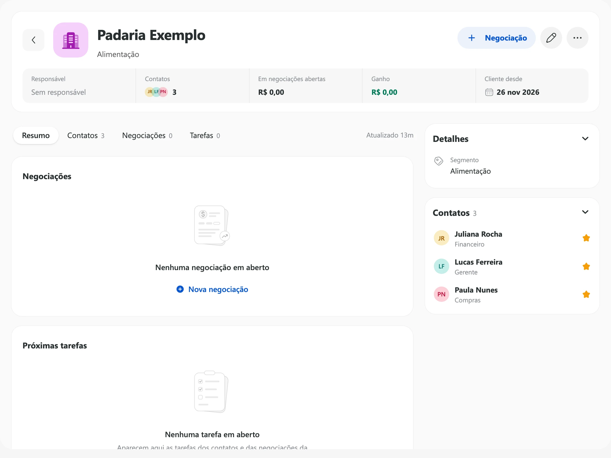

Cadastre organizações para agrupar contatos que trabalham na mesma empresa, registrar cargos e acompanhar os dados da empresa em um só perfil. Para entender como contatos, organizações e negociações se conectam, veja [Contatos, organizações e negociações](/docs/conceitos/contatos-e-negocios).

<Note>
  Quem pode: membros com a permissão **Gerenciar Organizações** ou o proprietário do workspace. Se o item **Clientes** ou a seção **Organizações** não aparecer no menu lateral, peça ao proprietário para dar **Gerenciar Organizações** ao seu papel (veja [Criar papéis e permissões](/docs/configuracoes-no-workspace/configurar-permissoes-dos-usuarios)). Sem essa permissão, os vínculos no perfil do contato aparecem apenas para leitura.
</Note>

## A lista de organizações

Vá em **Clientes** → **Organizações**. No topo aparecem o total de organizações, o botão **Nova organização** e o menu **⋯** para [exportar organizações](/docs/clientes/exportar-contatos).

- **Busca:** digite no campo "Nome, razão social, CNPJ ou ID" e aperte **Enter**.
- **Filtros:** filtre por **Segmento** (**Todos**, **Nenhum segmento** ou um segmento cadastrado) e por **Responsável** (**Todos** ou um membro), com os botões **Limpar** e **Aplicar**.
- **Colunas:** **Organização** (nome, razão social e CNPJ), **Segmento**, **Cidade**, **Contatos** (quantidade de contatos vinculados) e **Resp.** (responsável pela conta). No menu de cada linha há **Abrir** e **Excluir**.

## Criar uma organização

<Steps>
  <Step title="Abra o painel Nova organização">
    Em **Clientes** → **Organizações**, clique em **Nova organização**.
  </Step>

  <Step title="Informe o nome da organização">
    Preencha **Nome da organização** (único campo obrigatório, até 256 caracteres). Se quiser, envie uma imagem em **Adicionar logo** (até 2 MB).
  </Step>

  <Step title="Preencha os dados opcionais">
    Complete as seções que fizerem sentido para a sua operação:

    - **Empresa:** **CNPJ** (recebe máscara ao digitar; se os dígitos não baterem, surge o aviso "CNPJ parece inválido, confira os dígitos.", mas não impede salvar), **Site**, **Razão social**, **Segmento** (selecione um já usado ou clique em **Outro** para digitar) e **Responsável**.
    - **Contato:** **Telefone** (por exemplo, `+55 11 90000-0001`) e **E-mail** (por exemplo, `contato@example.com`).
    - **Endereço:** **CEP**, **Logradouro**, **Número**, **Complemento**, **Bairro**, **Cidade**, **Estado** e **País**.
    - **Descrição:** contexto sobre a empresa.
  </Step>

  <Step title="Vincule contatos e preencha campos personalizados">
    Em **Contatos**, busque contatos existentes para vincular na criação e informe o **Cargo** de cada um (se for a primeira organização do contato, ela vira a principal). Preencha também os [campos personalizados](/docs/configuracoes-no-workspace/campos-personalizados-no-kinbox) da entidade **Organização** (com mais de 4 campos vazios, eles ficam recolhidos em **Mostrar ... campos vazios**).
  </Step>

  <Step title="Salve a organização">
    Clique em **Salvar**. O perfil da organização abre em seguida.
  </Step>
</Steps>

<Tip>
  Ao sair dos campos **CNPJ** ou **Site**, a Kinbox verifica se já existe cadastro com o mesmo CNPJ ou domínio e mostra "Encontramos organizações com o mesmo CNPJ ou domínio", com link para cada uma (inclusive se estiver excluída). Abra a organização existente em vez de criar uma empresa duplicada.
</Tip>

## O perfil da organização

O cabeçalho mostra logo, nome e segmento (quando houver) e os botões **Negociação** (cria uma negociação para a organização, se você tem acesso aos funis; veja [Trabalhar com negociações no funil](/docs/crm/gerenciando-funil-de-vendas)), enviar e-mail (quando a organização tem e-mail), **Editar** e **⋯** (**Excluir**).

Logo abaixo, a faixa de números exibe **Responsável**, **Contatos**, **Em negociações abertas**, **Ganho** e **Cliente desde**. As abas mostram **Resumo** (negociações e **Próximas tarefas** dos contatos e negociações da organização), **Contatos**, **Negociações** e **Tarefas**. No painel lateral ficam **Detalhes**, **Campos personalizados** (quando houver) e **Contatos**.

<Frame caption="Perfil da organização com faixa de resumo, abas e contatos vinculados com cargo e estrela de principal">
  
</Frame>

## Vincular contatos

Um contato pode estar vinculado a várias organizações. Com **Gerenciar Organizações**, você cria vínculos de quatro maneiras:

- **Pelo contato** (formulário ou perfil, em **Organizações**): clique em **Vincular organização**, busque uma empresa existente ou clique em **Criar “...”** para criar uma nova só com o nome, informe **Cargo nessa organização (opcional)** e clique em **Vincular** (ou **Criar e vincular**). Veja [Contatos: encontrar, cadastrar, editar e excluir](/docs/conversas/clientes-contatos-e-organizacoes).
- **Pela organização** (aba ou painel **Contatos**): clique em **Vincular contato** para escolher um contato já cadastrado ou em **Novo contato** para preencher **Nome do contato**, **Celular**, **E-mail** e **Cargo / função** e vincular na hora.
- **Ao criar a organização:** pela seção **Contatos** do formulário.
- **Por planilha:** mapeando o nome ou o CNPJ da organização em [Importar contatos de uma planilha](/docs/clientes/importar-contatos).

## Cargo e organização principal

A primeira organização vinculada a um contato vira a **organização principal** (indicada com uma estrela); as demais entram como secundárias. A organização principal é a que aparece na coluna **Organização** da lista de contatos, abaixo do nome do contato e na coluna **Organização** da [exportação de contatos](/docs/clientes/exportar-contatos) no modo **Contatos**.

No menu **⋯** de cada vínculo (no contato ou na organização), você pode:

- **Editar cargo** ou **Adicionar cargo**;
- **Tornar principal** (no contato) ou **Tornar organização principal do contato** (na organização);
- **Desvincular**.

## Desvincular um contato

Ao clicar em **Desvincular** no menu **⋯** do vínculo, a Kinbox confirma que o contato deixará de fazer parte da organização, mantendo os cadastros e as negociações.

Se a organização removida for a principal e o contato tiver outras organizações vinculadas, a janela pede que você escolha a nova organização principal (se nenhuma for escolhida, a mais antiga assume).

## Excluir e restaurar uma organização

Para excluir, abra o menu **⋯** na linha da lista ou no cabeçalho do perfil e clique em **Excluir**. A organização sai da listagem, deixa de aparecer nas buscas e não pode receber novos vínculos, mas os contatos vinculados e as negociações são preservados.

A exclusão pode ser desfeita (com **Gerenciar Organizações**). Como não há filtro de excluídas na lista, abra a organização excluída por um link — por exemplo, pelo aviso "Encontramos organizações com o mesmo CNPJ ou domínio" ao informar o mesmo CNPJ ou site em **Nova organização** (onde ela aparece marcada como "excluída") — e clique em **Restaurar**.
