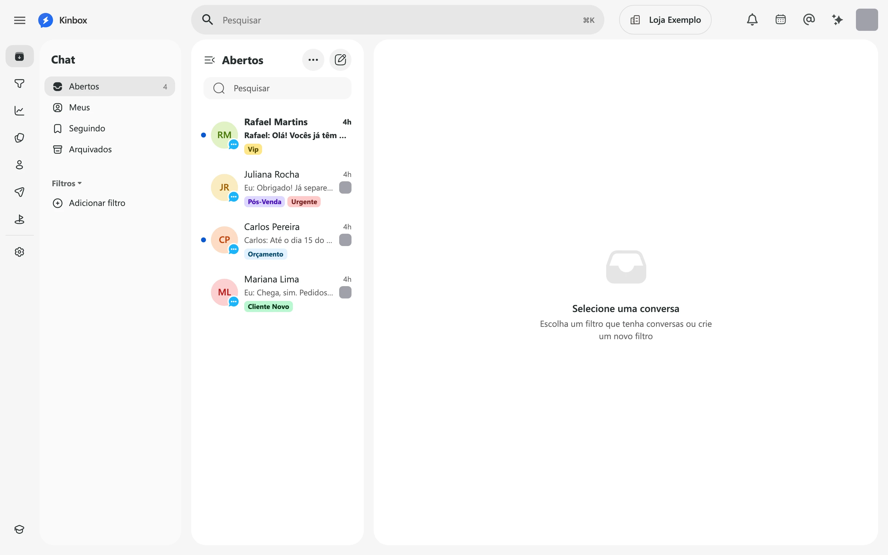

A Kinbox é uma plataforma de atendimento que reúne os canais de mensagem da sua empresa em uma única **Caixa de entrada**, junto com CRM, automações, inteligência artificial e relatórios.

## As peças da Kinbox

Cada parte da plataforma se liga ao atendimento:

- **Workspace** (na tela, **ambiente**): o espaço da sua empresa na Kinbox. Canais, membros, contatos, conversas, plano e saldo pertencem a um workspace. Veja [Workspace, membros e papéis](/docs/conceitos/workspace-membros-e-papeis).
- **Canais**: as contas de mensagem ligadas ao workspace, como WhatsApp, Instagram, Facebook, Telegram, e-mail, SMS e o chat do site. Veja [Canais: conectar e gerenciar](/docs/canais/visao-geral).
- **Contato e conversa**: quando alguém manda a primeira mensagem num canal, a Kinbox cria o contato e a conversa sozinha. Cada canal que o contato usa é uma conversa. Veja [Contatos, organizações e negociações](/docs/conceitos/contatos-e-negocios).
- **Caixa de entrada e sessão**: onde os membros atendem as conversas, separadas em visões como **Abertos**, **Meus**, **Seguindo** e **Arquivados**. Cada atendimento dentro da conversa é uma sessão, com protocolo próprio. Veja [Conversas, sessões e status](/docs/conceitos/conversas-e-sessoes).
- **Membros, grupos e papéis**: membros são as pessoas com acesso ao workspace. Eles ficam em grupos (como Vendas ou Suporte) e têm um papel de permissão que define o que cada um vê e faz. Veja [Workspace, membros e papéis](/docs/conceitos/workspace-membros-e-papeis).
- **Funis e negociações**: o CRM, onde você acompanha vendas ou processos em etapas. Cada negociação tem um contato e pode estar ligada a uma organização e a uma conversa. Veja [Contatos, organizações e negociações](/docs/conceitos/contatos-e-negocios).
- **Automação e IA**: bot, automações, cenários, agentes de IA e copiloto atendem contatos, executam regras, integram sistemas e ajudam o time. Veja [Bot, automações, cenários e agentes de IA: qual usar](/docs/conceitos/automacao-e-ia).
- **Relatórios**: os indicadores do workspace, para quem tem permissão.
- **Saldo**: recursos de inteligência artificial e ligações gastam o saldo em reais da carteira do workspace. Veja [Saldo da carteira e créditos: o que consome](/docs/conceitos/saldo-e-creditos).

<Frame caption="Tela da Kinbox: o botão do ambiente no topo, o menu lateral à esquerda, as visões da Caixa de entrada e a lista de conversas">
  
</Frame>

## Onde fica cada coisa

O menu lateral, à esquerda, mostra só ícones: o nome aparece ao passar o mouse. Alguns itens só aparecem para quem tem a permissão.

| Para | Onde |
| --- | --- |
| Atender | **Caixa de entrada** |
| Vender e acompanhar clientes | **Funis**, **Clientes**, **Campanhas**, **Tarefas** e **Metas** |
| Medir | **Relatórios** |
| Configurar canais, equipe, automações e assinatura | **Configurações** |
| Trocar de workspace | Botão com o nome do ambiente, no topo da tela |
| Conversar com o time | **Salas**, no topo da tela (veja [Salas: o chat interno da equipe](/docs/salas/visao-geral)) |
| Aprender a usar | **Academia**, no rodapé do menu lateral |

## Explore os conceitos

Começando agora? Siga a trilha a partir de [Criar sua conta e o workspace](/docs/primeiros-passos/criar-seu-workspace-no-kinbox).

<CardGroup cols={2}>
  <Card title="Workspace, membros e papéis" href="/docs/conceitos/workspace-membros-e-papeis">
    O que é o workspace (ambiente), o proprietário, as licenças, os papéis de permissão e os grupos.
  </Card>
  <Card title="Conversas, sessões e status" href="/docs/conceitos/conversas-e-sessoes">
    A diferença entre conversa, sessão e protocolo e como funcionam os status da Caixa de entrada.
  </Card>
  <Card title="Contatos, organizações e negociações" href="/docs/conceitos/contatos-e-negocios">
    Como contatos, organizações, negociações, funis e etapas se ligam às conversas.
  </Card>
  <Card title="Bot, automações, cenários e agentes de IA" href="/docs/conceitos/automacao-e-ia">
    O que cada ferramenta faz e como escolher a opção certa para cada caso.
  </Card>
  <Card title="Saldo da carteira e créditos" href="/docs/conceitos/saldo-e-creditos">
    O que consome o saldo da carteira, o que usa créditos de SMS e o que acontece quando o saldo acaba.
  </Card>
  <Card title="Glossário" href="/docs/conceitos/glossario">
    Lista rápida dos termos usados na Kinbox e como eles aparecem na tela.
  </Card>
</CardGroup>
