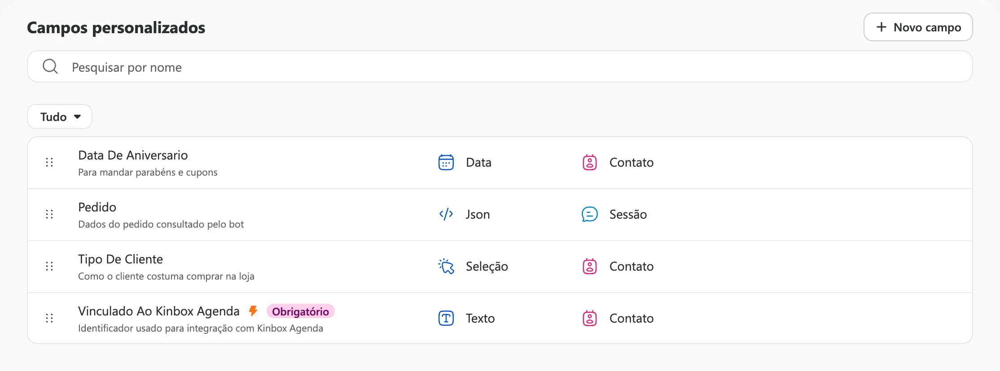
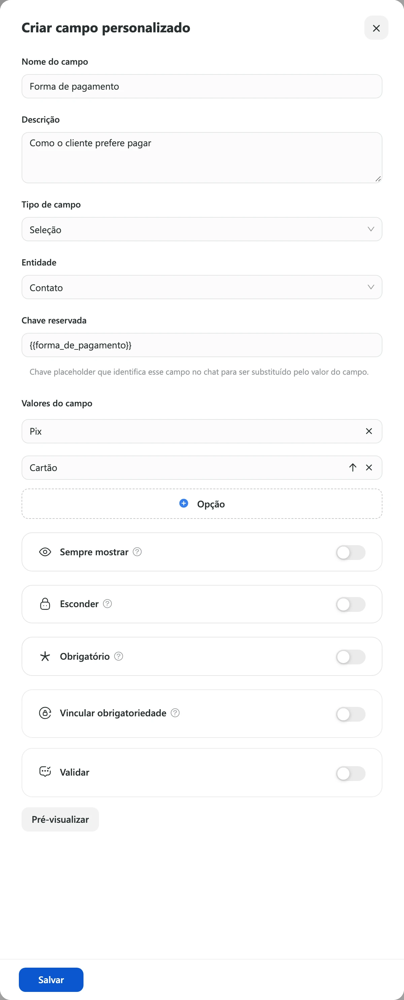

Crie campos personalizados para registrar informações que os campos padrão da Kinbox não cobrem, como CPF, número do pedido, tipo de cliente ou forma de pagamento.

<Note>
  Quem pode: membros com a permissão **Campos** (seção **Gerenciamento do Ambiente**) ou o proprietário do workspace (na tela, **ambiente**). Nos papéis padrão, **Supervisor** e **Administrador** têm essa permissão e **Atendente** não. Veja [Criar papéis e permissões](/docs/configuracoes-no-workspace/configurar-permissoes-dos-usuarios).
</Note>

<Frame caption="Lista de Campos personalizados em Configurações → Ambiente → Campos personalizados">
  
</Frame>

## Criar um campo

<Steps>
  <Step title="Abra Campos personalizados">
    Vá em **Configurações** → **Ambiente** → **Campos personalizados** e clique em **Novo campo** para abrir o painel **Criar campo personalizado**.
  </Step>

  <Step title="Configure nome, tipo, entidade e opções">
    Preencha as informações do campo:

    - **Nome do campo** (obrigatório, até 128 caracteres): use letras, números e espaços.
    - **Descrição** (opcional): explica o uso do campo para o time.
    - **Tipo de campo:** escolha o formato (**Texto**, **Texto em área**, **Seleção**, **Seleção Multipla**, **Booleano**, **Número**, **Decimal**, **Data**, **Data e hora** ou **Json**). Veja o que cada um faz em [Tipos de campo e validações](/docs/clientes/tipos-de-campo).
    - **Entidade:** escolha onde o campo aparece (**Contato**, **Sessão de conversa**, **Membro**, **Grupo**, **Canal**, **Produto**, **Organização**, **Negociação** ou **Tarefa**). **A entidade não pode ser trocada depois de criar.**
    - **Valores do campo** (aparece em **Seleção** e **Seleção Multipla**): clique em **Opção** para adicionar cada alternativa, reordene pelas setas ou remova pelo X. Quem preenche escolhe apenas entre as opções cadastradas.
    - **Opções extras:** ative **Sempre mostrar**, **Esconder**, **Obrigatório**, **Vincular obrigatoriedade** ou **Validar**, conforme disponíveis para a entidade escolhida.

    <Frame caption="Painel Criar campo personalizado preenchido com tipo Seleção, entidade Contato e chave reservada">
      
    </Frame>
  </Step>

  <Step title="Pré-visualize e salve">
    Se quiser conferir a aparência do campo antes de gravar, clique em **Pré-visualizar**. Depois, clique em **Salvar** (aparece o aviso "Campo Personalizado criado.").
  </Step>
</Steps>

<Note>
  Você pode alterar o **Tipo de campo** depois de criar, mas os valores já gravados não são convertidos. Troque o tipo apenas antes de começar a usar o campo.
</Note>

## A chave reservada

Ao criar o campo, a Kinbox gera automaticamente a **Chave reservada** a partir do nome — em minúsculas, sem acentos e com `_` no lugar de espaços e pontos, entre chaves (por exemplo, `Forma de pagamento` vira `{{forma_de_pagamento}}`).

- A chave é única no workspace inteiro (se já existir outra igual, aparece "Já existe um campo personalizado com esse chave reservada.") e **não muda** se você renomear o campo depois.
- A chave de um campo de **Contato** pode ser usada nas mensagens da conversa, em [frases rápidas](/docs/conversas/criar-frases-rapidas-para-suas-conversas) e no [bot](/docs/bot/blocos-do-bot) (para campos **Json**, veja [Usar um campo personalizado JSON no bot](/docs/bot/usar-campo-personalizado-em-json)).
- Campos de **Sessão de conversa** não são substituídos em mensagens enviadas manualmente pelo membro, e [campanhas](/docs/campanhas/campanhas-no-kinbox) não usam chaves de campos personalizados.

## Campo obrigatório para resolver a conversa

Nas entidades **Contato** e **Sessão de conversa**, você pode ativar **Obrigatório** ("Requerido para conseguir resolver uma conversa"):

- **Obrigatório sempre:** ative **Obrigatório**.
- **Obrigatório só em uma condição:** ligue **Vincular obrigatoriedade** e escolha outro **Campo** (de contato ou de sessão). O campo passa a ser obrigatório quando o outro campo estiver preenchido com qualquer valor — por exemplo, exigir "Motivo da troca" somente quando "Número do pedido" estiver preenchido.

Se um campo obrigatório estiver vazio quando o membro clicar em **Resolver** (em uma conversa ou em lote), a conversa não é encerrada, o painel lateral abre com o campo destacado e aparece "Campo obrigatório ... não foi setado.". Veja [Atender uma conversa: responder, notas, resolver e reabrir](/docs/conversas/gerenciar-conversas), [Ações em lote e exportar conversas](/docs/conversas/acoes-em-lote-e-exportar) e [Não consigo responder ou ver uma conversa](/docs/conversas/problemas-comuns).

A obrigatoriedade vale apenas para resolver a conversa e **não** impede salvar um contato em **Clientes** → **Contatos**.

Não combine **Obrigatório** com **Esconder**, pois o campo bloqueia a resolução sem aparecer no painel para ser preenchido. Nos campos de **Contato** com **Vincular obrigatoriedade**, ative também **Sempre mostrar** para que fiquem visíveis enquanto estiverem vazios.

## Mostrar ou esconder nos painéis

- **Sempre mostrar** (somente **Contato**): mantém o campo visível no painel **Contato** da conversa mesmo sem valor preenchido. Ativar **Sempre mostrar** desativa **Esconder**.
- **Esconder** (**Contato** e **Sessão de conversa**): oculta o campo nos painéis laterais da conversa.

## Editar, clonar, reordenar e excluir

Na tela **Campos personalizados**, use "Pesquisar por nome" e o filtro de entidade (**Tudo**, **Contato**, **Sessão**, **Membro**, **Grupo**, **Canal**, **Organização**, **Produto**, **Tarefa** ou **Negociação**) para localizar um campo.

- **Reordenar:** no computador, deixe o filtro em **Tudo** e a busca vazia, e arraste cada linha pela alça (`⋮⋮`). A ordem vale nos painéis da conversa e no perfil do contato.
- **Editar:** no menu **⋯** da linha, clique em **Editar** para mudar nome, descrição, tipo, opções e chaves (**Entidade** e **Chave reservada** não podem ser alteradas).
- **Clonar:** no menu **⋯**, clique em **Clonar** para abrir o formulário preenchido (inclusive permitindo escolher outra entidade). **Troque o nome antes de salvar** para gerar uma nova chave reservada.
- **Excluir:** no menu **⋯**, clique em **Excluir** e confirme em "Tem certeza que deseja excluir esse campo?".

<Warning>
  Excluir um campo personalizado apaga os valores dele nos contatos e não pode ser desfeito. Antes de excluir, confira se o campo é usado no bot, em automações, em frases rápidas ou em integrações.
</Warning>

## Campos de integrações

Campos criados por integrações aparecem com um ícone de "Integrado com outro sistema" e não podem ser editados nem excluídos ("Esse campo é usado por uma integração e não pode ser editado."). Campos do Kinbox Agenda permitem editar apenas a **Descrição** e não podem ser clonados nem excluídos.

## Onde os campos aparecem

- **Contato:** formulário e perfil do [contato](/docs/conversas/clientes-contatos-e-organizacoes), painel **Contato** na [Caixa de entrada](/docs/conversas/caixa-de-entrada-do-kinbox), colunas da tabela de contatos, [importação](/docs/clientes/importar-contatos), [exportação](/docs/clientes/exportar-contatos) e [formulário do widget](/docs/canais/widget/personalizar).
- **Sessão de conversa:** painel da [sessão](/docs/conceitos/conversas-e-sessoes) na conversa, filtros de [relatórios](/docs/relatorios/como-funcionam), exportação **Por conversa** e [formulário do widget](/docs/canais/widget/personalizar).
- **Organização:** formulário, perfil e importação de [organizações](/docs/clientes/organizacoes).
- **Outras entidades:** cadastros de **Membro**, **Grupo**, **Canal**, **Produto**, **Negociação** e **Tarefa**.
- **Automações e canais:** [blocos do bot](/docs/bot/blocos-do-bot) (incluindo [campos JSON](/docs/bot/usar-campo-personalizado-em-json)), [agentes de IA](/docs/agente-de-ia/ferramentas), automações, integrações e [links e API para desenvolvedores](/docs/desenvolvedor/visao-geral) (por exemplo, preencher campos do contato pelo link em [Abrir uma conversa por link](/docs/usando-o-kinbox/conversa-em-um-clique)).
