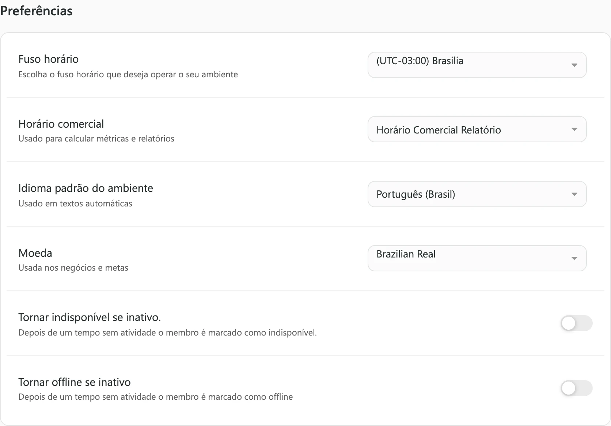

A tela **Geral** reúne as informações básicas, as preferências e as regras de atendimento do seu workspace (na tela, **ambiente**). Tudo o que você configura nesta tela vale para todos os membros do workspace.

<Note>
  Quem pode: você precisa da permissão **Workspace** na seção **Gerenciamento do Ambiente** do papel (na tela, **Permissão**) ou ser o proprietário do workspace (veja [Criar papéis e permissões](/docs/configuracoes-no-workspace/configurar-permissoes-dos-usuarios) e [Referência de permissões](/docs/administracao/referencia-de-permissoes)). O cartão **Admin** (**Excluir ambiente**) só aparece para o proprietário, e o cartão **Parceria** só aparece se o seu workspace for ligado a um parceiro que pode inspecioná-lo.
</Note>

## Onde fica

Vá em **Configurações** (ícone de engrenagem no menu lateral) → **Ambiente** → **Geral**. A tela abre com o título **Geral** e o cartão de apresentação **Seu ambiente**. Sem a permissão **Workspace**, o item **Geral** não aparece no menu.

## Como salvar

A tela salva as alterações de dois jeitos:

- **Imagem do ambiente** e **Nome do ambiente** salvam na hora, assim que você envia a imagem ou confirma a edição do nome.
- **Preferências**, **Caixa de Entrada** e **Parceria** mostram a barra com **Cancelar** e **Salvar mudanças** sempre que algum campo muda. Clique em **Salvar mudanças** para aplicar ("Suas preferências foram atualizadas.") ou em **Cancelar** para voltar aos valores salvos. Se você sair da tela sem salvar, as alterações são perdidas.

## Imagem e nome

| Campo | O que faz |
| --- | --- |
| **Imagem do ambiente** | Define o logo do workspace. Aceita arquivos de imagem de até 2 MB e salva na hora ("Imagem do ambiente alterada."). Clique em **Remover** para tirar a imagem; sem imagem, a Kinbox mostra as iniciais do nome. |
| **Nome do ambiente** | Nome exibido no [seletor de workspaces](/docs/conta/trocar-de-workspace) e exigido na confirmação de exclusão do workspace. Clique no ícone de lápis para editar na janela **Editar Nome do ambiente** (campo obrigatório; salva na hora com o aviso "Nome do ambiente editado."). |

## Preferências

| Campo | O que faz |
| --- | --- |
| **Fuso horário** | Define o fuso usado pelas regras do workspace: horários de atendimento, **Mensagem quando fora do horário comercial**, [bot](/docs/bot/visao-geral), automações, campanhas e limites de horário do papel. |
| **Horário comercial** | Escolhe um horário cadastrado em [Horários](/docs/configuracoes-no-workspace/criar-e-gerenciar-horarios) para o cálculo de TME, TMP e TMA nos [relatórios](/docs/relatorios/como-funcionam) e para a **Mensagem quando fora do horário comercial**. |
| **Idioma padrão do ambiente** | Idioma das notificações de quem não escolheu idioma no perfil (**Português (Brasil)** ou **English**). Não muda o idioma das telas (cada membro escolhe em [Editar seu perfil](/docs/configuracoes-no-workspace/configurar-o-perfil-do-usuario)) nem traduz as mensagens da **Caixa de Entrada**. |
| **Moeda** | Define o símbolo e o formato dos valores nas [negociações (funis)](/docs/crm/visao-geral) e [metas](/docs/metas/criando-metas-no-kinbox), sem converter valores já cadastrados (vazio usa real). O preço dos produtos continua em R$. |
| **Tornar indisponível se inativo.** | Define quantos minutos sem atividade em todas as abas da Kinbox deixam o membro indisponível (sugestão inicial de 30 minutos). Ao voltar a mexer, ele fica disponível de novo. Não age em quem ficou indisponível manualmente, em quem tem **Não torna indisponível se ficar inativo** nem no proprietário. |
| **Tornar offline se inativo** | Define quantos minutos (de 1 a 1444; vazio vale 60) sem atividade desconectam o membro por inatividade ("Você foi desconectado por inatividade." com **Reconectar**). Não age em quem tem **Não torna offline se ficar inativo** nem no proprietário. |

<Frame caption="Cartão Preferências em Configurações → Ambiente → Geral">
  
</Frame>

O **Fuso horário** vale para as regras do workspace. Se o campo estiver vazio (como na imagem acima, em que **Moeda** também está vazia e vale o real), a Kinbox usa o horário de Brasília (UTC−3) na maior parte das regras; escolha o fuso e clique em **Salvar mudanças** para evitar diferenças causadas pelo campo vazio. A hora mostrada na tela (mensagens, listas e Auditoria) segue o relógio e o fuso do computador ou celular de cada pessoa, não esse campo.

## Caixa de Entrada

O cartão **Caixa de Entrada** reúne as mensagens automáticas e as regras de atendimento. Veja como configurar cada opção em [Mensagens automáticas e regras da caixa de entrada](/docs/administracao/mensagens-automaticas).

| Opção | O que faz |
| --- | --- |
| **Mensagem ao resolver conversa** | Envia um texto automático quando uma sessão é resolvida. |
| **Mensagem quando fora do horário comercial** | Envia um texto automático quando o contato escreve fora do horário comercial. |
| **Mensagem quando membro indisponível** | Envia um texto automático quando o contato escreve e o responsável pela conversa está indisponível. |
| **Preservar tags ao resolver uma conversa** | Faz a próxima sessão da mesma conversa (o mesmo contato no mesmo canal) herdar as tags da sessão anterior. |
| **Enviar nome do membro em cada mensagem** | Mostra ao contato o nome do membro antes de cada mensagem que ele envia. |
| **Sempre atribuir ao membro que responder** | Transfere a conversa para quem enviar uma resposta, mesmo se já houver outro responsável. |
| **Desatribuir ao reabrir se membro offline** | Retira o responsável offline quando a sessão é reaberta. |
| **Nota de avaliação pública** | Mostra a média de avaliação de cada membro na lista de membros das **Salas**. |
| **Indicação dinâmica de conversa pendente** | Muda a cor do indicador da conversa pendente conforme o tempo sem resposta. |
| **Tempo de tolerância ao resolver conversa** | Reabre a mesma sessão, em vez de criar uma nova, se o contato responder logo depois de resolvida. |
| **Campos obrigatórios no chat ativo** | Exige campos preenchidos ao iniciar uma conversa pelo chat ativo. |

## Parceria

O cartão **Parceria** só aparece se o seu workspace for ligado a um parceiro que pode inspecioná-lo. Ele traz a opção **Permitir que o parceiro veja as conversas**; veja o que muda ao desligar em [Controlar o que o parceiro vê no seu workspace](/docs/administracao/acesso-do-parceiro).

## Admin

O cartão **Admin** só aparece para o proprietário do workspace e traz o botão **Excluir ambiente**. Veja o passo a passo e os cuidados antes de confirmar em [Excluir o workspace](/docs/administracao/excluir-workspace).

## Veja também

- [Definir os horários de atendimento](/docs/configuracoes-no-workspace/criar-e-gerenciar-horarios)
- [Ficar disponível ou indisponível](/docs/conta/disponibilidade)
- [Ver o histórico de alterações (Auditoria)](/docs/administracao/auditoria)
- [Workspace, membros e papéis](/docs/conceitos/workspace-membros-e-papeis)
