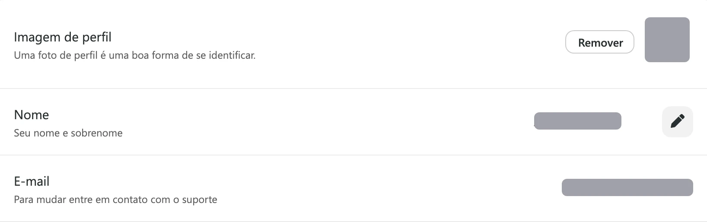

O **Perfil** guarda os seus dados pessoais e preferências na Kinbox, não as configurações do workspace (na tela, **ambiente**).

<Note>
  Quem pode: todo membro tem acesso ao próprio perfil, sem precisar de permissão. Com a restrição **Não pode mudar informação de perfil** no seu papel, aparece um aviso no topo da tela e você não edita foto, nome, celular, compartilhamento de conversas, senha nem verificação em duas etapas — **Idioma** e **Aparência** continuam livres. Essa restrição não vale para o proprietário. As restrições do papel ficam em [Criar papéis e permissões](/docs/configuracoes-no-workspace/configurar-permissoes-dos-usuarios).
</Note>

## Onde fica

Você abre a tela **Perfil** por dois caminhos:

- **Configurações** → **Perfil** (ícone de engrenagem no menu lateral).
- Sua foto, no canto superior direito → **Perfil**.

## O que vale para todos os workspaces e o que vale só para este

Se você participa de mais de um workspace (veja [Workspace, membros e papéis](/docs/conceitos/workspace-membros-e-papeis)), parte das opções do perfil acompanha sua conta e parte vale só no workspace aberto:

- **Valem para todos os workspaces:** foto, nome, celular, idioma e tema (além da senha, da verificação em duas etapas e dos sons de [Notificações](/docs/conta/notificacoes)).
- **Valem só para o workspace aberto:** compartilhamento de conversas e fundo das conversas (além da sua [disponibilidade](/docs/conta/disponibilidade) e das opções de **Push**).

## Foto, nome e celular

No cartão **Informações**, você atualiza seus dados pessoais. Se os botões de lápis não aparecerem, seu papel tem a restrição **Não pode mudar informação de perfil** — fale com quem administra o workspace.

- **Imagem de perfil:** clique na foto (ou arraste uma imagem) e escolha um arquivo de até 2 MB. Aparece "Foto de perfil alterada." Se o arquivo passar de 2 MB, a Kinbox mostra "Erro ao fazer upload. O tamanho máximo deve ser 2MB." Para voltar à inicial do seu nome, clique em **Remover**.
- **Nome:** clique no botão de lápis, preencha o campo obrigatório na janela **Editar Nome** e salve. Aparece "Nome editado."
- **Celular:** clique no botão de lápis, digite seu celular na janela **Editar Celular** e salve. Aparece "Celular editado."
- **E-mail:** não pode ser alterado pela tela (nem por quem administra o workspace). Para trocar o e-mail da conta, fale com o suporte.

<Frame caption="Cartão Informações na tela Perfil, com foto, nome, e-mail, celular e compartilhamento de conversas">
  
</Frame>

## Compartilhar suas conversas

O **Compartilhamento de conversas** vale só para o workspace aberto e deixa os colegas escolhidos verem e responderem às conversas atribuídas a você — útil no almoço ou em uma pausa. Se a linha não aparecer, seu papel tem a restrição **Não pode compartilhar conversa** ou **Não pode mudar informação de perfil**; fale com quem administra o workspace.

<Steps>
  <Step title="Abra o compartilhamento">
    Em **Configurações** → **Perfil**, no cartão **Informações**, clique no botão de lápis da linha **Compartilhamento de conversas**.
  </Step>
  <Step title="Escolha os colegas">
    Na janela **Editar Compartilhamento**, selecione os membros que podem cobrir seu atendimento e salve.
  </Step>
</Steps>

Quem recebe o compartilhamento vê suas conversas na visão **Compartilhados** da [Caixa de entrada](/docs/conversas/caixa-de-entrada-do-kinbox) e pode interagir com os contatos.

Para encerrar o compartilhamento, abra **Editar Compartilhamento** de novo, retire o membro da lista e salve.

## Senha e verificação em duas etapas

No cartão **Segurança**, você altera sua senha e ativa a verificação em duas etapas (2FA) para proteger o acesso em todos os workspaces.

Veja o passo a passo em [Trocar a senha, recuperar o acesso e sair da conta](/docs/conta/senha-e-sessoes) e [Ativar a verificação em duas etapas](/docs/conta/verificacao-em-duas-etapas).

## Idioma

No cartão **Preferências**, em **Idioma**, escolha **Automático** (segue o idioma do navegador), **Português (Brasil)** ou **English**. A alteração salva na hora e vale para todos os workspaces.

## Tema e fundo das conversas

No cartão **Aparência**, você escolhe o visual da interface e o fundo da área de atendimento:

- **Tema:** clique na miniatura do tema desejado (claro, azul ou escuro). A troca aplica na hora e vale para todos os workspaces.
- **Fundo das conversas:** em **Tipo de fundo**, escolha o fundo padrão, **WhatsApp** ou **Imagem**. Se escolher **Imagem**, envie um arquivo PNG ou JPEG de até 2 MB em **Imagem de fundo** e ajuste **Opacidade** e **Encaixe** (**Preencher**, **Conter** ou **Repetir**). Clique em **Salvar fundo** — aparece "Fundo de conversa atualizado." O fundo vale só para você no workspace aberto.

## Seu nome para o contato

Seu nome aparece para os colegas dentro do workspace. Para o contato no WhatsApp ou no Facebook, ele só aparece nas mensagens se o workspace tiver ligada a opção **Enviar nome do membro em cada mensagem**, em **Configurações** → **Ambiente** → **Geral**.
