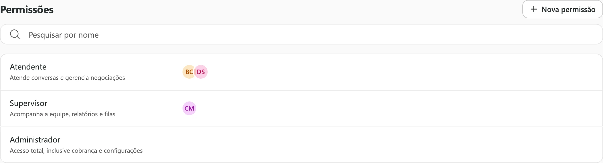
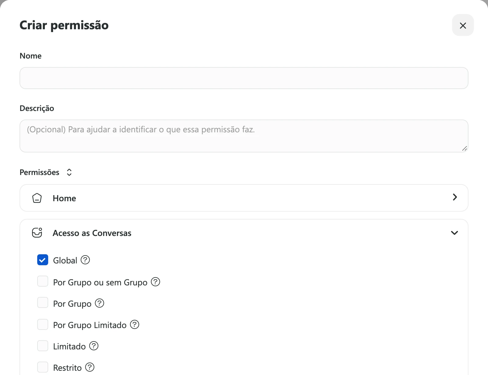

Crie papéis para controlar quais conversas, menus e ações do workspace (na tela, **ambiente**) cada membro pode usar. Nesta central, **papel** é o conjunto de permissões dado a um membro. Na tela, esse conjunto se chama **Permissão**.

<Note>Quem pode: o proprietário do workspace ou quem tem a permissão **Permissões** (em **Gerenciamento do Ambiente**). Se **Permissões** não aparecer em **Configurações** → **Ambiente**, peça ao administrador ou ao proprietário para liberar essa permissão.</Note>

## Papéis que já vêm prontos

Todo workspace novo vem com papéis prontos definidos pela Kinbox — em geral **Administrador**, **Supervisor** e **Atendente** — que você pode editar, clonar ou excluir quando não estiverem em uso.

| Papel | Descrição na tela | O que muda na prática |
| --- | --- | --- |
| **Administrador** | "Acesso total, inclusive cobrança e configurações" | Libera tudo o que o Supervisor tem, mais **Assinatura**, **Permissões**, **Auditoria**, **Agentes de IA**, **Automações**, **Base de conhecimento** e **Metas**. |
| **Supervisor** | "Acompanha a equipe, relatórios e filas" | Vê todas as conversas (**Global**), relatórios, canais, membros, grupos e a maior parte das configurações; não tem **Assinatura**, **Permissões**, **Auditoria**, **Agentes de IA**, **Automações**, **Base de conhecimento** nem **Metas**. |
| **Atendente** | "Atende conversas e gerencia negociações" | Vê conversas com **Por Grupo ou sem Grupo** e usa as ações de conversa, **Salas**, **Tags**, **Frases Rápidas**, **Filtros** e **Gerenciar negociações**; não tem relatórios, contatos, canais nem configurações do workspace. |

<Frame caption="Tela Permissões com os papéis prontos e o botão Nova permissão">
  
</Frame>

## Criar um papel

<Steps>
  <Step title="Abra a tela de permissões">
    Vá em **Configurações** (engrenagem no menu lateral) → **Ambiente** → **Permissões** e clique em **Nova permissão** para abrir o painel **Criar permissão**.
  </Step>
  <Step title="Preencha Nome e Descrição">
    Digite um **Nome** (obrigatório) e, se quiser, uma **Descrição** para ajudar a identificar o papel na lista.
  </Step>
  <Step title="Defina a tela inicial em Home (se aparecer)">
    A seção **Home** só aparece para o proprietário ou para quem tem **Gerenciar relatórios**. Quando ela aparece, você escolhe a primeira tela que o membro vê ao entrar: **Caixa de entrada** (padrão) ou **Dashboard** com um **Dashboard inicial** (para liberar **Dashboard**, marque antes **Gerenciar relatórios** no papel; ao entrar, o membro vê a versão mais recente salva desse dashboard).
  </Step>
  <Step title="Escolha o Acesso as Conversas">
    Abra **Acesso as Conversas** e marque uma das seis opções. Um papel novo começa marcado em **Global**.

    <Frame caption="Seção Acesso as Conversas no painel Criar permissão">
      
    </Frame>
  </Step>
  <Step title="Marque as opções das outras seções">
    Use o ícone ao lado de **Permissões** (dica **Expandir tudo**) ou abra cada seção (**Conversas**, **Negociações**, **Tarefas**, **Contatos**, **Relatórios**, **Canais**, **Gerenciamento do Ambiente**, **Agendas**, **Copiloto**, **Outros** e, em workspaces de parceiro, **Parceria**). Um papel novo já vem com as ações básicas de conversa marcadas. Passe o mouse sobre o ícone **?** de qualquer opção para ler a ajuda.
  </Step>
  <Step title="Salve o papel">
    Clique em **Salvar**. Aparece um aviso de que o papel foi criado, e ele passa a aparecer no campo **Permissão** ao convidar ou editar membros em [Gerenciar membros](/docs/configuracoes-no-workspace/gerenciar-membros).
  </Step>
</Steps>

Antes de dar um papel a um membro, revise especialmente **Acesso as Conversas** e **Gerenciamento do Ambiente**. Se fechar o painel antes de salvar, a Kinbox pergunta "Fechar sem salvar?" para evitar perda das alterações.

## Escolher o Acesso as Conversas

Em cada papel, você escolhe uma das seis opções de **Acesso as Conversas**. Ela define quais conversas aparecem nas listas da [Caixa de entrada](/docs/conversas/caixa-de-entrada-do-kinbox), olhando para o membro responsável e o grupo da sessão atual (veja [Conversas, sessões e status](/docs/conceitos/conversas-e-sessoes)). As opções **Por Grupo ou sem Grupo**, **Por Grupo**, **Por Grupo Limitado** e **Limitado** usam os grupos de que o membro participa (veja [Criar grupos de atendimento](/docs/configuracoes-no-workspace/criar-e-gerenciar-grupos)):

| Opção | O membro vê | Exemplo: Ana está no grupo Vendas |
| --- | --- | --- |
| **Global** | Todas as conversas | Ana vê tudo |
| **Por Grupo ou sem Grupo** | As conversas dos grupos dele, as sem grupo e as atribuídas a ele | Ana vê as de Vendas, as sem grupo e as dela em qualquer grupo (inclusive as de Suporte atribuídas a ela); não vê as outras de Suporte |
| **Por Grupo** | As conversas dos grupos dele e as atribuídas a ele, mesmo em outro grupo ou sem grupo | Ana vê as de Vendas e as atribuídas a ela (mesmo sem grupo ou em Suporte); não vê as outras sem grupo nem as outras de Suporte |
| **Por Grupo Limitado** | As conversas atribuídas a ele e as sem responsável dos grupos dele | Ana vê as dela e as de Vendas sem responsável; não vê as de Vendas atribuídas a Bruno |
| **Limitado** | As conversas atribuídas a ele e as sem responsável, desde que sem grupo ou de um grupo dele | Ana vê as dela e as sem responsável de Vendas ou sem grupo; as de Suporte não aparecem na lista, nem as dela que estejam em Suporte |
| **Restrito** | Só as conversas atribuídas a ele | Ana vê só as dela |

<Note>A tabela vale para as listas da **Caixa de entrada**. As descrições da tela de **Limitado** e **Restrito** falam em conversas que o membro está "seguindo": seguir uma conversa não a traz para as listas, mas ele continua podendo abri-la, assim como as conversas compartilhadas com ele.</Note>

## Permissões que liberam e restritivas

A maioria das opções de um papel **libera** um acesso ou uma ação (como **Responder** ou **Gerenciar Contatos**). As opções **restritivas** fazem o contrário: quando marcadas, ficam com a marca vermelha e **tiram** um acesso (como **Não pode exportar contatos** ou **Responder apenas conversas dele**), por isso leia o nome antes de marcar. Algumas opções se excluem entre si — marcar uma desmarca a outra, como nas opções de **Acesso as Conversas** e nas duas restrições de relatórios — e algumas restritivas abrem um campo extra para escolher horários (de **Configurações** → **Ambiente** → **Horários**; veja [Definir os horários de atendimento](/docs/configuracoes-no-workspace/criar-e-gerenciar-horarios)), canais, palavras proibidas ou ambientes. O proprietário do workspace passa em todas as permissões e não sofre restrições de papel; além disso, só o proprietário pode marcar **Pode resetar senha de membros**.

O que as opções da seção **Contatos** mudam na tela de contatos está em [Contatos: encontrar, cadastrar, editar e excluir](/docs/conversas/clientes-contatos-e-organizacoes).

## Editar, clonar e excluir um papel

- **Editar**: clique na linha do papel ou passe o mouse, abra os três pontos e clique em **Editar**. Faça as alterações e clique em **Salvar**.
- **Clonar**: para criar um papel novo a partir de um parecido, abra os três pontos da linha e clique em **Clonar**. O painel **Criar permissão** abre com o nome "Cópia de [nome]" e todas as opções copiadas.
- **Excluir**: abra os três pontos e clique em **Excluir**. Não é possível excluir um papel que esteja sendo usado por algum membro — primeiro troque o papel desses membros em [Gerenciar membros](/docs/configuracoes-no-workspace/gerenciar-membros).

<Note>Ao editar um papel, os membros com esse papel precisam entrar de novo na Kinbox: a sessão deles termina na próxima vez que abrirem ou atualizarem a página. O proprietário não é afetado.</Note>

<Warning>Excluir um papel não pode ser desfeito. Depois de confirmar a exclusão, o papel precisa ser recriado do zero se você voltar a precisar dele.</Warning>

Para consultar a lista de todas as opções de cada seção, veja a [Referência de permissões](/docs/administracao/referencia-de-permissoes). Veja também [Workspace, membros e papéis](/docs/conceitos/workspace-membros-e-papeis) e [O convite não chegou ou o membro não consegue entrar](/docs/administracao/problemas-com-membros).
