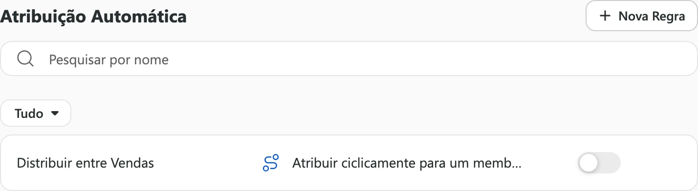
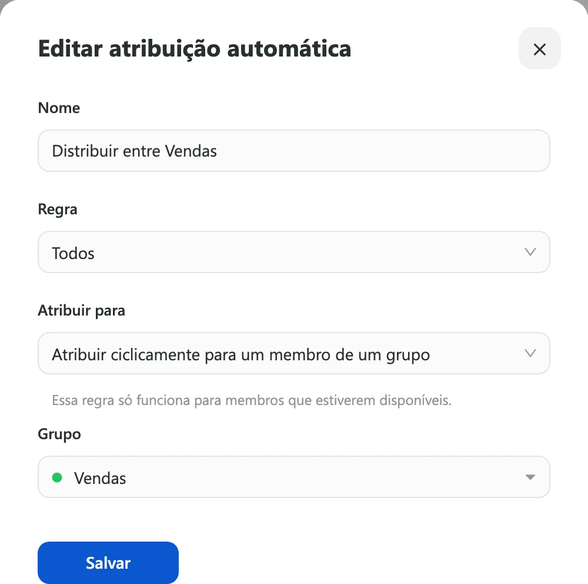

Crie regras de atribuição automática para distribuir as sessões novas entre os membros ou grupos do workspace (na tela, **ambiente**), sem depender de atribuição manual. Na Kinbox, um grupo é uma equipe de membros (não um grupo de WhatsApp).

<Note>
  Quem pode: o proprietário ou quem tem a opção **Atribuição automática** ("Ver, adicionar, editar e excluir atribuição automáticas.") na seção **Gerenciamento do Ambiente** do papel (na tela, **Permissão**). Se **Atribuição automática** não aparecer em **Configurações** → **Automação**, peça ao proprietário ou a quem administra o workspace para liberar essa permissão.
</Note>

## Quando a regra roda

- Uma regra ligada roda sozinha sempre que uma mensagem do contato abre uma **sessão nova**, em qualquer canal (inclusive grupos de WhatsApp). Ela não roda quando uma sessão é reaberta, em mensagens de uma sessão já aberta nem em conversas iniciadas por um membro pela Kinbox.
- Só uma regra ligada é usada em cada sessão nova, e a Kinbox não garante qual regra vence quando várias servem para a mesma situação. Deixe ligada só uma regra para cada situação (lembre que **Todos** vale tanto para o primeiro contato quanto para o contato existente).
- Na distribuição, **Disponível** é o membro **Ativo** com o interruptor **Disponível** ligado; **online** é o membro disponível que também está com a Kinbox aberta e conectada (navegador ou app). As regras que escolhem um membro entre vários (as de rodízio e as de "menos atendimentos"; as de último membro só exigem **Disponível** com **Membro precisa estar disponível** marcado) só escolhem membros disponíveis, e as opções com "online" exigem membro disponível e conectado.

<Tip>
  O bot (bloco **Atendimento**), as automações, os agentes de IA (ação **Transferir**), os cenários e a API conseguem usar uma regra mesmo desligada. Se a regra existe só para ser chamada por um desses recursos, deixe-a desligada na lista para evitar que ela rode sozinha em toda sessão nova.
</Tip>

## Onde fica

Vá em **Configurações** (engrenagem no menu lateral) → **Automação** → **Atribuição automática**. A tela **Atribuição Automática** mostra o botão **Nova Regra**, a busca **Pesquisar por nome** e o filtro **Tudo** / **Ativos** / **Inativos**. Cada linha traz o nome da regra, a estratégia definida em **Atribuir para** e o interruptor de ligar ou desligar.

<Frame caption="Tela Atribuição Automática com o botão Nova Regra, filtro Tudo e o interruptor desligado">
  
</Frame>

## Criar uma regra

<Steps>
  <Step title="Abra o painel Criar atribuição automática">
    Em **Configurações** → **Automação** → **Atribuição automática**, clique em **Nova Regra**.
  </Step>
  <Step title="Defina o nome e quando a regra vale">
    Digite o **Nome** (obrigatório) e escolha uma opção no campo **Regra** (começa em **Todos**):
    - **Todos:** vale para toda sessão nova.
    - **Primeiro contato no canal:** vale para uma sessão nova em uma conversa (aquele contato naquele canal) que nunca foi resolvida.
    - **Contato existente no canal:** vale para uma sessão nova em uma conversa que já foi resolvida pelo menos uma vez.
  </Step>
  <Step title="Escolha a estratégia em Atribuir para">
    Em **Atribuir para**, selecione como a Kinbox escolhe o membro ou o grupo. As opções **Atribuir para o último membro que atendeu a conversa** e **Atribuir para o último grupo que atendeu a conversa** só ficam disponíveis com **Regra** em **Contato existente no canal**. O texto de ajuda abaixo do campo indica quando a estratégia depende de membros disponíveis ou online.

    <Frame caption="Painel Editar atribuição automática com Regra, Atribuir para e o aviso de disponibilidade">
      
    </Frame>
  </Step>
  <Step title="Preencha os campos extras e salve">
    Complete os campos que a estratégia pedir — como **Membro**, **Grupo**, **Grupos participantes**, **Distância máxima em km**, **Membro precisa estar disponível**, **Excluir canais** ou **Grupos de transbordo** — e clique em **Salvar**. A Kinbox confirma a criação e fecha o painel.
  </Step>
</Steps>

<Note>
  A regra nova nasce desligada (o mesmo acontece ao clonar uma regra). Depois de salvar, ligue o interruptor na lista de **Atribuição Automática** para que ela comece a distribuir as sessões novas.
</Note>

## Qual estratégia escolher

| Quero… | Use | Atenção |
| --- | --- | --- |
| Revezar as conversas entre os membros de um grupo | **Atribuir ciclicamente para um membro de um grupo** | Só escolhe membros disponíveis |
| Mandar para quem tem menos conversas abertas | **Atribuir para o membro que tem menos atendimentos** (ou **Atribuir para membro que tem menos atendimentos no grupo**) | Só escolhe membros disponíveis; conta as sessões abertas na hora |
| Só para quem está com a Kinbox aberta | As opções com "online" | Exige membro disponível e conectado |
| Mandar tudo para um grupo, sem escolher membro | **Atribuir para um grupo** | A conversa fica sem responsável se o responsável atual não fizer parte do grupo |
| Devolver ao membro que já atendeu o contato | **Atribuir para último membro que atendeu ao contato** | Olha todos os canais do contato (exceto os de **Excluir canais**); membro inativo nunca recebe |

Para ver todas as opções do campo **Atribuir para**, os campos de cada uma e as regras de disponibilidade, DDD, CEP e transbordo, consulte [Estratégias de atribuição automática](/docs/atendimento/estrategias-de-atribuicao).

## Ligar, editar e excluir

- **Ligar ou desligar:** clique no interruptor da regra na lista.
- **Editar, clonar ou excluir:** passe o mouse sobre a linha e abra o menu de três pontos para escolher **Editar**, **Clonar** (cria "Cópia de [nome]", desligada) ou **Excluir** ("Tem certeza que deseja excluir essa atribuição automática?").

## Depois de configurar

Quando a regra distribui uma sessão nova, a conversa mostra a mensagem de sistema "Conversa transferida por [nome da regra] para [membro ou grupo]". Se a regra escolher um membro que não participa do grupo atual da conversa, a conversa sai desse grupo; se escolher um grupo do qual o responsável atual não participa, a conversa fica sem responsável. Quando ninguém atende às condições da estratégia, a regra não faz nova atribuição e, em geral, mostra uma mensagem de sistema com o nome dela; se a sessão ainda não tem responsável, continua sem (se já tem, por exemplo quando o bot ou uma automação chamam a regra, o responsável continua).

Você acompanha as distribuições no relatório **Atribuição** (veja [Relatório de atribuição](/docs/relatorios/atribuicao)). Veja também como gerenciar a disponibilidade em [Ficar disponível ou indisponível](/docs/conta/disponibilidade) e [Gerenciar membros](/docs/configuracoes-no-workspace/gerenciar-membros), como usar regras no [bot](/docs/bot/blocos-do-bot) e nas [ações do fluxograma do agente de IA](/docs/agente-de-ia/acoes-do-fluxograma), ou como atribuir manualmente em [Atribuir, mover para um grupo ou transferir uma conversa](/docs/conversas/atribuir-e-transferir).

Se as conversas não estiverem chegando para você ou para a equipe, consulte [As conversas não chegam para mim ou para a equipe](/docs/atendimento/problemas-comuns).
