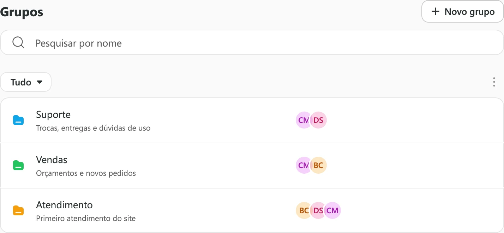
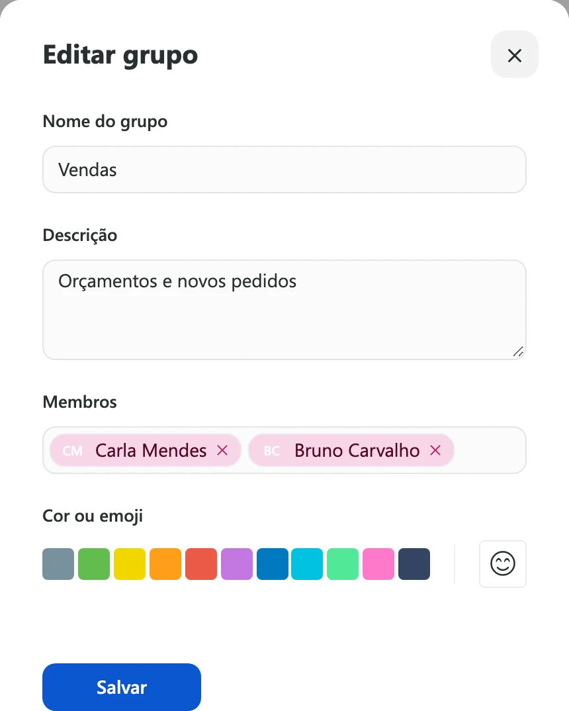

Crie grupos para dividir os membros da sua equipe na Kinbox — como Vendas, Suporte e Atendimento —, direcionar conversas e controlar quais atendimentos cada time pode ver. Na Kinbox, um **grupo** é uma equipe de membros do workspace (na tela, **ambiente**), não um grupo de WhatsApp.

<Note>
  Quem pode: o proprietário ou quem tem a opção **Grupos** ("Adicionar, editar e excluir grupos.") na seção **Gerenciamento do Ambiente** do papel (na tela, **Permissão**). Se **Grupos** não aparecer em **Configurações** → **Ambiente**, peça ao proprietário ou a quem administra o workspace para liberar essa permissão em [Criar papéis e permissões](/docs/configuracoes-no-workspace/configurar-permissoes-dos-usuarios).
</Note>

## Onde fica

Vá em **Configurações** (engrenagem no menu lateral) → **Ambiente** → **Grupos**. No topo da lista **Grupos**, você encontra o botão **Novo grupo**, a busca **Pesquisar por nome**, o filtro **Tudo** / **Meus grupos** (grupos dos quais você faz parte) e o menu **⋮**. Cada linha exibe a cor ou o emoji, o nome, a descrição e as iniciais ou fotos dos membros ativos do grupo (membros inativos não aparecem).

<Frame caption="Tela Grupos com o botão Novo grupo, busca, filtro Tudo e a lista de equipes">
  
</Frame>

## Criar um grupo

<Steps>
  <Step title="Abra o painel Criar grupo">
    Em **Configurações** → **Ambiente** → **Grupos**, clique em **Novo grupo**.
  </Step>
  <Step title="Preencha os dados e escolha os membros">
    Informe o **Nome do grupo** e, se quiser, uma **Descrição**. Em **Membros**, selecione os membros da equipe — um membro pode participar de vários grupos, e um grupo também pode ficar sem membros. Em **Cor ou emoji**, escolha uma cor ou um emoji para identificar o grupo. Se o workspace tiver campos personalizados de grupo, eles aparecem neste mesmo painel.

    <Frame caption="Painel Editar grupo com Nome do grupo, Descrição, Membros e Cor ou emoji">
      
    </Frame>
  </Step>
  <Step title="Salve o grupo">
    Clique em **Salvar**. A Kinbox confirma que o grupo foi criado e o exibe na lista.
  </Step>
</Steps>

A Kinbox não deixa criar dois grupos com o mesmo nome. Se você fechar o painel com alterações sem salvar, aparece o aviso "Fechar sem salvar?" para evitar a perda dos dados.

Regras de atribuição por CEP ou DDD usam dados do grupo: veja [Estratégias de atribuição automática](/docs/atendimento/estrategias-de-atribuicao).

## Colocar ou tirar membros

Os membros de um grupo são incluídos ou removidos apenas pela tela **Grupos**. Em [Gerenciar membros](/docs/configuracoes-no-workspace/gerenciar-membros), o painel **Editar membro** apenas exibe os grupos dos quais a pessoa faz parte; para alterar, abra o grupo em **Configurações** → **Ambiente** → **Grupos**, ajuste o campo **Membros** e clique em **Salvar**.

## Onde os grupos são usados

- **Conversas:** você pode mover a sessão para um grupo pelo botão **Mover para grupo** (ícone de pasta) no cabeçalho, e a conversa pode ter grupo e membro responsável ao mesmo tempo; veja [Atribuir, mover para um grupo ou transferir uma conversa](/docs/conversas/atribuir-e-transferir).
- **Papéis e permissões:** as opções **Por Grupo ou sem Grupo**, **Por Grupo**, **Por Grupo Limitado** e **Limitado** de **Acesso as Conversas**, além das restrições **Somente pode mover para grupo que pertence**, **Somente pode atribuir para quem pertence ao grupo do membro** e **Restringir relatórios aos grupos do membro**, usam os grupos do membro; veja [Criar papéis e permissões](/docs/configuracoes-no-workspace/configurar-permissoes-dos-usuarios) e [Referência de permissões](/docs/administracao/referencia-de-permissoes).
- **Atribuição automática:** regras de atribuição distribuem sessões novas para um grupo ou entre os membros de um grupo; veja [Distribuir as conversas automaticamente](/docs/configuracoes-no-workspace/criar-atribuicoes-automaticas) e [Estratégias de atribuição automática](/docs/atendimento/estrategias-de-atribuicao).
- **Canais:** a opção **Restringir visibilidade** do canal, junto com a restrição **Somente pode ver canais na lista se estiver no grupo do canal**, controla quais grupos veem o canal na lista; veja [Canais: conectar e gerenciar](/docs/canais/visao-geral).
- **Tags e frases rápidas:** o campo **Visível para** em **Grupos** limita quais equipes veem cada item; veja [Criar e usar tags](/docs/configuracoes-no-workspace/criar-e-gerenciar-tags) e [Criar frases rápidas](/docs/conversas/criar-frases-rapidas-para-suas-conversas).
- **Filtros e relatórios:** a condição **Grupos** entra em [Criar filtros de conversa](/docs/conversas/criar-filtros-de-conversa), e os relatórios podem ser agrupados **Por Grupo** (veja [Como os relatórios contam sessões e tempos](/docs/relatorios/como-funcionam)).
- **Automações, bot e agentes de IA:** a condição **Grupo** pode ser usada em automações, no [bot](/docs/bot/blocos-do-bot) e nos agentes de IA.

## Clonar, excluir e exportar

Passe o mouse sobre a linha de um grupo e clique no menu de três pontos para **Editar**, **Clonar** (abre um formulário preenchido com "Cópia de [nome]") ou **Excluir**.

<Warning>
  Excluir um grupo não pode ser desfeito. Ao confirmar ("Tem certeza que deseja excluir esse grupo?"), o grupo sai de todas as sessões em que estava — inclusive as resolvidas (as conversas ficam sem grupo e não são apagadas) —, dos membros e da visibilidade por grupo dos filtros de conversa. Antes de excluir, troque o grupo nas regras de atribuição, nos canais com **Restringir visibilidade**, nas tags, nas frases rápidas e nas condições dos filtros de conversa que o usam.
</Warning>

Para exportar a lista de grupos, clique no menu **⋮** acima da tabela → **Exportar** → **CSV** ou **Excel**. O arquivo `grupos` inclui as colunas ID, **Nome**, **Descrição**, **Membros**, DDD, CEP, **Ativo** e os campos personalizados de grupo.
