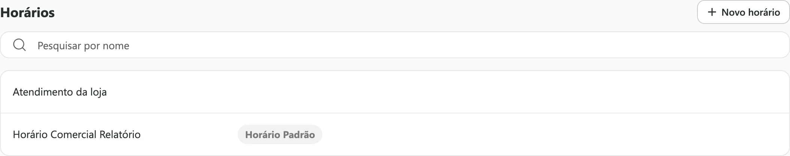
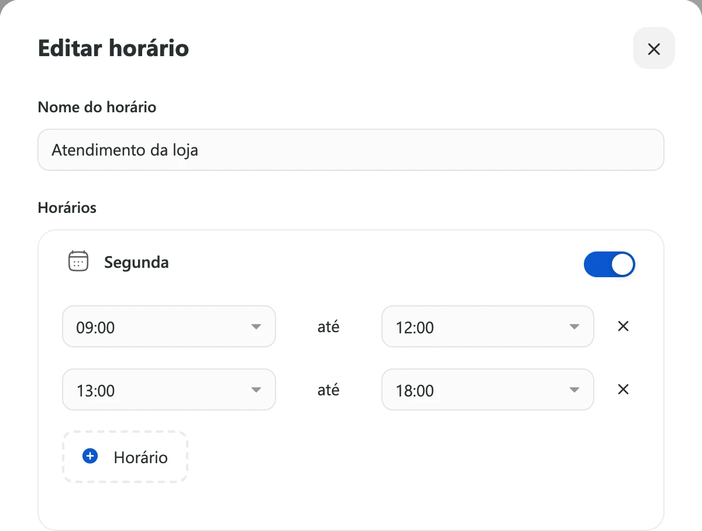

Cadastre horários de atendimento com os dias da semana e as faixas de hora em que sua equipe atende. Tudo o que fica fora dessas faixas conta como fora do horário; para configurar um intervalo de almoço, adicione duas faixas no mesmo dia (por exemplo, `09:00` até `12:00` e `13:00` até `18:00`).

<Note>
  Quem pode: o proprietário ou quem tem a opção **Horários** ("Ver, adicionar, editar e excluir horário comercial.") na seção **Gerenciamento do Ambiente** do papel (na tela, **Permissão**). Se **Horários** não aparecer em **Configurações** → **Ambiente**, peça ao proprietário ou a quem administra o workspace (na tela, **ambiente**) para liberar essa permissão.
</Note>

## Onde fica

Vá em **Configurações** (engrenagem no menu lateral) → **Ambiente** → **Horários**. A tela **Horários** mostra a busca **Pesquisar por nome**, o botão **Novo horário** e a lista de horários cadastrados. O horário escolhido como **Horário comercial** do workspace exibe a marca **Horário Padrão**.

Em geral, um workspace novo já vem com o **Horário Comercial Relatório** (segunda a sexta, das `08:00` até `18:00`), escolhido como **Horário comercial**.

<Frame caption="Tela Horários com o botão Novo horário e a marca Horário Padrão">
  
</Frame>

## Criar um horário

<Steps>
  <Step title="Abra o painel Criar horário">
    Em **Configurações** → **Ambiente** → **Horários**, clique em **Novo horário**.
  </Step>
  <Step title="Informe o nome e ligue os dias">
    Digite o **Nome do horário** (obrigatório). Em **Horários**, ligue o interruptor de cada dia da semana em que há atendimento (de **Segunda** a **Domingo**).
  </Step>
  <Step title="Adicione as faixas de hora">
    Em cada dia ligado, clique em **Horário**, escolha o início e o fim (**até**) e, se houver intervalo, clique em **Horário** de novo para criar outra faixa no mesmo dia. O botão **x** remove a faixa.

    <Frame caption="Painel Editar horário com duas faixas na Segunda e o botão Horário">
      
    </Frame>
  </Step>
  <Step title="Salve o horário">
    Clique em **Salvar**. A Kinbox confirma a criação e exibe o horário na lista.
  </Step>
</Steps>

Todo dia ligado precisa ter pelo menos uma faixa com início e fim preenchidos.

## Escolher o horário comercial do workspace

Para definir o horário padrão do workspace, vá em **Configurações** → **Ambiente** → **Geral**, no cartão **Preferências** (veja [Configurações gerais do workspace](/docs/configuracoes-no-workspace/configuracoes-gerais); acessível ao proprietário ou a quem tem a opção **Workspace** na seção **Gerenciamento do Ambiente** do papel). Selecione o horário desejado no campo **Horário comercial** e clique em **Salvar mudanças**, que aparece embaixo da tela quando você muda algo. O horário escolhido passa a exibir a marca **Horário Padrão** na lista de **Horários**. No bot, nas automações, nas campanhas e nas restrições do papel, as faixas de hora são avaliadas no **Fuso horário** escolhido nesse mesmo cartão **Preferências**.

## Onde o horário é usado

- **Horário comercial do workspace:** serve de base para o cálculo de TME, TMP e TMA nos relatórios (veja [Como os relatórios contam sessões e tempos](/docs/relatorios/como-funcionam)) e para a **Mensagem quando fora do horário comercial** em **Configurações** → **Ambiente** → **Geral** (essa mensagem só é enviada se houver um **Horário comercial** escolhido em **Geral** e só em conversas que já têm um membro responsável).
- **Bot:** o campo **Horários** faz o bot iniciar sozinho apenas dentro dos horários escolhidos — essa opção não vale quando **Atende todos os canais** está ligado —, e o bloco **Decisão** aceita a condição **Horário**; veja [Criar e publicar um bot](/docs/bot/aprender-a-usar-o-bot) e [Blocos do bot](/docs/bot/blocos-do-bot).
- **Condição Horário:** aparece no grupo **Contexto** ("está dentro de" e "está fora de") em automações, no [bot](/docs/bot/blocos-do-bot), nas etapas do agente de IA e nas metas.
- **Campanhas:** o campo **Horário comercial** pausa a campanha fora do horário e retoma sozinho no próximo período; veja [Velocidade de envio e horário comercial](/docs/campanhas/velocidade-e-horario).
- **Papel (Permissão):** as restrições **Limitar horário que pode responder**, **Limitar horário de acesso ao ambiente** e **Limitar horário que pode ficar disponível** usam um horário cadastrado aqui; veja [Referência de permissões](/docs/administracao/referencia-de-permissoes) e [Ficar disponível ou indisponível](/docs/conta/disponibilidade).
- **Chat do site (widget):** a opção **Habilitar horário comercial** indica que os membros estão online durante o horário escolhido; veja [Configurações do widget: domínios, horário, celular e balão do WhatsApp](/docs/canais/widget/configuracoes).
- **Kinbox Agenda:** define o expediente dos serviços cadastrados.

## Clonar e excluir

Passe o mouse sobre a linha de um horário e abra o menu de três pontos para **Editar**, **Clonar** (abre um novo formulário preenchido com "Cópia de [nome]") ou **Excluir**.

<Warning>
  Excluir um horário não pode ser desfeito ("Tem certeza que deseja excluir esse horário?"). A Kinbox impede a exclusão em três casos: se o horário for o **Horário comercial** do workspace (troque antes em **Configurações** → **Ambiente** → **Geral**), se estiver em uso por um serviço ativo do Kinbox Agenda ou se estiver vinculado a algum bot (remova antes em **Configurações** → **Automação** → **Bot**). Antes de excluir, troque também o horário nas campanhas, automações e papéis que o usam.
</Warning>

Feriados não têm cadastro próprio na Kinbox: os horários funcionam apenas por dia da semana.
