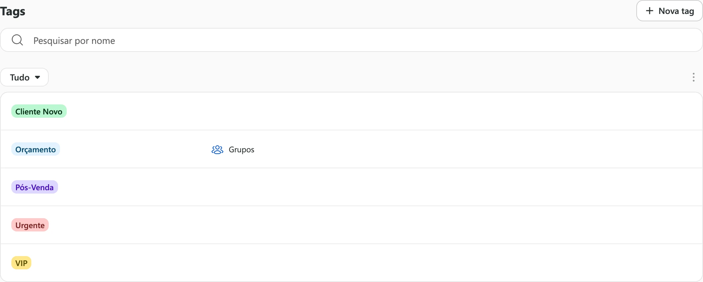
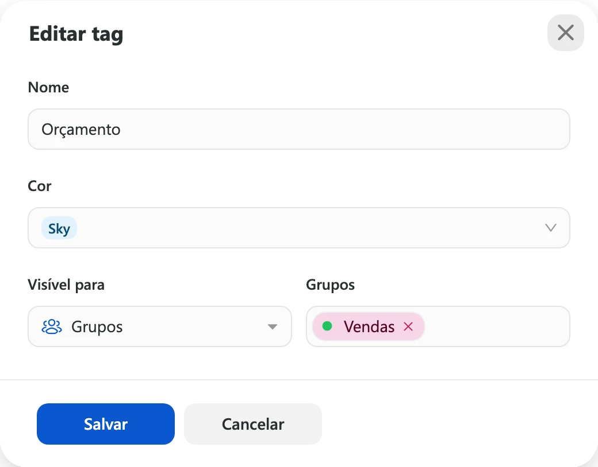
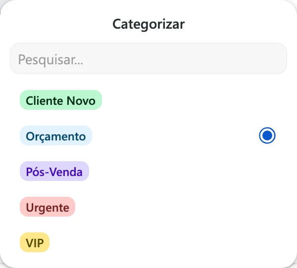

Crie tags para categorizar conversas e negociações, facilitando a identificação, a busca, os filtros e os relatórios no workspace (na tela, **ambiente**). Na conversa, a tag vale para a **sessão** em que foi colocada (veja [Conversas, sessões e status](/docs/conceitos/conversas-e-sessoes)).

<Note>
  Quem pode: criar, editar e excluir tags exige ser o proprietário ou ter a opção **Tags** ("Adicionar, editar e excluir tags.") na seção **Gerenciamento do Ambiente** do papel (na tela, **Permissão**). Qualquer membro que abre a conversa pode colocar e tirar tags, respeitando as restrições do papel **Não pode remover tags** e **Esconder tags se não for atribuido** (veja [Referência de permissões](/docs/administracao/referencia-de-permissoes)). Se **Tags** não aparecer em **Configurações** → **Ambiente**, peça ao proprietário ou a quem administra o workspace para liberar essa permissão.
</Note>

## Onde fica

Vá em **Configurações** (engrenagem no menu lateral) → **Ambiente** → **Tags**. A tela **Tags** traz o botão **Nova tag**, a busca **Pesquisar por nome**, o filtro **Tudo** / **Visível somente para mim** e o menu **⋮**. A lista aparece em ordem alfabética com a tag e a visibilidade (vazio para **Todos**, **Grupos** ou quem pode ver) e mostra apenas as tags visíveis para você; o proprietário vê todas.

<Frame caption="Tela Tags com o botão Nova tag, busca, filtro Tudo e a coluna de visibilidade">
  
</Frame>

## Criar uma tag

<Steps>
  <Step title="Abra a janela Criar tag">
    Em **Configurações** → **Ambiente** → **Tags**, clique em **Nova tag**.
  </Step>
  <Step title="Defina o nome e a cor">
    Digite o **Nome** (obrigatório) e escolha uma opção em **Cor**.
  </Step>
  <Step title="Escolha quem vê a tag em Visível para">
    Em **Visível para**, selecione **Todos** (padrão), **Grupos** (e escolha os grupos no campo **Grupos**) ou **Apenas para mim**.

    <Frame caption="Janela Editar tag com Nome, Cor e Visível para definido como Grupos">
      
    </Frame>
  </Step>
  <Step title="Salve a tag">
    Clique em **Salvar** (ou **Cancelar** para sair). A Kinbox confirma a criação e exibe a tag na lista.
  </Step>
</Steps>

Quem vê a tag na lista de **Tags** e ao categorizar uma conversa:

- **Todos:** todos os membros do workspace.
- **Grupos:** apenas os membros dos grupos escolhidos (na Kinbox, grupos são equipes de membros, não grupos de WhatsApp; veja [Criar grupos de atendimento](/docs/configuracoes-no-workspace/criar-e-gerenciar-grupos)).
- **Apenas para mim:** somente quem criou a tag.

O proprietário vê todas as tags. A visibilidade da tag não muda quem pode ver a conversa.

## Colocar e tirar tags numa conversa

No rodapé da conversa, abaixo do campo de mensagem, aparecem as tags da sessão (cada uma com **x** para remover) e o botão de etiqueta com a dica **Adicionar tag**. Ao clicar nele, abre a lista **Categorizar**, com a busca **Pesquisar...** e as tags que você pode ver em ordem alfabética: clique em uma tag para colocar e clique de novo na tag marcada para tirar. Cada alteração registra uma mensagem de sistema na conversa (veja [Atender uma conversa: responder, notas, resolver e reabrir](/docs/conversas/gerenciar-conversas)).

<Frame caption="Lista Categorizar aberta no rodapé da conversa com a tag Orçamento marcada">
  
</Frame>

Duas restrições do papel mudam o uso na conversa: com **Não pode remover tags**, o membro só consegue colocar tags (tentar remover exibe "Não tem permissão para remover tags."); com **Esconder tags se não for atribuido**, o rodapé de tags desaparece para quem não é o responsável pela conversa.

Para colocar ou tirar tags em várias conversas de uma vez, use **Executar ação...** → **Adicionar Tag** ou **Remover Tag**; veja [Ações em lote e exportar conversas](/docs/conversas/acoes-em-lote-e-exportar).

## Tags na sessão nova

Com **Preservar tags ao resolver uma conversa** ligado em **Configurações** → **Ambiente** → **Geral** (nas configurações gerais do workspace), a sessão nova de uma conversa herda automaticamente as tags da sessão anterior dessa mesma conversa (o mesmo contato no mesmo canal). Em workspaces novos, essa opção já vem ligada.

## Onde as tags aparecem

- **Caixa de entrada:** na lista de conversas (use **Esconder tags** ou **Mostrar tags** em **Mais opções**) e em **Filtrar por** → **Tag**.
- **Filtros de conversa:** na condição **Tags** em [Criar filtros de conversa](/docs/conversas/criar-filtros-de-conversa).
- **Relatórios:** no agrupamento **Por Tag** (veja [Como os relatórios contam sessões e tempos](/docs/relatorios/como-funcionam)).
- **Automações e bot:** no gatilho **Ao adicionar tag** e na ação **Adicionar tag** das automações, e no bloco **Adicionar tag** em [Blocos do bot](/docs/bot/blocos-do-bot).
- **Negociações:** no cadastro e edição de negociações nos funis.

## Clonar, excluir e exportar

Passe o mouse sobre a linha de uma tag e abra o menu de três pontos para **Editar**, **Clonar** (abre um novo formulário com "Cópia de [nome]") ou **Excluir**.

<Warning>
  Excluir uma tag não pode ser desfeito ("Tem certeza que deseja excluir essa tag?"). A tag some da lista e das conversas em que estava aplicada.
</Warning>

Para exportar a lista, clique no menu **⋮** acima da tabela → **Exportar** → **CSV** ou **Excel**. O arquivo `tags` inclui as colunas ID, **Nome**, **Cor**, **Privacidade** (Público, Privado ou Grupos) e **Ativo**.
