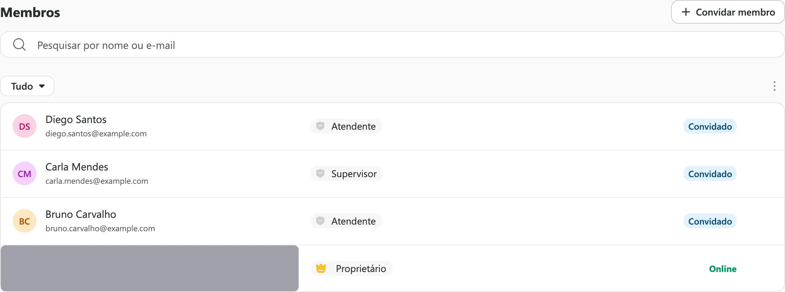
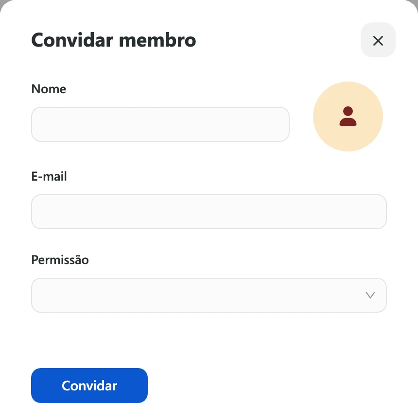

Convide pessoas para o workspace (na tela, **ambiente**), defina o papel de cada membro e gerencie quem tem acesso à Kinbox. Nesta central, **papel** é o conjunto de permissões dado a um membro. Na tela, esse conjunto se chama **Permissão**.

<Note>Quem pode: o proprietário do workspace ou quem tem a permissão **Membros** (em **Gerenciamento do Ambiente**). Se **Membros** não aparecer em **Configurações** → **Ambiente**, peça ao administrador ou ao proprietário para liberar essa permissão. Para usar **Resetar senha**, também é preciso ter a permissão **Pode resetar senha de membros**, que só o proprietário pode marcar no papel.</Note>

## Onde fica

Vá em **Configurações** (ícone de engrenagem no menu lateral) → **Ambiente** → **Membros**.

<Frame caption="Tela Membros com a busca, o filtro Tudo e o botão Convidar membro">
  
</Frame>

A lista mostra as seguintes informações e controles:

- **Nome, foto e e-mail**: quando o membro usa [verificação em duas etapas](/docs/conta/verificacao-em-duas-etapas), aparece um escudo verde ao lado do nome.
- **Permissão**: o nome do papel do membro ou **Proprietário** (com ícone de coroa).
- **Situação**: **Online**, o tempo desde a última vez que o membro esteve online, **Convidado** (convite enviado, mas a pessoa ainda não concluiu o cadastro) ou **Inativo** (linha riscada e apagada).
- **Busca e filtro**: pesquise em **Pesquisar por nome ou e-mail** e filtre pelo botão **Tudo**, que oferece seis opções: **Tudo**, **Ativo**, **Inativo**, **Convite enviado**, **Online** e **Offline**.
- **Menu da linha**: passe o mouse sobre a linha de um membro para ver os três pontos com as ações disponíveis para ele.

## Convidar um membro

<Steps>
  <Step title="Abra o painel de convite">
    Em **Configurações** → **Ambiente** → **Membros**, clique em **Convidar membro**.
  </Step>
  <Step title="Preencha os dados do membro">
    Informe **Nome**, adicione uma foto opcional no círculo à direita, digite o **E-mail** (por exemplo, `ana@example.com`) e escolha o papel em **Permissão**. Se o workspace tiver campos personalizados de membro, eles também aparecem nesse painel.

    <Frame caption="Painel Convidar membro com os campos Nome, E-mail e Permissão">
      
    </Frame>
  </Step>
  <Step title="Envie o convite">
    Clique em **Convidar**.
  </Step>
</Steps>

Depois de clicar em **Convidar**, a tela exibe o aviso **Convite enviado** com o nome e o e-mail informados:

- Quem ainda não tem conta na Kinbox fica como **Convidado** até concluir o cadastro. O cadastro é feito pelo link do e-mail, na tela **Complete seu cadastro** (**Nome**, **Senha**, **Termos e Condições** e **Finalizar cadastro**). Em seguida, a tela oferece ativar a verificação em duas etapas.
- Quem já participa de outro workspace na Kinbox com o mesmo e-mail entra direto, sem passar por **Convidado**. O e-mail só avisa do novo acesso. O workspace aparece em **Escolha um ambiente** ou no botão do ambiente no topo da tela.
- O convite já ocupa uma licença do plano, mesmo antes de a pessoa aceitar. Se todas as licenças estiverem em uso, aparece um aviso de que o limite foi atingido e o convite não é enviado. Veja [Licenças, desativar membros e transferir a propriedade](/docs/administracao/licencas-e-propriedade).
- O convite também não é enviado se o e-mail já estiver no workspace (mesmo como **Convidado** ou **Inativo**) ou se a assinatura estiver vencida há mais de 3 dias (veja [Minha assinatura venceu ou o pagamento falhou](/docs/assinatura/assinatura-vencida)).

## Editar um membro

Clique na linha do membro ou passe o mouse, abra os três pontos e clique em **Editar** para abrir o painel **Editar membro**.

- Você pode alterar **Nome** (bloqueado para o proprietário), foto, **Permissão**, campos personalizados de membro e os interruptores **Disponível** e **Ativo** (que não aparecem para o proprietário). Clique em **Salvar** ao terminar.
- **E-mail** não muda na edição: se o convite foi enviado para o endereço errado, exclua o membro convidado e envie um novo convite. **Grupos** aparece apenas para consulta — para adicionar ou remover o membro de grupos, acesse **Configurações** → **Ambiente** → **Grupos** (veja [Criar grupos de atendimento](/docs/configuracoes-no-workspace/criar-e-gerenciar-grupos)).
- **Disponível** define se o membro entra nas regras de atribuição automática que escolhem um membro entre vários — as de rodízio e as de "menos atendimentos"; as de último membro só exigem **Disponível** com **Membro precisa estar disponível** marcado (a atribuição manual continua possível, e regras como **Atribuir para um membro** atribuem mesmo a quem está indisponível; veja [Estratégias de atribuição automática](/docs/atendimento/estrategias-de-atribuicao)). Indisponível, o membro também não ouve os sons de nova mensagem e de nova conversa; o push continua conforme as escolhas dele em [Notificações](/docs/conta/notificacoes). **Ativo** define se o membro consegue entrar no workspace: desligar **Ativo** deixa o membro **Inativo**.
- Você não consegue trocar o próprio papel: ao editar a si mesmo, o campo **Permissão** fica bloqueado (exceto para o proprietário).

## Clonar um membro

Nos três pontos da linha, clique em **Clonar** para abrir **Convidar membro** preenchido com "Cópia de [nome]", o mesmo e-mail e o mesmo papel. Troque o **Nome** e o **E-mail** antes de clicar em **Convidar**, pois a Kinbox não permite convidar um e-mail que já está no workspace.

## Reenviar o convite

Se o membro ainda aparece como **Convidado**, abra os três pontos da linha, clique em **Reenviar convite** (a opção só aparece para quem ainda não aceitou o convite) e confirme em **Sim**. A Kinbox reenvia o mesmo link para o e-mail do membro. O link não expira. Para cancelar um convite antes de ser aceito, exclua o membro convidado.

## Desconectar um membro

Nos três pontos da linha, clique em **Desconectar** e confirme. A opção só fica ativa quando o membro está **Online** e nunca fica disponível para o proprietário. O membro vê o aviso "Você foi deslogado por um gestor...", tem a sessão encerrada em 3 segundos e pode entrar novamente.

## Desativar e reativar um membro

Desativar bloqueia o acesso e mantém o histórico de quem atendeu cada conversa. Abra os três pontos da linha e clique em **Desativar** (o proprietário não pode ser desativado). Na janela **Desativar membro**, você pode escolher **Excluir agendamentos** e **Transferir atribuições** antes de confirmar em **Desativar**. O membro passa a **Inativo** e deixa de ocupar uma licença do plano.

Se você cancelar a janela de progresso no meio, o que já foi feito não volta: os agendamentos já excluídos e as atribuições já transferidas continuam assim, e o membro não é desativado.

Desativar não derruba na hora uma aba já aberta: se o membro estiver **Online**, clique em **Desconectar** para encerrar a sessão imediatamente. Para devolver o acesso depois, abra os três pontos de um membro **Inativo** e clique em **Reativar** — ele volta a entrar com a mesma senha e o mesmo papel e volta a ocupar uma licença. Veja os detalhes em [Licenças, desativar membros e transferir a propriedade](/docs/administracao/licencas-e-propriedade).

## Excluir um membro

Nos três pontos da linha, clique em **Excluir** (o proprietário não pode ser excluído). Na janela **Excluir membro**, você pode selecionar duas opções antes de confirmar em **Excluir**:

- **Excluir agendamentos**: exclui os agendamentos de mensagens ainda não enviadas criados pelo membro.
- **Transferir atribuições**: transfere as conversas abertas e negociações abertas atribuídas ao membro, alternando uma a uma entre os membros selecionados. Se o campo de membros ficar em branco, a Kinbox apenas retira a atribuição.

Enquanto a transferência acontece, uma janela exibe o progresso e permite cancelar. Cancelar não desfaz o que já foi feito: os agendamentos já excluídos e as atribuições já transferidas continuam assim, e o membro não é excluído. Excluir remove o membro do workspace e dos grupos e apaga convites pendentes, sem apagar a conta dele na Kinbox (ele continua com acesso a outros workspaces).

<Warning>Excluir um membro tira ele do histórico de todas as conversas do workspace, inclusive as já resolvidas. Se quiser manter o histórico de quem atendeu cada conversa, desative em vez de excluir.</Warning>

## Resetar a senha de um membro

A opção **Resetar senha** só aparece nos três pontos se você for o proprietário ou tiver a permissão **Pode resetar senha de membros** (marcada apenas pelo proprietário), e apenas para membros que já aceitaram o convite. Se a opção não aparecer, confirme esses dois pontos.

O reset só funciona quando o membro atende às quatro condições ao mesmo tempo: está **ativo** (não **Inativo**), participa **somente deste workspace**, **já aceitou o convite** e **não é o proprietário**. Para um membro **Inativo**, reative antes. Se o membro participa de outros workspaces, ele mesmo precisa redefinir a senha (veja [Trocar a senha, recuperar o acesso e sair da conta](/docs/conta/senha-e-sessoes)).

<Steps>
  <Step title="Abra a janela de reset">
    Nos três pontos da linha do membro, clique em **Resetar senha**.
  </Step>
  <Step title="Confirme o envio da nova senha">
    Clique em **Resetar senha**. A Kinbox cria uma senha nova e envia para o e-mail do membro, com o assunto "[Kinbox] - Redefinição de senha". Você não precisa preencher **Nova senha**.
  </Step>
</Steps>

## Exportar a lista de membros

Acima da lista, abra o menu **⋮** e clique em **Exportar** → **CSV** ou **Excel**. O arquivo exporta a lista com papel, situação, último login, grupos e campos personalizados de cada membro.

Veja também [Criar papéis e permissões](/docs/configuracoes-no-workspace/configurar-permissoes-dos-usuarios), [Referência de permissões](/docs/administracao/referencia-de-permissoes) e [O convite não chegou ou o membro não consegue entrar](/docs/administracao/problemas-com-membros).
