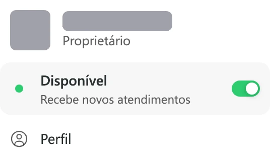

Sua disponibilidade define se você entra na **Atribuição automática** de novas conversas. Quando você está **Disponível**, a bolinha na sua foto fica verde ("Recebe novos atendimentos"); quando está **Indisponível**, fica laranja ("Sem novos atendimentos"). A disponibilidade vale só para o workspace aberto (veja [Workspace, membros e papéis](/docs/conceitos/workspace-membros-e-papeis)).

<Note>
  Quem pode: todo membro muda a própria disponibilidade pelo menu da sua foto, a menos que o papel tenha uma das restrições **Não pode ficar indisponível**, **Não pode mudar disponibilidade** ou **Limitar horário que pode ficar disponível**. Essas restrições não valem para o proprietário (veja [Criar papéis e permissões](/docs/configuracoes-no-workspace/configurar-permissoes-dos-usuarios)).
</Note>

## Passo a passo

<Steps>
  <Step title="Abra o menu da sua foto">
    Clique na sua foto, no canto superior direito da tela.
  </Step>
  <Step title="Ligue ou desligue o interruptor Disponível">
    Use o interruptor na linha **Disponível** para ficar disponível ou indisponível.

    <Frame caption="Menu da sua foto com a linha Disponível ligada">
      
    </Frame>
  </Step>
</Steps>

Quando você fica indisponível manualmente, seu status continua assim até você ligar o interruptor de novo ("Você está indisponível. Seu status permanecerá assim até que você altere manualmente para disponível.").

## O que muda e o que não muda

Ficar indisponível tira você da atribuição automática e silencia os sons de nova mensagem e de nova conversa da [Caixa de entrada](/docs/conversas/caixa-de-entrada-do-kinbox). O resto continua:

- As conversas que já são suas continuam na sua lista.
- Outros membros ainda podem [atribuir ou transferir](/docs/conversas/atribuir-e-transferir) uma conversa para você manualmente.
- Os avisos de push (no navegador e no app) continuam chegando. Para pará-los, desligue-os em [Receber notificações no navegador e no celular](/docs/conta/notificacoes).

## Quando a Kinbox muda sozinha

O workspace ou o seu papel podem mudar sua disponibilidade automaticamente em três situações:

- **Indisponível por inatividade:** se o workspace tiver a configuração **Tornar indisponível se inativo.** ligada, você fica indisponível depois do tempo configurado sem mexer em nenhuma aba da Kinbox e volta a ficar disponível sozinho ao mexer de novo. Quem ficou indisponível manualmente continua assim.
- **Horário do papel:** com a restrição **Limitar horário que pode ficar disponível**, você fica indisponível automaticamente fora do horário definido e volta a ficar disponível quando o horário começa — só se a indisponibilidade tiver sido automática por horário.
- **Offline por inatividade:** se o workspace usar **Tornar offline se inativo**, após o tempo configurado sem atividade a Kinbox desconecta a atualização em tempo real e mostra "Você foi desconectado por inatividade." com o botão **Reconectar**. Clique em **Reconectar** para voltar.

## Antes de sair

Antes de sair para o almoço ou uma troca de turno, desligue sua disponibilidade para não receber novas conversas automáticas. Se quiser que um colega cubra suas conversas enquanto estiver fora, ative o **Compartilhamento de conversas** em [Editar seu perfil](/docs/configuracoes-no-workspace/configurar-o-perfil-do-usuario).

## Problemas comuns

- **A Kinbox diz que você não tem permissão para ficar indisponível.** Seu papel tem a restrição **Não pode ficar indisponível**. Fale com quem administra o workspace.
- **A Kinbox diz que você não tem permissão para mudar sua disponibilidade.** Seu papel tem a restrição **Não pode mudar disponibilidade**. Fale com quem administra o workspace.
- **A Kinbox impede você de ficar disponível fora do horário.** Seu papel tem a restrição **Limitar horário que pode ficar disponível**. Você só consegue ligar a disponibilidade dentro do horário configurado; fora dele, fale com quem administra o workspace.
