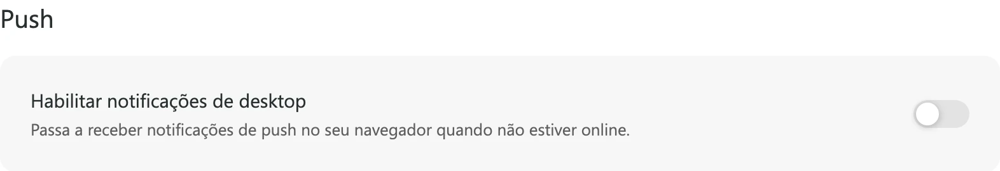

A Kinbox tem dois tipos de aviso: **Push** (notificações do sistema quando a Kinbox não está visível na tela) e **Som** (alertas sonoros que tocam só com a Kinbox aberta). As opções de **Push** valem só para o workspace aberto e são as mesmas do app para celular. Os **Sons** valem para a conta toda, em todos os workspaces.

<Note>
  Quem pode: todo membro pode configurar as próprias notificações em **Configurações** → **Notificações**.
</Note>

## Ligar o push no navegador

<Steps>
  <Step title="Abra a tela de Notificações">
    No menu lateral, vá em **Configurações** → **Notificações**.
  </Step>
  <Step title="Ative o push no navegador">
    No cartão **Push**, ligue **Habilitar notificações de desktop**.

    <Frame caption="Opção Habilitar notificações de desktop no cartão Push">
      
    </Frame>
  </Step>
  <Step title="Escolha os tipos de aviso">
    Ligue os tipos de notificação que você quer receber na tabela abaixo.
  </Step>
  <Step title="Salve as alterações">
    Clique em **Salvar mudanças**. A Kinbox confirma com "Suas notificações foram atualizadas."
  </Step>
  <Step title="Permita notificações no navegador">
    Quando o navegador pedir permissão, permita notificações para a Kinbox. Se aparecer o aviso de que a permissão foi negada, libere as notificações para a Kinbox nas configurações do navegador.
  </Step>
</Steps>

Tipos de aviso disponíveis no cartão **Push**:

| Opção | Texto na tela | Quem recebe |
| --- | --- | --- |
| **Mensagem** | "Quando receber nova mensagem atribuída a você" | Só o responsável pela conversa |
| **Mensagem de time** | "Quando for mencionado em uma sala ou receber uma mensagem direta." | Quem foi mencionado ou recebeu a mensagem direta |
| **Atribuído** | "Quando uma conversa for atribuída a você." | O novo responsável pela conversa |

## Quando o push aparece

- O push do navegador só aparece quando nenhuma aba da Kinbox está aberta e visível naquele navegador (é o que a tela chama de "quando não estiver online"). Com a Kinbox visível na tela, valem os sons.
- **Mensagem** e **Atribuído** avisam apenas conversas sob sua responsabilidade; **Mensagem de time** avisa quando mencionam você em uma sala ou mandam uma mensagem direta.
- Clicar na notificação de push abre a conversa correspondente.

## Sons

Os sons tocam só com a Kinbox aberta em alguma aba do navegador e valem para a conta toda, em todos os workspaces. Ative ou desative no cartão **Som** e clique em **Salvar mudanças**:

- **Quando receber nova mensagem:** toca ao chegar mensagem do contato em uma conversa da sua lista que não é a que está aberta (ou com a aba fora de foco).
- **Quando receber nova conversa:** toca quando uma nova conversa entra na lista ou no filtro aberto na [Caixa de entrada](/docs/conversas/caixa-de-entrada-do-kinbox).
- **Quando receber mensagem de time:** toca para mensagem de sala, menção, lembrete de tarefa e aviso de template.
- **Quando ganhar uma negociação:** toca som de caixa registradora e aplausos ao marcar uma negociação como ganha.

Em workspaces com recursos em teste, também podem aparecer opções de som para ligações do WhatsApp.

## No celular

No celular, as notificações chegam pelo app da Kinbox e são ativadas nas preferências do próprio app (**Receber notificações** e **Quando receber**, entre **Sempre** e **Quando não estiver usando o web**, que é o padrão).

Os três tipos de aviso (**Mensagem**, **Mensagem de time** e **Atribuído**) são os mesmos do navegador: o que você liga ou desliga aqui muda no app, e vice-versa.

## Problemas comuns

- **Não chega push no navegador.** Confira se **Habilitar notificações de desktop** e o tipo desejado estão ligados (e salvos em **Salvar mudanças**), se o navegador permite notificações para a Kinbox, se a Kinbox não está aberta e visível na tela e se a conversa está atribuída a você.
- **Não toca som.** Confira se o interruptor está ligado no cartão **Som**, se a Kinbox está aberta em uma aba e se a mensagem não chegou na conversa que já está aberta em foco.
- **Recebo avisos de um workspace e de outro não.** As opções de **Push** valem só para o workspace aberto. Troque para o outro workspace e ligue o push nele também.

Se o problema for não receber novas conversas pela atribuição automática (e não falta de avisos), veja [Ficar disponível ou indisponível](/docs/conta/disponibilidade).
