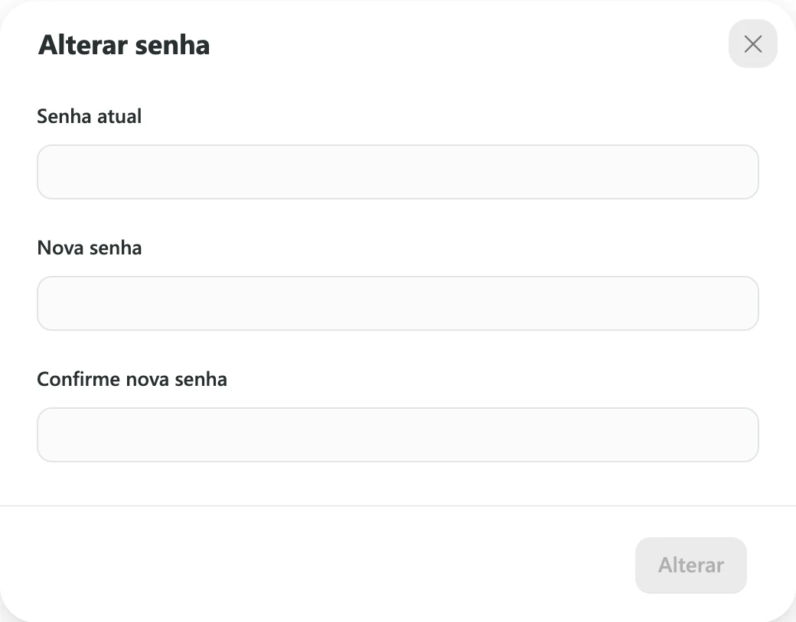

Veja como alterar sua senha, criar uma nova pela tela de entrada, sair da Kinbox com segurança e liberar um login quando atingir o limite de acessos abertos.

<Note>
  Quem pode: todo membro pode trocar a própria senha em **Configurações** → **Perfil**, exceto quem tem a restrição **Não pode mudar informação de perfil** no papel (o botão de lápis em **Senha** não aparece — fale com quem administra o workspace). Essa restrição não vale para o proprietário. A senha vale para a conta toda, em todos os workspaces e no app para celular.
</Note>

## Trocar a senha

A nova senha precisa ter no mínimo **8 caracteres**, com pelo menos **uma letra** e **um número**.

<Steps>
  <Step title="Abra a janela Alterar senha">
    Vá em **Configurações** → **Perfil**, role até o cartão **Segurança** e clique no botão de lápis da linha **Senha** (se o botão não aparecer por causa da restrição **Não pode mudar informação de perfil**, fale com quem administra o workspace).
  </Step>
  <Step title="Preencha os campos da senha">
    Na janela **Alterar senha**, preencha **Senha atual**, **Nova senha** e **Confirme nova senha**. Digite a mesma senha nos dois campos: a senha que vale é a de **Nova senha**.

    <Frame caption="Janela Alterar senha no cartão Segurança">
      
    </Frame>
  </Step>
  <Step title="Salve a nova senha">
    Clique em **Alterar**. Aparece "Sua senha foi alterada."
  </Step>
</Steps>

Se a senha atual estiver errada, a Kinbox avisa que a senha está incorreta ("Senha incorreta"). Se a nova senha não cumprir os requisitos, a troca é recusada informando o que faltou.

## Esqueci a senha

Se você não está logado ou não lembra sua senha, crie uma nova pela tela de entrada:

<Steps>
  <Step title="Peça as instruções na tela de entrada">
    Na tela **Entrar**, clique em **Esqueceu a senha?**. Na tela **Esqueci a senha**, informe seu **E-mail** e clique em **Obter instruções**. Aparece **Confira seu e-mail**.
  </Step>
  <Step title="Abra o link recebido por e-mail">
    Procure o e-mail com o assunto "[Kinbox] - Reset de senha" e clique no link. O link vale por **2 horas** e só pode ser usado uma vez. Se você pediu mais de uma vez, use o e-mail mais recente: cada pedido troca o link.
  </Step>
  <Step title="Crie a nova senha">
    Na tela **Resetar senha**, digite a nova senha (os requisitos na tela ficam verdes conforme você preenche), repita em **Confirmar senha** e clique em **Resetar**. Quando aparecer "Senha alterada!", clique em **Voltar ao início**.
  </Step>
</Steps>

- A tela mostra **Confira seu e-mail** mesmo se o endereço digitado não tiver conta. Se nada chegar, confira o e-mail da sua conta, procure na caixa de spam e peça de novo.
- Se o link tiver vencido ou já tiver sido usado, aparece "Token inválido ou expirado." — volte a **Esqueceu a senha?** e peça outro link.
- Redefinir a senha não desativa a [verificação em duas etapas](/docs/conta/verificacao-em-duas-etapas).

## Sair da Kinbox

Para encerrar seu acesso neste navegador, clique na sua foto, no canto superior direito, e clique em **Sair**. Isso encerra seu login e desliga as notificações push nesse navegador.

Em computadores compartilhados ou que você não vai mais usar, sempre clique em **Sair** em vez de apenas fechar a aba.

Sair não apaga a sua conta. Para excluí-la de vez, veja [Excluir sua conta pelo app](/docs/app/excluir-conta).

## Se aparecer o limite de acessos abertos

Cada navegador ou app conta como um acesso aberto; abas do mesmo navegador contam juntas. Em geral, o limite é de **3 acessos** abertos por pessoa em cada workspace (na tela, **ambiente**), mas esse limite pode ser diferente no seu workspace.

**No app para celular**, ao passar do limite o app encerra o acesso e mostra **Limite de sessões**: "Gerencie suas sessões no Kinbox web e entre novamente no aplicativo." Libere um acesso pelo navegador (passos abaixo) e entre de novo no app.

**No navegador**, ao passar do limite a Kinbox mostra a tela "Você atingiu o limite de sessões ativas no ambiente [nome]." com a lista dos acessos abertos (data, hora de início, navegador e ícone de computador ou celular).

<Steps>
  <Step title="Escolha um acesso antigo na lista">
    Identifique na lista um acesso aberto que você não está mais usando.
  </Step>
  <Step title="Desconecte o acesso">
    Clique em **Desconectar** nesse acesso. O aparelho desconectado sai da Kinbox e este navegador passa a funcionar.
  </Step>
</Steps>

Se você participa de outros workspaces, também pode usar o botão do ambiente na tela para trocar para outro workspace.

## Se você acha que alguém entrou na sua conta

Fora da tela de limite de acessos, não há uma tela para listar ou encerrar seus outros acessos abertos. Se suspeitar de acesso indevido, faça nesta ordem:

1. Troque sua senha (veja [Trocar a senha](#trocar-a-senha), acima).
2. Ative a [verificação em duas etapas](/docs/conta/verificacao-em-duas-etapas).
3. Peça a quem administra os membros do workspace para usar **Desconectar** na sua linha (veja [Gerenciar membros](/docs/configuracoes-no-workspace/gerenciar-membros)). A opção só fica ativa enquanto você está **Online** e fica desativada para o proprietário.
4. Fale com o suporte pela sua foto → **Ajuda e documentação** → **Falar com o suporte no WhatsApp**.

## Quem administra pode mandar uma senha nova

Quem tem a permissão **Pode resetar senha de membros** (ou o proprietário) pode gerar uma senha nova e enviá-la por e-mail para um membro, desde que o membro esteja ativo, já tenha aceitado o convite, não seja o proprietário e não tenha vínculo com outro workspace, nem mesmo inativo (veja [Gerenciar membros](/docs/configuracoes-no-workspace/gerenciar-membros)). Fora dessas condições, use **Esqueceu a senha?**.

## Quando a Kinbox tira você da conta

Se a Kinbox levar você de volta para a tela de entrada (com ou sem aviso), veja as causas e o que fazer em [Não consigo entrar na Kinbox](/docs/conta/problemas-de-acesso).
