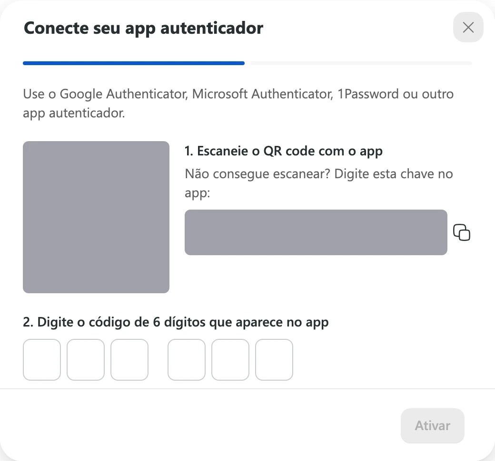

A verificação em duas etapas (2FA) protege sua conta pedindo um código de 6 dígitos de um app autenticador no celular depois da sua senha, do login com o Google ou, no app para iPhone, do login com a Apple. A proteção vale para a conta toda, em todos os workspaces.

<Note>
  Quem pode: cada membro ativa a própria verificação em **Configurações** → **Perfil**. Com a restrição **Não pode mudar informação de perfil** no seu papel, os botões **Ativar** e **Gerenciar** ficam desativados — fale com quem administra o workspace. Essa restrição não vale para o proprietário. Ninguém do workspace ativa, desativa ou exige a verificação de outro membro.
</Note>

## Antes de começar

- Instale um app autenticador no seu celular (como Google Authenticator, Microsoft Authenticator, 1Password ou outro compatível).

## Passo a passo

<Steps>
  <Step title="Abra a seção Segurança no seu perfil">
    Vá em **Configurações** → **Perfil**, role até o cartão **Segurança** e clique em **Ativar** na linha **Verificação em duas etapas** (se o botão aparecer desativado por causa da restrição **Não pode mudar informação de perfil**, fale com quem administra o workspace).

    <Frame caption="Linha Verificação em duas etapas no cartão Segurança, desativada, com o botão Ativar">
      
    </Frame>
  </Step>
  <Step title="Conecte seu app autenticador">
    Na janela **Conecte seu app autenticador**, abra o app no celular e escaneie o QR code. Se não conseguir escanear, use o botão **Copiar** e digite a chave manualmente no app.
  </Step>
  <Step title="Digite o código de 6 dígitos">
    Digite o código de 6 dígitos exibido no app autenticador. Ao completar os 6 números, a Kinbox envia automaticamente (ou clique em **Ativar**, que só libera com os 6 dígitos).

    <Frame caption="Parte de baixo da janela Conecte seu app autenticador, com o campo do código e o botão Ativar">
      
    </Frame>
  </Step>
  <Step title="Guarde seus códigos de recuperação">
    Na janela **Guarde seus códigos de recuperação**, salve os 10 códigos usando **Copiar** ou **Baixar .txt**. Se perder o acesso ao app autenticador, use um desses códigos para entrar — cada um funciona uma única vez.
  </Step>
  <Step title="Conclua a ativação">
    Marque **Guardei meus códigos em um lugar seguro** e clique em **Concluir**. Aparece "Verificação em duas etapas ativada."
  </Step>
</Steps>

<Warning>
  A verificação em duas etapas já fica ativa no passo 3, antes de os códigos de recuperação aparecerem. Se você fechar a janela no passo 4 sem guardar os códigos, abra **Gerenciar** → **Gerar novos códigos de recuperação** para criar uma nova lista.
</Warning>

## Depois de ativar

- A linha **Verificação em duas etapas** no cartão **Segurança** passa a mostrar **Ativada**, a data da ativação, quantos dos 10 códigos de recuperação restam e o botão **Gerenciar**.
- Você recebe o e-mail "Verificação em duas etapas ativada". Se não tiver sido você, troque sua senha (veja [Trocar a senha, recuperar o acesso e sair da conta](/docs/conta/senha-e-sessoes)) e fale com o suporte: sua foto, no canto superior direito → **Ajuda e documentação** → **Falar com o suporte no WhatsApp**.
- Quem entra na Kinbox por convite também pode ativar a verificação ao terminar o cadastro, na tela **Proteja sua conta** (**Ativar agora** ou **Agora não**).

## Entrar na Kinbox com o código

Depois de informar e-mail e senha, usar **Continuar com o Google** ou, no app para iPhone, **Continuar com Apple**, aparece a tela **Verificação em duas etapas**:

- Digite o código de 6 dígitos do app autenticador (ao completar os 6 números, o envio é automático, ou clique em **Verificar**).
- Cada código do app só vale uma vez: se você acabou de usá-lo, espere o próximo código. Se todos os códigos forem recusados, confira se a hora do celular está configurada no automático.
- Sem o app autenticador por perto, clique em **Usar um código de recuperação** e digite um dos códigos guardados (formato `xxxx-xxxx`). Cada código de recuperação deixa de funcionar depois de usado.
- Redefinir a senha não desativa a verificação em duas etapas. Se o código for recusado ou a tela expirar, veja [Não consigo entrar na Kinbox](/docs/conta/problemas-de-acesso).

## Gerar novos códigos ou desativar

<Steps>
  <Step title="Abra o menu Gerenciar">
    Vá em **Configurações** → **Perfil**, no cartão **Segurança**, e clique em **Gerenciar** na linha **Verificação em duas etapas**.
  </Step>
  <Step title="Escolha a ação e confirme com um código">
    - **Gerar novos códigos de recuperação:** digite um código atual do app autenticador (ou clique em **Usar um código de recuperação**), clique em **Gerar códigos**, salve a nova lista na janela **Seus novos códigos de recuperação** e clique em **Concluir**. Os códigos anteriores deixam de funcionar.
    - **Desativar:** na janela **Desativar verificação em duas etapas**, confirme com um código do app (ou de recuperação) e clique em **Desativar**. Aparece "Verificação em duas etapas desativada." e você recebe um e-mail de aviso.
  </Step>
</Steps>

## Perdi o celular

<Warning>
  Sem o app autenticador e sem nenhum código de recuperação, você não consegue entrar nem desativar a verificação sozinho, e quem administra o workspace também não consegue redefini-la. Só o suporte da Kinbox pode redefinir a verificação em duas etapas.
</Warning>

Como você não conseguirá entrar na Kinbox para abrir o suporte, peça a um colega do workspace ou ao proprietário que acione o suporte pela foto no canto superior direito → **Ajuda e documentação** → **Falar com o suporte no WhatsApp**.

Depois da redefinição, você recebe o e-mail "Verificação em duas etapas redefinida pelo suporte", entra com sua senha e pode ativar a verificação novamente em [Editar seu perfil](/docs/configuracoes-no-workspace/configurar-o-perfil-do-usuario).

## Quem administra o workspace

Quem administra os membros vê quem ativou a verificação pelo escudo verde na lista de **Membros** (veja [Gerenciar membros](/docs/configuracoes-no-workspace/gerenciar-membros)) e na coluna **Verificação em duas etapas** da exportação. Não existe opção para obrigar todo o workspace a usar a verificação em duas etapas.
