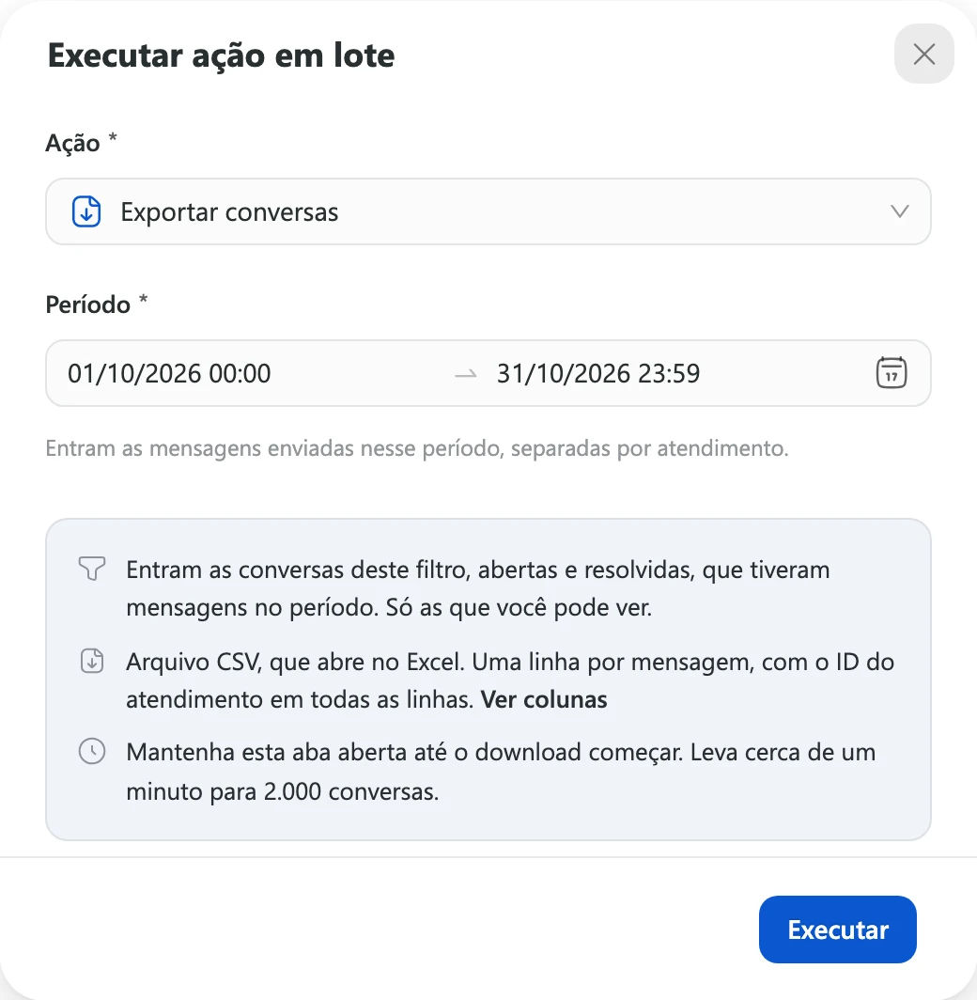

Execute uma mesma ação em várias conversas ao mesmo tempo ou baixe o histórico em CSV. As duas coisas partem da lista aberta, mas pegam conversas diferentes:

- **Ação em lote** (resolver, atribuir, mover, tags): vale para **todas** as conversas que estão na lista aberta. Escolha antes a visão, um [filtro de conversa](/docs/conversas/criar-filtros-de-conversa) ou o **Filtrar por** que mostre só as conversas que você quer alterar.
- **Exportar conversas**: pega as conversas da visão ou do filtro **abertas e resolvidas** que tiveram mensagens no período. Por exemplo, exportar a partir de **Abertos** também traz as conversas já resolvidas que tiveram mensagens no período escolhido.

<Note>
  Quem pode: membros sem a restrição **Não pode executar ações em lote** (que desativa o item **Executar ação...**). **Atribuir** exige a permissão **Atribuir**, **Mover para grupo** exige **Mover para grupo**, e a exportação não está disponível para quem tem a restrição **Não pode exportar para CSV**.
</Note>

## Executar uma ação em lote

<Steps>
  <Step title="Abra a lista com as conversas desejadas">
    Selecione a visão ou o filtro na [Caixa de entrada](/docs/conversas/caixa-de-entrada-do-kinbox). Se precisar afunilar ainda mais, aplique **Mais opções** → **Filtrar por** ou o campo **Pesquisar** da lista.
  </Step>
  <Step title="Abra Executar ação em lote">
    No topo da lista de conversas, clique em **Mais opções** (três pontos) → **Executar ação...**.
  </Step>
  <Step title="Escolha a ação e execute">
    Selecione a **Ação**, preencha o campo adicional quando houver (**Membro**, **Grupo**, **Tag** ou **Período**) e clique em **Executar**.
  </Step>
  <Step title="Aguarde a barra de progresso">
    Deixe a janela aberta até o processo terminar. Se precisar interromper no meio, clique em **Abortar**.
  </Step>
</Steps>

### Ações disponíveis

| Ação | O que faz |
| --- | --- |
| **Resolver** | Encerra as conversas abertas da lista. |
| **Atribuir** | Atribui as conversas ao **Membro** escolhido (seguindo as regras de grupo e bot de [Atribuir, mover para um grupo ou transferir uma conversa](/docs/conversas/atribuir-e-transferir)). |
| **Mover para grupo** | Move as conversas para o **Grupo** escolhido. |
| **Adicionar Tag** | Adiciona a **Tag** escolhida às conversas da lista. |
| **Remover Tag** | Remove a **Tag** escolhida das conversas da lista. |
| **Exportar conversas** | Gera um arquivo CSV com os atendimentos e mensagens do período selecionado. |

Ao usar **Resolver** em lote, conversas que não podem ser resolvidas (por exemplo, com um campo personalizado obrigatório em branco) são puladas — o aviso no fim mostra quantas foram concluídas no formato "feitas/total" (como `8/10`).

## Exportar as conversas de um filtro

<Steps>
  <Step title="Selecione a visão ou o filtro">
    Abra a visão ou o filtro desejado na **Caixa de entrada**. Entram as conversas desse filtro — abertas e resolvidas — que você pode ver e que tiveram mensagens no período escolhido.
  </Step>
  <Step title="Escolha Exportar conversas e o período">
    Clique em **Mais opções** → **Executar ação...**, selecione **Exportar conversas** em **Ação** e defina o **Período** (o padrão é o mês passado inteiro). Cada exportação aceita até 93 dias e até 10 mil conversas: se passar disso, escolha um período menor ou um filtro mais específico.

    <Frame caption="Janela Executar ação em lote com Exportar conversas e seleção de Período">
      
    </Frame>
  </Step>
  <Step title="Execute e mantenha a aba aberta">
    Clique em **Executar** e mantenha a aba aberta até o download começar (leva cerca de um minuto para 2.000 conversas).
  </Step>
</Steps>

O arquivo baixado é um CSV pronto para abrir no Excel, com uma linha por mensagem e o ID do atendimento em todas as linhas; notas internas também entram, e arquivos e mídias aparecem como link. Para conferir todos os campos antes de baixar, clique em **Ver colunas** na própria janela.

## Exportar uma conversa só

Para baixar o histórico de uma conversa específica, abra a conversa e clique em **Mais ações** (três pontos no cabeçalho) → **Exportar para CSV**. A Kinbox gera um arquivo CSV com data, remetente e mensagem, com até 9.999 mensagens da conversa.
