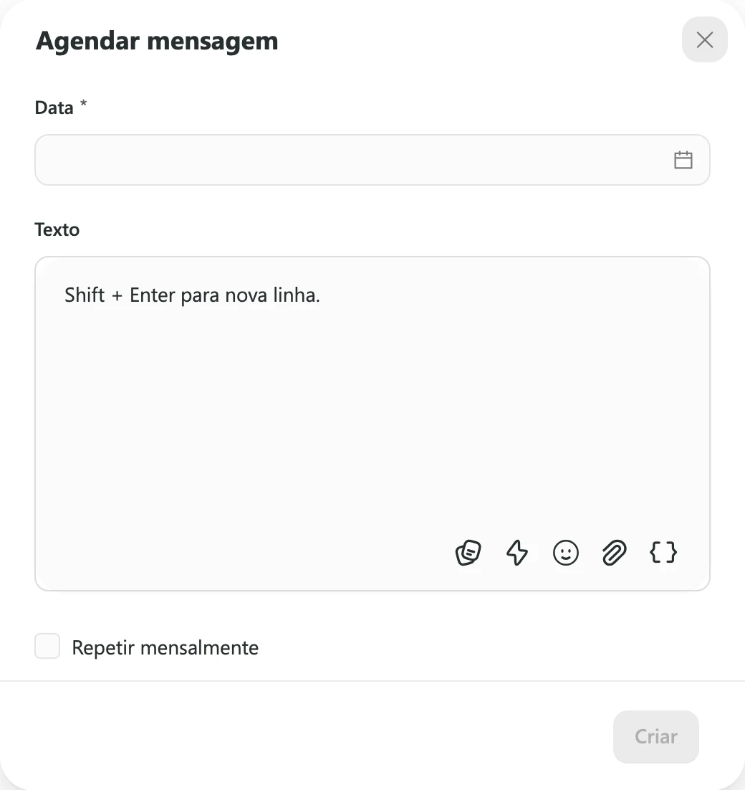

Programe o envio de uma mensagem em uma conversa para uma data e horário futuros, com opção de repetição mensal.

<Note>
  Quem pode: membros com a permissão **Agendar mensagem**. Sem ela, o item aparece desativado no menu.
</Note>

## Passo a passo

<Steps>
  <Step title="Abra o agendamento na conversa">
    No cabeçalho da conversa, clique em **Mais ações** (três pontos) → **Agendar mensagem**. Você também pode abrir pelo comando na pesquisa geral (`Ctrl+K` / `⌘K`).
  </Step>
  <Step title="Defina a data, o conteúdo e a repetição">
    Escolha a **Data** (data e hora no formato `DD/MM/AAAA HH:mm`, a partir de hoje) e escreva o **Texto** — o editor aceita [frases rápidas](/docs/conversas/criar-frases-rapidas-para-suas-conversas), emojis, anexos, chaves `{}` e também **Áudio**. Se quiser enviar todo mês, marque **Repetir mensalmente**.

    <Frame caption="Janela Agendar mensagem com Data, Texto e Repetir mensalmente">
      
    </Frame>
  </Step>
  <Step title="Salve o agendamento">
    Clique em **Criar**. Aparece o aviso "Agendamento realizado.".
  </Step>
</Steps>

## WhatsApp oficial

Se a data escolhida ficar dentro da janela de 24 horas desde a última mensagem do contato, você pode agendar texto livre. Quando a janela já está fechada ou encerra antes do horário marcado, a tela troca o campo de texto por **Modelo de mensagem**, exigindo um template aprovado pela Meta.

## Depois de agendar

- O cabeçalho da conversa exibe o selo **Mensagem Agendada** (passar o mouse mostra a data do envio).
- Clique no selo **Mensagem Agendada** — ou abra **Mais ações** → **Ver Informações** — e vá em **Agendamentos** para consultar todos os agendamentos da conversa.
- Clique em um agendamento ainda não enviado para editar os dados ou excluí-lo. Agendamentos já enviados abrem apenas para visualização, sem botão de salvar.

## Bom saber

- A mensagem pode sair alguns minutos depois do horário definido.
- Chaves como `{{name}}` e `{{first_name}}` são trocadas pelos dados do contato na hora do envio; se o contato não tiver valor naquele campo, a chave some do texto.
- Se a conversa estiver resolvida quando chegar a hora do envio, a Kinbox abre uma nova sessão atribuída a quem criou o agendamento.
- Com **Repetir mensalmente** marcado, depois que a mensagem é enviada a Kinbox agenda automaticamente a próxima para o mês seguinte.
