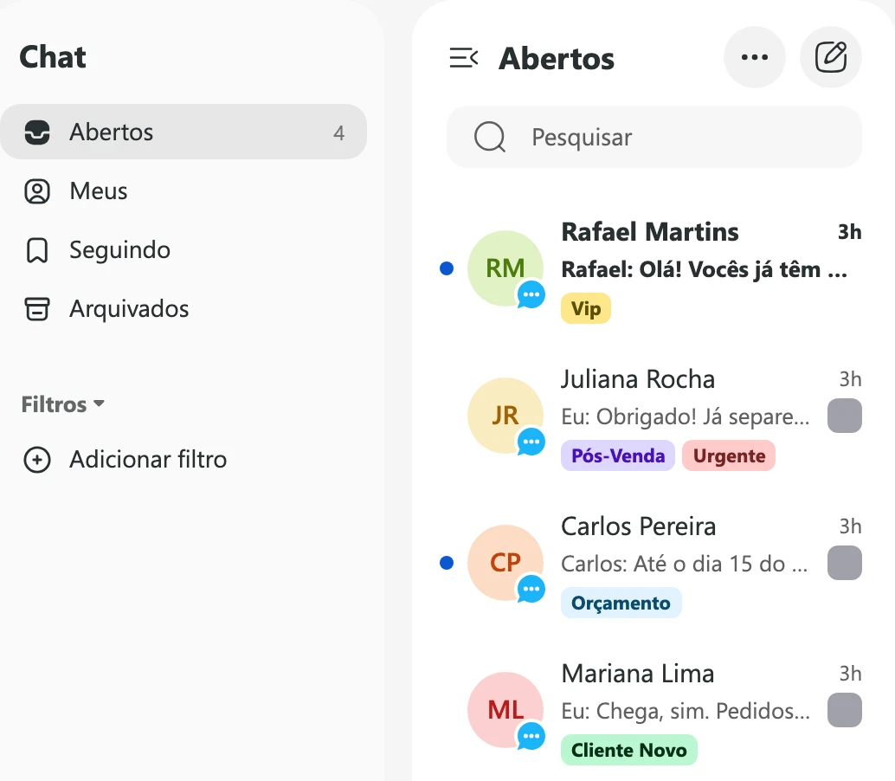

A **Caixa de entrada** é a tela onde chegam e são atendidas as conversas de todos os canais conectados ao workspace (na tela, **ambiente**). Cada conversa reúne a troca de mensagens com um contato em um canal, dividida em sessões numeradas a cada atendimento.

## Como a tela se organiza

Você acessa a **Caixa de entrada** no primeiro item da barra lateral. A tela se divide em três colunas:

1. **Painel Chat**, à esquerda: traz as visões padrão (**Abertos**, **Meus**, **Seguindo**, **Arquivados**) e a seção **Filtros** para os filtros personalizados.
2. **Lista de conversas**, ao centro: mostra as conversas da visão ou do filtro selecionado. Cada item exibe a foto ou iniciais do contato, o ícone do canal, o nome, a prévia e o horário da última mensagem, as tags, a foto de quem atende e um ponto azul quando há mensagem não lida.
3. **Conversa aberta**, à direita: mostra as mensagens, o editor de resposta e o painel **Detalhes** (com **Contato**, **Negociações**, **Tarefas** e **Notas**), além dos ícones laterais **Detalhes**, **Linha do tempo** e **Notas**. Quando nenhuma conversa está aberta, a tela orienta a selecionar uma conversa ou escolher um filtro.

<Frame caption="Caixa de entrada com o painel Chat à esquerda e a lista Abertos">
  
</Frame>

## Visões padrão

| Visão | O que mostra |
| --- | --- |
| **Abertos** | Todas as conversas não resolvidas que você pode ver. |
| **Meus** | Conversas atribuídas a você e ainda não resolvidas. |
| **Compartilhados** | Conversas de outro membro que escolheu você em **Compartilhamento de conversas**, no perfil dele. Só aparece quando alguém faz isso. |
| **Seguindo** | Conversas que você marcou em **Mais ações** → **Seguir**. Seguir não atribui a conversa a você. |
| **Arquivados** | Conversas que foram resolvidas. |

O número ao lado das visões e dos filtros conta só as conversas abertas.

## Encontrar uma conversa

- **Na lista atual:** use o campo **Pesquisar** no topo da lista para buscar dentro da visão ou do filtro aberto.
- **Em todo o workspace:** use o campo **Pesquisar** no topo da tela (ou `Ctrl+K` / `⌘K`). Ele encontra o contato por nome, telefone, e-mail ou campo personalizado e lista as conversas dele.

## O que dá para fazer na lista

- Filtrar na hora por **Atribuído a**, **Grupo**, **Tag** ou **Campo personalizado**, ordenar por **Mais recentes** ou **Mais antigos**, e usar **Esconder tags** / **Mostrar tags** pelo botão **Mais opções** (três pontos).
- Criar visões salvas que se atualizam sozinhas em [Criar filtros de conversa](/docs/conversas/criar-filtros-de-conversa).
- Resolver, atribuir, mover, pôr ou tirar tags de várias conversas de uma vez, ou exportar para CSV, em [Ações em lote e exportar conversas](/docs/conversas/acoes-em-lote-e-exportar).
- Mandar a primeira mensagem para um contato pelo botão **Enviar mensagem** (ícone de lápis): veja [Iniciar uma conversa com um contato](/docs/conversas/iniciar-conversa).

## Quem vê o quê

As conversas visíveis para cada membro dependem da opção **Acesso as Conversas** definida no papel dele pelo administrador em **Configurações** → **Ambiente** → **Permissões**. O proprietário do workspace vê todas as conversas.

## Próximos passos

<CardGroup cols={2}>
  <Card title="Atender uma conversa" href="/docs/conversas/gerenciar-conversas">
    Responda contatos, envie notas para o time, anexe arquivos, resolva e reabra conversas.
  </Card>
  <Card title="Atribuir e transferir" href="/docs/conversas/atribuir-e-transferir">
    Passe uma conversa para outro membro, mova para um grupo ou transfira para outro número de WhatsApp.
  </Card>
  <Card title="Criar filtros de conversa" href="/docs/conversas/criar-filtros-de-conversa">
    Monte visões salvas por grupo, membro, canal, tag ou estado e organize em pastas.
  </Card>
  <Card title="Não consigo responder ou ver uma conversa" href="/docs/conversas/problemas-comuns">
    Veja o que fazer quando a Kinbox bloqueia o envio, esconde mensagens ou não mostra uma conversa.
  </Card>
</CardGroup>
