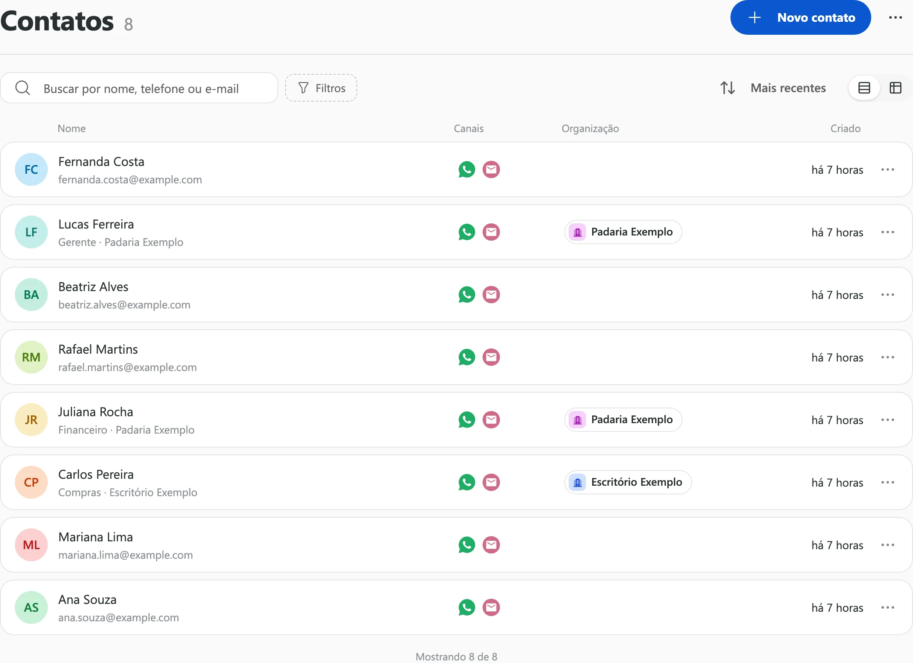
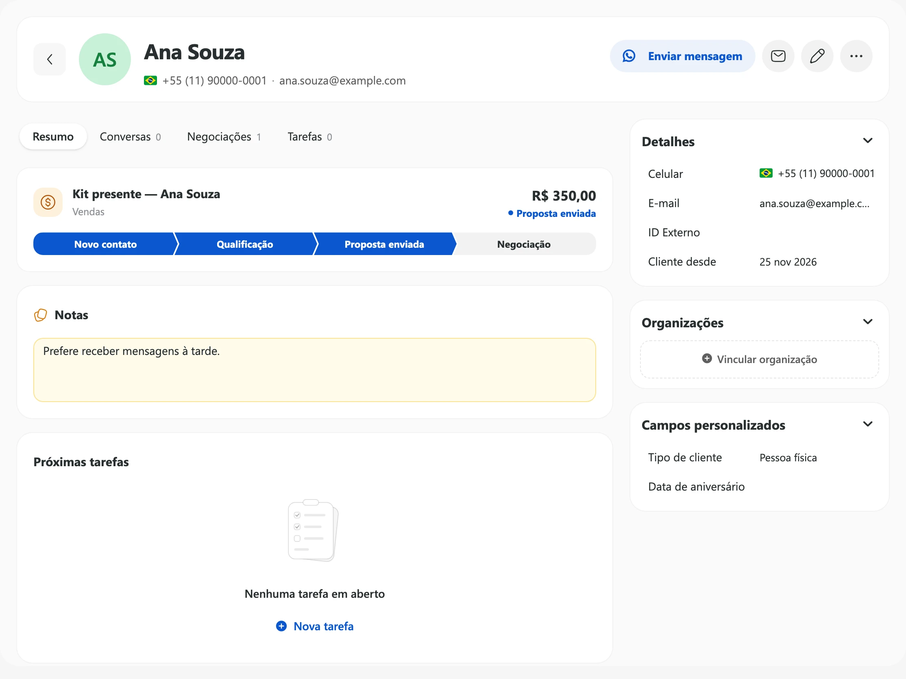

Use a lista de contatos em **Clientes** → **Contatos** para encontrar pessoas cadastradas, criar novos contatos, editar informações, marcar um contato como privado ou excluir cadastros. Para entender como os contatos nascem automaticamente nas conversas e como se relacionam com empresas e vendas, veja [Contatos, organizações e negociações](/docs/conceitos/contatos-e-negocios).

<Note>
  Quem pode: membros com a permissão **Gerenciar Contatos** ou o proprietário do workspace. Se o item **Clientes** não aparecer no menu lateral, peça ao proprietário para dar **Gerenciar Contatos** ao seu papel. Para editar dados ou salvar um contato (inclusive ao criar), seu papel também precisa de **Alterar propriedades do contato**.
</Note>

## A lista de contatos

Acesse **Clientes** no menu lateral (ele aparece como ícone; o nome surge ao passar o mouse) e abra a seção **Contatos**. Se o seu papel também tiver **Gerenciar Organizações**, a seção **Organizações** aparece logo abaixo à esquerda (no celular, a troca fica em abas no topo).

No topo da tela ficam o total de contatos (quando não há busca ativa), o botão **Novo contato** e o menu **⋯** com **Importar contatos**, **Exportar (CSV)** e **Exportar (XLSX)**.

- **Busca:** digite no campo "Buscar por nome, telefone ou e-mail" e aperte **Enter** para pesquisar. A busca exige ao menos 3 letras (para nome ou parte do e-mail) ou 5 números (para telefone); termos com `@` buscam por e-mail.
- **Filtros:** clique em **Filtros** para filtrar por **E-mail**, **Celular**, **Criado entre**, **Sessão criada entre**, **Organização** e **Filtro de conversa** (os filtros salvos em [Criar filtros de conversa](/docs/conversas/criar-filtros-de-conversa)), com atalhos de data (**Hoje**, **Ontem**, **Últimos 7 dias**, **Últimos 30 dias**, **Esse mês**, **Mês passado**) e os botões **Limpar** e **Aplicar**. Cada filtro ativo aparece como etiqueta acima da lista com botão para remover.
- **Ordem:** escolha entre **Mais recentes** (padrão), **Mais antigos**, **Nome (A-Z)** e **Nome (Z-A)**.
- **Cartões ou tabela:** alterne entre a visão em cartões (padrão; única opção no celular) e a visão em tabela (a escolha fica salva no navegador). Na tabela, clique em **Mostrar colunas...** para escolher quais colunas aparecem, incluindo [campos personalizados](/docs/configuracoes-no-workspace/campos-personalizados-no-kinbox) de contato.

Na lista em cartões, cada linha exibe:

- **Nome:** nome do contato com cargo e organização principal (ou e-mail e telefone). Se o contato não tiver nome, a Kinbox mostra o telefone, depois o e-mail ou "Visitante" seguido do identificador.
- **Canais:** ícones dos canais do contato (passe o mouse para ver o valor).
- **Organização:** organização principal e quantas outras organizações estão vinculadas.
- **Criado:** há quanto tempo o contato foi criado e quem o cadastrou (ou que veio da importação).

A lista carrega mais contatos conforme você rola a página.

<Frame caption="Lista de contatos em Clientes → Contatos com busca, filtros, ordenação e alternância entre cartões e tabela">
  
</Frame>

## Cadastrar um contato

<Steps>
  <Step title="Abra o painel Criar contato">
    Em **Clientes** → **Contatos**, clique em **Novo contato**.
  </Step>

  <Step title="Preencha os dados do contato">
    Preencha as seções do painel conforme a necessidade:

    - **Adicionar foto** (opcional, imagem de até 2 MB) e **Nome**.
    - **CANAIS:** informe **E-mail** e **Celular** (clique na bandeira para escolher o código do país, como `+55 11 90000-0001`). Preencha ao menos o celular ou o e-mail para poder enviar mensagens depois.
    - **ORGANIZAÇÕES** (opcional, aparece com **Gerenciar Organizações**): clique em **Vincular organização** para ligar o contato a uma empresa; veja [Agrupar contatos em organizações](/docs/clientes/organizacoes).
    - **NOTAS** (opcional): observações internas sobre o contato.
    - **CONFIGURAÇÕES:** ative **Vincular ao Kinbox Agenda** (se não aparecer, o app Kinbox Agenda não está ativo no workspace; quando ligada, o campo **E-mail** vira obrigatório) e **Contato privado** (aparece apenas para quem tem **Ver telefone de contatos privados**).
    - **Campos personalizados:** preencha os campos cadastrados para a entidade **Contato** (quando há mais de 4 campos vazios, eles ficam recolhidos em **Mostrar ... campos vazios**).

    <Frame caption="Painel Criar contato com foto, Nome, CANAIS, ORGANIZAÇÕES, NOTAS, CONFIGURAÇÕES e Salvar">
      
    </Frame>
  </Step>

  <Step title="Salve o cadastro">
    Clique em **Salvar**. Se o botão **Salvar** estiver desativado, falta a permissão **Alterar propriedades do contato** no seu papel.
  </Step>
</Steps>

Depois de salvar, aparece o aviso "Contato criado." e o perfil do novo contato abre. Se já houver outro cadastro com exatamente o mesmo telefone, a Kinbox mostra "Já existe um contato cadastrado com esse telefone" (e-mails repetidos não são recusados).

Para aproveitar os dados de um contato existente em um novo cadastro, abra o menu **⋯** dele (na lista ou no perfil) e clique em **Clonar**: o painel **Criar contato** abre já preenchido.

## O perfil do contato

Clique em qualquer contato da lista para abrir o perfil dele.

- **Cabeçalho:** mostra foto, nome, telefone e e-mail, o selo **Privado** (quando ativo), a organização principal, **Canais** e **Última interação**, além dos botões **Enviar mensagem**, enviar e-mail, **Editar** (lápis) e **⋯** (**Buscar conversas**, **Clonar** e **Excluir**).
- **Abas:** **Resumo** (negociações em aberto, **Notas**, **Próximas tarefas**, **Últimas conversas** e histórico do contato), **Conversas**, **Negociações** e **Tarefas**.
- **Lateral direita:** **Detalhes** (**Celular**, **E-mail**, Instagram, Facebook ou Telegram quando existem, **ID Externo**, **Cliente desde**, **Origem** e **Criado por** — os três últimos são somente leitura), **Organizações** (visível com **Gerenciar Organizações** ou quando já há vínculo), **Campos personalizados** e **Anúncios** (quando o contato veio de anúncio).

Para editar um único dado (com **Alterar propriedades do contato**), clique direto sobre o valor dele na lateral. Para editar vários dados e registrar a mudança no histórico do contato, clique no lápis (**Editar**) no cabeçalho. Na aba **Resumo**, clique no quadro **Notas** para editar as anotações e pressione `Ctrl + Enter` para salvar.

<Frame caption="Perfil do contato com cabeçalho de ações, abas, Notas e painel lateral com Detalhes, Organizações e Campos personalizados">
  
</Frame>

## Contato privado

A opção **Contato privado** esconde o telefone e o e-mail do contato de membros que não têm a permissão **Ver telefone de contatos privados**.

- **Quem vê e quem configura:** apenas membros com **Ver telefone de contatos privados** e o proprietário veem a chave **Contato privado** em **Configurações** e conseguem ver telefone e e-mail do contato.
- **Como aparece para os demais:** o telefone e o e-mail aparecem como `*******` ou ficam ocultos no perfil e bloqueados no formulário, e saem em branco na [exportação de contatos](/docs/clientes/exportar-contatos). Na lista, o contato ganha um ícone de cadeado ("Contato privado") e, no perfil, o selo **Privado**.
- **Como ligar:** abra o formulário do contato (**Novo contato** ou **Editar**), ative **Contato privado** em **Configurações** e clique em **Salvar**.

## Enviar mensagem e buscar conversas

Na lista (menu **⋯**) ou no perfil do contato, clique em **Enviar mensagem** para abrir a janela de nova mensagem com os dados dele preenchidos (WhatsApp ou SMS se houver celular; canal de e-mail se houver apenas e-mail). Sem celular nem e-mail (ou sem canal de e-mail disponível), o botão fica desativado. Veja como funciona o envio em [Iniciar uma conversa com um contato](/docs/conversas/iniciar-conversa).

Para abrir a busca de conversas já preenchida com o telefone, e-mail ou nome do contato, use **Buscar conversas** no menu **⋯**.

## Excluir um contato

<Warning>
  Excluir um contato apaga o cadastro, os campos personalizados e **todas as conversas** dele. Essa ação não pode ser desfeita e não existe lixeira. As negociações ligadas ao contato não são excluídas.
</Warning>

<Steps>
  <Step title="Escolha Excluir no menu do contato">
    Na lista de contatos ou no cabeçalho do perfil, abra o menu **⋯** e clique em **Excluir**.
  </Step>

  <Step title="Confirme a exclusão">
    Confirme o aviso "Tem certeza que deseja excluir esse contato do ambiente?". Se o contato tiver conversas, confirme também a segunda mensagem: "Este contato possui conversas associadas. Ao excluir, todas as conversas também serão removidas. Deseja continuar?".
  </Step>
</Steps>

Contatos vinculados ao Kinbox Agenda que tenham agendamentos não podem ser excluídos ("Não é possível excluir: esse contato tem agendamentos vinculados no Kinbox Agenda."). Não existe exclusão em lote na tela de contatos.

## Permissões que mudam esta tela

O proprietário do workspace tem todas as permissões abaixo e não sofre restrições. Para os demais membros, as opções da seção **Contatos** do papel definem o que cada pessoa vê e faz:

| Opção no papel | O que muda na tela de contatos |
| --- | --- |
| **Gerenciar Contatos** | Libera a seção **Contatos** em **Clientes** para ver, cadastrar, importar, editar e excluir contatos. |
| **Gerenciar Organizações** | Libera a seção **Organizações** e o vínculo de contatos com organizações. |
| **Alterar propriedades do contato** | Libera a edição no perfil e o botão **Salvar** no formulário (inclusive ao criar). |
| **Ver telefone de contatos privados** | Exibe a chave **Contato privado** e libera telefone e e-mail de contatos privados. |
| **Não pode exportar contatos** *(restrição)* | Desativa as opções de exportar contatos e esconde a exportação de organizações. |
| **Esconder telefone** *(restrição)* | Esconde o telefone na lista, exibe `*******` no perfil e oculta **Celular** no formulário. |
| **Proibir alterar celular** *(restrição)* | Bloqueia a edição do campo **Celular** no perfil e no formulário. |

Para ajustar papéis, veja [Criar papéis e permissões](/docs/configuracoes-no-workspace/configurar-permissoes-dos-usuarios) e [Referência de permissões](/docs/administracao/referencia-de-permissoes).

## Próximos passos

<CardGroup cols={2}>
  <Card title="Importar contatos de uma planilha" href="/docs/clientes/importar-contatos">
    Suba uma planilha CSV ou Excel para criar ou atualizar vários contatos e vincular organizações.
  </Card>
  <Card title="Exportar contatos" href="/docs/clientes/exportar-contatos">
    Baixe a lista filtrada de contatos (por contato ou por conversa) ou de organizações em CSV ou XLSX.
  </Card>
  <Card title="Mesclar contatos duplicados" href="/docs/clientes/mesclar-contatos">
    Junte dois contatos com o mesmo número de WhatsApp direto pela conversa.
  </Card>
  <Card title="Agrupar contatos em organizações" href="/docs/clientes/organizacoes">
    Cadastre empresas, defina cargos e escolha a organização principal de cada contato.
  </Card>
</CardGroup>
