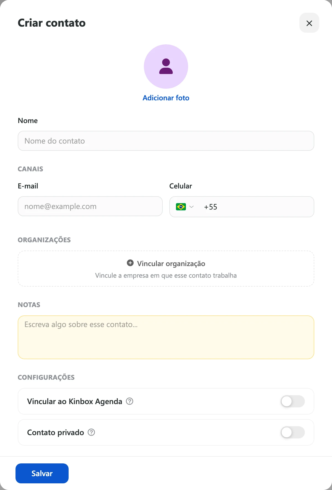

Use a lista de contatos em **Clientes** → **Contatos** para encontrar pessoas cadastradas, criar contatos, editar informações, marcar um contato como privado ou excluir cadastros. Para entender como os contatos nascem nas conversas e como se ligam a empresas e vendas, veja [Contatos, organizações e negociações](/docs/conceitos/contatos-e-negocios).

<Note>
  Quem pode: membros com a permissão **Gerenciar Contatos** ou o proprietário do workspace. Para editar dados ou salvar um contato (inclusive ao criar), o papel também precisa de **Alterar propriedades do contato**. Se o item **Clientes** não aparecer no menu lateral, peça ao proprietário para dar **Gerenciar Contatos** ao seu papel.
</Note>

## A lista de contatos

Abra **Clientes** no menu lateral (ele aparece como ícone; o nome surge ao passar o mouse) e escolha **Contatos**. Se o seu papel também tiver **Gerenciar Organizações**, a seção **Organizações** aparece logo abaixo.

No topo ficam o total de contatos, o botão **Novo contato** e o menu **⋯**, com **Importar contatos**, **Exportar (CSV)** e **Exportar (XLSX)**.

- **Busca:** digite em "Buscar por nome, telefone ou e-mail" e aperte **Enter**. Use ao menos 3 letras (nome ou parte do e-mail) ou 5 números (telefone).
- **Filtros:** clique em **Filtros** para recortar a lista, por exemplo por **Organização**, **Criado entre** ou **Filtro de conversa** (os filtros de [Criar filtros de conversa](/docs/conversas/criar-filtros-de-conversa)), e clique em **Aplicar**.
- **Ordem:** **Mais recentes** (padrão), **Mais antigos**, **Nome (A-Z)** ou **Nome (Z-A)**.
- **Cartões ou tabela:** a visão em cartões é a padrão. Na tabela, **Mostrar colunas...** escolhe as colunas, inclusive os [campos personalizados](/docs/configuracoes-no-workspace/campos-personalizados-no-kinbox) de contato.

Cada contato mostra o nome (com cargo e organização principal, quando houver), os canais, a organização principal e quando foi criado. A lista carrega mais contatos conforme você rola a página.

<Frame caption="Lista de contatos em Clientes → Contatos com busca, filtros, ordenação e alternância entre cartões e tabela">
  
</Frame>

## Cadastrar um contato

<Steps>
  <Step title="Abra o painel Criar contato">
    Em **Clientes** → **Contatos**, clique em **Novo contato**.
  </Step>

  <Step title="Preencha os dados do contato">
    Preencha o que precisar:

    - **Adicionar foto** (opcional, imagem de até 2 MB) e **Nome**.
    - **Canais:** **E-mail** e **Celular** (clique na bandeira para escolher o código do país, como `+55 11 90000-0001`). Preencha ao menos o celular ou o e-mail para poder mandar mensagens depois.
    - **Organizações** (opcional, com **Gerenciar Organizações**): clique em **Vincular organização**; veja [Agrupar contatos em organizações](/docs/clientes/organizacoes).
    - **Notas** (opcional): observações internas sobre o contato.
    - **Configurações:** **Contato privado** (aparece só para quem tem **Ver telefone de contatos privados**) e **Vincular ao Kinbox Agenda** (veja abaixo e [Kinbox Agenda: visão geral](/docs/agenda/kinbox-agenda)).
    - **Campos personalizados:** os campos cadastrados para a entidade **Contato**. Com mais de 4 campos vazios, eles ficam recolhidos em **Mostrar ... campos vazios**.

    <Frame caption="Painel Criar contato com foto, Nome, Canais, Organizações, Notas, Configurações e Salvar">
      
    </Frame>
  </Step>

  <Step title="Salve o cadastro">
    Clique em **Salvar**. Se o botão **Salvar** estiver desativado, falta a permissão **Alterar propriedades do contato** no seu papel.
  </Step>
</Steps>

Depois de salvar, aparece o aviso "Contato criado." e o perfil do novo contato abre. Se já existe outro cadastro com exatamente o mesmo telefone, a Kinbox mostra "Já existe um contato cadastrado com esse telefone". E-mail repetido não é recusado.

**Vincular ao Kinbox Agenda:** com a chave ligada, o **E-mail** e o campo de data de nascimento (quando existir no workspace) passam a ser obrigatórios para salvar. Para criar ou refazer o vínculo, o contato também precisa de **Celular**: sem celular, o contato é salvo, mas o vínculo não é criado.

Para aproveitar os dados de um contato num novo cadastro, abra o menu **⋯** dele (na lista ou no perfil) e clique em **Clonar**: o painel **Criar contato** abre já preenchido.

## O perfil do contato

Clique em qualquer contato da lista para abrir o perfil dele.

- **Cabeçalho:** foto, nome, telefone e e-mail, o selo **Privado** (quando o contato é privado), a organização principal (quando houver), **Canais** e **Última interação**, e os botões **Enviar mensagem**, enviar e-mail, **Editar** (lápis) e **⋯** (**Buscar conversas**, **Clonar** e **Excluir**).
- **Abas:** **Resumo** (negociações em aberto, **Notas**, **Próximas tarefas**, **Últimas conversas** e o histórico do contato), **Conversas**, **Negociações** e **Tarefas** (veja [Criar e acompanhar tarefas](/docs/tarefas/criando-e-gerenciando-tarefas)).
- **Lateral direita:** **Detalhes** (**Celular**, **E-mail**, Instagram, Facebook ou Telegram quando houver, **ID Externo**, **Cliente desde** e, quando houver, **Origem** e **Criado por**), **Organizações**, **Campos personalizados** e **Anúncios** (quando o contato veio de um anúncio; veja [Medir anúncios e o site com a Kinbox](/docs/marketing/visao-geral)).

Para editar um dado, clique no valor dele na lateral. Para editar vários de uma vez, clique no lápis (**Editar**). **Cliente desde**, **Origem** e **Criado por** não mudam. Na aba **Resumo**, clique no quadro **Notas** para editar as anotações e aperte `Ctrl + Enter` para salvar.

<Frame caption="Perfil do contato com ações no cabeçalho, abas, Notas e a lateral com Detalhes, Organizações e Campos personalizados">
  
</Frame>

## Contato privado

**Contato privado** esconde o telefone e o e-mail do contato de quem não tem a permissão **Ver telefone de contatos privados**.

- **Quem vê:** só o proprietário e quem tem **Ver telefone de contatos privados** vê a chave **Contato privado** e os dados desse contato.
- **Para os outros membros:** telefone e e-mail aparecem como `*******` ou ficam ocultos, e saem em branco na [exportação de contatos](/docs/clientes/exportar-contatos). Na lista, o contato tem um cadeado; no perfil, o selo **Privado**.
- **Como ligar:** abra o formulário do contato (**Novo contato** ou **Editar**), ligue **Contato privado** na seção **Configurações** e clique em **Salvar**.

## Enviar mensagem e buscar conversas

Na lista (menu **⋯**) ou no perfil, clique em **Enviar mensagem** para abrir a janela de nova mensagem com os dados do contato (WhatsApp ou SMS se houver celular; e-mail se houver só e-mail). Sem celular nem e-mail, ou sem canal de e-mail disponível, o botão fica desativado. Veja [Iniciar uma conversa com um contato](/docs/conversas/iniciar-conversa).

Para procurar as conversas do contato, use **Buscar conversas** no menu **⋯**.

## Excluir um contato

<Warning>
  Excluir um contato apaga o cadastro, os campos personalizados e **todas as conversas** dele. Não tem volta e não existe lixeira. As negociações ligadas ao contato não são excluídas (veja [Trabalhar com negociações no funil](/docs/crm/gerenciando-funil-de-vendas)).
</Warning>

<Steps>
  <Step title="Escolha Excluir no menu do contato">
    Na lista ou no cabeçalho do perfil, abra o menu **⋯** e clique em **Excluir**.
  </Step>

  <Step title="Confirme a exclusão">
    Confirme "Tem certeza que deseja excluir esse contato do ambiente?". Se o contato tem conversas, confirme também "Este contato possui conversas associadas. Ao excluir, todas as conversas também serão removidas. Deseja continuar?".
  </Step>
</Steps>

Contatos vinculados ao Kinbox Agenda que têm agendamentos não podem ser excluídos ("Não é possível excluir: esse contato tem agendamentos vinculados no Kinbox Agenda."). Não existe exclusão em lote na tela de contatos.

## Permissões que mudam esta tela

O proprietário do workspace tem todas estas permissões. Para os outros membros, valem as opções da seção **Contatos** do papel:

| Permissão | O que libera |
| --- | --- |
| **Gerenciar Contatos** | A seção **Contatos** em **Clientes**: ver, cadastrar, importar, editar e excluir contatos. |
| **Gerenciar Organizações** | A seção **Organizações** e o vínculo de contatos com organizações. |
| **Alterar propriedades do contato** | A edição no perfil e o botão **Salvar** do formulário (inclusive ao criar). |
| **Ver telefone de contatos privados** | A chave **Contato privado** e o telefone e o e-mail de contatos privados. |

O papel também tem restrições que escondem ou bloqueiam dados do contato, como **Esconder telefone**, **Proibir alterar celular** e **Não pode exportar contatos**. Veja o que cada uma faz em [Referência de permissões](/docs/administracao/referencia-de-permissoes) e como ajustar papéis em [Criar papéis e permissões](/docs/configuracoes-no-workspace/configurar-permissoes-dos-usuarios).

## Próximos passos

Se algo não funcionar como esperado, veja [Problemas com contatos, importação e campos personalizados](/docs/clientes/problemas-comuns).

<CardGroup cols={2}>
  <Card title="Agrupar contatos em organizações" href="/docs/clientes/organizacoes">
    Cadastre empresas, defina cargos e escolha a organização principal de cada contato.
  </Card>
  <Card title="Importar contatos de uma planilha" href="/docs/clientes/importar-contatos">
    Suba uma planilha CSV ou Excel para criar ou atualizar vários contatos e vincular organizações.
  </Card>
  <Card title="Exportar contatos" href="/docs/clientes/exportar-contatos">
    Baixe os contatos (com os filtros da tela), os dados de atendimento por conversa ou as organizações, em CSV ou XLSX.
  </Card>
  <Card title="Mesclar contatos duplicados" href="/docs/clientes/mesclar-contatos">
    Junte dois contatos com o mesmo número de WhatsApp pela conversa.
  </Card>
</CardGroup>
