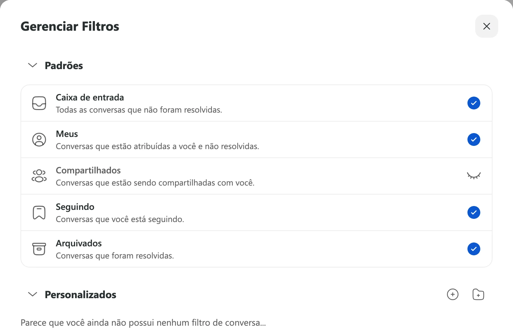
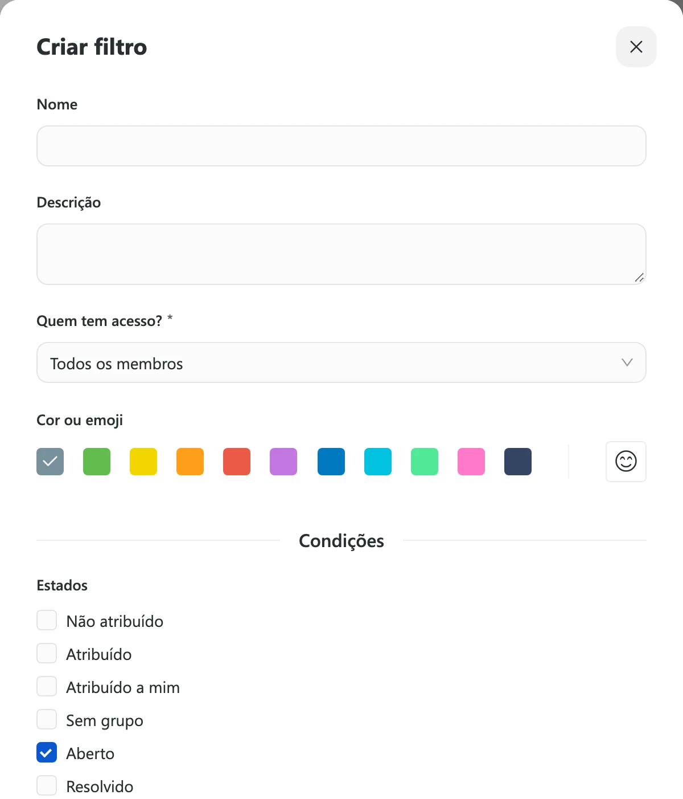

Um filtro de conversa é uma lista salva da [Caixa de entrada](/docs/conversas/caixa-de-entrada-do-kinbox) que se atualiza sozinha sempre que uma conversa passa a atender ou deixa de atender às condições definidas.

<Note>
  Quem pode: para criar ou editar filtros, você precisa da permissão **Filtros** (configurada em **Configurações** → **Ambiente** → **Permissões**).
</Note>

## Passo a passo

<Steps>
  <Step title="Abra Gerenciar Filtros">
    Na barra lateral da **Caixa de entrada**, vá até **Filtros** e clique em **Adicionar filtro**. O painel **Gerenciar Filtros** abre com a seção **Padrões** (só informativas; nessa tela, **Abertos** aparece como **Caixa de entrada**) e a seção **Personalizados**.

    <Frame caption="Painel Gerenciar Filtros com Padrões e Personalizados">
      
    </Frame>
  </Step>
  <Step title="Crie um novo filtro">
    Em **Personalizados** (ou dentro de uma pasta já criada), clique em **Novo filtro** (ícone **+**).
  </Step>
  <Step title="Defina nome, acesso e visual">
    Preencha **Nome**, adicione uma **Descrição** se quiser (ela aparece ao passar o mouse sobre o filtro em **Gerenciar Filtros**), escolha **Quem tem acesso?** (**Todos os membros**, **Apenas você** ou **Membros em grupos específicos**) e selecione **Cor ou emoji**.
  </Step>
  <Step title="Configure os estados e as condições">
    Em **Condições**, marque os **Estados** desejados (**Aberto** já vem marcado por padrão). Para adicionar outros critérios, clique em **Condição** e ative os campos de que precisa: **Grupos**, **Atribuídos**, **Canais**, **Tags**, **Tags ausentes**, **Seguidores** ou **Tempo** (**Minutos desde última mensagem** e **Minutos desde pendente**).

    <Frame caption="Painel Criar filtro com identificação, acesso e Estados">
      
    </Frame>
  </Step>
  <Step title="Salve o filtro">
    Clique em **Criar**. O filtro é salvo e já entra na sua barra lateral.
  </Step>
</Steps>

## Como as condições se combinam

Condições de campos diferentes precisam acontecer ao mesmo tempo, enquanto vários itens marcados no mesmo campo (**Grupos**, **Atribuídos**, **Canais** ou **Seguidores**) trazem conversas que atendam a qualquer um deles. Em **Tags**, a conversa entra ao ter qualquer uma das tags escolhidas — marque **Deve conter todas as tags** se ela precisar ter todas, ou use **Tags ausentes** (**Não contém nenhuma das tags**) para excluir conversas com determinadas tags.

Os estados **Janela de resposta aberta** e **Janela de resposta expirado** valem para conversas individuais do WhatsApp oficial, por causa da [janela de 24 horas](/docs/canais/whatsapp/whatsapp-cloud-api/janela-de-24-horas). **Janela de resposta expirado** inclui também as conversas sem data de janela (o contato nunca escreveu).

## Mostrar o filtro para a equipe

Ao criar um filtro, ele aparece na barra lateral apenas de quem o criou. Os outros membros que têm acesso precisam abrir **Gerenciar Filtros**, localizar o filtro em **Personalizados** e clicar em **Mostrar** no menu do filtro para adicioná-lo à própria barra lateral.

Escolher **Esconder** tira o filtro somente da sua barra lateral, sem afetar o restante da equipe.

## Pastas

Você pode organizar filtros em pastas e subpastas — com até dois níveis (uma pasta dentro de outra). Para criar, clique em **Nova pasta** (ícone de pasta com **+**) em **Personalizados** ou dentro de uma pasta de primeiro nível, informe **Nome**, **Descrição**, **Quem tem acesso?** e **Cor**, e salve (aparece um aviso de que a pasta foi criada).

Uma pasta que contém filtros ou subpastas não pode ser excluída: mova os filtros para fora antes de excluir a pasta.

## Editar, mover e excluir

Em **Gerenciar Filtros**, clique em um filtro para abrir as opções **Esconder** / **Mostrar**, **Editar**, **Mover para pasta** e **Excluir** (também dá para arrastar um filtro para uma pasta ou de volta para **Personalizados**). Nas pastas, as mesmas ações ficam no menu **Mais opções**.

<Warning>
  Excluir um filtro apaga o filtro para todos os membros que tinham acesso a ele. Nenhuma conversa é apagada.
</Warning>

## Contadores

O número ao lado de cada filtro conta só as conversas abertas. Para atualizar os números, clique em **Atualizar contadores** (ícone de atualizar) ao lado do título **Filtros**.

Os filtros também aparecem no aplicativo de celular da Kinbox, onde você pode editá-los.

## Problemas comuns

- **O filtro não aparece na barra lateral de outro membro.** Novos filtros ficam ocultos para quem não os criou. A pessoa precisa abrir **Gerenciar Filtros** e clicar em **Mostrar** no menu do filtro, além de estar incluída em **Quem tem acesso?**.
- **Uma conversa não aparece no filtro.** Confira três coisas:
  - O acesso do seu papel: o filtro nunca mostra conversas que você não vê na Caixa de entrada (veja [Workspace, membros e papéis](/docs/conceitos/workspace-membros-e-papeis)).
  - O estado: com **Aberto** marcado, as conversas resolvidas ficam de fora. Para vê-las, marque **Resolvido**.
  - As outras condições: a conversa precisa atender a todas.
- **O contador mostra 0 num filtro com Resolvido marcado.** Os contadores somam só conversas abertas.
