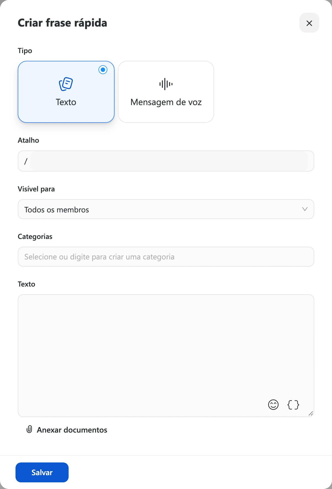

Crie respostas prontas de texto ou de voz com atalho para enviar mensagens frequentes mais rápido nas conversas.

<Note>
  Quem pode: criar, editar e excluir frases exige a permissão **Frases Rápidas** (em **Configurações** → **Ambiente** → **Permissões**). Usar frases na conversa não exige permissão: cada membro vê as frases públicas, as criadas por ele e as dos grupos de que participa.
</Note>

## Passo a passo

<Steps>
  <Step title="Abra a tela de frases rápidas">
    Vá em **Configurações** → **Ambiente** → **Frases rápidas** e clique em **Nova frase**. Quem tem permissão também pode clicar em **Nova resposta rápida** dentro da janela de frases da conversa.
  </Step>
  <Step title="Preencha os dados da frase">
    No painel **Criar frase rápida**, escolha o **Tipo** (**Texto** ou **Mensagem de voz**), informe o **Atalho** (o campo já coloca `/` na frente), defina **Visível para** (**Todos os membros**, **Grupo específico** ou **Apenas para mim**) e selecione ou crie **Categorias** (opcional).

    <Frame caption="Painel Criar frase rápida com Tipo, Atalho, Visível para, Categorias e Texto">
      
    </Frame>
  </Step>
  <Step title="Escreva o texto ou grave o áudio e salve">
    Para **Texto**, preencha o campo **Texto** (e anexe arquivos se quiser). Para **Mensagem de voz**, clique em **Gravar** e depois em **Parar** (depois de salva, o áudio não pode ser trocado: para mudar a gravação, crie outra frase). Ao finalizar, clique em **Salvar** (aparece um aviso confirmando que a frase rápida foi criada).
  </Step>
</Steps>

## Pôr o nome do cliente na frase

No campo **Texto**, clique no botão **Chaves reservadas** (`{}`) e escolha **Primeiro nome** (`{{first_name}}`), **Nome** (`{{name}}`) ou outro dado do contato (como **E-mail**, **Telefone**, **Protocolo** ou [campos personalizados](/docs/configuracoes-no-workspace/campos-personalizados-no-kinbox) de contato).

A troca pelo dado real acontece quando a mensagem é enviada — no campo de digitação você ainda vê a chave. Se o contato não tiver aquele dado preenchido, a chave some do texto. Use cada chave apenas uma vez por mensagem.

## Anexar documentos

Em frases do tipo **Texto**, clique em **Anexar documentos** para vincular um ou mais arquivos à frase. Ao selecionar essa frase na conversa, a Kinbox abre a janela de envio de arquivos já preenchida com os anexos.

## Categorias

Para criar uma categoria, digite o nome direto no campo **Categorias** da frase (limite de 50 caracteres; nomes separados por vírgula criam mais de uma). Uma categoria existe enquanto alguma frase rápida a utiliza.

Para renomear ou excluir categorias, abra o menu de três pontos na página de **Frases rápidas** e clique em **Gerenciar categorias**.

<Warning>
  Renomear ou excluir uma categoria altera todas as frases rápidas que a usam. Ao excluir uma categoria, ela é removida das frases, mas as frases não são apagadas.
</Warning>

## Usar na conversa

No editor da conversa (veja [Atender uma conversa](/docs/conversas/gerenciar-conversas)), digite `/` ou clique no botão **Frases rápidas** para abrir a janela **Respostas Rápidas**.

- Pesquise pelo atalho, use **Filtrar por categoria** ou navegue com as setas e pressione `Enter`.
- Ao abrir com `/`, a frase de texto entra no lugar da barra; ao abrir pelo botão **Frases rápidas**, o texto da frase substitui o que já estava escrito no campo.
- Frases de voz abrem a janela de áudio pronta para envio.
- Para desligar o atalho `/`, clique na engrenagem **Configurações das Frases Rápidas** na janela, desmarque **Habilitar atalho para frases rápidas ("/")** e clique em **Salvar** (a escolha vale apenas neste navegador).

Quando o copiloto está configurado para sugerir frases rápidas, a janela também pode exibir sugestões no topo conforme a conversa.

## Editar, clonar, excluir e exportar

Na lista em **Configurações** → **Ambiente** → **Frases rápidas**, você pode buscar por atalho ou frase, filtrar por **Tudo**, **Visível somente para mim**, **Com anexo**, **Voz** ou **Categorias**, e clicar em **Editar**, **Clonar** ou **Excluir** em cada linha.

Pelo menu de três pontos no topo da lista, clique em **Exportar** para baixar suas frases em **CSV** ou **Excel**.
