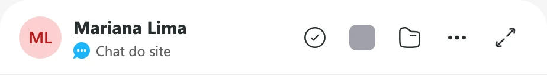
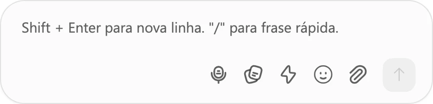

Na conversa aberta você responde o contato, troca notas internas com o time, usa o menu de cada mensagem e resolve ou reabre a conversa.

<Note>
  Quem pode:
  - Responder contatos: permissão **Responder**.
  - Mandar notas internas: permissão **Enviar notas privadas**.
  - Resolver ou reabrir conversas: permissões **Resolver** e **Reabrir**.

  Se a Kinbox impedir algum envio ou ação, veja [Não consigo responder ou ver uma conversa](/docs/conversas/problemas-comuns).
</Note>

<Frame caption="Cabeçalho da conversa: Resolver, Atribuir, Mover para grupo e Mais ações">
  
</Frame>

## Responder

1. Selecione a conversa na lista da [Caixa de entrada](/docs/conversas/caixa-de-entrada-do-kinbox).
2. Digite a mensagem no editor, na parte de baixo, e pressione `Enter` para enviar (`Shift + Enter` cria uma nova linha).

<Frame caption="Editor da conversa com os botões Áudio, Nota pro time, Frases rápidas, Emojis, Anexar e Enviar">
  
</Frame>

No editor você também pode:

- Digitar `/` para escolher uma das [frases rápidas](/docs/conversas/criar-frases-rapidas-para-suas-conversas). A lista abre quando a barra é o último caractere digitado; a frase entra no lugar da barra, e o que você já escreveu antes continua no campo.
- Clicar em **Anexar**, arrastar e soltar arquivos na conversa ou colar arquivos no campo. Cada arquivo vai como uma mensagem separada.
- Clicar em **Áudio** para gravar uma mensagem de voz (o botão só aparece nos canais que aceitam áudio).
- Responder citando uma mensagem pelo menu da mensagem → **Responder** (nos canais que aceitam citação).

Se a conversa está resolvida, o editor some e aparece **Reabrir conversa** no rodapé. No WhatsApp oficial, a regra é outra: veja [Resolver e reabrir](#resolver-e-reabrir).

## Mandar uma nota para o time

1. Clique em **Nota pro time** no editor. O contato não recebe nem vê o texto.
2. Escreva a nota e pressione `Enter`.

Digite `@` na nota para mencionar um membro: ele recebe uma notificação. Uma nota pode ser fixada pelo menu dela (**Fixar**).

## Resolver e reabrir

Clique em **Resolver** no cabeçalho. A conversa vai para **Arquivados** e mostra a faixa "Essa conversa foi encerrada.".

A Kinbox não deixa resolver enquanto houver:

- um [campo personalizado obrigatório](/docs/configuracoes-no-workspace/campos-personalizados-no-kinbox) vazio (o painel lateral abre com o campo destacado);
- uma ligação de WhatsApp em andamento.

Com o copiloto ligado na conversa, pode aparecer a pergunta "Ficou algo em aberto?", com a opção de resolver mesmo assim (veja [Usar o copiloto na conversa](/docs/copiloto/usar-o-copiloto-de-ia)).

Para voltar a atender, clique em **Reabrir** no cabeçalho ou em **Reabrir conversa** no rodapé. Quando o contato escreve de novo depois de resolvida, começa uma nova [sessão](/docs/conceitos/conversas-e-sessoes) (faixa **Nova sessão #N**). Se o workspace (na tela, **ambiente**) usa **Tempo de tolerância ao resolver conversa** (**Configurações** → **Ambiente** → **Geral**), uma mensagem dentro desse prazo reabre a sessão anterior.

<Info>
  **Só no WhatsApp oficial:** se já passaram 24 horas desde a última mensagem do contato, ou se ele nunca escreveu, reabrir não libera texto livre. Com a conversa resolvida, o rodapé mostra **Enviar template** como ação principal, e **Reabrir conversa** e **Enviar nota de time** ficam no menu ao lado. Envie um template: o texto livre volta quando o contato responder. Veja [Janela de 24 horas](/docs/canais/whatsapp/whatsapp-cloud-api/janela-de-24-horas).
</Info>

## Outras ações do menu Mais ações

- **Marcar como não lido** / **Marcar como lido**.
- **Marcar como pendente** / **Desmarcar como pendente**.
- **Seguir** / **Parar de seguir**: põe a conversa na visão **Seguindo**, sem mudar quem atende.
- **Executar bot**: inicia um bot; **Atendimento manual** para o bot (veja [Criar e publicar um bot](/docs/bot/aprender-a-usar-o-bot)).
- **Agendar mensagem**: veja [Agendar uma mensagem](/docs/conversas/agendar-mensagem).
- **Sincronizar histórico** (só no WhatsApp por QR Code com conexão Clássica): veja [Configurações do WhatsApp por QR Code](/docs/canais/whatsapp/whatsapp-app/configuracoes).
- **Transferir para outro canal**: veja [Atribuir, mover para um grupo ou transferir uma conversa](/docs/conversas/atribuir-e-transferir).
- **Bloquear** / **Desbloquear**: a Kinbox deixa de receber mensagens desse contato naquele canal, e o ícone **Bloqueado** aparece ao lado do nome. Desbloquear volta a receber.
- **Exportar para CSV**: veja [Ações em lote e exportar conversas](/docs/conversas/acoes-em-lote-e-exportar).
- **Pesquisar mensagem** e **Ver Informações**.

## Menu de cada mensagem

- **Responder**: cita a mensagem.
- **Fixar** / **Desafixar**: destaca uma nota interna.
- **Encaminhar**: envia a mensagem para outra conversa.
- **Ver histórico de edições**: aparece quando o contato editou a mensagem.
- **Conversar com** + número: numa conversa de grupo, abre a conversa com o participante.
- **Baixar áudio** e **Transcrever** (transforma o áudio em texto e usa o saldo da carteira).
- **Copiar texto** e **Copiar erro**.
- **Excluir**: aparece só em alguns canais e depende das permissões de deletar mensagens.

<Warning>
  Excluir uma mensagem não pode ser desfeito.
</Warning>
