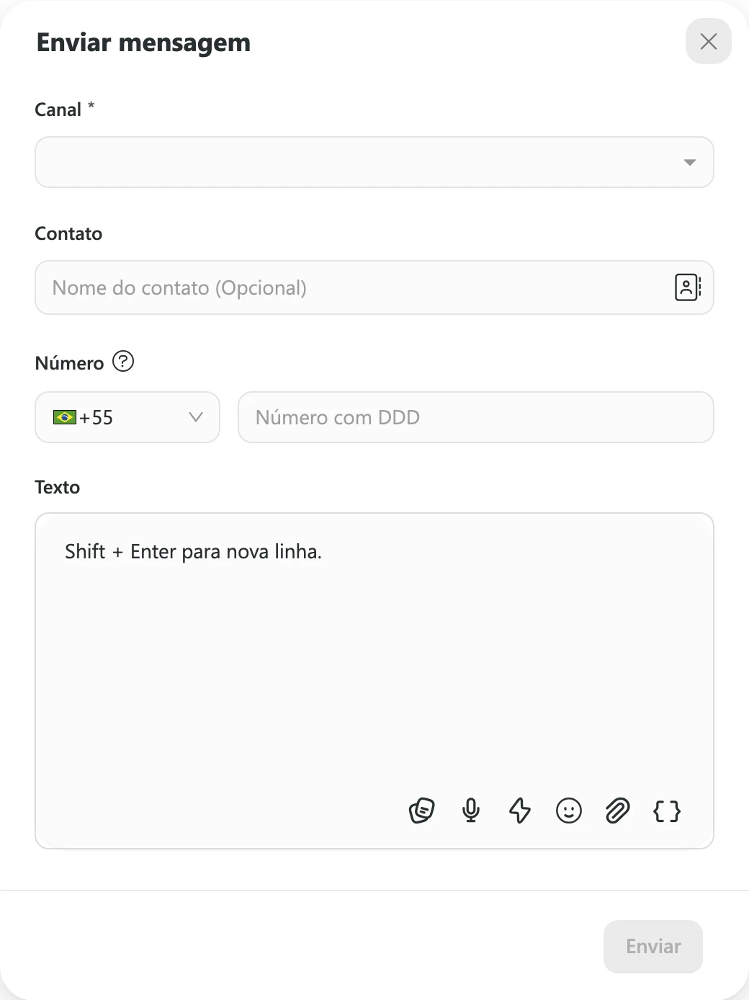

Envie a primeira mensagem para um contato pela Kinbox para iniciar um atendimento ativo por WhatsApp, SMS ou e-mail.

<Note>
  Quem pode: membros com a permissão **Iniciar chat ativo**. Disponível apenas para canais de **WhatsApp**, **SMS** e **E-mail**.
</Note>

## Passo a passo

<Steps>
  <Step title="Abra a janela Enviar mensagem">
    Na lista de conversas da [Caixa de entrada](/docs/conversas/caixa-de-entrada-do-kinbox), clique no botão **Enviar mensagem** (ícone de lápis). Você também pode abrir o comando pela pesquisa geral (`Ctrl+K` / `⌘K`) ou pelos botões **Enviar WhatsApp**, **Enviar SMS** e **Enviar e-mail** no painel **Detalhes** de um contato.
  </Step>
  <Step title="Escolha o canal">
    Selecione o **Canal** de saída. A lista mostra apenas canais de WhatsApp, SMS e e-mail liberados para o seu papel e que não estejam marcados como **Apenas Receptivo**.
  </Step>
  <Step title="Preencha o destinatário e a mensagem">
    - **No WhatsApp por QR Code e no SMS:** preencha **Contato** (opcional, ou escolha um contato já cadastrado), digite o **Número** com código do país (`+55`) e DDD (por exemplo, `+55 11 90000-0001`), e escreva o **Texto** — o editor aceita [frases rápidas](/docs/conversas/criar-frases-rapidas-para-suas-conversas), emojis, anexos, chaves `{}` e, no WhatsApp, **Áudio**.
    - **No WhatsApp oficial:** selecione um **Modelo de mensagem** em vez de digitar texto livre (veja abaixo).
    - **No e-mail:** preencha **Email**, **Assunto** e o texto da mensagem.
    - Se o workspace tiver **Campos obrigatórios no chat ativo** ativado em **Configurações** → **Ambiente** → **Geral**, preencha também os campos exibidos na janela.

    <Frame caption="Janela Enviar mensagem com Canal, Contato, Número e editor de Texto">
      
    </Frame>
  </Step>
  <Step title="Envie a mensagem">
    Clique em **Enviar**.
  </Step>
</Steps>

## WhatsApp oficial

Para iniciar uma conversa pelo WhatsApp oficial, o campo de texto é substituído por **Modelo de mensagem**. Escolha um template aprovado pela Meta, preencha os campos solicitados (**Cabeçalho**, **Corpo**, **Botões** ou **Anexo**, conforme o modelo) e confira a **Pré-visualização** antes de clicar em **Enviar**.

## Vários números

Você pode enviar a mesma mensagem para mais de um número separando os números por vírgulas no campo **Número**.

No WhatsApp por QR Code, o envio segue estas regras:

- **Até 3 números:** envia normalmente.
- **De 4 a 10 números:** exige a permissão **Campanhas** e mostra uma confirmação alertando que enviar a mesma mensagem para muitos números em um curto intervalo de tempo pode gerar bloqueio do seu número pelo WhatsApp (veja [Como evitar que o número seja bloqueado](/docs/canais/whatsapp/whatsapp-app/como-nao-ter-numero-bloqueado-whatsapp)).
- **Mais de 10 números:** a Kinbox não permite o envio pela janela e pede que você crie uma campanha.

Para falar com muitos contatos de uma vez em qualquer canal, use **Campanhas**.

## Depois de enviar

- A Kinbox mostra um aviso confirmando o envio; quando você seleciona um contato cadastrado, o aviso traz o link **Clique aqui** para abrir a conversa.
- Se o contato não tinha conversa aberta naquele canal, é criada uma nova sessão atribuída a você (visível em **Abertos** e **Meus**), sem grupo e sem bot.
- Se o contato já tiver uma conversa aberta naquele canal, a mensagem entra nessa conversa.
- Se algum número falhar, a janela permanece aberta listando os números com erro.

## Problemas comuns

- **O canal não aparece em Canal.** Confira se o canal é de WhatsApp, SMS ou e-mail, se a opção **Apenas Receptivo** não está ligada no canal (no WhatsApp por QR Code, ela fica nas [configurações do canal](/docs/canais/whatsapp/whatsapp-app/configuracoes)) e se o seu papel não tem a restrição **Limitar canais que pode responder**.
- **Aparece "{número} - Em atendimento" ou "{número} - Em atendimento com {nome}".** O seu papel tem uma restrição de chat ativo que bloqueia o envio quando o número ou o contato já está em atendimento.
- **Aparece "Não é possível enviar mensagem para esse número".** O número informado é inválido ou não existe no WhatsApp. Revise o código do país e o DDD.
- **Não deixa enviar sem preencher campos extras.** O administrador ligou **Campos obrigatórios no chat ativo** nas configurações do ambiente; preencha os campos exibidos para concluir.
- **Outro erro de permissão ou horário.** Consulte [Não consigo responder ou ver uma conversa](/docs/conversas/problemas-comuns).
