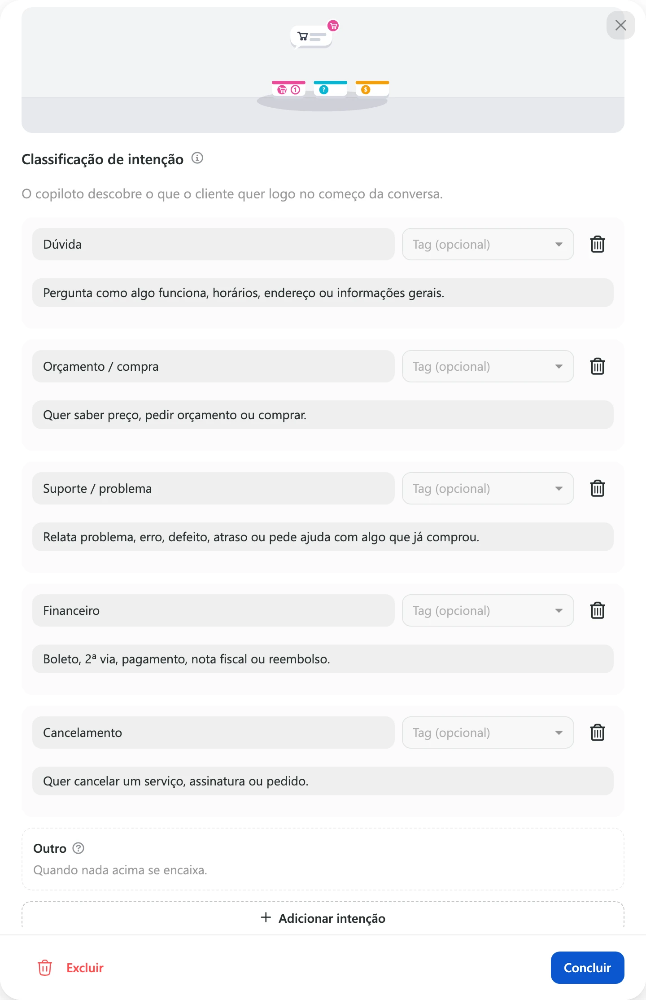

As análises do copiloto leem a conversa sozinhas depois das mensagens do contato e guardam o resultado para o time acompanhar no cartão **Sessão**, na lista de conversas e nos relatórios.

<Note>
  Quem pode e condições: adicionar ou alterar análises exige a permissão **Copiloto** ou ser o proprietário do workspace (veja [Referência de permissões](/docs/administracao/referencia-de-permissoes)). Todas as análises começam desligadas, só rodam em conversas dentro de **Onde o copiloto atua** e consomem saldo da carteira a cada leitura — sem saldo, param de atualizar.
</Note>

## Como ligar uma análise

<Steps>
  <Step title="Abra a galeria do Copiloto">
    Vá em **Configurações** → **Automação** → **Copiloto** e clique em **Adicionar função**.
  </Step>
  <Step title="Escolha e configure a análise">
    Clique na análise desejada na janela **Escolha uma função...**, ajuste as opções (quando houver) e clique em **Adicionar**.
  </Step>
  <Step title="Salve as mudanças">
    Clique em **Salvar mudanças** na barra inferior. As alterações podem levar até 60 segundos para fazer efeito. Para editar ou excluir funções depois, veja [Configurações do copiloto](/docs/copiloto/configuracoes-de-copiloto).
  </Step>
</Steps>

## Análise de sentimento

- **O que faz:** avalia como o contato se sente a cada mensagem dele na sessão (inclusive enquanto um bot atende), em 5 níveis: 😡 **Irritado**, 😕 **Impaciente**, 😐 **Neutro**, 🙂 **Satisfeito** e 😄 **Encantado** (ou 🤔 **Indefinido** quando não há leitura confiável). Também mostra a tendência (**Melhorando** ou **Piorando**) conforme as leituras anteriores. Cada nova sessão começa sem sentimento.
- **Como configurar:** não tem campos de configuração. Adicione a função e clique em **Salvar mudanças**.
- **Onde aparece:** no cartão **Sessão** da conversa e, na lista de conversas abertas, apenas quando o contato está **Irritado** (😡) ou **Impaciente** (😕).

## Classificação de intenção

- **O que faz:** identifica o que o contato quer no começo do atendimento (inclusive enquanto um bot atende). Assim que identifica uma intenção com certeza, trava o resultado uma vez por atendimento (sessão). Se a intenção tiver uma tag vinculada, a tag é aplicada na conversa e dispara as automações de tag (veja [Criar e usar tags](/docs/configuracoes-no-workspace/criar-e-gerenciar-tags)).
- **Como configurar:** já traz 5 intenções iniciais (**Dúvida**, **Orçamento / compra**, **Suporte / problema**, **Financeiro** e **Cancelamento**) e o item fixo **Outro** (para quando nada se encaixa ou o contato só cumprimentou). Você pode editar, excluir ou clicar em **Adicionar intenção** até o limite de **10 intenções**, definindo o nome, a **Tag (opcional)** e como reconhecer cada uma.

<Frame caption="Configuração de Classificação de intenção com as 5 intenções iniciais, Tag (opcional) e Outro">
  
</Frame>

- **Onde aparece:** no cartão **Sessão** da conversa e, quando configurada, como tag aplicada na conversa.

## Lead score

- **O que faz:** atribui uma nota de 0 a 100 para a intenção de compra do contato a cada mensagem dele (inclusive enquanto um bot atende), com tendência **Esquentando** ou **Esfriando**. A nota fica guardada no **contato**, então uma nova sessão já mostra a última nota dele. Contatos com negociação ganha em qualquer funil não são avaliados e aparecem como **Já é cliente**.

| Nota | Nível | Critério padrão |
| --- | --- | --- |
| 0–16 | 🧊 **Frio** | Sem intenção de comprar o que o negócio vende, já é cliente pedindo suporte ou fora do cliente ideal. |
| 17–49 | 🌤️ **Morno** | Tem interesse e está conhecendo; pergunta como funciona sem falar de preço, prazo ou condições. |
| 50–83 | 🔥 **Quente** | Interesse claro; pergunta preço, condições, prazo, formas de pagamento ou compara opções. |
| 84–100 | 💰 **Excelente** | Quer fechar agora; pede proposta, link de pagamento, contrato ou como comprar. |

- **Como configurar:** descreva o que você vende e o perfil buscado em **Seu cliente ideal**. Se quiser mudar os critérios de cada nível, abra **Personalizar critérios de cada faixa** e edite os campos (ou clique em **Restaurar padrão** para limpar).
- **Onde aparece:** no cartão **Sessão** da conversa e, na lista de conversas abertas, apenas quando o contato está **Quente** ou **Excelente**.

## Cliente preso no bot

- **O que faz:** roda apenas enquanto um bot ou agente de IA atende a sessão e depois que o contato responde ao bot. Detecta quando o contato pede para falar com uma pessoa, repete a mesma pergunta, reclama das respostas automáticas ou o bot repete o mesmo menu (reclamar do produto ou do problema em si não conta). A detecção acontece uma vez por atendimento (sessão) e para quando um humano assume.
- **Como configurar:** escolha o comportamento em **Quando detectar**:
  - **Só sinalizar** (padrão): marca a conversa com 🆘 e o bot continua atendendo.
  - **Passar para humano:** interrompe o bot, registra uma mensagem de sistema na conversa e passa o atendimento para a equipe. Com essa opção, você pode definir **Mover para o grupo** (opcional; veja [Criar grupos de atendimento](/docs/configuracoes-no-workspace/criar-e-gerenciar-grupos) — sem grupo escolhido, a conversa apenas sai do bot).
- **Onde aparece:** como 🆘 na lista de conversas abertas e na linha **Atendimento automático** (**🆘 Precisa de humano**) do cartão **Sessão**. O 🆘 some da lista e do cartão quando um membro responde a conversa.

## Avaliadores

- **O que faz:** executa avaliações sob medida (até **10 avaliadores** por workspace) que leem a conversa e salvam o resultado em um [campo personalizado](/docs/configuracoes-no-workspace/campos-personalizados-no-kinbox) (da sessão ou do contato) ou aplicam tags na conversa (disparando as automações de tag).
- **Como configurar:** abra a função **Avaliadores**, clique em **Criar avaliador** (ou **Novo avaliador**) e escolha **Em branco** ou um dos 10 modelos prontos, que já vêm com o momento da avaliação e o campo onde o resultado é salvo:
  - **Qualidade do atendimento:** **Nota do atendimento**, **Problema resolvido?** e **Pontos a melhorar**.
  - **Vendas:** **Motivo de perda**, **Objeções do cliente**, **Pediu desconto?** e **Oportunidade futura**.
  - **Suporte:** **Urgência**.
  - **Relacionamento:** **Risco de cancelamento** e **Não quer receber mensagens**.

No editor do avaliador, preencha **Nome**, **Quando avaliar** (**No início da conversa**, **A cada mensagem** ou **Ao resolver**), **O que avaliar** e **Onde salvar o resultado**:

- **Campo personalizado:** escolha **Usar campo existente** (campos de número, seleção ou sim/não da sessão ou do contato) ou **Criar campo novo** (**Nome do campo**, **Tipo** entre **Nota**, **Seleção única**, **Seleção múltipla** ou **Sim/não**, e **Fica em** entre **Sessão** ou **Contato**). O campo novo só é criado quando você clica em **Salvar mudanças** na página do Copiloto. Conforme o tipo, você pode ajustar **Nota mínima** e **Nota máxima**, **Como reconhecer cada opção** ou **Aplicar tag quando for "sim" (opcional)**.
- **Tags:** adicione regras em **Adicionar regra de tag** escolhendo a **Tag** e escrevendo a condição em que ela deve ser aplicada.

Se quiser ignorar quem já comprou, ligue **Pular contatos com negociação ganha**. Clique em **Salvar avaliador**, depois em **Adicionar** (ou **Concluir**, se a função já estava adicionada) na janela da função **Avaliadores** e, por fim, em **Salvar mudanças** na página.

Na lista de avaliadores, você pode ligar ou desligar cada um sem apagar, editar pelo ícone de lápis ou remover pela lixeira (**Remover**).

<Warning>
  Clicar em **Excluir** na janela da função **Avaliadores** remove todos os avaliadores configurados no workspace. Para pausar apenas um avaliador sem apagá-lo, use a chave **Desligar** no cartão dele.
</Warning>

- **Onde aparece:** campos de sessão aparecem no cartão **Sessão** da conversa; campos de contato ficam no cadastro do contato; tags entram na conversa.

## Onde ver os resultados

- **Cartão Sessão (painel lateral da conversa):** as linhas do copiloto aparecem no topo do cartão, na ordem **Atendimento automático** (quando detectado), **Intenção**, **Sentimento** e **Lead score**, seguidas pelos campos personalizados da sessão. Enquanto não há leitura, a linha mostra **Aguardando**; com saldo de R$ 0,20 ou menos, as linhas ainda sem leitura mostram **Sem saldo** (os resultados já registrados continuam aparecendo). No lead score, **Já é cliente** indica um contato com negociação ganha, que não é mais avaliado.
- **Lista de conversas (conversas abertas):** mostra 🆘 para cliente preso no bot, 😡 ou 😕 para contato irritado ou impaciente, e o selo com a nota apenas para leads **Quente** ou **Excelente**.
- **Relatórios → Copiloto:** reúne os resultados em abas (**Qualidade**, **Sentimento**, **Intenções**, **Lead score** e **Atendimento automático**), cada uma disponível quando a função correspondente está ligada. O item aparece para quem tem a permissão **Gerenciar relatórios** (veja [Como os relatórios contam sessões e tempos](/docs/relatorios/como-funcionam)).

## Restrições de papel

Os papéis podem ter as restrições **Esconder sentimento do cliente** e **Esconder lead score**, no quadro **Restrições** da seção **Conversas** (veja [Criar papéis e permissões](/docs/configuracoes-no-workspace/configurar-permissoes-dos-usuarios)).

## Quanto gasta

Todas as análises ligadas rodam juntas em uma única leitura depois das mensagens do contato (e avaliadores **Ao resolver** rodam quando a conversa é resolvida), descontando do [saldo da carteira](/docs/conceitos/saldo-e-creditos) conforme as funções ativas. Sem saldo, as análises param até você [adicionar saldo](/docs/assinatura/adicionar-saldo).
