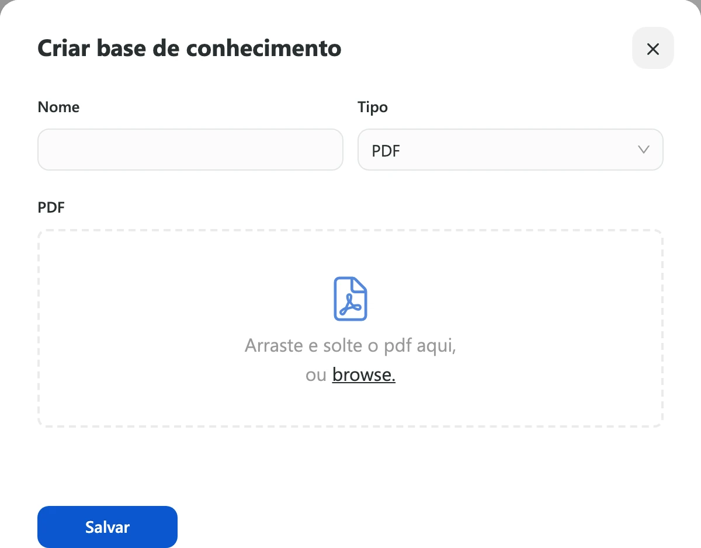
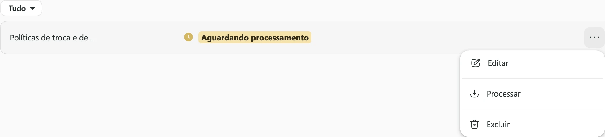

Crie bases de conhecimento com textos ou documentos da sua empresa para que o copiloto (nas **Sugestões automáticas**) e o bloco **Agente de IA** do bot consultem esse conteúdo ao sugerir ou gerar respostas. A cada resposta, a Kinbox busca apenas os trechos mais parecidos com a mensagem do contato, e não a base inteira.

<Note>
  Quem pode: criar, editar, processar e excluir bases exige a permissão **Base de conhecimento** ou ser o proprietário do workspace (veja [Referência de permissões](/docs/administracao/referencia-de-permissoes)). Cada workspace pode ter até **20 bases de conhecimento**.
</Note>

Os agentes de IA têm um cadastro próprio de conhecimento, separado desta base: para ensinar um agente, veja [Ensinar o agente com arquivos, textos, sites e vídeos](/docs/agente-de-ia/conhecimento).

## Antes de começar

Cada base aceita um texto colado ou **um arquivo** de até **5 MB**:

| Tipo | O que aceita |
| --- | --- |
| **Texto** | Texto digitado ou colado no campo **Texto** |
| **PDF** | Um arquivo `.pdf` com texto selecionável (PDF escaneado só com imagem não tem texto para leitura e dá erro ao processar) |
| **Arquivo de texto** | Um arquivo `.txt` |
| **Docx** | Um arquivo `.docx` (Word) |

Markdown (`.md`), CSV, planilhas, imagens, `.doc` antigo, links de site e vídeos não são aceitos nesta tela.

## Criar e processar

<Steps>
  <Step title="Abra Base de conhecimento">
    Vá em **Configurações** → **Automação** → **Base de conhecimento**.
  </Step>
  <Step title="Clique em Nova base de conhecimento">
    Clique em **Nova base de conhecimento** para abrir o painel **Criar base de conhecimento**.
  </Step>
  <Step title="Preencha Nome, Tipo e conteúdo">
    Informe o **Nome**, escolha o **Tipo** (**Texto**, **PDF**, **Arquivo de texto** ou **Docx**) e cole o texto ou arraste o arquivo (até 5 MB). Trocar o **Tipo** limpa o conteúdo ou o arquivo já escolhido.

    <Frame caption="Painel Criar base de conhecimento com Nome, Tipo e área para envio de arquivo">
      
    </Frame>
  </Step>
  <Step title="Salve a base">
    Clique em **Salvar**. A base aparece na lista com status **Aguardando processamento** (salvar ainda não processa o conteúdo).
  </Step>
  <Step title="Processe a base">
    Na linha da base, abra o menu de três pontos e clique em **Processar**. Aguarde o status mudar de **Processando** para **Pronto**. Se ficar em **Erro**, revise o conteúdo ou o arquivo, salve e clique em **Processar** novamente.

    <Frame caption="Base em Aguardando processamento com o menu de três pontos aberto">
      
    </Frame>
  </Step>
</Steps>

## Usar a base

Para contar com o conteúdo da base, use uma base com status **Pronto**:

- **No copiloto:** vá em **Configurações** → **Automação** → **Copiloto**, abra **Sugestões automáticas**, ligue **Usar base de conhecimento**, selecione a base, clique em **Concluir** (ou **Adicionar**, na primeira vez que liga a função) e depois em **Salvar mudanças**. Para usar uma base diferente por equipe, configure **Personalizar por grupo** (veja [Configurações do copiloto](/docs/copiloto/configuracoes-de-copiloto)). Os outros recursos do copiloto (como **Comandos de chat**) não consultam a base.
- **No bot:** no bloco **Agente de IA** do fluxo, selecione a base no campo opcional **Base de conhecimento** (veja [Blocos do bot](/docs/bot/blocos-do-bot)). Um agente de IA conectado direto aos canais, fora do bot, usa apenas o próprio conhecimento do agente.

## Editar e excluir

Clique na linha da base ou abra o menu de três pontos → **Editar** para abrir **Editar base de conhecimento**:

- Mudar apenas o **Nome** mantém o status **Pronto**.
- Mudar o **Tipo**, o **Texto** ou o arquivo apaga o processamento anterior e volta a base para **Aguardando processamento**.

<Warning>
  Editar o conteúdo ou trocar o arquivo apaga o processamento anterior na hora. Depois de salvar, clique em **Processar** novamente — até a base voltar para **Pronto**, o copiloto e o bot ficam sem o conteúdo dela.
</Warning>

Para apagar uma base, abra o menu de três pontos → **Excluir** e confirme em **Excluir**.

<Warning>
  A exclusão não avisa se a base está em uso no copiloto ou em um bloco do bot. Antes de excluir, troque a base nas configurações do copiloto e nos blocos do bot que a utilizam para que eles não fiquem sem esse conteúdo.
</Warning>

## Quanto gasta

Processar uma base de conhecimento desta tela não gasta saldo. O uso da base entra no consumo normal das sugestões do copiloto ou das respostas do bloco **Agente de IA** no [saldo da carteira](/docs/conceitos/saldo-e-creditos).

## Problemas comuns

- **Não consigo criar uma nova base.** Confira se você tem a permissão **Base de conhecimento** (ou é proprietário) e se o workspace não chegou ao limite de 20 bases ("Você atingiu o limite máximo de 20 bases de conhecimento.").
- **O arquivo foi recusado ao enviar.** Verifique se a extensão corresponde ao **Tipo** escolhido (`.pdf`, `.txt` ou `.docx`) e se o arquivo tem no máximo 5 MB.
- **A base ficou em Erro.** Confira se o arquivo foi anexado, se o texto não está vazio e se o PDF tem texto selecionável (não é apenas imagem escaneada). Ajuste o conteúdo, salve e clique em **Processar** de novo.
- **A opção Processar está cinza (desativada).** A base já está com status **Pronto**. Ela só volta a aceitar processamento depois que o conteúdo ou o arquivo é alterado.
