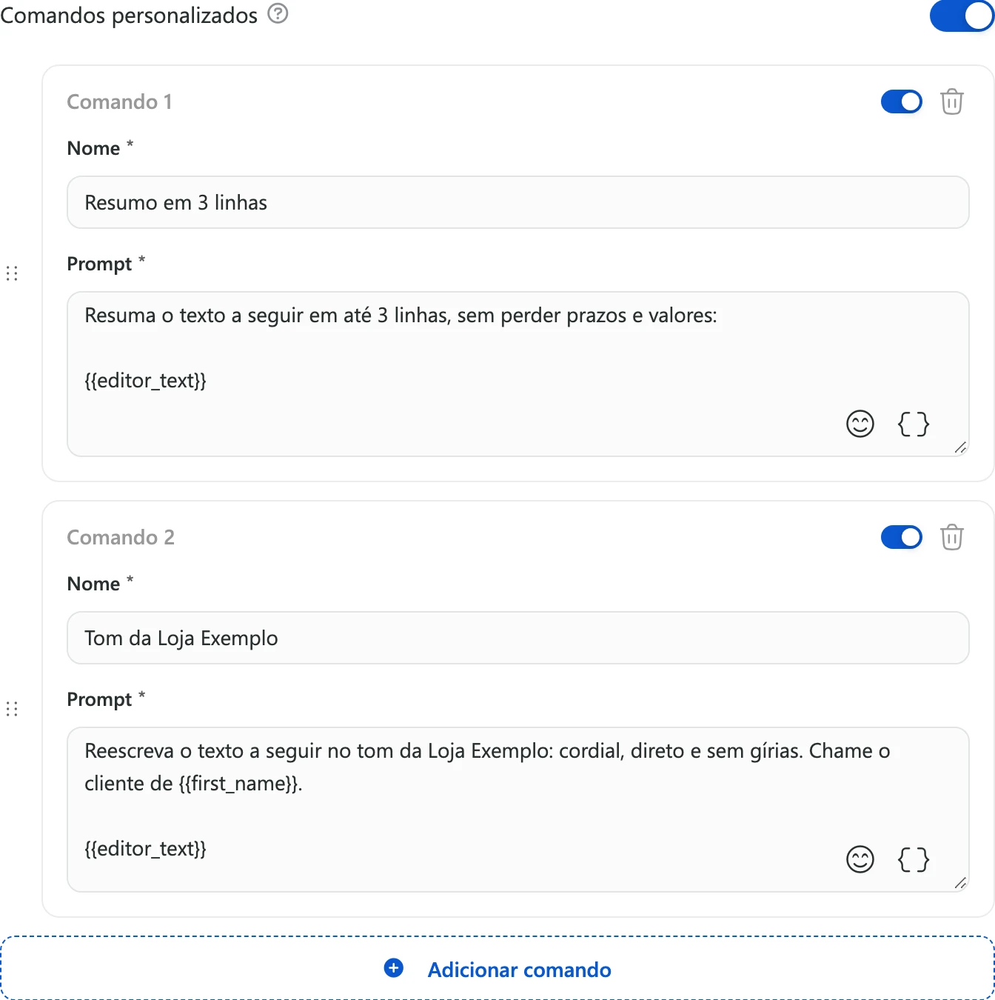

Crie comandos personalizados para adicionar ações com as instruções da sua empresa ao menu do copiloto no editor da conversa. Os comandos criados aparecem no topo do menu, no grupo **Personalizado**.

<Note>
  Quem pode: criar e organizar comandos exige a permissão **Copiloto** ou ser o proprietário do workspace (veja [Referência de permissões](/docs/administracao/referencia-de-permissoes)). Para usar os comandos na conversa, não é preciso ter essa permissão: a função **Comandos de chat** precisa estar adicionada e salva, a conversa precisa estar em **Onde o copiloto atua** e o workspace precisa ter saldo na carteira.
</Note>

## Criar um comando

<Steps>
  <Step title="Abra a função Comandos de chat">
    Vá em **Configurações** → **Automação** → **Copiloto** e clique no cartão **Comandos de chat**. Se a função ainda não estiver adicionada, clique em **Adicionar função** e escolha **Comandos de chat**.
  </Step>
  <Step title="Ligue Comandos personalizados e adicione um comando">
    Abaixo dos comandos padrão, ligue o interruptor **Comandos personalizados** e clique em **Adicionar comando**.
  </Step>
  <Step title="Preencha Nome e Prompt">
    Informe o **Nome** (como o comando vai aparecer no menu) e escreva a instrução em **Prompt**. Use o botão **{ }** (**Chaves reservadas**) para inserir dados da conversa ou o texto do editor, e o botão de emoji se quiser.

    <Frame caption="Bloco Comandos personalizados ligado com Nome, Prompt, chaves reservadas e Adicionar comando">
      
    </Frame>
  </Step>
  <Step title="Conclua e salve as mudanças">
    Clique em **Concluir** (ou em **Adicionar**, se estiver adicionando a função agora) e depois clique em **Salvar mudanças** na barra inferior. As alterações podem levar até 60 segundos para fazer efeito.
  </Step>
</Steps>

<Tip>
  Inclua a chave **Texto digitado** (`{{editor_text}}`) no **Prompt** sempre que o comando precisar trabalhar sobre o que o membro escreveu no editor. Sem essa chave, o texto digitado não vai para o copiloto.
</Tip>

### Chaves disponíveis no botão `{ }`

| Grupo | Chaves disponíveis |
| --- | --- |
| **Contexto** | **Texto digitado** (`{{editor_text}}`) — texto digitado pelo membro no editor |
| **Sessão da conversa** | **Protocolo** e [campos personalizados](/docs/configuracoes-no-workspace/campos-personalizados-no-kinbox) de sessão |
| **Contato** | **Nome**, **Primeiro nome** (`{{first_name}}`), **E-mail**, **Telefone** e campos personalizados de contato |

Exemplo de prompt usando **Primeiro nome** e **Texto digitado**:

```text
Reescreva a mensagem abaixo para {{first_name}} em tom cordial e direto, em até três frases curtas:

{{editor_text}}
```

## Usar na conversa

Na conversa aberta dentro de **Onde o copiloto atua**, escreva um texto no editor, clique no ícone de estrelas (**Copiloto**) e selecione o comando no grupo **Personalizado** (veja [Usar o copiloto na conversa](/docs/copiloto/usar-o-copiloto-de-ia)).

Todo comando personalizado exige algum texto no editor: sem texto, aparece "Escreva um texto para usar essa ação do assistente.". O resultado substitui o texto do editor e mostra o aviso "Copiloto alterou o texto" com **Desfazer** — o membro revisa antes de enviar.

## Organizar os comandos

- **Comandos personalizados:** use o interruptor no cartão de cada comando para ligar ou desligar sem apagar, clique na lixeira (**Excluir comando**) para remover e arraste pela alça à esquerda para mudar a ordem (o menu na conversa segue a mesma ordem).
- **Comandos padrão:** no bloco **Comandos padrão**, ative ou desative cada comando e arraste para mudar a ordem dentro do grupo. Grupos sem nenhum comando ativo somem do menu. Cada grupo tem **Desativar todos** / **Ativar todos**, e **Restaurar padrão** aparece depois de alguma mudança para voltar todos os comandos ligados na ordem original.

Grupos e comandos padrão disponíveis:

- **Conversa:** **Resumir sessão**.
- **Mudar texto:** **Resumir**, **Simplificar**, **Reescrever**, **Expandir**, **Explicar**, **Corrigir erros de português**, **Traduzir para o inglês**, **Traduzir para o espanhol**, **Traduzir**.
- **Mudar tom para:** **Amigável**, **Empolgante**, **Fofinho**, **Urgente**, **Triste**, **Casual**, **Formal**.
- **Gerar texto:** **Promocional**, **Pedido de desculpas**, **Felicitação**.

Depois de organizar os comandos, clique em **Concluir** e em **Salvar mudanças** (veja mais em [Configurações do copiloto](/docs/copiloto/configuracoes-de-copiloto)).

## Quanto gasta

Cada uso de um comando personalizado ou padrão consome [saldo da carteira](/docs/conceitos/saldo-e-creditos); sem saldo, os comandos ficam desativados no menu.
