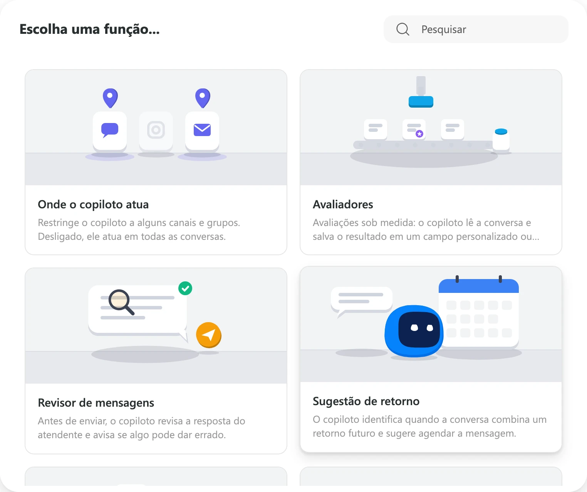

Todas as funções do copiloto são configuradas em **Configurações** → **Automação** → **Copiloto**.

<Note>
  Quem pode: membros com a permissão **Copiloto** ou o proprietário do workspace (veja [Referência de permissões](/docs/administracao/referencia-de-permissoes)). As configurações valem para o workspace inteiro e todas as funções começam desligadas.
</Note>

## Adicionar, mudar e excluir uma função

- **Adicionar:** clique em **Adicionar função**, escolha a função na janela **Escolha uma função...** (use **Pesquisar** para filtrar), ajuste as opções e clique em **Adicionar**.
- **Mudar:** clique no cartão de uma função já adicionada, faça os ajustes e clique em **Concluir**.
- **Excluir (desligar):** abra o cartão da função, clique em **Excluir** e confirme ("Excluir esta função? O copiloto deixa de fazer isso.").
- **Salvar:** nenhuma alteração passa a valer até você clicar em **Salvar mudanças** na barra inferior (**Cancelar** desfaz). Ao salvar, a tela mostra "Configurações salvas. As mudanças podem levar até 60 segundos para fazer efeito.". Fechar a janela de uma função ou sair da tela com mudanças pendentes pede confirmação.

<Frame caption="Janela Escolha uma função... aberta ao clicar em Adicionar função">
  
</Frame>

<Warning>
  Excluir a função **Avaliadores** remove todos os avaliadores configurados no workspace. Para pausar um avaliador sem apagá-lo, desligue a chave dele dentro da função.
</Warning>

## Funções do copiloto

| Função | O que faz | Onde atua / quem vê | Opções (padrão) | Guia |
| --- | --- | --- | --- | --- |
| **Onde o copiloto atua** | Limita todas as funções a canais e grupos | Todas as funções | **Canais**, **Grupos** (vazio = todos) | [Nesta página](#onde-o-copiloto-atua) |
| **Sugestões automáticas** | Sugere respostas ao abrir a conversa | Bloco **Sugestões** acima do editor | Ver [Sugestões automáticas](#sugestões-automáticas) abaixo | [Usar o copiloto na conversa](/docs/copiloto/usar-o-copiloto-de-ia) |
| **Comandos de chat** | Abre o menu do copiloto no editor | Ícone de estrelas no editor (conversas e campanhas por WhatsApp por QR Code ou SMS) | **Comandos padrão** (todos ligados), **Comandos personalizados** (desligado) | [Usar o copiloto na conversa](/docs/copiloto/usar-o-copiloto-de-ia) e [Criar comandos personalizados](/docs/copiloto/comandos-personalizados) |
| **Análise de sentimento** | Avalia o sentimento do contato a cada mensagem | Cartão **Sessão** e lista (só Irritado/Impaciente) | Sem opções | [Analisar conversas com IA](/docs/copiloto/analises-de-ia) |
| **Avaliadores** | Avaliações próprias salvas em campo ou tags | Campos da sessão/contato e tags | Até 10 avaliadores | [Analisar conversas com IA](/docs/copiloto/analises-de-ia) |
| **Revisor de mensagens** | Revisa a resposta antes de enviar | Janela **Revise antes de enviar** | 5 categorias (3 ligadas), até 12 itens por categoria, até 5 regras personalizadas | [Nesta página](#revisor-de-mensagens) e [Usar o copiloto na conversa](/docs/copiloto/usar-o-copiloto-de-ia) |
| **Aviso ao resolver** | Avisa pendência ao clicar em **Resolver** | Janela **Ficou algo em aberto?** | Sem opções | [Usar o copiloto na conversa](/docs/copiloto/usar-o-copiloto-de-ia) |
| **Sugestão de retorno** | Sugere agendar quando a conversa combina retorno | Faixa **Ficou um retorno combinado** (precisa de **Agendar mensagem**) | Sem opções | [Usar o copiloto na conversa](/docs/copiloto/usar-o-copiloto-de-ia) |
| **Não reabrir por agradecimento** | Mantém resolvida se o contato só agradecer em até 24 h | Mensagem de sistema na conversa | Sem opções | [Nesta página](#não-reabrir-por-agradecimento) |
| **Cliente preso no bot** | Detecta contato preso no bot ou agente de IA | 🆘 na lista e cartão **Sessão** | **Quando detectar**: **Só sinalizar** (padrão) ou **Passar para humano** + **Mover para o grupo** (opcional) | [Analisar conversas com IA](/docs/copiloto/analises-de-ia) |
| **Classificação de intenção** | Identifica a intenção no começo da sessão | Cartão **Sessão** e tag opcional | 5 intenções iniciais + **Outro**, até 10 | [Analisar conversas com IA](/docs/copiloto/analises-de-ia) |
| **Lead score** | Nota de 0 a 100 de intenção de compra | Cartão **Sessão** e lista (só Quente/Excelente) | **Seu cliente ideal**, **Personalizar critérios de cada faixa** | [Analisar conversas com IA](/docs/copiloto/analises-de-ia) |

## Onde o copiloto atua

Restringe todas as funções do copiloto (sugestões, comandos, revisor, avisos, análises e avaliadores) aos **Canais** e **Grupos** selecionados.

| Configuração | Onde o copiloto atua |
| --- | --- |
| Função não adicionada, ou **Canais** e **Grupos** vazios | Todas as conversas do workspace. |
| Só **Canais** selecionados | Todas as conversas desses canais, em qualquer grupo ou sem grupo. |
| Só **Grupos** selecionados | Apenas conversas em um desses grupos. Conversas sem grupo (por exemplo, ainda no bot) ficam de fora. |
| **Canais** e **Grupos** selecionados | Apenas conversas que estejam em um dos canais **e** em um dos grupos selecionados. |

## Sugestões automáticas

| Opção | O que faz | Padrão |
| --- | --- | --- |
| **Personalizar modelo** | Permite escolher o **Modelo** de IA que gera as sugestões (pode mudar o gasto). | Desligado (usa o modelo padrão da Kinbox) |
| **Personalizar instruções** | Abre o campo **Instruções extras** para orientar o tom e as regras das respostas sugeridas. | Desligado |
| **Usar base de conhecimento** | Seleciona uma [base de conhecimento](/docs/copiloto/base-de-conhecimento) com status **Pronto** para dar contexto às sugestões. | Desligado |
| **Personalizar por grupo** | Cria regras (**Regra 1**, **Regra 2**...) com **Grupos**, **Instruções extras** e **Base de conhecimento** próprias para o grupo do membro em atendimento. Vale a primeira regra que bater; a base da regra vale mesmo com **Usar base de conhecimento** desligado. | Desligado |
| **Processar imagens** | Analisa imagens enviadas pelo contato ao gerar sugestões. | Ligado |
| **Transcrever áudios** | Transcreve áudios recentes da conversa para usar nas sugestões e salva a transcrição na mensagem. | Ligado |
| **Sugerir frases rápidas** | Sugere até 3 [frases rápidas](/docs/conversas/criar-frases-rapidas-para-suas-conversas) no topo da janela ao abri-la na conversa. | Ligado |
| **Criatividade** | Também conhecido como temperatura: define quão variadas são as sugestões; valores maiores aumentam o risco de respostas inventadas ou incorretas. | **Neutro** |
| **Quantidade de sugestões** | Quantidade de opções mostradas por vez (de 1 a 3). | 1 |

Níveis de **Criatividade** na régua, do mais conservador ao mais criativo: **Muito conservador**, **Conservador**, **Neutro**, **Criativo**, **Muito criativo**, **Super criativo** e **Doido varrido**.

## Revisor de mensagens

Revisa respostas de texto antes do envio (não revisa notas internas, mídias nem mensagens curtas, e não confere se uma informação está certa). Categorias ou regras desativadas não são consideradas, e uma categoria sem itens não é verificada.

As cinco categorias são **Tom inadequado**, **Promessas comerciais** e **Perguntas não respondidas** (já começam ligadas), **Informações sensíveis** e **Padrão de comunicação da empresa** (começam desligadas). Cada categoria, exceto **Perguntas não respondidas**, tem uma lista **O que será verificado** que você pode editar.

Nas categorias com lista, digite um item e pressione `Enter` para adicionar (até 12 por categoria) ou clique no `×` para remover.

Em **Regras personalizadas**, clique em **Adicionar regra personalizada** para criar até **5 regras** específicas com **Nome da regra**, **O que o revisor deve verificar** e **Exemplos** (opcional). Cada regra pode ser ligada, desligada, editada ou excluída individualmente.

## Não reabrir por agradecimento

Não tem campos de configuração. Quando está adicionada, uma conversa resolvida continua resolvida e não cria uma nova [sessão](/docs/conceitos/conversas-e-sessoes) se:

- a mensagem vier do contato em até **24 horas** depois de a conversa ser resolvida;
- a mensagem for apenas de texto (áudios, imagens, arquivos e figurinhas reabrem normalmente);
- o contato apenas agradecer, confirmar, se despedir ou reagir (por exemplo, "obrigado", "ok", "valeu", 👍). Se houver pergunta, pedido, problema ou assunto novo, a conversa reabre mesmo que também agradeça.

Quando a conversa é mantida resolvida, a mensagem entra no histórico seguida da mensagem de sistema "Mensagem de encerramento: a conversa continua resolvida (Copiloto)", a conversa não volta como não lida nem pendente e o evento conta em **Reaberturas evitadas** em **Relatórios** → [**Copiloto**](/docs/relatorios/copiloto) → **Atendimento automático**. Se o copiloto demorar, falhar ou faltar saldo, a conversa reabre normalmente.

## Comandos de chat, análises e permissões

- **Comandos de chat:** veja como configurar comandos padrão e próprios em [Criar comandos personalizados](/docs/copiloto/comandos-personalizados).
- **Análises (sentimento, avaliadores, intenção, lead score e cliente preso no bot):** veja em [Analisar conversas com IA](/docs/copiloto/analises-de-ia).
- **Restrições por papel:** **Não mostrar sugestões de respostas** (seção **Copiloto** do papel), **Esconder sentimento do cliente** e **Esconder lead score** (seção **Conversas**); veja [Criar papéis e permissões](/docs/configuracoes-no-workspace/configurar-permissoes-dos-usuarios).

## Saldo

As funções gastam [saldo da carteira](/docs/conceitos/saldo-e-creditos) quando estão ligadas e rodam; sem saldo, a função para. As exceções são o botão **Sugestões**, que gera sugestões sob demanda ao ser clicado mesmo sem **Sugestões automáticas** (gerar uma nova sugestão consome saldo), e **Criar com Copiloto** nos editores do WhatsApp oficial, que não depende deste painel. Para recarregar, veja [Adicionar saldo e créditos de SMS](/docs/assinatura/adicionar-saldo).
