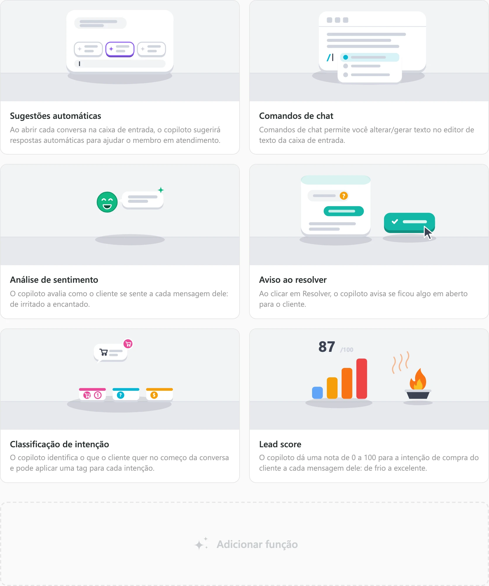

O copiloto é o assistente de IA do time na Kinbox: ajuda o membro dentro da conversa e analisa os atendimentos, sem conversar com o contato sozinho. Enquanto o bot e os agentes de IA atendem o contato diretamente, o copiloto apoia quem está atendendo — veja a diferença em [Bot, automações, cenários e agentes de IA: qual usar](/docs/conceitos/automacao-e-ia).

## O que o copiloto faz

Todas as funções começam desligadas e você escolhe quais ligar no workspace.

### Na conversa

- **Sugestões automáticas:** sugere respostas ao abrir a conversa na **Caixa de entrada** e frases rápidas ao abrir a lista de frases.
- **Comandos de chat:** abre o menu do copiloto no editor para resumir a sessão, corrigir, traduzir, mudar o tom, gerar texto e rodar comandos personalizados.
- **Revisor de mensagens:** revisa a resposta antes de enviar e avisa se algo pode dar errado.
- **Aviso ao resolver:** confere ao clicar em **Resolver** se ficou algo em aberto para o contato.
- **Sugestão de retorno:** identifica quando a conversa combina um retorno futuro e sugere agendar a mensagem.

Veja como cada recurso aparece no atendimento em [Usar o copiloto na conversa](/docs/copiloto/usar-o-copiloto-de-ia) e como montar instruções próprias em [Criar comandos personalizados](/docs/copiloto/comandos-personalizados).

### Análises

- **Análise de sentimento:** avalia como o contato se sente a cada mensagem dele, de irritado a encantado.
- **Avaliadores:** faz avaliações sob medida e salva o resultado em um campo personalizado ou aplica tags.
- **Classificação de intenção:** identifica o que o contato quer no começo da sessão e pode aplicar uma tag para cada intenção.
- **Lead score:** dá uma nota de 0 a 100 para a intenção de compra do contato a cada mensagem dele.
- **Cliente preso no bot:** detecta quando o contato está preso ou frustrado com o bot ou agente de IA e pode passar a conversa para humano.

Veja como ligar cada análise e onde acompanhar os resultados em [Analisar conversas com IA: sentimento, avaliadores, intenções e lead score](/docs/copiloto/analises-de-ia).

### Regras do workspace

- **Onde o copiloto atua:** restringe todas as funções do copiloto aos canais e grupos escolhidos.
- **Não reabrir por agradecimento:** evita reabrir uma conversa resolvida quando o contato só agradece ou se despede em até 24 horas.

Veja todas as opções e valores padrão em [Configurações do copiloto](/docs/copiloto/configuracoes-de-copiloto).

## Onde fica e quem pode

As funções ficam em **Configurações** → **Automação** → **Copiloto**.

<Note>
  Quem pode configurar: membros com a permissão **Copiloto** (na seção **Gerenciamento do Ambiente** do papel) ou o proprietário do workspace (veja [Referência de permissões](/docs/administracao/referencia-de-permissoes)). As configurações valem para o workspace inteiro. Usar os recursos na conversa não exige a permissão **Copiloto**: depende de a função estar adicionada e salva, de a conversa estar em **Onde o copiloto atua** e de haver saldo na carteira.
</Note>

<Frame caption="Tela do Copiloto com funções adicionadas em cartões e o bloco Adicionar função">
  
</Frame>

A tela funciona como uma galeria: clique em **Adicionar função**, escolha o recurso, clique em **Adicionar** e depois em **Salvar mudanças** na barra inferior (as mudanças podem levar até 60 segundos para fazer efeito) — veja os detalhes em [Configurações do copiloto](/docs/copiloto/configuracoes-de-copiloto).

## Quanto gasta

O copiloto consome [saldo da carteira](/docs/conceitos/saldo-e-creditos) do workspace — nas telas do copiloto, esse saldo é chamado de "créditos", mas é o saldo em reais da carteira, não os **Créditos de SMS**. Só gasta o que está ligado e quando roda; funções desligadas não geram cobrança. Sem saldo, as funções param e o menu no editor mostra **Seus créditos acabaram** com o botão **Comprar créditos**. Para recarregar, veja [Adicionar saldo e créditos de SMS](/docs/assinatura/adicionar-saldo).

## Base de conhecimento

As **Sugestões automáticas** podem consultar uma [Base de conhecimento](/docs/copiloto/base-de-conhecimento) cadastrada em **Configurações** → **Automação** → **Base de conhecimento**, a mesma usada pelo bloco **Agente de IA** do bot. Esse cadastro é separado do [conhecimento dos agentes de IA](/docs/agente-de-ia/conhecimento), que fica dentro do editor de cada [agente de IA](/docs/agente-de-ia/visao-geral).

## Outros lugares com o copiloto

- **Editores do WhatsApp oficial:** o botão **Criar com Copiloto** abre um painel lateral para criar [templates](/docs/canais/criar-templates-dentro-do-kinbox), [WhatsApp Flows](/docs/canais/criar-flows-dentro-do-kinbox) e [carrosséis](/docs/canais/criar-carrossel-dentro-do-kinbox). Funciona de forma independente das funções ligadas na tela do Copiloto e usa saldo da carteira.
- **Editor de campanhas:** o mesmo menu de comandos (ícone de estrelas) aparece no campo **Mensagem** ao [criar uma campanha](/docs/campanhas/campanhas-no-kinbox) quando **Comandos de chat** está adicionado.
- **Relatórios:** os dados das análises aparecem em **Relatórios** → **Copiloto** quando ao menos uma função com aba de relatório está ligada (veja [Como os relatórios contam sessões e tempos](/docs/relatorios/como-funcionam)).

O antigo Assistente Kin foi substituído pelo menu do copiloto, ativado pela função **Comandos de chat**.

<CardGroup cols={2}>
  <Card title="Usar o copiloto na conversa" href="/docs/copiloto/usar-o-copiloto-de-ia">
    Veja como usar o menu de comandos, as sugestões de resposta e os avisos ao enviar e ao resolver.
  </Card>
  <Card title="Criar comandos personalizados" href="/docs/copiloto/comandos-personalizados">
    Crie comandos próprios no menu do copiloto e organize os comandos padrão.
  </Card>
  <Card title="Analisar conversas com IA" href="/docs/copiloto/analises-de-ia">
    Ligue sentimento, avaliadores, intenções, lead score e cliente preso no bot.
  </Card>
  <Card title="Configurações do copiloto" href="/docs/copiloto/configuracoes-de-copiloto">
    Consulte todas as funções, opções, valores padrão e o escopo de atuação.
  </Card>
</CardGroup>
