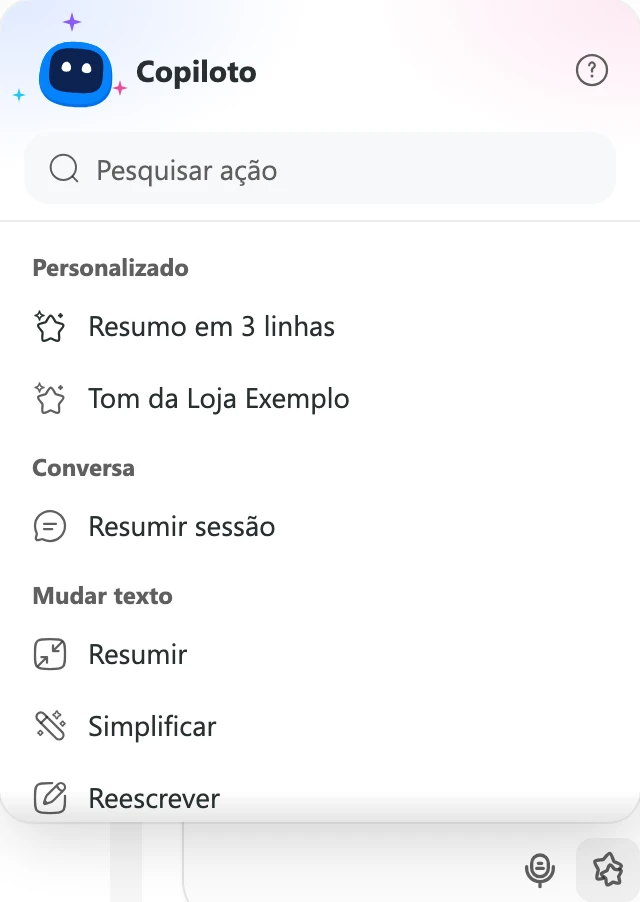
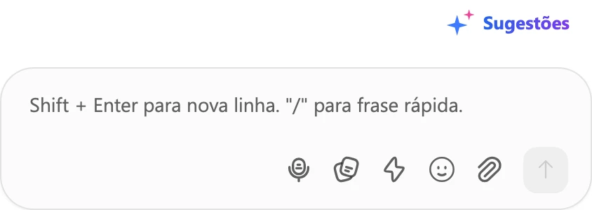

Use o copiloto dentro da conversa na [Caixa de entrada](/docs/conversas/caixa-de-entrada-do-kinbox) para ajustar ou gerar textos no editor, resumir a sessão, receber sugestões de resposta e conferir avisos antes de enviar ou resolver. O copiloto não envia nem agenda nada sozinho: você sempre revisa o texto antes de confirmar.

<Note>
  Condições de uso: a maioria dos recursos só aparece se a função estiver adicionada e salva em **Configurações** → **Automação** → **Copiloto** (por alguém com a permissão **Copiloto** ou pelo proprietário do workspace), se a conversa estiver em **Onde o copiloto atua** e se o workspace tiver saldo na carteira. As exceções são o botão **Sugestões**, que aparece e gera sugestões ao ser clicado mesmo sem **Sugestões automáticas** (gerar uma nova sugestão consome saldo), e **Criar com Copiloto** nos editores do WhatsApp oficial, que não depende da tela do Copiloto. Se o botão do copiloto não aparecer no editor, peça a quem administra o workspace para ativar **Comandos de chat**.
</Note>

## Mudar ou criar o texto com o menu do copiloto

O menu do copiloto aparece no editor quando a função **Comandos de chat** está adicionada e a conversa está dentro de **Onde o copiloto atua**.

<Steps>
  <Step title="Escreva o texto no editor">
    Digite a mensagem que você quer alterar ou traduzir. Para **Resumir sessão** e os comandos de **Gerar texto**, o campo pode ficar vazio.
  </Step>
  <Step title="Abra o menu do copiloto">
    Clique no ícone de estrelas (**Copiloto**) na barra do editor.

    <Frame caption="Menu Copiloto aberto no editor da conversa com busca e grupos de comandos">
      
    </Frame>
  </Step>
  <Step title="Escolha o comando">
    Use **Pesquisar ação** ou clique em um comando dentro dos grupos disponíveis. Comandos e grupos desativados pelo workspace não aparecem no menu.
  </Step>
  <Step title="Revise o resultado e envie">
    O texto gerado substitui o conteúdo do editor. Quando já havia texto no campo, aparece o aviso "Copiloto alterou o texto" com o botão **Desfazer**. Revise a mensagem e envie normalmente.
  </Step>
</Steps>

| Grupo | Comandos | Precisa de texto no editor? |
| --- | --- | --- |
| **Personalizado** | Comandos criados pelo workspace (veja [Criar comandos personalizados](/docs/copiloto/comandos-personalizados)) | Sim |
| **Conversa** | **Resumir sessão** (lê a sessão atual e escreve um resumo no editor) | Não |
| **Mudar texto** | **Resumir**, **Simplificar**, **Reescrever**, **Expandir**, **Explicar**, **Corrigir erros de português**, **Traduzir para o inglês**, **Traduzir para o espanhol**, **Traduzir** | Sim |
| **Mudar tom para** | **Amigável**, **Empolgante**, **Fofinho**, **Urgente**, **Triste**, **Casual**, **Formal** | Sim |
| **Gerar texto** | **Promocional**, **Pedido de desculpas**, **Felicitação** | Não |

- **Traduzir:** abre a janela **Traduzir texto** ("Traduzir para qual lingua?") para você digitar qualquer idioma e clicar em **Traduzir**.
- **Gerar texto:** abre a janela **Gerar texto promocional**, **Gerar texto de desculpas** ou **Gerar texto de felicitação** pedindo o contexto, com o botão **Gerar texto**.

O mesmo menu de comandos também aparece no campo **Mensagem** ao [criar uma campanha](/docs/campanhas/campanhas-no-kinbox) por WhatsApp por QR Code ou SMS, quando **Comandos de chat** está adicionado.

## Sugestões de resposta

O bloco **Sugestões** aparece acima do editor quando todas as condições abaixo são verdadeiras:

- a última mensagem da conversa é do contato (notas internas e eventos não contam);
- a conversa não está resolvida;
- nenhum bot está atendendo a conversa;
- a conversa está em **Onde o copiloto atua**;
- o seu papel não tem a restrição **Não mostrar sugestões de respostas** (seção **Copiloto** do papel);
- com **Sugestões automáticas** ligada, o workspace tem saldo na carteira.

<Frame caption="Botão Sugestões exibido acima do editor da conversa">
  
</Frame>

- **Automáticas:** com a função **Sugestões automáticas** adicionada, o copiloto gera as sugestões sozinho ao abrir a conversa (mostra "Gerando sugestões" e depois a lista, conforme a **Quantidade de sugestões** configurada).
- **Sob demanda:** mesmo sem **Sugestões automáticas** adicionada, o botão **Sugestões** aparece nas mesmas condições acima e gera as sugestões quando você clica nele. Gerar sob demanda também consome saldo da carteira.

Clique em **Sugestões** para abrir ou esconder a lista. Clicar em uma sugestão coloca o texto no editor para você ajustar e enviar.

Quando as opções estão ligadas em **Sugestões automáticas**, o copiloto também analisa imagens enviadas pelo contato e transcreve áudios recentes da conversa (salvando a transcrição na própria mensagem). Para transcrever um áudio manualmente sem depender do copiloto, use **Transcrever**, se aparecer no menu do áudio; a opção some depois que o áudio já foi transcrito, e a transcrição fica na própria mensagem (veja [Atender uma conversa](/docs/conversas/gerenciar-conversas)).

Se o workspace usa **Personalizar por grupo**, membros de grupos diferentes podem receber sugestões com instruções extras ou [base de conhecimento](/docs/copiloto/base-de-conhecimento) próprias do seu grupo.

## Frases rápidas sugeridas

Com **Sugestões automáticas** e **Sugerir frases rápidas** ligadas (esta já vem ligada), ao abrir **Frases rápidas** na conversa o copiloto sugere até 3 [frases rápidas](/docs/conversas/criar-frases-rapidas-para-suas-conversas) no topo da janela conforme o momento da conversa. Para aparecer, o workspace precisa ter frases cadastradas, a conversa precisa estar em **Onde o copiloto atua** e haver saldo.

## Avisos ao enviar e ao resolver

Os avisos do copiloto nunca bloqueiam o atendimento: em caso de erro, demora ou falta de saldo, a mensagem é enviada ou a conversa é resolvida normalmente.

- **Revisor de mensagens:** ao enviar uma resposta de texto (não revisa notas internas nem mensagens curtas), se o copiloto detectar algo nas categorias ou regras ligadas, abre a janela **Revise antes de enviar** listando os avisos com **Editar mensagem** e **Enviar mesmo assim**.
- **Aviso ao resolver:** ao clicar em **Resolver** na conversa aberta (veja [Atender uma conversa](/docs/conversas/gerenciar-conversas)), se o copiloto detectar uma pendência ("O cliente fez uma pergunta que ainda não foi respondida.", "Foi prometido um retorno ao cliente que ainda não aconteceu." ou "O cliente parece estar aguardando alguma ação do atendimento."), abre a janela **Ficou algo em aberto?** com **Voltar para a conversa** e **Resolver mesmo assim**.
- **Sugestão de retorno:** quando a conversa combina um retorno futuro, não há bot ou agente de IA atendendo e não existe agendamento pendente, aparece a faixa **Ficou um retorno combinado** acima do editor com **Agendar** e **Dispensar**. A faixa só aparece para quem tem a permissão **Agendar mensagem** (veja [Referência de permissões](/docs/administracao/referencia-de-permissoes)). Ao clicar em **Agendar**, a janela [Agendar mensagem](/docs/conversas/agendar-mensagem) abre já com a data e o rascunho preenchidos para você revisar e confirmar; no WhatsApp oficial, quando a data cai fora da janela de 24 horas, o copiloto sugere um template aprovado compatível; se não houver template compatível, escolha um manualmente na janela.

## Sentimento, intenção e lead score na conversa

Os resultados das análises automáticas ficam no cartão **Sessão** do painel lateral e nos selos da lista de conversas — veja como ler cada um em [Analisar conversas com IA](/docs/copiloto/analises-de-ia).

## Quanto gasta

Cada clique em um comando do menu, cada geração de sugestões (automática ou pelo botão **Sugestões**), cada transcrição de áudio e cada verificação dos avisos consome [saldo da carteira](/docs/conceitos/saldo-e-creditos) (chamado de "créditos" na tela do copiloto).

Quando o saldo acaba, o menu do copiloto mostra **Seus créditos acabaram** com os comandos desativados e o botão **Comprar créditos**. Quem não tem acesso ao financeiro vê "Fale com um administrador para colocar créditos no ambiente.". Para recarregar, veja [Adicionar saldo e créditos de SMS](/docs/assinatura/adicionar-saldo).

## Problemas comuns

- **O botão do copiloto não aparece no editor.** A função **Comandos de chat** pode não estar adicionada e salva, ou a conversa pode estar fora de **Onde o copiloto atua**. Peça a quem administra o workspace para conferir [Configurações do copiloto](/docs/copiloto/configuracoes-de-copiloto).
- **Aparece "Escreva um texto para usar essa ação do assistente.".** Comandos de **Mudar texto**, **Mudar tom para** e **Personalizado** exigem algum texto no editor antes de clicar na ação.
- **Aparece "Saldo insuficiente." ou "Seus créditos acabaram".** O saldo da carteira está baixo ou zerado. Peça a quem tem acesso ao financeiro para [adicionar saldo](/docs/assinatura/adicionar-saldo).
- **O bloco Sugestões não aparece.** Confira se a última mensagem é do contato, se a conversa não está resolvida, se não há bot atendendo, se a conversa está em **Onde o copiloto atua**, se o seu papel não tem **Não mostrar sugestões de respostas** e se o workspace tem saldo.
