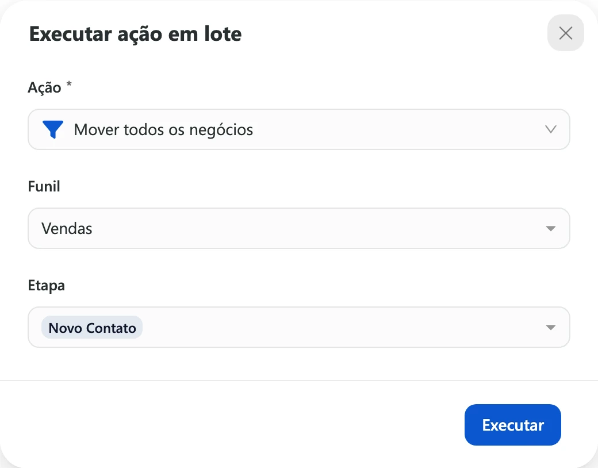

Use as ações em lote para mover, atribuir, mudar o status, excluir, iniciar bots, associar conversas ou gerar relatórios de várias negociações de um funil de uma só vez.

<Note>
  Quem pode: membros com a permissão **Gerenciar negociações** ou o proprietário do workspace. Se o item **Funis** não aparecer no menu lateral, peça ao proprietário a permissão **Gerenciar negociações**. **Iniciar bot em uma etapa** exige também a permissão **Iniciar Bot** (na seção **Conversas**). O menu **⋯** → **Executar ação...** aparece apenas com um funil aberto no computador.
</Note>

## Quais negociações a ação alcança

A ação em lote atua sobre **todas as negociações do funil aberto que aparecem com a pesquisa, os filtros e o período atuais** — de todas as etapas e de todos os status (abertas, ganhas e perdidas) — respeitando o que você pode ver pelas permissões do seu papel e pela visibilidade do funil.

- **Não há seleção individual de cartões:** antes de executar, filtre o quadro do funil para deixar apenas as negociações que você quer alterar (veja [Trabalhar com negociações no funil](/docs/crm/gerenciando-funil-de-vendas)).
- **Exceções de etapa e funil:** **Iniciar bot em uma etapa** e **Excluir negociações** permitem limitar a ação a uma etapa em **De qual etapa?**, e **Associar conversas** usa o funil e a etapa escolhidos dentro da janela (combinados aos filtros ativos).
- **Sem desfazer:** nenhuma ação em lote pode ser desfeita. Apenas **Atribuir todos os negócios para um membro** pede confirmação antes de começar. Durante a execução, clique em **Abortar** para interromper depois da negociação em andamento (o que já foi feito permanece).

## Passo a passo

<Steps>
  <Step title="Filtre as negociações no quadro">
    Abra o funil em **Funis** e aplique a pesquisa, os filtros e o período necessários para isolar somente as negociações desejadas.
  </Step>

  <Step title="Abra Executar ação em lote">
    Clique no menu **⋯** no canto superior direito do quadro e selecione **Executar ação...**.
  </Step>

  <Step title="Escolha a ação e execute">
    Na janela **Executar ação em lote**, selecione a opção em **Ação**, preencha os campos solicitados e clique em **Executar**.

    <Frame caption="Janela Executar ação em lote com a ação Mover todos os negócios selecionada">
      
    </Frame>
  </Step>
</Steps>

## Ações disponíveis

### Mover todos os negócios

Escolha o **Funil** (a lista mostra apenas os funis visíveis para você) e a **Etapa** de destino. Negociações que já estão nesse funil e etapa são puladas.

- O status da negociação não muda, e a movimentação cria as tarefas de [cadência](/docs/crm/cadencias) configuradas na etapa de destino.
- **Mover para um Funil Operacional:** o valor é zerado, os produtos são removidos e cada negociação recebe um número de ticket.

### Atribuir todos os negócios para um membro

Escolha o responsável em **Membro** (se o seu papel tiver **Somente pode atribuir para quem pertence ao grupo do membro**, a lista exibe apenas membros dos seus grupos). Negociações que já pertencem ao membro são puladas.

Ao clicar em **Executar**, a Kinbox abre **Transferir tarefas em aberto?** com os botões **Transferir tarefas** e **Não transferir tarefas** (fechar a janela cancela a execução). O novo responsável recebe uma notificação quando outra pessoa faz a atribuição.

### Atribuir todos os negócios para um grupo

Escolha o **Grupo** de destino ou **Sem grupo** para remover o grupo das negociações filtradas. Negociações que já estão nesse grupo são puladas. A ação executa sem confirmação.

### Iniciar bot em uma etapa

Exige a permissão **Iniciar Bot** (na seção **Conversas**) ou ser o proprietário; sem ela, a Kinbox exibe o aviso de falta de permissão.

Escolha **De qual etapa?** (opcional; deixe vazio para todas as etapas filtradas) e selecione o **Bot** (veja [Bot: visão geral](/docs/bot/visao-geral)). O bot é iniciado uma conversa por segundo apenas nas negociações que já possuem conversa associada — negociações sem conversa são puladas. Se as negociações ainda não têm conversa ligada, execute **Associar conversas** antes.

### Associar conversas

Escolha **Funil**, **Etapa** (pode limpar para alcançar todas as etapas) e **Canal** (obrigatório; mostra apenas os canais visíveis para você).

Como informa o aviso da tela, apenas conversas já existentes no canal selecionado são associadas — esta ação não cria conversas novas. A Kinbox procura no canal uma conversa do contato da negociação (ou de um contato com o mesmo telefone ou o mesmo e-mail), escolhendo a de mensagem mais recente se houver mais de uma. Negociações que já têm conversa associada ou contatos sem correspondência no canal são ignorados. É útil logo depois de [Importar negociações](/docs/crm/importar-negociacoes).

### Mudar status das negociações

Escolha **Aberto**, **Ganho** ou **Perdido** em **Status** (no **Funil Operacional**, **Ganho** equivale a **Resolvido** e **Perdido** equivale a **Não resolvido**).

A ação altera todas as negociações alcançadas: **Ganho** e **Perdido** gravam a data de hoje como data de fechamento, enquanto **Aberto** apaga essa data.

### Excluir negociações

Escolha **De qual etapa?** (opcional — deixar vazio exclui todas as negociações filtradas do funil, de todas as etapas).

<Warning>
  **Excluir negociações** começa imediatamente ao clicar em **Executar**, **sem pedir confirmação**, e não pode ser desfeito. Cada negociação é apagada definitivamente junto com o histórico e as tarefas de cadência. Revise todos os filtros e exporte uma cópia pelo menu **⋯** → **Exportar** antes de executar.
</Warning>

### Gerar relatório com dados de contato

Escolha o **Tipo de arquivo** (**CSV** ou **XLSX**). Ao concluir, o navegador baixa o arquivo diretamente (nada é enviado por e-mail; clicar em **Abortar** interrompe sem gerar arquivo).

Além das mesmas colunas do **Exportar** do funil e dos campos personalizados de negociação, o arquivo traz os dados atuais do cadastro do contato, os campos personalizados do contato, redes sociais, **ID Externo do contato** e **Notas do contato**.
