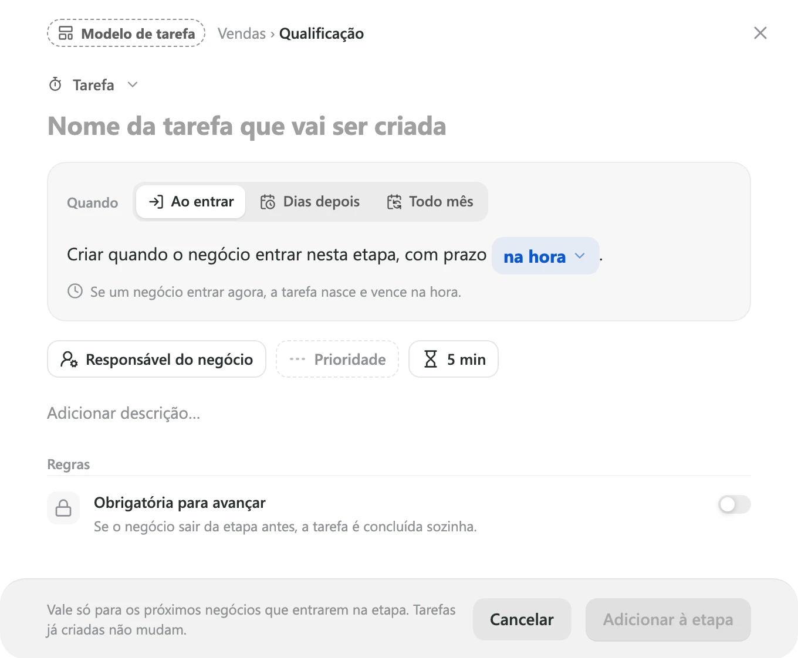

A cadência é uma lista de **modelos de tarefa** por etapa do funil: quando uma negociação entra naquela etapa, a Kinbox cria automaticamente as tarefas configuradas (na hora, dias depois ou todo mês). Se ela sair e voltar, as tarefas de **Ao entrar** e **Dias depois** que já recebeu ali não são criadas de novo. Ela funciona no **Funil Comercial** e no **Funil Operacional** (no operacional, o passo chama-se **Cadência operacional** e os textos usam "ticket").

<Note>
  Quem pode: membros com a permissão **Funis** (na seção **Gerenciamento do Ambiente**) ou o proprietário do workspace (na tela, **ambiente**). Se **Configurações** → **CRM** não aparecer, peça ao proprietário a permissão **Funis**. Quem tem a restrição **Proibir excluir tarefas** não vê as opções para excluir modelos da cadência.
</Note>

## Onde fica

A cadência fica no passo **Cadência** do assistente do funil, tanto ao criar quanto ao editar em **Configurações** → **CRM** → **Funis** (veja [Criar um funil e as etapas](/docs/crm/criar-funil-de-vendas)).

Os botões **Adicionar à etapa** e **Salvar modelo** guardam o modelo apenas na tela: a cadência só é gravada quando você avança até a revisão e clica em **Criar funil** ou **Salvar funil**.

## Adicionar uma tarefa à etapa

<Steps>
  <Step title="Abra o passo Cadência do funil">
    Vá em **Configurações** → **CRM** → **Funis**, clique no funil desejado e clique em **Continuar** até o passo **Cadência**. Na coluna da etapa, clique em **+** (**Adicionar tarefa**). Você pode adicionar mais de uma tarefa na mesma etapa.
  </Step>

  <Step title="Configure o modelo de tarefa">
    Na janela **Modelo de tarefa**, preencha os campos:

    1. **Tipo da tarefa:** clique no tipo acima do nome (padrão **Tarefa**; há também **Ligar**, **Reunião**, **Deadline**, **Almoço**, **E-mail** e **Iniciar bot**). Apenas **Iniciar bot** executa uma ação automaticamente; os outros tipos servem para identificar a tarefa.
    2. **Nome:** escreva o nome da tarefa (único campo obrigatório).
    3. **Quando:** escolha entre **Ao entrar**, **Dias depois** ou **Todo mês** e ajuste o prazo. A janela exibe uma frase de exemplo mostrando quando a tarefa venceria se uma negociação entrasse agora.
    4. **Propriedades abaixo de Quando:** escolha o **Responsável** (padrão **Responsável do negócio**), a **Prioridade** (padrão **Sem prioridade**), a **Duração** (padrão **5 min**, define o fim da tarefa) e o **Lembrete** (aparece apenas com **Num horário fixo** e sem **Bots em fila**; envia notificação na Kinbox para o responsável antes do prazo).
    5. **Descrição e Regras:** se quiser, adicione uma descrição e ligue **Obrigatória para avançar** (e, no tipo **Iniciar bot**, as opções do bot).

    <Frame caption="Janela Modelo de tarefa com tipo, nome, cartão Quando, responsável, duração e regras">
      
    </Frame>
  </Step>

  <Step title="Adicione o modelo e salve o funil">
    Clique em **Adicionar à etapa** (ou em **Salvar modelo**, ao editar um cartão existente). Para mover um modelo para outra etapa, arraste o cartão entre as colunas; para remover, abra o cartão e clique em **⋯** → **Excluir da cadência**.

    Ao terminar, clique em **Continuar** até a revisão e clique em **Salvar funil** (ou **Criar funil**).
  </Step>
</Steps>

## Quando a tarefa é criada

| Opção em **Quando** | Quando a tarefa nasce | Opções de prazo |
| --- | --- | --- |
| **Ao entrar** | Assim que a negociação entra na etapa | **Na hora da entrada** (padrão), **Alguns minutos depois** ou **Num horário fixo** |
| **Dias depois** | No dia escolhido (N dias corridos após a entrada) | **No mesmo horário da entrada** (padrão) ou **Num horário fixo** |
| **Todo mês** | Todo dia N do mês enquanto a negociação permanecer na etapa (em meses sem esse dia, cai no último dia do mês) | **No início do dia** (padrão) ou **Num horário fixo** |

Regras importantes sobre a criação das tarefas:

- **Dias corridos e fuso:** a contagem é sempre em dias corridos (sábados, domingos e feriados contam), e os horários seguem o fuso configurado no workspace.
- **Qualquer entrada na etapa:** a cadência vale para toda negociação que entra na etapa — inclusive as criadas na etapa inicial, importadas por planilha, movidas em lote ou movidas pela ação **Mudar etapa da negociação** de uma [automação](/docs/automacao/gatilhos-e-acoes).
- **Saída da etapa:** se a negociação sair da etapa antes do dia previsto, a tarefa agendada não nasce. As tarefas pendentes criadas pelos modelos da etapa que ela deixou são **concluídas automaticamente**.
- **Voltar para a etapa:** se a negociação sair e voltar para a mesma etapa, ela não recebe de novo as tarefas de **Ao entrar** ou **Dias depois** que já recebeu ali (modelos **Todo mês** continuam criando uma tarefa por mês enquanto ela estiver na etapa).
- **Alterações na cadência:** como avisa o rodapé da janela, `"Vale só para os próximos negócios que entrarem na etapa. Tarefas já criadas não mudam."` (modelos **Todo mês** também se aplicam às negociações que já estão na etapa).

## Tarefa obrigatória

Com **Obrigatória para avançar** ligado, a tarefa criada impede a mudança de etapa da negociação enquanto estiver pendente; concluir ou cancelar a tarefa libera a mudança. Uma tarefa obrigatória configurada em **Dias depois** só trava a etapa depois que nasce no dia previsto. As outras conferências feitas ao mudar de etapa estão em [Trabalhar com negociações no funil](/docs/crm/gerenciando-funil-de-vendas#mudar-de-etapa).

## Iniciar um bot

Para acionar um bot pela cadência, escolha o tipo **Iniciar bot** e selecione o bot em **Bot** (veja [Bot: visão geral](/docs/bot/visao-geral)). Sem **Executar o bot sozinho**, o modelo cria apenas uma tarefa para o membro iniciar o bot manualmente.

Com **Executar o bot sozinho** ligado, a Kinbox executa o bot no prazo da tarefa e marca a tarefa como concluída automaticamente:

- **Conversa usada:** o bot roda na conversa associada à negociação no momento em que a tarefa nasceu.
- **Criar conversa se não houver:** se a negociação não tiver conversa associada, o bot não roda, a menos que você ligue **Criar conversa se não houver** e escolha um **Canal** de **WhatsApp** ou **SMS** (dos grupos que você vê). Se o contato tiver telefone válido, a Kinbox abre a conversa nesse canal, associa à negociação e inicia o bot.
- **Bots em fila:** quando ligada, os bots do funil rodam um de cada vez, separados pelo intervalo escolhido em **Quando** (padrão 5 minutos). Com **Bots em fila** ligada, o modo **Todo mês** fica indisponível.

## Onde ver as tarefas e regras do funil

Os membros acompanham as tarefas geradas pela cadência no menu lateral **Tarefas** (ver tarefas de outros membros exige **Pode ver tarefas atribuídas a outros.**), na seção **Tarefas** da negociação e, para quem tem **Pode gerenciar as tarefas da conversa.**, na seção **Tarefas** da conversa.

Você também pode combinar a cadência com as regras do funil **Não executar tarefas anteriores ao horário de mudança de etapa no mesmo dia.** e **Criar tarefas de cadência mesmo após negócio ganho ou perdido.** — veja [Motivos de perda, campos obrigatórios e regras do funil](/docs/crm/motivos-de-perda-e-regras).
